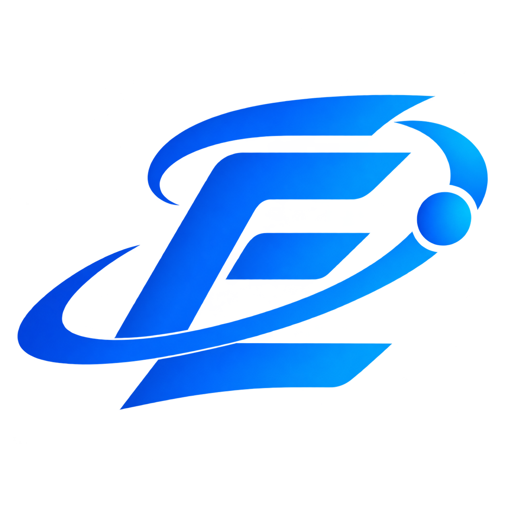
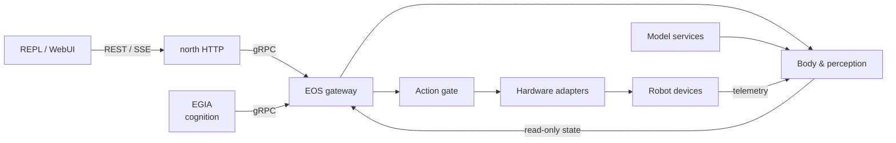
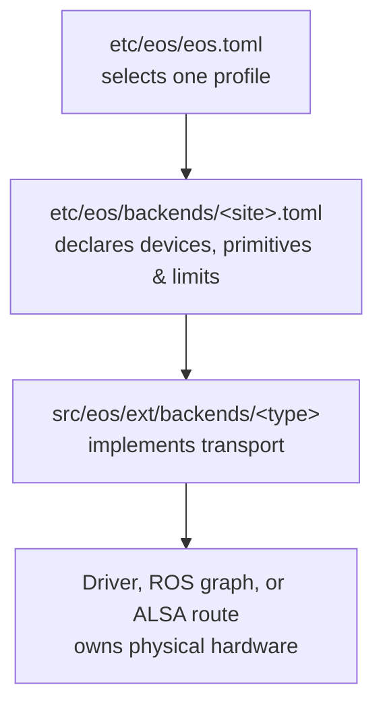

<div align="center">
  

  # IslandOS Aether · EOS

  **The embodied execution and hard-safety layer for intelligent robots**

  [](https://isocpp.org/) [](https://cmake.org/) [](https://kernel.org/) [](docs/eos/interfaces/README.md)

  [中文](README_cn.md) · [Documentation](docs/eos/README.md) · [Website](https://os-island.com)
</div>

EOS is the native runtime of **IslandOS Aether**. It connects robot hardware, exposes read-only body state, calls configured perception services, and admits every command through one action gate before it reaches a device.

Cognition lives in the separate EGIA process. EOS exposes a protobuf-defined gRPC core; browser and operator clients use the separate HTTP/ProtoJSON and SSE adapter, keeping reasoning and client transports independent from hardware authority.

## What EOS owns

The **hardware bridge** binds one validated robot profile to demo, ROS 2, ALSA, or deployment-owned adapters. **Body perception** projects read-only device and scene state. **Model clients** call bounded HTTP services for VAD, ASR, TTS, detection, pose, posture, and face operations.

The **action gate** validates schemas, device limits, leases, stops, and policy before releasing commands. The **Skill Manager** executes deployment-owned native ABI v2 skills with claims, typed SIGNALs, replayable events, and cooperative cancellation. The **gateway** serves the Agent–EOS gRPC contract, while a separate north HTTP process translates it to REST/SSE.



## Quick start

> [!NOTE]
> [`etc/eos/eos.example.toml`](etc/eos/eos.example.toml) selects the hardware-free `demo` profile. Copy it to the ignored local `etc/eos/eos.toml`, then customize that local file for your deployment.

Install the base toolchain on Ubuntu:

```sh
sudo apt update
sudo apt install alsa-utils build-essential cmake git libboost-dev libgtest-dev libspdlog-dev python3
```

Create your local configuration, then build its selected profile:

```sh
cp etc/eos/eos.example.toml etc/eos/eos.toml
./eos-build.sh
```

For the demo profile, start the simulator, EOS, north HTTP, and then the diagnostic REPL in separate terminals:

```sh
./bin/eos-simulator
```

```sh
./bin/eosd
```

```sh
./bin/eos-north-http
```

```sh
./bin/eos-repl
```

By default, EOS gRPC listens on `127.0.0.1:16003`; the separately launched `eos-simulator` owns its WebUI API on `127.0.0.1:16004` and private `<run>/simulator.sock`; and north HTTP listens for REST/SSE on `127.0.0.1:16005`. `eos-repl` connects only to north HTTP. Each is independently deployable; `eosd` starts or supervises none of them.

To build and run a supervised daemon plus REPL in one terminal:

```sh
./eos-build.sh
./eos-launch.sh
```

The development launcher supervises simulator → EOS → north HTTP → REPL, waits for each readiness boundary, and tears down all children in reverse order. Pass `--no-repl` or `--no-simulator` to omit those processes; use `./eos-launch.sh --help` for endpoint and REPL overrides. When a default development port is already occupied, the launcher selects a free loopback fallback and reports the effective endpoints. An explicitly supplied port remains strict and fails on a collision.

The launcher automatically omits the simulator for a non-demo hardware binding because a simulator configured for system capture can contend with a physical camera. Use `--simulator` only when explicitly testing both processes together.

## Requirements

Native builds target Ubuntu 22.04 or 24.04 on an NVIDIA GPU PC or Jetson. They require a C++17 compiler, CMake 3.22 or newer, Boost 1.74 or newer, spdlog, Python 3 with `protobuf==3.20.3`, and `protoc`. Test builds also use GoogleTest. ROS 2 Humble or Jazzy is optional and must match the host distribution; native speaker output uses `aplay` from `alsa-utils`. `ccache` and Ninja can shorten builds.

CMake prefers compatible system packages for protobuf, gRPC, toml++, nlohmann/json, and nlohmann/json-schema-validator. Missing packages are fetched at pinned revisions, so a clean build may require network access and take longer than later builds.

## Build profiles

Run commands from the repository root.

The development presets use `Debug`, export `compile_commands.json` for language servers and static-analysis tools, and build the test targets. Use them while changing EOS or diagnosing behavior. The release presets use `RelWithDebInfo`, retain symbols for production diagnostics, omit the test targets, and are the appropriate default for deployment artifacts. `dev` and `default` build x86 hosts in `build/aether`; `arm64-dev` and `arm64` apply the same development/release distinction in the architecture-isolated `build/aether-arm64` tree and must be configured natively.

Install the contract generator dependency with `uv sync --locked --group contracts` (or a Python virtual environment containing `protobuf==3.20.3`). Pass that environment to CMake with `-DPython3_EXECUTABLE="$PWD/.venv/bin/python"` on the first configure. `./eos-build.sh` selects `.venv/bin/python` automatically when it exists.

For x86 development, configure with `cmake --preset dev -DPython3_EXECUTABLE="$PWD/.venv/bin/python"`, build with `cmake --build --preset dev -j`, and test with `ctest --preset dev`. For an x86 release build, use the `default` preset for configure and build. Native ARM64 development uses `arm64-dev` for all three steps; native ARM64 release uses `arm64` for configure and build.

ARM64 uses a separate build tree and must be built natively. See the [ARM64 running guide](docs/eos/usage/arm64.md) for supported hosts, dependency setup, ROS 2, and troubleshooting.

For ROS 2, source the distribution and robot workspace before using the profile-aware build script:

```sh
source /opt/ros/humble/setup.bash
source /absolute/path/to/ros2-workspace/install/setup.bash
./eos-build.sh
```

The script chooses an architecture- and ROS-specific build tree. Set `AETHER_BUILD_JOBS` or `AETHER_DEPENDENCY_JOBS` to a positive integer to override its memory-aware parallelism. Use `./eos-build.sh --clean` to rebuild only the selected tree.

## Configure a robot

EOS separates process settings from hardware descriptions:



1. Start from [`etc/eos/backends/demo.toml`](etc/eos/backends/demo.toml), the canonical complete profile.
2. Declare the robot, devices, primitives, caller-visible limits, feed rates, and transport endpoints.
3. Select that backend file and profile in your local `etc/eos/eos.toml` (initially copied from [`etc/eos/eos.example.toml`](etc/eos/eos.example.toml)).
4. Start deployment-owned drivers, ROS nodes, and model services before launching EOS.

Use an existing adapter whenever configuration can express the integration:

The `demo` backend supports loopback development and contract tests. The `ros2` backend uses standard ROS 2 arm, gripper, and camera messages. The `aplay` backend streams bounded WAV data through a selected ALSA route.

Hardware names, addresses, calibration, joint order, frames, limits, and endpoints belong in deployment configuration—not reusable runtime code. See the complete [configuration reference](docs/eos/usage/configuration.md) and [southbound body interface](docs/eos/develop/interfaces/southbound/body.md).

### Add a backend type

Only add code when an existing adapter cannot represent the transport:

1. Implement `eos::hardware::Backend` in `src/eos/ext/backends/<type>/`.
2. Add its target and an opt-in CMake flag when it introduces an external dependency.
3. Add class-specific parsing, admission, and construction in `src/eos/runtime/hardware/`.
4. Keep endpoint names, limits, frames, and other deployment alignment in the selected profile.
5. Cover profile parsing, registry admission, dispatch, body projection, and the adapter with hardware-free tests.
6. Document public configuration and behavior in the [configuration reference](docs/eos/usage/configuration.md) and the applicable [southbound interface](docs/eos/develop/interfaces/southbound/body.md).

Vendor-specific ROS messages belong in a deployment-owned graph-edge node that translates them to EOS's documented standard message layouts.

## Runtime options

The wrappers resolve paths relative to the checkout and can be called from any directory. Common overrides are:

```sh
./bin/eosd \
  --config /absolute/path/to/eos.toml \
  --etc /absolute/path/to/eos-config-root \
  --contracts /absolute/path/to/share \
  --skills-dir /absolute/path/to/native-skills \
  --host 127.0.0.1 \
  --grpc-port 16003 \
  --log-level info
```

HTTP listener, upstream, CORS, limits, and SSE settings live in the separate strict [`etc/eos/north-http.toml`](etc/eos/north-http.toml). Start it with `./bin/eos-north-http --config /absolute/path/to/north-http.toml`.

Environment equivalents include `EOS_ETC`, `EOS_CONTRACTS`, and `EOS_SKILLS`. The bundled `share/` contract tree is used by default. Checkout state, caches, logs, runtime files, and temporary files remain below `var/`.

Render the protobuf and JSON Schema surface with:

```sh
./scripts/print_contract_interfaces.py
```

## Project layout

```text
src/eos/
├── runtime/
│   ├── init/          process configuration and composition
│   ├── hardware/      backend ownership and admission
│   ├── perception/    read-only semantic state projection
│   ├── models/        all model capabilities and provider clients
│   ├── dispatch/      the sole command action gate
│   ├── skills/        native skill loading and execution
│   └── northbound/    gRPC-only core transport
└── ext/
    ├── backends/      concrete hardware adapters
    ├── north_http/  external REST/SSE-to-gRPC process
    └── repl/          HTTP/SSE diagnostic client

share/contracts/       canonical Agent↔EOS wire contracts
etc/eos/               process and hardware profiles
docs/eos/              architecture and reference documentation
```

## Development

Build with tests enabled, run the focused tests for the module you change, then run the full preset:

```sh
cmake --preset dev
cmake --build --preset dev -j
ctest --preset dev
```

Follow the repository [coding conventions](docs/island/conventions.md). Keep process composition and schemas in `runtime/init`, hardware admission in `runtime/hardware`, read-only state in `runtime/perception/body`, every model capability and provider client in `runtime/models`, and command policy in `runtime/dispatch`.

## Documentation

- [EOS documentation](docs/eos/README.md) — architecture, module map, setup, and installation
- [EOS body](docs/eos/develop/interfaces/body.md), [world](docs/eos/develop/interfaces/world.md), and [primitive actions](docs/eos/develop/interfaces/actions.md)
- [Southbound body](docs/eos/develop/interfaces/southbound/body.md), [world](docs/eos/develop/interfaces/southbound/world.md), and [primitives](docs/eos/develop/interfaces/southbound/primitives.md)
- [Canonical contracts](docs/eos/develop/interfaces/contracts.md) — protobuf and JSON Schema architecture and inventory
- [Perception runtime](docs/eos/design/runtime/perception.md) — read-only semantic resources and ownership boundaries
- [Models runtime](docs/eos/design/runtime/models.md) — audio, vision, future model capabilities, provider mappings, and bounded workers
- [Use SkillService](docs/eos/develop/interfaces/skills.md) — catalog, execution management, SIGNALs, watches, and errors
- [Use WorkflowService](docs/eos/develop/interfaces/workflow.md) — action-list DAGs, scheduling, facts, supersession, and snapshots
- [HTTP and WebUI contract](docs/eos/develop/interfaces/external/http.md) — complete REST/SSE routes, errors, request IDs, and CORS
- [Write native skills](docs/eos/develop/interfaces/skills/native/README.md) — built-in runtime, ABI v2, schemas, claims, and installation
- [Skill Manager runtime](docs/eos/design/runtime/skills.md) — scheduling, records, events, retention, and native execution
- [External decision library](src/eos/ext/decision/README.md) — backend-neutral client, policy, and reconnecting runner
- [Documentation index](docs/eos/doc_index.md) — complete design and reference map
