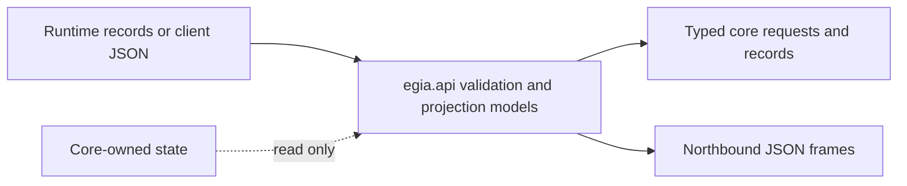

# `egia.api` data models

## Contents

- [Overview](#overview)
- [Architecture](#architecture)
- [Owned modules](#owned-modules)
- [Data flow](#data-flow)
- [Conditions](#conditions)
- [Related documentation](#related-documentation)

## Overview

`egia.api` owns the typed data exchanged between the runtime, the northbound adapter, and operator clients. These modules define values and validation only: they do not open sockets, call EOS, schedule missions, or persist state. Runtime owners create these values, and `egia.io` projects them onto WebSocket frames.

## Architecture

## Owned modules

`chat.py`, `invoke.py`, and `review.py` define command requests and their success or error replies. `mission.py` defines mission commands, lifecycle records, history, documents, and table snapshots. `plan.py` defines semantic plan graphs, edits, execution records, migrations, and operator projections.

`context.py`, `observation.py`, and `perceptions.py` describe bounded model context and admitted observation projections. `model_io.py` describes model messages, exchanges, activity, agent status, and the combined model-I/O frame.

`primitives.py`, `skills.py`, and `prompts.py` describe discovered catalogs and the static prompt projection. `skills.py` also owns strict tagged skill commands, cursor requests, acknowledgements, errors, and complete execution snapshots. `status.py` describes aggregate runtime health, subsystem health, safety state, backend connection state, and per-device status.

## Data flow

Command JSON enters through `egia.io.northbound`, is decoded, and is validated by the corresponding strict request model. The adapter attaches server-owned trust attributes, turns the request into a core operation, then serializes an acknowledgement or error model. Client input never supplies mission origin, runtime lifecycle state, safety verdicts, or backend health.

Core records flow in the other direction. Projection models select operator-visible fields while preserving stable robot aliases, device IDs, correlation IDs, timestamps, revisions, results, and failure reasons. They do not become an independent source of truth; mission, memory, perception, and link owners retain canonical state.

Plan data has an explicit compatibility path. `PlanRecord` accepts stored schema versions 1, 2, and 3, converts them in memory to schema version 4, and leaves the persisted row unchanged. New decision graphs require unique node IDs, known references, no self-reference, and an acyclic `after` dependency relation.

## Conditions

Normal input produces a typed value or a JSON frame with the exact documented enum literals and field names. Empty optional collections remain empty, optional snapshots may be absent until their producer publishes, and nullable result or reason fields retain their semantic distinction.

Malformed JSON is rejected by the northbound adapter before these models run. Structurally invalid values, unknown fields on strict command models, invalid enum values, bad bounds, inconsistent acknowledgement fields, duplicate graph nodes, unknown dependencies, self-dependencies, and dependency cycles fail validation and do not mutate core state.

Unavailable producers are represented by route-level `unavailable` errors or absent optional projections, not fabricated model values. Timeouts are owned by the caller, such as primitive invocation or model execution; API models only carry the resulting status or error. Restart restores canonical persisted records and applies read-time plan migration. Shutdown owns no API cleanup because this package holds no resources.

## Related documentation

See [northbound.md](northbound.md) for WebSocket routes, [io.md](io.md) for adapter ownership, [core/missions.md](core/missions.md) for mission state, [core/decision.md](core/decision.md) for plan execution, and [core/memory.md](core/memory.md) for stored plan records.
