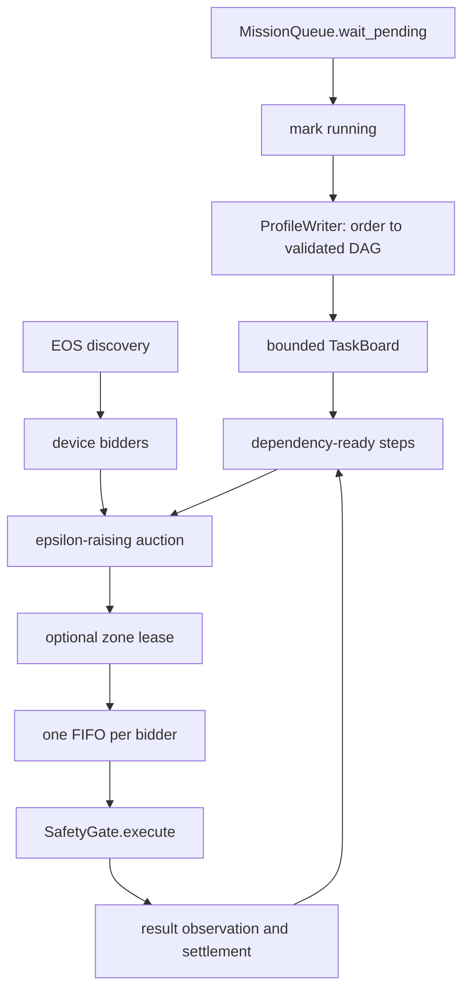

# Coordinated profile execution

[中文](../../../docs_cn/ei/core/coordination.md) · [Core overview](modules.md) · [Decision](decision.md)

`src/egia/core/decision/coordination/` is the optional multi-executor decision path. It replaces the serial decision entry when enabled, but uses the same mission table and `SafetyGate`. The design is an incremental market over a validated profile DAG: capability decides feasibility, cost ranks feasible devices, dependencies expose work, and zone leases arbitrate shared workspaces.

## Ownership and data

- `bidders.py` compiles one `BidderProfile` per discovered device with at least one primitive. Identity is `backend:device_id`; mutable state is health, committed seconds, current zone and last primitive.
- `auction.py` consumes ready `ProfileStep`s and bidder snapshots and returns awards, standing prices, recorded bids and unassigned step IDs.
- `board.py` owns bounded jobs and `WAITING -> READY -> RUNNING -> DONE | FAILED` state. Dependencies are local to one job.
- `leases.py` owns exclusive in-memory zone claims; it is not a physical lock.
- `coordinator.py` owns intake, ticks, executor queues, rediscovery, result observations and mission settlement.

## Complete process

Intake pops pending missions, marks each running, and constructs profiles concurrently. Writer failure fails the mission. Board overflow fails it with `coordination board full`. Root steps begin `READY`; other steps wait until all `after` dependencies are `DONE`.

Each tick offers ready steps to non-busy bidders. A bidder abstains if unhealthy, missing the exact primitive, or if its non-empty station set excludes the named station. Empty station/tag sets mean unknown/unrestricted; EOS currently supplies neither, so EGIA does not infer them. Raw bid cost is execution duration plus zone transition, primitive switch, and configured congestion times committed load. The auction adds standing prices, breaks ties by bidder ID, awards at most one step per bidder, and raises a contested bidder's price by the tightest runner-up gap plus `epsilon`. After 64 rounds, remaining work is unassigned and stays ready for a later tick.

An awarded zoned step must acquire its zone. Current coordinator wiring uses priority `1.0` and accepts only `ACQUIRED`; a held zone defers the claimant even though the general lease type can represent preemption. The bidder commits load, zone and primitive, then its dedicated executor serially drains its FIFO while different bidders run in parallel.

Execution copies arguments, adds `part_id` for a non-fallback device, creates an explicitly targeted invocation, and calls the gate under `step_timeout_s`. Success requires gate admission, an acknowledgement, and `ack.accepted=true`. The outcome enters perception as `kind=result`. Success releases the lease, settles load, completes the step and exposes dependents; the final completion succeeds and retires the job. Gate denial, EOS refusal, missing acknowledgement or timeout fails the step and mission; downstream steps do not run.

## Refresh, shutdown and edge conditions

Forced discovery builds initial bidders; a failed backend contributes none. Periodic refresh is disabled at interval zero. New devices get queues and executors; returning devices preserve load/zone history while capabilities are refreshed; missing devices become unhealthy for new awards. Already queued work is neither killed nor reassigned. Refresh failure retains the prior market.

No missions, no ready work, no available bidder, no feasible bid and a held zone all wait without fabricating an assignment. Unknown or duplicate board transitions raise instead of repairing state. An empty profile cannot satisfy `BoardJob.finished()` and must be rejected by profile validation upstream. Unexpected executor exit is logged but that executor is not individually restarted. Shutdown cancels and drains intake, tick, discovery, executor and mission tasks; cancellation never marks work successful.

See [Missions](missions.md) for admission and priority, [Decision](decision.md) for profile validation, and [Safety](safety.md) for final authority.
