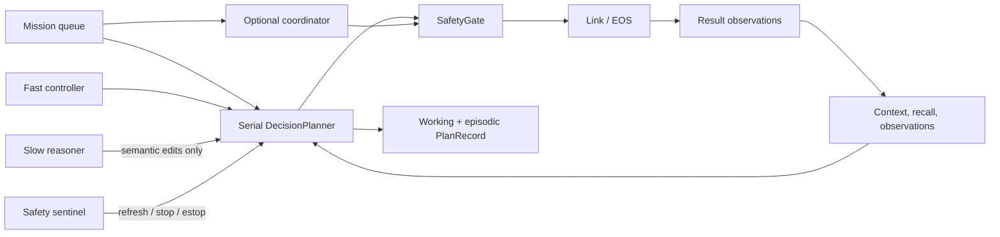
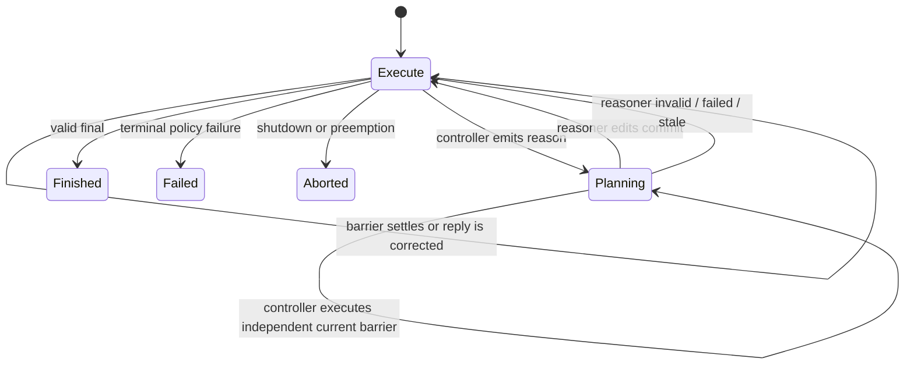

# Decision: from Mission meaning to safe primitive execution

Chinese companion: [中文](../../../docs_cn/ei/core/decision.md)

Decision owns the transformation from an admitted `MissionRecord` into an editable semantic Plan, validated primitive barriers, and a durable `PlanRecord`. Its original design separates **meaning** from **motion**: models may interpret goals and propose changes, but only deterministic code parses, validates, schedules, records, and sends actions. No model talks to EOS directly. Every physical action follows `decision → safety gate → link → EOS`, and its acknowledgement returns through perception as a `result` observation.

This page is the overview for `egia.core.decision`: the serial controller/reasoner path, autonomous proposer, safety sentinel, model-call policy, profiles, and optional multi-executor coordination.

## Design and boundary

The subsystem preserves five invariants.

1. **The Mission is the goal; the Plan is mutable working state.** A model may add, edit, complete, retry, fail, or remove eligible semantic steps without changing the admitted Mission.
2. **The fast controller is the only execution authority.** It uses reasoning mode `none`, may emit at most one ready barrier per reply, and is the only model lane whose output can become an `ActionInvocation`.
3. **The slow reasoner is advisory and semantic.** It can replace future Plan structure through an atomic compare-and-swap, but cannot emit primitives or finish a Mission.
4. **Acknowledgement is not physical proof.** EOS acceptance records that a request was accepted. Required outcomes remain `verifying` until fresh evidence completes them.
5. **Recorded history reflects work that crossed the execution boundary.** Pending suggestions are disposable; accepted barriers are checkpointed before egress and settled results are checkpointed afterward.



Decision does not own mission admission, perception retention, safety policy, backend transport, or memory storage engines. It consumes their contracts through `MissionQueue`, `Admission`, `ContextBuilder`, `SafetyGate`, `PrimitiveRegistry`, `DecisionModel`, and the memory-store interfaces.

## Data model

A `MissionRecord` supplies identity, order text, source/origin, priority, optional template identity, and lifecycle state. The planner never copies another pending Mission into the active Plan.

A `PlanStep` is a semantic sentence with a stable ID, `pending | running | verifying | done | failed` status, latest command text, optional reason and evidence, dependencies in `after`, and two constraints: `required` steps are protected from edit/removal, while `terminal` steps must succeed before `final` is legal.

A controller reply normalizes to `CommandReply`: zero or more `PlanEdit` values, zero or more independent `ActionInvocation` values forming one barrier, an optional `reason` request, an optional next reasoning effort, and either a selected Plan-step ID or a terminal answer. Parsing is all-or-nothing; malformed lines never create partial execution.

A `StepRecord` records one executed barrier: 1-based index, aggregate outcome, reason, token counts, parse retries, planning/execution duration, selected semantic step, applied edits, and one `ActionRecord` per primitive. A `PlanRecord` combines Mission metadata, the final semantic Plan, all settled barriers, annotations, result/error, outcome, revision, and schema version. It is the durable plans-as-memory artifact.

Coordination uses a separate `Profile`: a versioned TOML job note containing an unparsed semantic `intro` and a validated DAG of `ProfileStep` values. Each step names a primitive, dependencies, tags, object inputs/outputs, optional zone/station, estimated duration, and arguments.

## Serial pipeline

1. **Select and mark a Mission.** The default entry selects the highest-priority pending Mission and marks it running. Only one serial Mission executes at a time.
2. **Restore durable state.** If preload and a resumable record are available, settled barriers and the semantic Plan are copied in. A formerly `running` Plan step becomes `verifying`; its outcome is unknown and its commands must not be blindly replayed.
3. **Seed the Plan and recall.** A selected Mission template may provide protected initial steps. Recall queries reviewed reference plans first, then episodic plans, vector results when available, and relevant docs excerpts. With memory disabled or no matches, the section is absent and execution continues.
4. **Recognize the deterministic shortcut.** An untemplated, non-resumed order that is exactly one fully targeted primitive command is parsed and registry-preflighted. If valid, it becomes a checkpointed direct barrier without a controller call; otherwise it fails before egress. Natural language and compound work use the normal loop.
5. **Build one controller request.** Static prompt sections are the system message. A token-budgeted final user message contains the active Mission, Plan, recall, result ledger, perception, trigger, stale peer reference when present, and newest dynamic context. The controller is always called with reasoning effort `none`.
6. **Watch while inference runs.** The availability gate cancels a completion when the model fleet becomes unavailable and retries after recovery. The sentinel concurrently watches new safety-relevant observations. Scheduler, monitor, or audit interrupts can cancel inference or cooldown.
7. **Fence stale output.** A controller/reasoner reply is discarded if Plan generation changed or action context changed during inference. Continuous `body` telemetry and decision-produced result records do not independently stale a reply; other relevant context does. A stale peer reply may appear once as bounded advisory text, never as executable input.
8. **Parse and validate atomically.** The command grammar, Plan-edit rules, dependency/readiness rules, required/terminal constraints, primitive registry, explicit target, argument shape, duplicate-success protection, and barrier independence are checked before any action runs. Invalid replies return actionable feedback to the next fast request.
9. **Optionally start reasoning.** `reason <cause>` is the only route to the slow lane. The controller may request reasoning alone or request it while supplying safe current work. The reasoner receives the same semantic state and returns only a complete Plan-edit set.
10. **Checkpoint before egress.** The selected Plan step becomes `running`, its exact commands are attached, and working/live state is published before the safety call. A crash at this point therefore recovers an unknown barrier rather than silently replaying it.
11. **Execute the barrier.** Calls inside one barrier run concurrently only when their explicit resource claims do not overlap; a skill claims its whole robot. Primitive calls pass independently through `SafetyGate`. Skill calls require an exact discovered version whose dependencies are all planner-visible, validate arguments and results against the advertised schemas, and use the same bounded step timeout (capped at EOS's one-hour maximum).
12. **Fold results back.** Each action produces an `ActionRecord`, activity update, and `kind="result"` observation. All success makes an ordinary step `done` and a required step `verifying`; any refusal/failure makes it `failed`; timeout is an aborted, unknown action outcome. A failed barrier invalidates buffered later barriers.
13. **Continue or finish.** The next controller request sees the settled ledger and fresh context. `final` is accepted only when required steps are settled, terminal steps succeeded, edits are legal, and the answer does not claim unsupported work. Explicitly failing the entire Plan produces Mission failure, not success. Optional final speech is itself a normal gated primitive and can fail the Mission.
14. **Persist and settle.** Every exit publishes the final live Plan. With memory enabled, the planner writes episodic/index state and clears working state. The mission entry marks success, failure, suspension, or preemption in the Mission table.

## Controller command language

Plan edits must precede `reason`, `step`, or `final`. Blank lines and a surrounding code fence are tolerated; JSON is not accepted in this lane.

```text
effort none
plan add inspect "Inspect the target and retain observable evidence."
plan edit inspect "Inspect all visible sides of the target."
plan complete inspect "Fresh image confirms the target is intact."
plan retry inspect
plan fail inspect "The camera remains unavailable."
plan remove optional_note
reason occlusion requires a recovery route
step inspect
camera.capture@robot-a/camera-0 mode=rgb intent="collect verification evidence"
```

`final <supported outcome>` must be the only terminal command, although preceding legal Plan edits may accompany it. It cannot coexist with `reason`, `step`, or action lines. A `step <id>` must contain at least one action. Primitive syntax is `name@robot/device key=value`; skill syntax is `skill name@version robot=alias key=value`. Skills require an exact version and explicit robot. A primitive target without a device is accepted only where the parser call permits it. Scalar booleans, nulls, integers, floats, comma lists, and the special list fields are normalized deterministically.

The parser rejects duplicate keys, malformed quoting, multiple terminal forms, edits after execution begins, shared resources inside a concurrent barrier, and provably dependent calls. Registry and safety validation then reject unknown/ambiguous primitives, targets, schemas, stale state, bounds violations, emergency state, and unauthorized operator-tier commands.

## Controller/reasoner concurrency



At most one controller completion and one reasoner completion are active for a Mission. Both capture the Plan generation and action-context fingerprint. The planner coroutine is the sole writer. A valid reasoner result that completes in the same event-loop turn gets the first compare-and-swap opportunity; its atomic commit fences the older controller output. An obsolete result is retained once for reconsideration by the opposite lane. No stale advisory inbox is persisted across restart.

The reasoner may use only its configured `low`, `medium`, or `high` mode supported by its distinct binding. Unsupported binding capabilities fail composition or the Mission rather than silently changing cognition policy.

## Invocation policy, budgets, and retries

Every call has a trigger: `mission_start`, `step`, `parse_retry`, or `fault_interrupt`; proposer calls use `proposal_event` and `proposal_idle`. A pending interrupt promotes the next planner trigger to `fault_interrupt`. Ordinary calls obey `min_call_interval_s`; an interrupt bypasses cooldown so urgent state is reconsidered promptly.

`mission_token_budget = 0` means unlimited. A positive budget covers controller and reasoner together. The policy reserves capacity before an in-flight call and replaces the reservation with reported prompt-plus-completion usage afterward. Exhaustion denies all triggers, including interrupts, and fails the Mission. Cancellation releases the reservation.

Successful but invalid controller replies increment a consecutive counter and are retried with validation feedback. A valid reply resets the counter. Reaching `max_invalid_replies` fails the Mission. Model transport failures are different: the same logical request retries indefinitely with exponential backoff from `model_retry_initial_s` through `model_retry_max_s`; shutdown and interrupts cancel the wait. Model unavailability pauses all cognition lanes and cancels active completions until recovery.

`max_steps = 0` means unlimited executed barriers; a positive limit counts new barriers after restored history and fails the Mission when reached. `step_timeout_s` bounds each gate/egress call. Timeout is not treated as proof of failure in the world: it records an unknown/aborted action and returns that uncertainty to planning.

## Preemption, cancellation, shutdown, and restart

Preemption is checked only at safe boundaries: before another model call or barrier, never by replaying or pretending to undo an in-flight physical action. A higher-priority winner aborts and records the current Plan with a scheduler annotation; `MissionQueue` decides whether the Mission may return to pending under its capacity and `max_preemptions`. Operator-origin Missions always outrank self-proposed Missions; same-class replacement uses the configured margin and aging score.

A monitor/audit interrupt cancels stale inference, appends its source/detail to history and annotations, and re-enters through the fast lane. A sentinel `REFRESH` only refreshes cognition; `STOP` also requests motion stop; `ESTOP` engages the monitor-owned emergency latch. Failure of the sentinel model or its safety-side call is logged and does not silently replace the deterministic gate.

Graceful shutdown cancels child model tasks, records an aborted Plan, and suspends eligible Mission state. With `mission_preload = true`, restart restores it. Settled barriers are never replayed. Skill execution identity and the latest watch sequence are checkpointed immediately after start and after every snapshot; restart uses `GetExecution` and resumes `WatchExecution` without calling `StartExecution` again. A missing EOS execution is recorded as unknown and its semantic step remains `verifying`. Any primitive step checkpointed as `running` likewise becomes `verifying`. With preload disabled, persisted non-terminal Mission history is cleared at fresh launch.

## Proposer flow

The proposer is an optional non-reasoning lane that turns perception into candidate Missions; it never executes actions. It wakes on new `hearing` or `detection`, and on an idle timer only when no Mission runs or waits. Bursts are debounced and coalesced. Repeated idle ticks without a non-body observation or Mission lifecycle change do not spend another call.

The response is one compact JSON object. Proposals are clamped for urgency/value, cost-estimated from recall, checked against pending self-origin capacity, deduplicated by Mission admission, and submitted with origin `self`. When templates are enabled, only an exact whitelisted template ID is accepted and its canonical Mission/Plan replaces model-authored wording. Unknown IDs are dropped. A request exactly satisfied by one advertised primitive may become an exact targeted command and use the deterministic direct path; compound intent remains natural language. Malformed, empty, noisy, duplicate, or unsupported perceptions may yield no proposal. Model errors degrade to the next event/idle opportunity; they do not block operator Missions.

## Sentinel flow

The sentinel snapshots admission revision and known observation IDs at the start of each controller call. It ignores old baseline state and filters new records to `fault`, `status`, `vision`, `scene`, `detection`, and `result`. Relevant records form a bounded safety-only prompt. `CONTINUE` or an unparseable response yields no signal; `REFRESH`, `STOP`, and `ESTOP` cancel the stale controller path, with the latter two also invoking deterministic safety actions. Request failures wait `retry_s` and retry while the parent call remains active. Cancellation terminates the watcher without manufacturing a verdict.

## Profiles and coordination mode

When `[decision.coordination].enabled = true`, the coordinator replaces the serial planner entry; it is not an extra executor beside it.

1. The profile writer sends Mission text, live primitive catalog, and newest valid profile catalog to the reasoner-bound model.
2. It extracts fenced or raw TOML, forbids unknown fields, validates name/step IDs, non-empty steps, unique IDs, known dependencies, an acyclic dependency graph, positive durations, and registered primitive names.
3. Invalid output is retried up to the writer attempt limit with the last exact error. Exhaustion fails the Mission and stores nothing. Valid profiles are persisted as `<name>.v<version>.toml`; a same-version save overwrites that file.
4. Loading selects the newest valid version per name. Malformed or hand-edited files move to `quarantine/*.invalid`; quarantine failure is logged and that file is ignored. Profile-schema migration is intentionally unsupported.
5. A bounded task board instantiates the profile. Root steps start `ready`; dependent steps remain `waiting`. A full board fails admission rather than evicting another job.
6. EOS discovery compiles one bidder per alive/admitted device advertising primitives. A bidder abstains when unhealthy, missing the primitive, or unable to serve an explicit station. Empty station metadata means unknown/any and leaves final admission to EOS.
7. Each auction assigns dependency-ready steps to distinct idle bidders using execution duration, zone transition, primitive switch, standing price, and congestion load. Ties are deterministic. No feasible bidder or the 64-round cap leaves a step ready for a later tick; feasibility is never invented.
8. A zone lease prevents simultaneous shared-workspace use. The current coordinator defers a claimant whenever the zone is held; running-step lease preemption is not enabled on this path. Lease release is idempotent for a non-holder.
9. Each bidder has one serial executor queue; different bidders and Missions may run concurrently. The coordinator injects `part_id` when needed and sends the call through the same safety gate with `step_timeout_s`.
10. Acceptance marks the step `done`, releases committed load/zone, opens newly dependency-ready steps, and completes the Mission when all steps are done. Timeout, gate rejection, or backend rejection marks the step and Mission failed; downstream steps never become ready. Every outcome is also admitted as a decision `result` observation.
11. Rediscovery can add executors, mark missing ones unhealthy, refresh capabilities, and replace a degraded default bidder after recovery. Queued work on a disappearing bidder is allowed to drain; new auctions exclude unhealthy bidders. Rediscovery errors are best-effort and retried on the next interval.

Coordination currently does not persist live board, auction, or lease state for restart and does not use the serial planner's semantic `PlanRecord` recovery path. A process restart therefore rebuilds coordination work from Mission/profile inputs rather than resuming an exact in-flight board.

## Conditions and outcomes

- **Empty or missing data:** no recall, no profile catalog, no sentinel-relevant delta, or no ready step is a valid no-op/wait state. An empty model reply, empty profile, empty barrier, or empty final answer is invalid.
- **Malformed or oversized data:** strict Pydantic/TOML/command parsing rejects malformed shapes. Dynamic prompt sections are priority-ordered and token-budgeted; required sections remain authoritative. Provider truncation commonly becomes an invalid reply and follows correction limits.
- **Duplicate data:** duplicate command keys, profile step IDs, Plan no-op edits, repeated successful primitive/target/arguments, and duplicate Mission proposals are rejected or suppressed at their owning boundary. Repeated streaming frames update one exchange rather than incrementing request totals.
- **Stale or partial data:** changed Plan/context fences model output; failed barriers discard dependent buffered work; partial command parses execute nothing. Continuous body telemetry is intentionally non-invalidating, but safety and registry checks still run at egress.
- **Unavailable or degraded dependencies:** missing optional memory removes recall/persistence only; absent vector indexing falls back to keyword recall; model loss pauses/retries cognition; bidder loss removes new awards; sentinel failure leaves deterministic safety enforcement intact.
- **Cancellation:** shutdown, availability loss, interrupt, and winning reasoner commits cancel or fence child work and drain tasks. Cancellation before egress creates no action record; cancellation after the pre-egress checkpoint recovers as unknown/verifying.
- **Terminal behavior:** success requires a valid final answer in serial mode or all profile steps done in coordination mode. Validation exhaustion, token/step bounds, explicit all-plan failure, final-speech failure, profile/board failure, or rejected coordination step fails. Shutdown and scheduler preemption abort/suspend rather than falsely succeeding.

## Configuration and observability

`etc/egia/egia.toml` owns decision bounds and feature gates; `etc/egia/models.toml` owns provider bindings and advertised reasoning modes; `etc/egia/prompts.toml` is the only lane-instruction source; `etc/egia/missions.toml` owns optional canonical templates. Safety thresholds remain under `etc/egia/safety/`.

`ModelIOStore` retains the latest exchange globally and per agent plus the latest primitive activity per agent. Streaming updates bump its version but one `(agent_id, mission_id, exchange_id)` counts once. Agent status is `thinking`, `working`, `error`, or `idle`. This is an observational projection, not durable execution state.

## Verification map

Core behavior is covered by `tests/egia/test_planner_mvp.py`, `test_decision_sentinel.py`, `test_invocation_policy.py`, `test_proposer.py`, `test_profile_writer.py`, `test_profiles.py`, and `test_coordination.py`, plus semantic-plan, mission, context, memory, safety, and composition tests that exercise the connected boundaries.

**Related:** [core overview](modules.md), [context](context.md), [missions](missions.md), [registry](registry.md), [safety](safety.md), [memory](memory.md), and [coordination](coordination.md).
