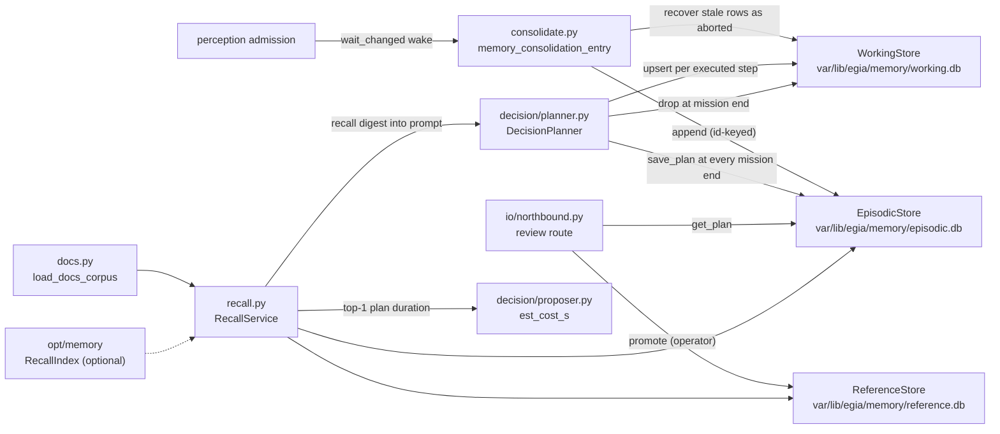
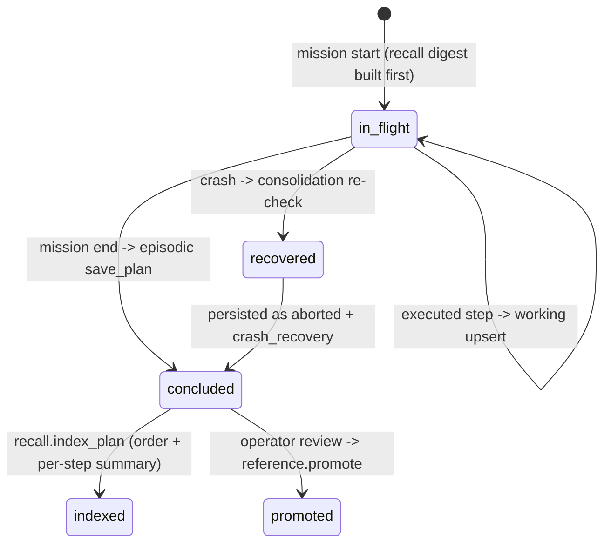

# egia/core/memory — working, episodic, and reference stores

## Contents

- [Overview](#overview)
- [Architecture](#architecture)
- [API](#api)
- [Design](#design)
- [Testing](#testing)

## Overview

`egia/core/memory/` is the memory chain of `docs/ei/egia-2607.md` §3.2–3.3: what the pipeline has seen and done, persisted as three SQLite databases under `var/lib/egia/memory/` — one file per store, so the three write paths are enforced structurally rather than by convention. `episodic.db` holds admitted observations plus concluded plans; `working.db` holds the in-flight plan of the running mission (crash visibility); `reference.db` holds reviewed, promoted plans only.

Memory is an **optional module**. The `[launch] memory` toggle in `etc/egia/egia.toml` (default true) is the master switch: disabled, the stores are not opened, no memory subsystem runs, recall is not wired, and the context snapshot carries no memory section — the pipeline runs without it, because optionality is by construction (see [`opt/memory.md`](../opt/memory.md) for the same guarantee on the vector index). The finer `[memory]` settings refine the enabled baseline: `vector_recall` and `docs_corpus` decide the index and the RAG corpus, `[decision] recall_limit` decides whether the planner queries at all.

`LocalMemoryStore` (`core/memory/local.py`) is intentionally outside that optional recall stack. It appends superseded perception, budget-truncated context, terminal mission records, and the completed plan's step/action history to `var/lib/egia/context_archive.jsonl`; it does not retrieve or expand the live prompt. Resumable mission ownership also sits outside this optional module: `core/missions/MissionStore` writes versioned checkpoints below `var/lib/egia/missions/` even when `[launch] memory = false`.

The package also owns recall (`RecallService`) and the local docs corpus: the planner's single entry point for recall-before-decomposition, merging keyword hits from both plan stores with optional vector hits and docs excerpts. The vector index itself is not implemented here — it sits behind the `RecallIndex` Protocol from `src/egia/internal/recall.py`, with the sqlite-vec implementation in [`egia/opt/memory`](../opt/memory.md).

Boundaries: memory never judges plan outcomes (the planner writes `succeeded`/`failed`/`aborted`; only the operator review path writes `effective`/`ineffective`), never calls the model, and never touches `core/link`. Consumers are `decision` (planner writes and recalls, proposer estimates cost) and `io` (the operator review route promotes); see [`modules.md`](modules.md) for the layering and [`decision.md`](decision.md) for the planner's side of the loop.

## Architecture



Persistence layout (paths injected into `core.launch`): `episodic.db`, `working.db`, and `reference.db` live under `var/lib/egia/memory/`. The rebuildable vector index lives separately at `var/cache/egia/memory/vec.db`. Parent directories are created on construction; backup is a file copy — the §3.2 offline-deployment properties. No service, no watcher: the docs corpus re-indexes at launch only.

Schemas (created with `CREATE TABLE IF NOT EXISTS` in each store module):

- `store.py` episodic `records`: `id` (PK), `ts`, `kind`, `source`, `text`, `metadata` (JSON string) — one row per admitted observation.
- `store.py` episodic `plans`: `id` (PK), `mission_id`, `order_text`, `outcome`, `started_at`, `finished_at`, `record_json` — the full `PlanRecord` as JSON; the typed columns exist for structured queries.
- `working.py` `plans`: `mission_id` (PK), `plan_json`, `updated_at` — one row per running mission.
- `reference.py` `plans`: `plan_id` (PK), `order_text`, `outcome`, `reviewed_at`, `review_note` (nullable), `record_json`.

## API

### EpisodicStore (store.py)

`EpisodicStore(path)` opens (creating if needed) one SQLite file. `append(ObservationRecord)` inserts keyed on the record id and returns `False` for duplicates, so re-draining an unchanged queue is idempotent. `count()` and `recent(limit)` (newest first, `(ts, kind, text)` rows) serve audit and recall. `save_plan(PlanRecord)` is idempotent the same way and also returns `False` on a closed store — a mission aborting during shutdown cannot crash the pipeline (the wave-1 shutdown race; the plan is recoverable from the working store on the next launch). `get_plan(plan_id)`, `list_plans(limit)` (newest first), and `search_plans(query, limit)` — case-insensitive substring match on the order text (`LIKE ? COLLATE NOCASE`) — are the plans read side, the baseline the vector recall of §3.3 layers on. `close()` releases the file.

### WorkingStore (working.py)

`WorkingStore(path)` (`var/lib/egia/memory/working.db` at launch). The planner calls `upsert_plan(PlanRecord)` after every executed step — keyed on `mission_id`, the upsert is a replace — so a crash or kill leaves the partial plan on disk. `get_plan(mission_id)` recalls the row; `drop(mission_id)` removes it at mission end (the concluded plan lives in episodic); `list_stale(active_mission_ids)` returns rows whose mission is not in the given set. Writes on a closed store are no-ops (`upsert_plan` logs `upsert_on_closed_store`; `drop` returns silently).

### ReferenceStore (reference.py)

`ReferenceStore(path)` (`var/lib/egia/memory/reference.db` at launch): reviewed, promoted plans only. `promote(plan, *, outcome=None, note=None)` is the *only* write path and the only writer of the `effective` / `ineffective` judgments — promotion is a human decision recorded with the plan (§3.3), never an automatic consequence of success. It stamps `reviewed_at` (now, UTC) and `review_note` on the stored record, optionally overrides the plan outcome (validated against `{effective, ineffective}`, `ValueError` otherwise; the wire frame `egia.api.review.ReviewRequest` enforces the same literal set), and replaces any prior row for the plan id. `get_plan`, `search_plans` (same LIKE semantics as episodic), and `list_plans` (newest first) are the read side; the WebUI review route (`egia/io` `_handle_review`) reads episodic via `get_plan` and promotes through this method.

### RecallService (recall.py)

`RecallService(episodic, reference, index=None, docs=None)` is the planner's single recall entry point (§3.2–3.3). `search_plans(order, limit)` merges keyword hits from both stores with vector hits from the optional `RecallIndex` (rehydrated through the stores' `get_plan`); reference hits — keyword or vector — always rank ahead of episodic ones, ids are deduped first-occurrence-wins, and the result is truncated to `limit`. The `index` property exposes the index in use or `None` (the degraded configuration). `search_docs(query, limit)` returns `(doc_id, excerpt)` pairs for corpus passages nearest the query (excerpt: ~200 chars starting up to 50 chars before the earliest query-token match, else the file head); without an index — or without a loaded corpus mapping — it answers `[]`. Both degradations together are the §3.2 "no sqlite-vec" shape: keyword recall only, docs retrieval off, no import broken.

`index_plan(record)` indexes a concluded plan's text for vector recall and is a no-op without an index. The text is the order plus one line per step: the step's action names joined by `"; "` (or `final` for a step that issued no actions), then the outcome — the same rendering the planner's recall digest uses.

Minimal example — the recall digest the planner folds into the user message (caps as described under [Design](#design)):

```text
Prior similar plans:
- "dock the robot at the station" -> effective
  steps: base.velocity -> succeeded; final -> succeeded
  review note: worked in low light
Relevant docs:
- egia/core/safety.md: The safety gate admits or rejects every egress call; estop engages after consecutive unrecovered faults.
```

### docs corpus (docs.py)

`load_docs_corpus(corpus_dir)` reads every `*.md`/`*.txt` (suffix case-insensitive) under the directory recursively into `{relative_posix_path: text}`; a missing directory logs `docs_corpus_missing` (only when a non-empty path was configured) and an empty or missing directory yields `{}` — docs RAG off, never a launch error. `index_docs_corpus(index, docs)` indexes the mapping into the vector index, returns the count, and logs `docs_corpus_indexed` for non-empty corpora. `core.launch` runs both at startup when `[launch] memory` is true, `[memory] docs_corpus` names a directory, and an index was built (default `docs_corpus = ""` disables docs retrieval).

### memory_consolidation_entry (consolidate.py)

`memory_consolidation_entry(queue, store, working, ready, stop, *, active_mission)` is the supervisor entry (subsystem `memory`). `ready` is set before the loop; the `finally` closes the episodic and working stores — the reference store has no loop of its own and closes in `core.launch` after the supervisor stops.

## Design

### Three tiers, three files

Working memory is a recall/diagnostic copy of the running mission's in-flight plan: one row, replaced per step, dropped at mission end. The versioned Mission JSON is authoritative for restart recovery. Startup removes working rows already claimed by restored mission checkpoints, preventing consolidation from misclassifying pending restored work as an aborted plan. Episodic memory is the append-only log of concluded work and observations. Reference memory is the distilled, human-reviewed subset.

### Plans-as-memory lifecycle



At mission start, before the first model call, the planner recalls prior plans; failed plans remain counter-examples and an empty digest is omitted. During execution, each completed primitive step checkpoints the working record. Every exit path saves an episodic `PlanRecord`, indexes it for recall, and drops the working row. Records retain mission priority, revision, explicit robot targeting, and primitive result payloads. Steps never attempted are absent.

### Recall digest construction (exact caps)

The digest query and caps live in `DecisionPlanner._recall_prior_plans` and `RecallService.search_plans`/`search_docs`; config is `[decision] recall_limit` (`src/egia/lib/config.py` `DecisionConfig`), default 3, valid range 0–16, and $0$ disables the query entirely (no service call, no section):

$$r = \texttt{recall\_limit} \in [0, 16],\quad \text{plans shown} \le r,\quad \text{docs shown} \le r$$

Per recalled plan, the order text renders in full when $\lvert\texttt{order}\rvert \le 80$, else the first 77 characters plus `"..."`. At most the first 6 steps are rendered — each as `action names joined by "; " -> outcome`, or `final -> outcome` for a step that issued no actions — with a trailing `...` entry when the plan has more than 6. The `review_note` line appears when the promoted record carries one. Each docs excerpt spans ~200 characters, starting up to $\lfloor 200/4 \rfloor = 50$ characters before the earliest query-token match (else the file head). Recall is advisory: both planner and proposer wrap the service calls in `try/except sqlite3.ProgrammingError` — a store closed mid-shutdown logs `plan_recall_failed` and the mission proceeds without the digest.

The merge order in `search_plans` is reference-keyword, reference-vector, episodic-keyword, episodic-vector; each source queries with the same `limit`, dedupe collapses ids that appear in both stores or both channels, and only then is the list truncated to `limit`. The proposer's cost estimate (`_estimate_cost` in `src/egia/core/decision/proposer.py`) reuses the same service with `limit = 1`: `est_cost_s` is the summed step duration of the most similar recalled plan, or unset when nothing recalls.

### index_plan rendering

`RecallService.index_plan` builds the indexed text as the order plus one line per step:

```python
names = [action.action for action in step.actions]
label = "; ".join(names) if names else "final"
lines.append(f"{label} -> {step.outcome.value}")
```

The current persisted record is schema v4: v2 introduced `StepRecord.actions` / `ActionRecord.action`, v3 introduced the semantic Plan, and v4 adds protected-step, dependency, terminal, evidence, and explicit verification fields. v1-v3 rows migrate on read. `index_plan` deliberately continues to render the stable action shape shown above, as does the planner's recall digest (`_recall_prior_plans`), so indexed text and digest text stay in step. A step that issued no actions renders as `final` — the concluding reply.

### Consolidation triggers and crash recovery

There is no timer: the loop wakes on every admission (`wait_changed(stop)`) and does two things per wake. First it drains `records()` (the current FIFO snapshot) into episodic with id-keyed `append` — an unchanged admission drains as a no-op, and the admission's capacity policy is reject-not-evict, so re-draining loses nothing (coalesced high-rate kinds degrade by design). Second it re-checks the working store — the MVP form of §3.3 plan re-checking. Rows reported by `list_stale` (every mission except the one `active_mission()` reports — the planner's `running_mission_id` provider in `core.launch`) belong to missions that died mid-write: if the plan id is not already in episodic, it is saved with outcome `aborted`, `finished_at` = now, and a `crash_recovery` annotation (`source="memory"`, `event="crash_recovery"`, log `plan_crash_recovered`); the stale row is dropped either way.

### Concurrency and persistence

All four pipeline chains share one asyncio event loop (`docs/ei/egia-2607.md` §3), and each store is a synchronous `sqlite3` connection touched only from that loop — no mutexes, single writer per file. The `_closed` flags on episodic and working exist for shutdown ordering, not threads: the supervisor stops subsystems concurrently, so the planner may write while consolidation is already closing its stores; those writes become logged no-ops (`save_plan_on_closed_store`, `upsert_on_closed_store`) and the data is recovered from the surviving store on the next launch. The reference store closes in `core.launch`'s shutdown sequence after every subsystem (including the planner that reads it) has stopped, as does the optional recall index.

## Testing

Method: unit tests over real SQLite files in `tmp_path`, plus async loop tests driving `memory_consolidation_entry` with a real admission instance, and planner-level stubbed integration (`ScriptedModel` fake model + `AdmittingGate` fake gate) for the recall digest — mock input at the model/gate boundary, real stores and real planner.

- `tests/egia/test_memory.py` — consolidation drains queued observations durably (records survive reopening the file) and `append` is idempotent; the working store's upsert/get/replace/drop/stale round-trip; reference promotion with and without an outcome override, note stamping, `ValueError` on invalid outcomes, case-insensitive search, newest-first listing; a stale working row is recovered as `aborted` with the `("memory", "crash_recovery")` annotation and then dropped, while a live mission's row is left alone.
- `tests/egia/test_launch_memory_toggle.py` — the `[launch] memory` toggle at the real `core.launch` level: with the master switch off (and the proposer off, so no model call can fire), the pipeline still reaches READY, the health payload's subsystem list omits `memory` and `proposer`, and `var/lib/egia/memory/` is never created.
- `tests/egia/test_recall.py` — the digest reaches the model with reference-first ordering and failed plans as counter-examples; plans present in both stores dedupe to one entry; no matches (or `recall_limit = 0`) omits the section; the working store tracks the in-flight plan mid-mission and drops it at the end; a save after the stores close during shutdown is a `MissionFailedError`, not a crash.
- `tests/egia/test_plan.py` — planner save paths per exit outcome plus `test_store_plan_round_trip_and_search` (save/get round-trip, duplicate suppression, newest-first listing, case-insensitive `search_plans`) and `test_v1_plan_json_migrates_on_read`.
- `tests/egia/test_vec_recall.py` — the sqlite-vec integration end to end (see [`egia/opt/memory`](../opt/memory.md)); without the `vec` extra its vec-dependent tests skip, while `test_index_plan_renders_v2_steps` still covers the step-line rendering through a stub index.

Run:

```bash
uv run pytest tests/egia/test_memory.py tests/egia/test_recall.py -q
uv run pytest tests/egia/test_plan.py -q          # store + planner persistence
uv run pytest tests/egia/test_vec_recall.py -q    # needs the 'vec' extra, else skips
```

Pass criteria: every test passes, or skips solely for the missing sqlite-vec extra; no unhandled `AttributeError` from `index_plan`.
