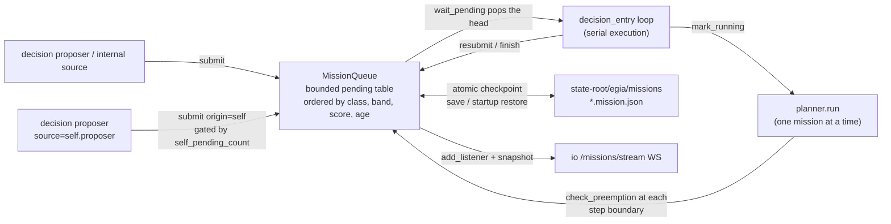
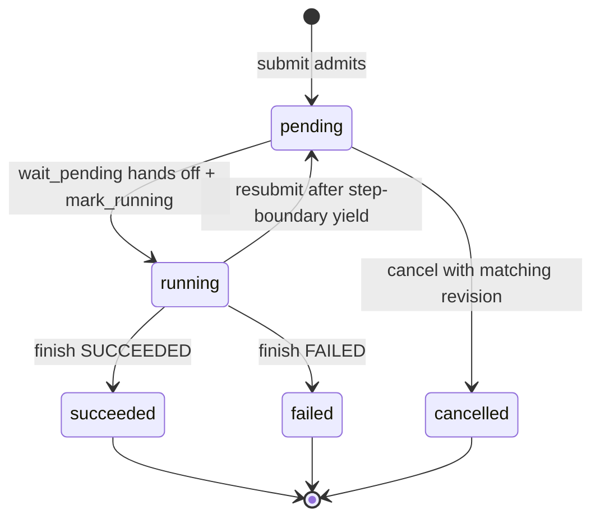

# egia/core/missions — the mission table

## Contents

- [Overview](#overview)
- [Architecture](#architecture)
- [API](#api)
- [Design](#design)
- [Testing](#testing)

## Overview

`egia/core/missions/` is the **sole admission gate for missions**, internal or autonomy-proposed. Every proposal enters the same bounded table and is executed strictly one at a time. Hearing is perception input and does not enter this table implicitly. The module was lifted out of `core/decision` so the table stands alone: `decision` consumes it (`wait_pending` hand-off, `check_preemption` at step boundaries, `resubmit` after a yield) but owns none of its policy. The [core overview](modules.md) locates that boundary; this page is the authoritative module-level view of scheduling and the §3.9 math.

Four files: `src/egia/core/missions/__init__.py` (`MissionQueue` — table, admission, hand-off, lifecycle, and the editable mission documents below), `src/egia/core/missions/document.py` (the mission document model: `MissionDocument`/`MissionStep`/`MissionAction`, revisions, edit validation), `src/egia/core/missions/priority.py` (pure §3.9 scoring), and `src/egia/core/missions/store.py` (`MissionCheckpoint` plus atomic versioned JSON persistence). Dependencies: `egia.api.mission` (`MissionRecord`, `MissionState`, `MissionHistoryEntry`), `egia.api.plan.PlanRecord`, `egia.lib.config.PriorityConfig`, and `egia.lib.logger`. Consumers are the [`decision` subsystem](decision.md#serial-pipeline), the planner, the proposer, and [`io`](../io.md).

## Architecture



All ingress paths converge on `submit`; the planner never admits anything itself. The composition root (`src/egia/core/__init__.py`, `launch`) builds one `MissionStore` below the resolved state root. A standalone fresh process may clear its checkpoints when `mission_preload=false`; a managed EGIA launch always restores valid non-terminal checkpoints or fails closed on corruption, even with that default. In-process backend handoff always retains the current session. Mission persistence is independent of the optional `[launch] memory` switch.

## API

`MissionQueue(capacity, priority=None, clock=None)` — `capacity` is the pending-table bound (`ValueError` below 1), `priority` a `PriorityConfig` (defaults apply when `None`), `clock` an injectable `time.time` replacement (tests). The record type is `egia.api.mission.MissionRecord`: `id` (UUID4), `order`, `source`, `state` (`MissionState`: `pending -> running -> succeeded | failed | cancelled`), `submitted_at`/`started_at`/`finished_at`, `result`/`error`, `correlation_id`, optional `mission_template_id`/`mission_template_version`, `origin` (`"operator" | "self"`), typed `priority_band` (`low | normal | high | urgent`, default `normal`), `priority` (last computed dynamic score), `urgency`/`value` (0–1 hints), `preempted_count`, and `est_cost_s`. Records and documents returned through public readers, admission, and hand-off are deep snapshots rather than live queue objects.

Admission and lifecycle:

- `await submit(order, *, source, correlation_id=None, origin="operator", priority_band=MissionPriorityBand.NORMAL, urgency=0.5, value=0.5, est_cost_s=None, template=None)` -> `MissionRecord | None`. `None` means the pending table is full — the order is rejected, logged WARNING `mission_rejected`, and leaves no record. `origin="self"` changes the priority class only, never the execution path. A plain admission seeds an empty editable document; a selected `MissionTemplateConfig` instead uses its canonical Mission, records its ID/version, and seeds its protected initial Plan.
- `await wait_pending(stop)` -> `MissionRecord | None` — blocks until something is pending, then **pops the table head** (it leaves `_pending` immediately); `None` once `stop` wins. The record's state stays `pending` until the caller runs `mark_running`.
- `mark_running(record)` — sets `RUNNING` and stamps `started_at`; `finish(record, *, state, result=|error=)` closes with `SUCCEEDED` or `FAILED` (`ValueError` for any other state).
- `resubmit(record)` -> `ResubmitOutcome` — returns a preempted mission to the table, incrementing `preempted_count`. Two rejection outcomes, both of which the caller (`decision_entry`) finishes as `FAILED` with the cause-specific error: `PREEMPTION_CAP` (past `max_preemptions`, error `"preempted too often"`) and `TABLE_FULL` (no room in the pending table, error `"preempted: mission table full"`). Neither rejection mutates the record — it keeps its `running` state until the caller finishes it.
- `check_preemption(running)` -> `MissionRecord | None` — the pending mission the running one should yield to; `best_pending()` -> the refreshed head without removing it.
- `suspend(record, detail=...)` — returns shutdown-interrupted serial work to durable `PENDING` state without consuming the preemption budget. A later managed launch restores it regardless of `mission_preload`; standalone fresh launch retains its legacy preload setting.
- `restore_checkpoints(checkpoints)` -> `dict[str, PlanRecord]` — converts durable non-terminal missions to pending work, preserves mission identity/document revisions, and returns their latest plans for the planner resume seam. It fails when the durable backlog exceeds configured capacity.
- `get(mission_id)` -> `MissionRecord | None` — exact deep record snapshot by identity.
- `update_order(mission_id, order, *, expected_revision)` -> `MissionRecord` — compare-and-swap edit for an ordinary, physically pending mission whose work has never started. It increments the document revision and atomically synchronizes `MissionRecord.order`, `MissionDocument.order`, and a safe draft pending plan title. Named templates and started work are rejected.
- `reprioritize(mission_id, priority_band, *, expected_revision)` -> `MissionRecord` — compare-and-swap band change for any mission physically in the pending table, including preempted work. It increments the document revision and synchronizes the record and document band.
- `cancel(mission_id, *, expected_revision, reason="cancelled")` -> `MissionRecord` — compare-and-swap terminal cancellation for any physically pending mission. It removes the mission from scheduling only after its `CANCELLED` checkpoint is durable, records history, invokes the normal finished/archive callback, and notifies listeners. A cancelled checkpoint is never restored.

Mutation failures have stable domain types and `code` values: `MissionNotFoundError` (`mission_not_found`), `MissionConflictError` (`mission_revision_conflict`), `MissionNotPendingError` (`mission_not_pending`), `MissionProtectedError` (`mission_protected`), and `MissionStartedError` (`mission_started`). Validation not covered by a narrower type uses `MissionMutationError` (`mission_mutation_failed`). Persistence happens before live state, audit history, callbacks, or listener notification; a store failure leaves all of those unchanged.

Observables: `pending()` (snapshot of the pending table), `records()` (every admitted mission, oldest first, finished included), `history()` (the bounded lifecycle log), `self_pending_count()` (backs the proposer's `max_self_pending` cap), `add_listener(callback)` -> unsubscribe callable (sync callbacks fired on every successful table mutation — and every mission-document mutation — for the northbound stream), the `running_mission` property (the one `RUNNING` record, if any), and the `capacity` / `priority_config` properties.

Human INFO logging reports submission, selection, start, compact changed plan progress, finish, suspension, resubmission, and restore boundaries. `mission_progress` includes plan/document revisions, decision mode, step-state counts, current step, settled barrier count, and latest outcome, but is emitted only when its compact progress signature changes. DEBUG logging retains document mutation, raw plan synchronization, and step/action transitions. These events contain identifiers, states, revisions, indexes, counts, priority metadata, and booleans only; mission text, plans, primitive arguments, evidence, and result payloads remain outside logs.

Document surface (all methods return isolated deep copies; callers never see live state):

- `document(mission_id)` -> `MissionDocument | None` — the mission's current revision.
- `plan_steps(mission_id)` -> `list[PlanStep]` — the current root Plan projected back into planner API records; this is the initial-plan seam for template Missions.
- `sync_plan(plan)` — replaces the Mission document's root Plan with the planner's latest statuses, results, evidence, dependencies, and protection metadata, then checkpoints and notifies listeners.
- `revisions(mission_id)` -> `list[MissionRevision]` — every accepted revision, oldest first.
- `revise(document)` -> `MissionDocument` — accepts an edit of not-yet-started work: `validate_edit` runs first (`KeyError` for an unknown mission), the accepted document replaces the current one, a `MissionRevision` is appended, and listeners fire. Returns the accepted snapshot.
- `begin_step(mission_id, step_index)` -> `MissionDocument` — makes one pending barrier eligible: the step and all of its actions flip to `EXECUTING`, the document goes `RUNNING`. `ValueError` when the step is not pending or an earlier step has not reached a terminal state (the barrier rule enforced, not assumed).
- `complete_action(mission_id, step_index, action_index, *, result=None, reason=None)` -> `MissionDocument` — records one terminal action outcome (`FAILED` when a reason is present, else `DONE`); when the step's last action closes, the step aggregates (any failed action fails the step, its reason the step's) and, when every step is terminal, the document itself resolves to `SUCCEEDED` or `FAILED` with an aggregate result.
- `await execute_next(mission_id, executor)` -> `MissionDocument | None` — runs the next eligible barrier: `begin_step`, then all of the step's actions launched concurrently through `asyncio.gather`, each as `await executor(action_snapshot)`, then `complete_action` per outcome. `None` when no step is pending. The `executor` is the safety/primitive boundary — it receives an isolated `MissionAction` snapshot, a returned value becomes the action result, and an exception is recorded as the action's failure reason; every invocation is made anew, so accepting a revision never bypasses safety admission.

`MissionStore(root)` persists one `<mission-id>.mission.json` file per mission. `clear` removes all checkpoint history for a fresh launch; `save_mission` preserves the latest plan while writing lifecycle/document changes; `save_plan` stores planner progress and an execution phase; `load` reads one checkpoint; `load_active` strictly validates every file and returns pending/running records in submission order. Unknown schema versions, identity mismatches, malformed revision chains, invalid UTF-8, and filename mismatches raise `MissionStoreError` rather than silently discarding work. Writes and clearing use directory `fsync`; writes additionally use a same-directory temporary file, file `fsync`, and `os.replace`.

The package re-exports the queue, store, and document types for consumers.

Minimal example — one operator admission and a hand-off:

```python
missions = MissionQueue(8)
record = await missions.submit("patrol the north dock", source="decision.proposer")
# MissionRecord(id=<uuid4>, order="patrol the north dock", state="pending",
#               origin="operator", priority=<§3.9 score>) — None when full
head = missions.best_pending()  # refreshed head; operator class first
mission = await missions.wait_pending(stop)  # pops the head, still "pending"
missions.mark_running(mission)  # now RUNNING with started_at stamped
```

Configuration (shipped `etc/egia/egia.toml`, defaults from `PriorityConfig` in `src/egia/lib/config.py`): `[decision] mission_capacity = 8`, `mission_preload = false`, and `load_mission_templates = false`; `[decision.priority]` — `w_urgency = 1.0`, `w_value = 1.0`, `w_cost = 0.001` (per estimated second), `w_age = 0.25`, `age_tau_s = 300.0`, `default_cost_s = 60.0`, `operator_urgency = 0.8`, `operator_value = 0.8`, `preempt_margin = 0.5`, `max_preemptions = 2`. The proposer's `max_self_pending = 4` lives in `[decision.proposer]` and is enforced by the proposer, not the table.

## Design

### Named Mission templates

`etc/egia/missions.toml` is an optional strict catalog of named Missions. It is not loaded or exposed to any runtime model by default; `[decision] load_mission_templates = true` enables it. When enabled, the proposer receives only the configured ID, version, description, and canonical Mission and must return an exact `mission_template` value to select one; Mission wording never triggers a template implicitly. Admission copies the template instead of retaining a model paraphrase, making `MissionRecord.mission_template_id` and `mission_template_version` durable audit fields.

Template steps carry stable IDs, semantic outcomes, `required`, `after`, and `terminal` metadata. Required steps cannot be edited or removed by planner commands. A pending non-terminal step is ready only after all dependencies are `DONE`; a terminal cleanup step may run after dependencies settle as either `DONE` or `FAILED`. Successful primitive execution moves a required step to `VERIFYING`; only an explicit later `plan complete` with non-empty evidence makes it `DONE`, while `plan retry` returns it to `PENDING` and `plan fail` records a blocker. Finalization requires every required step to be `DONE` or `FAILED` and every terminal step to be `DONE`.

### Mission state in agent prompts

The mission table has two projections. `io` publishes the full structured table to the TUI and northbound `/missions/stream`; model lanes receive a compact deterministic `MISSION_TABLE` with the running Mission first and pending Missions in scheduler order. Each line explicitly names `role`, short ID, lifecycle `state`, origin, band, queue position, and quoted order. The active planner additionally receives its authoritative `MISSION role=active` line, `CURRENT_STEP`, and one `STEP` line per semantic outcome. Step lines use literal runtime state plus a derived role: `current`, `ready`, `future`, `verify`, or `settled`; primitive outcomes include the robot/device target. The shared table is rebuilt on every mission mutation, so admission, start, completion, and failure are visible without waiting for perception. The planner remains serial: the table is awareness, not a second execution channel, and only the active Mission may issue actions.

### Table lifecycle



There is no `preempted` or `aborted` mission state. `CANCELLED` is a durable terminal state used only for explicit cancellation while a mission is physically pending. Preemption is `running -> pending` through `resubmit`, and the aborted outcome lives on the **plan record**, not the mission record. On shutdown mid-mission, the current plan is saved `aborted` as a checkpoint and the mission returns to durable `PENDING`; a later launch resumes it only when mission preload is enabled. The plan is the mission's surviving execution artifact: the model edits pending semantic work, the runtime owns step status, and the table owns admission and ordering.

A resubmitted mission that wins selection again starts a fresh planner run from the latest Plan synchronized into its Mission document. Settled barriers remain execution history, and pending semantic work remains available to the new planner run; episodic plans-as-memory provide additional recall rather than the sole continuity mechanism.

### Durable checkpoints and restart recovery

Each checkpoint is a schema-v3 aggregate containing `MissionRecord`, the current `MissionDocument`, its accepted `MissionRevision` history, the latest optional schema-v4 `PlanRecord`, `saved_at`, and `phase` (`pending | planning | executing | terminal`). Checkpoint v1/v2 data migrate on read with a `normal` priority band, and Plan v1-v3 data migrate through the plan model. The file lives at `<state-root>/egia/missions/<mission-id>.mission.json`; source checkout defaults therefore place it below `var/lib/egia/missions/`. Succeeded, failed, and cancelled terminal files remain durable records but are not re-admitted.

The queue writes before exposing each admission or lifecycle transition in memory. The planner writes an `executing` checkpoint before primitive egress and a settled checkpoint after the barrier result. When mission preload is enabled, a prior `RUNNING` mission becomes `PENDING`, completed barriers remain history, and a semantic plan step left `RUNNING` becomes an explicit unknown-outcome warning. The LLM must inspect fresh state and replan remaining work; EGIA never replays an old invocation cursor automatically. Every resumed run receives a new plan id with a `resumed_from` annotation, and every newly selected action traverses the normal registry, safety, link, and EOS path again.

EOS deduplicates operations by durable operation_id and supports receipt lookup. EGIA does not automatically replay an operation after process recovery: if completion cannot be established from its stored operation ID or fresh state, it stops for operator reconciliation rather than asking the model to repeat the physical action.

Mission JSON is the restart authority. When optional memory is enabled, startup removes the corresponding stale `working.db` rows so consolidation cannot archive a waiting restored mission as an aborted historical plan. Automatic recovery currently covers the serial decision planner. A running coordination checkpoint is closed as failed with an actionable interruption reason because task-board, award, lease, and executor state are not yet durable; replaying that work from the beginning could repeat physical actions. Pending coordination missions remain safe to admit normally.

### Mission documents

The authoritative model-owned shape is a mission plus one root `MissionPlan`. The root may contain any number of recursive subplans. Plans are revisioned and carry `draft | running | succeeded | failed | stopped`; each contains ordered barrier steps, and every action in a step has an explicit `robot_id`. Robot ids are unique within a step, so different hardware executes in parallel and the next step waits for the whole barrier. Model edits may replace future work anywhere in the tree; started work remains immutable audit history, and every action is still re-admitted through the safety gate. The legacy root `steps` field remains readable during the v1 migration.

`src/egia/core/missions/document.py` is the editable representation the northbound contract calls the mission document: an ordered list of **barrier steps** whose actions launch in parallel within a step.

- `MissionDocument` — `mission_id`, `order`, dynamic `priority`, typed `priority_band`, `revision` (starts at 1, must increment), `state` (`MissionState`), `result`/`reason`, and the ordered `steps`. A model validator enforces unique, ascending step indexes. Its `completeness` property is the fraction of the document's actions in a terminal state (`DONE` or `FAILED`; an empty document is 0.0).
- `MissionPlan` — `plan_id`, title, revision, plan state, results/reason, ordered `steps`, and recursive `subplans`. The planner synchronizes its live `PlanRecord` into this graph after every barrier and at termination.
- `MissionStep` — `index` (>= 1), stable `step_id`, `state` (`StepState`: `pending -> executing -> verifying -> done | failed`), `required`, `after`, `terminal`, `evidence`, `result`/`reason`, and an `actions` list. The validator enforces the one-robot-per-step invariant (a `robot_id` may appear only once within a step), unique action indexes, and actions ordered by index.
- `MissionAction` — `index` (>= 1), an explicit `robot_id` (non-blank; never inferred from the action name), `action`, `arguments`, `intent`, `state` (`ActionState`: same four values as steps), `result`, `reason`.
- `MissionRevision` — `revision`, `accepted_at` (UTC), and the accepted `document` snapshot; the table keeps one per accepted edit, oldest first.
- `validate_edit(current, proposed)` — the edit contract, raising `ValueError` on violation: the `mission_id` cannot change, the `revision` must increment by exactly one, and any step that has left `PENDING` must remain unchanged. Required Plan steps remain unchanged even while pending, so generic document revision cannot bypass template protection; ordinary pending work remains editable.

### The §3.9 priority score

`score_mission` (pure, injected clock, no I/O) computes a weighted additive score per mission:

$$ \mathrm{score} = w_{\text{urgency}}\cdot\mathrm{urgency} + w_{\text{value}}\cdot\mathrm{value}
- w_{\text{cost}}\cdot\mathrm{est\_cost}
+ w_{\text{age}}\cdot\min\!\Big(\tfrac{\mathrm{age}}{\tau_{\text{age}}},\ 1\Big) $$

with $\mathrm{urgency},\mathrm{value}\in[0,1]$ (clamped by `_clamp01`), $\mathrm{est\_cost}\ge 0$ seconds, and $\mathrm{age}=\max(\mathrm{now}-\mathrm{submitted\_at},\ 0)$. Two substitutions before the math: operator missions get their hints **replaced** by `operator_urgency`/`operator_value` (the northbound routes submit no hints, so every operator mission scores identically at admission), and a missing `est_cost_s` falls back to `default_cost_s`. Cost estimates come from plans-as-memory — the proposer sets `est_cost_s` to the measured duration of the most similar recalled plan ([decision.md](decision.md#proposer-flow)); the age term saturates at $\tau_{\text{age}}$ so an old mission cannot outrank forever on age alone.

### Origin is a class, not a term

`class_rank("operator") = 0`, `class_rank("self") = 1`; `band_rank(low, normal, high, urgent) = (0, 1, 2, 3)`. The pending table orders by the ascending key (smaller taken first):

$$ \mathrm{key}(r) = \big(\mathrm{class\_rank}(r),\ -\mathrm{band\_rank}(r),\ -\mathrm{score}(r,\mathrm{now}),\ \mathrm{submitted\_at}(r)\big) $$

`MissionPriority.order_key` returns exactly this 4-tuple (the `submitted_at` component resolves same-band, same-score ties deterministically). Because class ranks first, **no band or score a self-proposed mission can reach crosses the class boundary**. Within one class, a higher band always wins; dynamic score and age only order work within the same band.

### Scores recompute at selection time

Every selection (`best_pending`, `wait_pending`'s `_pop_best`) re-sorts the pending table, and the sort recomputes each score with the current clock — the age term grows while a mission waits — then writes it back to `record.priority`. `check_preemption` does the same on both sides: it builds fresh `MissionPriority` entries for the running record and the refreshed head (`_entry`), so the yield decision never compares stale scores. Two consequences. The score a client sees in a `/missions/stream` frame is the value as of the last table sort, which may trail the true selection order by one mutation. And the age a mission banks while waiting counts at the next comparison — against a stream of fresh, slightly better-scoring arrivals each starting at age zero, a waiting mission's score keeps rising until the `w_age` term saturates, which is the anti-starvation property, and the banked age also counts toward `preempt_margin` against a later-started running mission.

### Preemption at step boundaries

`should_preempt(running, pending)` is lexicographic before score hysteresis: a lower origin class always wins and a higher class never does; within one class a higher band always preempts and a lower band never does; equal bands require

$$ \mathrm{pending.score} - \mathrm{running.score} \ge \mathrm{preempt\_margin} $$

The margin (`preempt_margin = 0.5`) is hysteresis — score noise around a tie cannot oscillate the planner between missions. The planner consults `check_preemption` at the top of every step, never during a primitive call. The world keeps the current step's consequences, the plan records the hand-off, and the mission returns through `resubmit`. `max_preemptions` caps round trips before the mission fails.

A full pending table also rejects the re-entry (`ResubmitOutcome.TABLE_FULL`): the capacity check runs before any mutation, so the record keeps its `preempted_count`, `running` state, and `started_at`, and `decision_entry` finishes it `FAILED` with `"preempted: mission table full"` — the real cause, not the cap's message (the rejection itself still logs WARNING `mission_resubmit_rejected`). The rejected re-entry leaves no history entry — the log jumps from `running` straight to `failed`.

### Serial execution, backpressure, and history

Serial execution is the safety property: `decision_entry` runs `wait_pending -> mark_running -> planner.run` in a single loop, so two orders never interleave primitive calls on one robot. The capacity bound applies to pending missions only, and a full table rejects rather than evicts waiting work.

The lifecycle history (`history()`) is bounded at 100 missions (least recently updated trimmed). It holds **one record per mission**: every lifecycle update overwrites that mission's state, timestamp, and detail, then moves the record to the newest position. The `/missions/stream` projection sends the complete bounded history, including each mission document's current revision, steps, and actions, plus the last 20 finished missions in the table. `records()` itself is session-unbounded: it grows with every admission for the lifetime of the process; only the history is trimmed.

Everything runs on one event loop with no locks. `submit`, `resubmit`, and the mutations in `wait_pending` contain no `await` between check and mutation, so each applies atomically within a loop turn and the synchronous readers never see a half-applied state. `wait_pending` is the clear-then-wait pattern over a single `asyncio.Event` raced against `stop`.

## Testing

Method: unit tests with stub input — plain `MissionQueue` instances (no server, no supervisor; `pyproject.toml` sets `asyncio_mode = "auto"`), with `priority.py` exercised as a pure function through injected `now` values.

- `tests/egia/test_missions.py` — table mechanics: admission up to capacity then `None` (rejected orders leave no record); serial hand-off in submission order; `wait_pending` returns `None` on a pre-set `stop`; `mark_running`/`finish` record terminal outcomes and `finish` rejects non-terminal states with `ValueError`; history coalesces a consecutive same-state repeat into one entry.
- `tests/egia/test_mission_store.py` — UTF-8 JSON round-trip, atomic-file cleanup, pending/running/cancelled terminal phases, v1/v2-to-v3 migration, restart restoration, strict invalid-schema failure, backlog capacity, and write-failure behavior that prevents ghost admissions, starts, or mutations.
- `tests/egia/test_mission_templates.py` — strict catalog loading, unknown fields, duplicate IDs, dependency validation, cycle rejection, and template admission into a protected initial Plan.
- `tests/egia/test_mission_document.py` — the document model and edit contract: step/action validators (unique ordered indexes, one robot per step), `completeness` over terminal actions, `validate_edit` identity/revision/started-step rules, and the `MissionQueue` document surface (`revise`, `begin_step` barriers, `complete_action` aggregation, `execute_next` barrier execution with a stub executor).
- `tests/egia/test_mission_table.py` — the §3.9 rules: origin class dominance, descending band before dynamic score, deterministic age ties, score terms and saturation, class/band/margin preemption, capacity rejection, preemption caps, and cost pass-through.
- Consumer coverage: `tests/egia/test_northbound_missions.py` (read-only stream snapshots and updates) and `tests/egia/test_northbound_chat.py` (`/chat` hearing admission and backpressure on the observation queue).

Run:

```bash
uv run pytest tests/egia/test_missions.py -q
uv run pytest tests/egia/test_mission_store.py -q
uv run pytest tests/egia/test_mission_table.py -q
uv run pytest tests/egia/test_mission_document.py -q
uv run pytest tests/egia/test_mission_templates.py -q
```

Pass criteria: exit 0, all tests green. Both files are deterministic (injected clock, no I/O), so any failure is a contract break, not flakiness.
