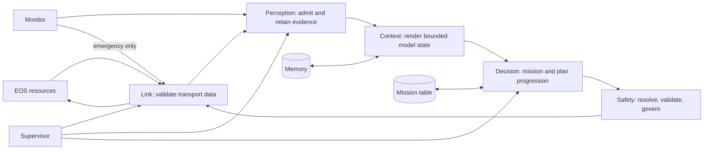

# EGIA core runtime

[中文](../../../docs_cn/ei/core/modules.md)

For the target graph hierarchy and per-kind operator behavior, start at the [node catalog](../layers/README.md). This page records the **current Python module implementation** and its algorithm, without redefining stage payload contracts.

This is the overview of `src/egia/core/`. The core turns external evidence and operator intent into governed EOS primitive calls. Its original architectural rule is a one-way authority chain: observations may inform cognition, cognition may propose work, but only the safety boundary may release a workload action. EOS remains authoritative for device execution and physical safety.

## Ownership map

| Module | Owns | Does not own | Focused reference |
|---|---|---|---|
| `core/link` | EOS channels, validated discovery generations, resource and call transport | planning or action policy | [Link](link.md) |
| `core/perception` | admission queue, bounded observation history, current replaceable evidence | source truth or prompt wording | [Perception](perception.md) |
| `core/context` | deterministic prompt sections and total dynamic-message budget | observation storage or model invocation | [Context](context.md) |
| `core/registry` | resolved primitive catalog and planner-visible signatures | transport or native-skill execution | [Registry](registry.md) |
| `core/missions` | mission admission, priority, documents, checkpoints and lifecycle | plan inference or primitive execution | [Missions](missions.md) |
| `core/decision` | model lanes, semantic plans, step progression and results | primitive authority | [Decision](decision.md) |
| `core/decision/coordination` | optional profile DAG market, device bidders and zone leases | capability invention or gate bypass | [Coordination](coordination.md) |
| `core/safety` | workload action admission, audit and emergency barrier | physical release guarantees | [Safety](safety.md) |
| `core/monitor` | health episodes, stalls, hard bounds, rate window and estop latch | ordinary workload execution | [Monitor](monitor.md) |
| `core/memory` | working, episodic and reviewed reference records | mission authority | [Memory](memory.md) |
| `core/supervisor` | task start, readiness, restart observation and stop signaling | domain state | [Supervisor](supervisor.md) |
| `core/__init__.py` | composition: construct collaborators, register entries, close resources | subsystem algorithms | this page |

## End-to-end data lifecycle

1. Composition resolves configuration and shared schemas, creates one client per stable backend alias, and builds stores beneath the resolved state/cache roots.
2. Link performs mandatory discovery. A complete validated generation replaces the prior backend snapshot; partial discovery is never published.
3. EOS resources and operator hearing become attributed `ObservationRecord`s. Event observations queue in order; replaceable state coalesces by identity.
4. Context reads snapshots and renders configured sections under one budget. Rendering may round or summarize values, but never mutates typed source state.
5. A bounded mission table selects one ordinary mission, or coordination admits multiple profile jobs when explicitly enabled. Model output remains a proposal.
6. Every workload invocation names a backend and device, resolves against the current registry, passes schema, device-limit, policy, runtime and rate checks, and only then reaches link. EOS acknowledgement is recorded as evidence.
7. Results return through perception, update plan/mission state, checkpoint working memory, and inform the next decision boundary. Concluded plans enter episodic memory; only an operator promotion enters reference memory.
8. Monitor independently observes links, progress and measured bounds. Emergency escalation erects a fail-closed barrier and uses the dedicated stop route.

## Lifecycle and degradation

`launch()` composes only configured subsystems, starts them through the supervisor, waits for readiness, serves health while running, then signals one shared stop event and closes non-supervised resources. Optional skill/model discovery, vector recall, docs retrieval, proposer and coordination may degrade without changing the primitive authority chain. A required backend discovery, schema, configuration or storage failure is surfaced rather than replaced with invented data.

Empty observations render as absent sections; an empty mission table waits; unknown targets and malformed model actions fail closed. Oversized collections are bounded with explicit omission counts. Duplicates are either idempotently ignored by identity or rejected where uniqueness is contractual. Timeouts and cancellation never synthesize success. Restarted supervised tasks receive a new readiness event, while durable mission and memory recovery follow their focused documents. Raster-map contracts are reserved types only: there is no map source, storage, prompt section or northbound producer in the current runtime.

## Architectural invariants

- Stable backend aliases are routing identities; EOS UUIDs detect process generations and are not operator targets.
- Native skills are descriptive planning guidance. EGIA executes primitives, never `ExecuteSkill`.
- I/O projects state and submits typed requests; it does not own core state.
- Monitor alone may bypass workload admission, and only for emergency stop.
- Mutable data is written below resolved `var/` roles, never source, config or shared-resource roots.
- The dependency contracts in `pyproject.toml` keep core logic behind injected protocols rather than provider SDKs or northbound handlers.
