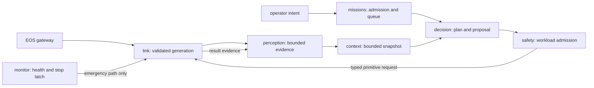

# EGIA 0.1.0 target architecture

[中文](../../../docs_cn/ei/design/architecture.md) · [Node catalog](../layers/README.md) · [Stage interface](../interfaces/pipeline.md) · [First use](../develop/build-and-run.md) · [Implementation TODO](../todo.md)

## Overview and release status

EGIA is the Python EGI Agent core. It turns attributed EOS evidence and operator intent into missions, plans, and safety-gated primitive requests. EOS owns physical execution and final admission; IsOS owns installed packages, the applied graph, generated configuration, process launch, and the shared log view. The target release is EGIA `0.1.0`; a product version does not set graph, node-type, protobuf, or HTTP version numbers.

**Current:** `src/egia/core/` implements link, perception, context, missions, decision, safety, monitor, memory, and supervision as Python modules. The A01 EGIA adapter advertises seven exact `@v0.1` stage types alongside the legacy `egia.agent` profile and renders a revision-bound stage overlay for a complete graph. Managed EGIA binds those instances to the existing core owners and routes stubbed evidence through the typed link, perception, context, and decision ports. The Rust EOS gRPC gateway and IsOS stage reader are implemented; the selected IsOS-managed end-to-end run remains a qualification dependency.

Q01's optional Vision reader is a process-owned ingress outside those seven stages. Its [private duplicate-generation test design](q01-vision-stale-test.md) exercises the existing admission rejection in a selected managed child without adding a public image or command route.

**Target:** The graph describes reusable EGIA stage instances at `core → layer → group → node` granularity. One process still hosts the Python core; stage nodes are configuration and observability units, not one OS process each. A stage's registered type fixes its ports, settings, and lifecycle; the instance supplies ID, description, routing, and values. A `description` for each registered type and configured node is visible in IsosUI. IsOS can render and launch EGIA only after it verifies graph/type support and an EOS gRPC endpoint.

## Dataflow and ownership

The graph wires evidence and proposal dependencies. The safety-to-link command path and link-to-perception terminal-result feedback are **governed runtime routes**, not arbitrary user-editable edges; this prevents a graph cycle or alternate actuator route from bypassing safety. The link-resource-to-perception evidence route is graph-authored and QoS-eligible under the exact A04 contract. Memory is a bounded optional context source and checkpoint sink, not action authority. Native skills remain descriptive planning guidance; only admitted primitives execute.

**A04 local routing:** The only QoS-eligible owner routes are link resource → perception resource and perception observations → context observations. Their one-value latest slots use a monotonic per-edge rate cap and weighted fair delivery, with replacement counters and an `evidence_overflow` diagnostic. The context snapshot → decision snapshot route has no bounded consumer and remains uncapped. Result, health, discovery, mission, safety, and stop delivery remain outside this scheduler. IsOS must independently register these exact routes before its graph can author QoS or claim an active EGIA edge.

**A02 governed link:** In a managed run, IsOS hands EGIA its run-scoped grant file by environment path and its saved graph revision through `egia/stages.json`. The stage composition preserves that exact 64-digit lowercase revision. Link validates owner, regular-file mode and exact grant bytes, then requires Discover, GetStatus and ListCapabilities to agree on both saved graph revision and EOS projection digest **and match the selected IsOS revision**. It fences the previous generation before forced rediscovery and after an uncertain transport break. Submit includes the grant and saved revision (estop may omit revision); Get, Watch and Cancel include the same grant and operation ID. A lost reply is recovered through Get with that ID, never a second Submit. Only a canonical matching terminal acknowledgement becomes success. Safety → link and monitor emergency egress remain code-owned; an authored graph edge cannot reach the client write method or EOS Dispatcher by itself.

| Layer / group | Stage type | Receives | Emits | Owner and failure rule |
|---|---|---|---|---|
| `io / link` | `egia.link.gateway@v0.1` | verified EOS endpoint and admitted requests | complete discovery generation, resource samples, operation results | Link owns channels; incomplete discovery does not publish a new generation. |
| `evidence / perception` | `egia.perception.admission@v0.1` | attributed EOS resources and operator hearing | bounded observation snapshots/events | Perception owns deduplication and limits; malformed evidence is rejected with a diagnostic. |
| `cognition / context` | `egia.context.builder@v0.1` | observations, body, optional memory | deterministic bounded context snapshot | Context owns rendering, not source data or model invocation. |
| `cognition / missions` | `egia.missions.queue@v0.1` | validated operator intent and plan results | selected mission and lifecycle changes | Mission queue owns priority, revision, and durable checkpoints. |
| `cognition / decision` | `egia.decision.planner@v0.1` | mission and context | typed proposal and plan transition | Decision owns model calls; model output never releases an action. |
| `governance / safety` | `egia.safety.gate@v0.1` | proposal, current registry, policy, monitor latch | admitted primitive request or rejection | Gate owns workload admission; unknown and stale targets fail closed. |
| `governance / monitor` | `egia.monitor.health@v0.1` | link health, progress, measured bounds | health episode and emergency latch | Monitor may use only the dedicated emergency-stop path. |

The [node catalog](../layers/README.md) gives a leaf page for every kind in the table; the [pipeline interface](../interfaces/pipeline.md) owns stage IDs, port types, envelope fields, and setting validation. EOS owns the [Island-eos](https://github.com/Island-Team/Island-eos) gRPC service and typed hardware contracts (`docs/eos/interfaces/`); EGIA consumes those contracts without redefining protobuf fields or EOS command payloads. IsOS owns graph serialization, edge priority/frequency, package resolution, and revision-checked Apply. EGIA does not use those edge priorities as mission priority or device safety policy.

## Algorithms and lifecycle

1. **Compose:** IsOS resolves exact packages and EOS endpoint, validates the graph revision and type support, renders immutable configuration from the complete installed EGIA defaults plus graph overlays, then starts EOS before EGIA. EGIA parses all config and schemas before exposing ready state. A TCP-open northbound listener alone is not readiness.
2. **Discover:** For each stable backend alias, link executes Gateway `Discover`, `ListResources`, and `GetStatus`, then CapabilityService `ListCapabilities`. It joins capabilities by exact robot, primitive, device, and version binding; only a complete valid generation atomically replaces the previous one.
3. **Admit evidence:** Perception validates source identity and payload, orders event evidence, coalesces replaceable state by key, and enforces bounded history. Context renders a deterministic snapshot under a total prompt budget, accounting for omissions. Empty optional evidence yields absent sections, not invented facts.
4. **Plan and admit:** Missions selects a bounded next mission; decision produces a typed proposal. The safety gate checks latch, target, exact capability, argument schema, limits, policy, runtime state, and rate window in that order. The first failure records a stable rejection; no transport follows. An admitted primitive uses EOS's durable operation identity and terminal acknowledgement rules.
5. **Observe and stop:** Results become attributed evidence before the next decision boundary. Monitor watches backend health and progress independently; it may latch an emergency stop through the dedicated path. On shutdown, reject new proposals, cancel model work, wait for or cancel in-flight operations according to EOS semantics, persist terminal mission state, close channels, then exit. Timeout or disconnect never means physical success.

Missing required EOS discovery, config, schema, or storage fails readiness with an actionable diagnostic. Optional model, recall, documentation, and skill sources may degrade without changing the primitive authority chain. Duplicate operation identities are handled idempotently where EOS promises that behavior; conflicting identities fail. A restarted process reconstructs durable mission state and performs fresh discovery before any new action.

## Configuration, versions, and logs

Standalone configuration continues to use `etc/egia/` or `--etc`; an IsOS deployment uses its private generated root via `EGIA_ETC`, `--mode isos --managed --no-tui`, and an IsOS-resolved EOS gRPC TCP or UDS endpoint. Defaults are copied from the installed package, then graph-derived overlays are rendered atomically. CLI and documented environment selections override runtime choices; secrets remain environment references and never appear in generated files or logs. The target adapter must render or seed `prompts.toml`, model bindings, and safety policy as well as current `egia.toml`, `modes.toml`, and profile overlays.

The A01 `egia-config setup` reader advertises product `0.1.0`, graph envelopes `0.1.0` and legacy `1.0.0`, and exact `@v0.1` and historical `@v1.0` IDs separately from setup schema. Existing identity scalars remain for old callers. A complete seven-stage graph is required for managed stage rendering; historical common design IDs stay read-only and have no runtime route. The merged IsOS A01 reader/catalog recognizes the seven stage types for cross-repository Apply/Run; selected end-to-end qualification remains a separate gate. EGIA does not rewrite saved graph bytes; IsOS owns explicit revision-checked migration. Unknown future versions and unimplemented types fail at their JSON paths before launch. Historical `island.eos.v1` and `island.eos.v2` protobuf namespaces remain wire identities, not product stability claims.

P05 adds exact setup type IDs and feature tokens plus a selected `egia --capabilities` probe. The [reader preflight design](reader-features.md) keeps runtime configuration support separate from graph reading and reserves EOS Gateway readiness for R02. IsOS binds the actual launcher, interpreter and installed code before admitting a managed EGIA child.

EGIA's current sanitized structured logging already provides run and correlation IDs, replay JSONL, human diagnostics, redaction, rotation, and a nonblocking session collector. The target maps those events to the shared IsOS envelope: UTC timestamp, level, source, core, optional canonical `node_path`, event code, run ID, optional correlation ID, message, and bounded fields. Emit one startup summary after configuration, then state transitions and terminal outcomes; suppress repeated identical diagnostics without suppressing audit or terminal events. The first-use log view must show package/version check → config/render → EOS discovery → EGIA ready → mission/action/rejection → stop in that causal order, with links from an error to its owning stage and recovery step. The shared log does not replace EGIA's replay or mission checkpoint store.

## Verification to implement

Use unit tests with fake EOS clients and clocks for each stage; stubbed integration tests for complete discovery, malformed/duplicate/stale evidence, mission priority, model timeout, gate rejection, emergency stop, and restart; and one IsOS → EOS → MuJoCo → EGIA real-process run. Assert the new and legacy graph readers produce equivalent safe behavior, while unknown versions fail. Check logging order, secret redaction, and that a disconnected northbound listener never reports ready. Save complete command output under `logs/test/<run-id>/` and summarize commands and results in this page after implementation.

Documentation verification on 2026-11-01: a Python 3 local-link and fenced-JSON scan checked 12 English/Chinese pages and parsed four JSON examples with zero broken links; `git diff --check` passed. The scan summary is in ignored `logs/test/20261101-docs-egia/egia-docs.log`. These checks validate document structure, not the target runtime behavior.
