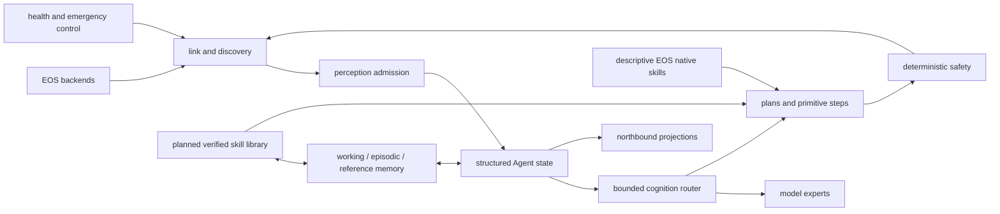
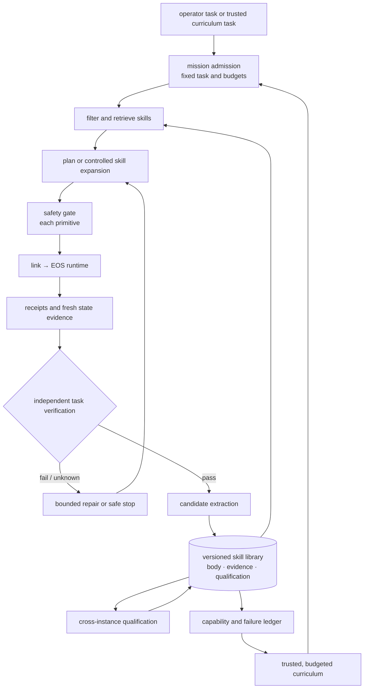

# EGI Agent target architecture (2607)

This is the target-architecture document for EGIA. Current implementation status lives only in [todo.md](todo.md). Reference documents describe the current MVP.

## Purpose

EGIA is the cognition and decision runtime of IslandOS Aether. It should make high-level embodied behavior portable across robots, environments, and model families while keeping execution explicit, attributable, and governable. EOS owns devices, continuous control, physical safety, and motion release.

The long-term objective is a dynamically routed embodied Agent over versioned primitive contracts. It should admit observations, maintain structured state, choose bounded context and reasoning paths, form verifiable plans, invoke only validated primitives, observe outcomes, and recover without backend-specific planning logic.

## Priorities

1. Strengthen the governed mission loop, executable plans, recovery, preemption, and deterministic multi-robot coordination.
2. Build routed cognition that chooses context views, memory, model experts, and feedback paths by goal, uncertainty, urgency, health, latency, and cost.
3. Operate model services as replaceable resources with explicit readiness, capacity, cancellation, fallback, and lifecycle semantics.
4. Convert independently verified experience into versioned, parameterized skills, beginning with advisory use and bounded sandbox qualification.
5. Capture governed trajectories for evaluation, routing-policy learning, advisory prediction, and bounded offline learning.
6. Allocate work across robots by primitive support, load, locality, leases, and resource constraints.

These are directions, not current-runtime claims.

## Current MVP foundation

The current runtime provides deterministic seams for future routing:

- EOS discovery yields hardware, resources, typed primitives, and optional descriptive native skills;
- perception admits timestamped, source-attributed observations;
- context produces one bounded dynamic message with explicit omissions;
- decision sends every Mission through a fast non-reasoning controller and uses a concurrent semantic reasoner, proposer, sentinel, and profile-writer lanes;
- the primitive registry resolves explicit robot/device targets;
- safety validates every workload call and monitor owns emergency stop;
- missions and memory retain attributable plans, outcomes, and recall;
- I/O publishes operator state without owning domain state.

One Agent-owned `etc/egia/prompts.toml` defines every lane. Static instructions are system messages. Prioritized dynamic facts appear once at the end of the user request. Environment facts are externally observed; synthetic clock text is not model context.

Native skills are semantic composition hints in this phase. EOS primitive calls remain the only executable planner actions. Raster-map contracts remain checked interfaces, but spatial processing awaits a bounded model-readable design.

## Invariants

1. Workload execution follows `decision → safety → link → EOS`.
2. Only monitor may bypass the workload path for emergency stop.
3. Every primitive call names an explicit backend and device unless the EOS contract defines a process-wide primitive.
4. Prompt rendering is derived from typed state; prompt text is not canonical runtime storage.
5. Model bindings are independent of EOS execution discovery.
6. Optional dependencies and optional skill discovery degrade locally.
7. Invalid contracts, missing required configuration, stale safety state, and rejected calls fail closed.
8. Learned components may propose, rank, or predict but cannot own release authority.
9. Runtime writes stay below resolved state, cache, log, run, and temporary roots.
10. Public wire schemas and checked package models remain in parity.
11. Skill promotion requires fixed task conditions, fresh attributable evidence, and an independent `pass`, `fail`, or `unknown` result.

## Target cognition graph

The future router selects expert graphs over typed inputs and budgets. It does not replace mission state, safety, or EOS release control. Routing decisions must be recorded with model identity, context view, latency, token use, health, fallback, and outcome so deterministic baselines can be reproduced.

## Model runtime direction

Services and logical models are distinct: one service may host several models, and one logical model may have multiple replicas. A model-runtime layer should track health, capacity, deadlines, cancellation, queueing, fallback, and optional managed-process lifecycle. Failure of an optional model should affect only lanes that depend on it.

## Data and learning direction

Trajectory capture should preserve prompt-section provenance, primitive targets, policy decisions, safety interventions, observations, and mission outcomes. Datasets require versioning, access control, retention, and reproducible splits. Learned routing, perception assistance, world-model scoring, and policies first run in shadow or advisory mode and must outperform deterministic baselines without raising safety violations. Reusable skills additionally require independent task verification, immutable provenance, and held-out cross-instance qualification.

## Voyager-inspired skill accumulation

EGIA adopts the transferable structure of Voyager rather than its Minecraft-specific runtime: an automatic curriculum, a persistent skill library, and iterative improvement driven by environment feedback and independent verification. This direction does not place another autonomous agent beside EGIA, import Mineflayer-style JavaScript execution, or imply online gradient updates to the foundation model. It adds a governed experience-to-skill loop inside the existing mission, memory, routing, and safety architecture.

In this document, a **skill** is a reusable upper-level behavior. A **primitive** is one typed capability invocation exposed by an EOS contract. Prompt instruction sections may provide static domain knowledge, but they are not learned skills and are never executable skill bodies.

### Verification and evidence

Skill learning starts from a task specification fixed by a trusted producer before execution. It identifies the environment and backend, object roles, required predicates, allowed primitives, contract versions, and finite model, action, time, evidence, and cost budgets. A model may explain failure or propose repairs, but it cannot weaken the fixed task and then claim the original task succeeded.

Verification returns `pass`, `fail`, or `unknown`. It uses fresh, attributable structured state from the same backend and task scope. Missing, stale, incomplete, ambiguous, or unavailable evidence remains `unknown`; it is not silently converted to success or skill failure. A gate verdict answers whether a call may leave EGIA, and a backend receipt answers whether the command was accepted or completed under that contract. Neither substitutes for task-level postconditions. An initially satisfied task records a verified no-op branch but gives no causal credit to an action sequence.

Episode provenance retains the initial environment description or digest, task and contract versions, model and policy versions, primitive arguments and receipts, read generations, final evidence, budgets, interruptions, and outcome. Evidence referenced by an active or reviewed skill cannot be removed by ordinary episodic cleanup without archival or reference checks.

### Skill representation and lifecycle

A skill is a declarative, content-addressed definition rather than copied prompt prose or unrestricted code. Its minimum record contains exact identity and version, family and description, typed role parameters, applicability constraints, checkable preconditions and postconditions, bounded read and primitive templates, resource and exit limits, exact dependency versions, source episodes, and qualification state. Temporary object IDs, material indices, arm bindings, and stale gate decisions from a source episode do not become reusable constants.

The lifecycle separates evidence from authority: `candidate` means extracted from an independently verified episode; `sandbox_qualified` means it also passed defined cross-instance tests with changed initial state and object bindings; `deployment_qualified` requires backend-specific review, shadow evidence, and deployment policy; `retired` prevents new selection while retaining the immutable body and provenance. Human-reviewed reference ranking is separate from execution authorization. Contract, binder, verifier, dependency, or skill-body changes create a new version or require requalification; they never rewrite old evidence in place.

Skills may eventually depend on other skills, but dependencies resolve to exact versions and an acyclic bounded graph. The first executable form remains a straight-line micro-skill with explicit read barriers; no arbitrary loops, recursion, dynamic imports, `eval`, hidden network access, or unbounded code generation is required.

### Retrieval and controlled execution

Retrieval first filters by task family, environment, backend, current primitive contracts, qualification, dependency versions, and satisfiable preconditions. Ranking or embeddings operate only on the remaining compatible set; semantic similarity never overrides a failed contract or state check. Retrieval records which skill version and evidence influenced a plan. A planner that rewrites a suggested template records a derived instance plan, not a successful execution of the original skill version.

Rollout has two distinct modes. In advisory mode, a candidate contributes a bounded signature and planning hint while the ordinary planner remains responsible for every step. In controlled mode, a qualified family-specific adapter binds current objects from fresh observations and expands one typed barrier at a time. A barrier is one planner execution boundary; the initial controlled form permits exactly one read or primitive in each barrier, so no dependent call is prepared across a required observation. A state-changing primitive that creates or moves an object is followed by an explicit read before dependent arguments are bound. Source-episode indices are never predicted for a new environment.

Every expanded primitive carries the original mission scope and independently traverses `decision → safety → link → EOS`; no outer `skill.run` admission authorizes an unchecked internal sequence. Budgets, rate limits, estop, stop, preemption, contract validation, backend receipts, and final task verification remain in force. Rejection invalidates dependent barriers. Timeout, cancellation, or a missing receipt may mean a non-idempotent primitive executed, so the runtime records `unknown`, reads and reconciles when a contract supports that decision, and otherwise stops rather than replaying the primitive. Partial progress is recovered from current facts and durable barrier provenance, not only from an in-memory cursor.

### Curriculum and composition

The curriculum reuses normal mission admission and never owns a private execution loop. It selects from trusted, verifiable task families using a capability and failure ledger, prerequisite coverage, expected learning value, user-task relevance, current resources, and explicit session budgets. Operator work retains priority. Early curricula vary controlled sandbox initial states; open-ended model-authored goals, physical actions, multi-robot coordination, and real deployment remain separately qualified stages.

Composition begins only after individual skills have stable contracts and cross-instance evidence. The composition planner checks all role bindings, postcondition-to-precondition links, resource conflicts, dependency versions, and total budgets before execution. Coordination adds executor capabilities, leases, locality, and handoff evidence but does not weaken per-primitive gates or task verification.

### Evaluation and promotion

Evaluation separates benefits from verification, authored execution infrastructure, automatic extraction, and curriculum scheduling. Common held-out tasks compare: the existing agent with an external evaluator; independent verification with bounded repair; manually authored parameterized skills; automatically extracted skills using the same binder and executor; and the same system with a curriculum. Training or practice instances remain separate from frozen evaluation instances.

Primary measures are independently verified task completion, false-success and `unknown` rates, model calls and tokens, primitive calls, latency and cost, compatible-skill reuse reliability, correct rejection of incompatible skills, recovery after rejection or interruption, and capability coverage under a fixed practice budget. Scripted models and deterministic sandboxes can check control-flow and provenance invariants within their modeled scope and test coverage, but they do not demonstrate real-model improvement, physical manipulation quality, electrical correctness, or broad generalization. Promotion requires a measured gain over the appropriate deterministic and manually authored baselines without more safety violations, followed by shadow evaluation, explicit deployment approval, canary limits, and rollback.

The target rollout is deliberately staged: establish repeatable sandbox verification; add declarative candidate extraction and advisory recall; qualify bounded controlled micro-skill expansion; evaluate adaptive curriculum and composition; then perform authorized read-only shadow evaluation before any separately governed physical or coordinated deployment.

## Planned interface modules

- A governed Agent-local extension module requires explicit contracts, isolation, policy, audit, and lifecycle design.
- Raster-map processing requires a new bounded spatial contract suitable for models; EOS no longer publishes a raster-map schema.
- Native-skill execution requires EOS argument schemas and deterministic safety validation. Until then, discovered skills remain descriptive.
- Multi-model routing requires measurable service health and versioned routing decisions before learned selection is introduced.
- Agent-owned reusable skills require fixed verification contracts, versioned evidence, qualification states, current-object binding, and bounded expansion.

## Delivery sequence

1. Keep the primitive-only MVP and its prompt inspection path reproducible.
2. Complete safety assessment for concurrent primitive steps.
3. Establish repeatable sandbox task verification with `pass`, `fail`, and `unknown` outcomes plus durable episode provenance.
4. Add declarative advisory skill candidates, then qualify bounded controlled micro-skill expansion on held-out instances.
5. Capture fixed-seed trajectories and routing-independent baselines.
6. Add explicit model-service health, capacity, cancellation, and fallback.
7. Ship a deterministic context/model router with full telemetry.
8. Evaluate adaptive curricula, advisory prediction, and learned routing in shadow mode.

Detailed status and promotion conditions belong in the [roadmap](todo.md).
