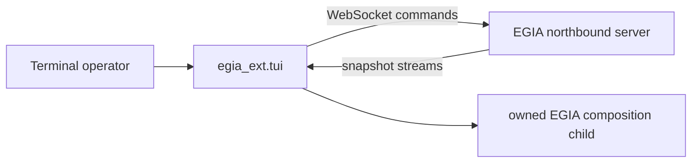

# `egia_ext` operator extensions

## Contents

- [Overview](#overview)
- [Architecture](#architecture)
- [Owned modules](#owned-modules)
- [Data flow](#data-flow)
- [Conditions](#conditions)
- [Related documentation](#related-documentation)

## Overview

`libexec/egia_ext/` contains private, out-of-process operator programs. Extensions consume public EGIA interfaces and may launch local helpers, but they do not import core implementation as an execution shortcut and do not own runtime truth.

## Architecture

## Owned modules

`tui/app.py` coordinates the terminal lifecycle and views. `config.py` resolves operator configuration. `feeds.py` connects to EGIA streams and converts frames into local feed state. `render.py` formats operator-visible panels. `repl.py` parses terminal commands into public northbound requests. `spawn.py` owns child-process creation and teardown. `procmon.py` observes those processes. `__main__.py` is the private program entry point.

## Data flow

The terminal reads configuration, starts the requested local helpers, subscribes to northbound snapshot streams, and renders received JSON without becoming a second state authority. Operator text or commands are validated locally enough to select a route and are then sent to EGIA, where canonical request validation, mission policy, primitive gating, and safety still occur.

Process output and WebSocket frames are normalized into bounded display state. Rendering changes presentation only; stable robot IDs, device IDs, mission revisions, correlation IDs, and backend reasons remain attributable to their source.

## Conditions

Normal startup connects available feeds and keeps independent views updating. Empty streams or snapshots render as empty or waiting state. Malformed frames, unknown command syntax, and rejected requests are shown as errors and do not mutate EGIA state locally.

An unavailable feed, refused connection, or reconnect delay affects that view without granting a fallback execution path. Command timeouts and server close code 1013 remain operator-visible. In attach mode the console owns no runtime child; in wrap mode a child startup failure is reported instead of being mistaken for a connected runtime.

After EGIA or an extension restart, streams send their current snapshots again and the terminal rebuilds display state. On shutdown or terminal interruption, feed tasks are cancelled, sockets are closed, and spawned children are terminated and reaped. Extension failure must not terminate the EGIA runtime.

## Related documentation

See [tui.md](ext/tui.md) for the terminal console, [northbound.md](northbound.md) for the consumed wire API, and [io.md](io.md) for northbound adapter ownership.
