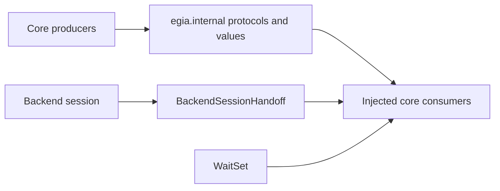

# `egia.internal` runtime seams

## Contents

- [Overview](#overview)
- [Architecture](#architecture)
- [Owned modules](#owned-modules)
- [Data flow](#data-flow)
- [Conditions](#conditions)
- [Related documentation](#related-documentation)

## Overview

`egia.internal` contains narrow types used to invert dependencies between core subsystems. These interfaces carry data and lifecycle signals without owning missions, devices, model policy, memory, or northbound state. They are internal contracts, not stable external APIs.

## Architecture

## Owned modules

`backend.py` defines `BackendSessionHandoff`, the process-local handoff of admitted missions, an active plan, and bounded observation state across a backend rebind. `decision.py` defines `ActionInvocation`, `StepContext`, and `GateVerdict`, which carry one requested action through policy and safety to an optional backend acknowledgement.

`model.py` defines the `DecisionModel` protocol consumed by planning without coupling core code to one provider. `recall.py` defines the `RecallIndex` protocol used by memory with either the optional vector index or another implementation. `notify.py` defines `WaitSet`, a small broadcast notification primitive used by replaceable stores.

## Data flow

A producer constructs an internal value from already validated domain data and passes it across an injected protocol. An action invocation preserves the primitive name, stable robot and device target, arguments, and intent; step context adds mission origin and execution context; the gate returns a verdict that distinguishes admission, refusal, backend acknowledgement, and egress failure.

Before backend-owned clients, watchers, and registries are replaced, composition deep-copies admitted missions, the active plan, and bounded observation state into the handoff. The next session consumes isolated copies and clears the pending values; its monotonically increasing revision identifies a new capture. Model and recall calls return their protocol results to decision or memory owners, which decide persistence and operator projection. `WaitSet.notify_all` wakes current waiters after a store version changes; consumers always reread owner state after waking.

## Conditions

Normal calls preserve typed values without adding policy. Empty optional targets and acknowledgements remain explicit: an admitted verdict may carry a backend rejection acknowledgement, while an admitted verdict without an acknowledgement represents egress failure and must not be treated as success.

Malformed data should have been rejected at the owning boundary; protocol implementations may still raise their documented provider, storage, or transport failures. Missing implementations disable the dependent feature through composition rather than a hidden fallback. `WaitSet.wait` returns `False` on timeout and `True` on notification; callers must tolerate a wake followed by unchanged or replaced state.

Restart creates new protocol implementations and a new backend handoff; no object in this package is durable. Cancellation and shutdown are controlled by the owning subsystem. Recall implementations must close their resources, model implementations must release provider resources when applicable, and waiters must be allowed to exit through their owner's stop condition.

## Related documentation

See [core/modules.md](core/modules.md) for dependency direction, [core/link.md](core/link.md) for backend sessions, [core/decision.md](core/decision.md) for model and action consumers, [core/safety.md](core/safety.md) for gate verdicts, and [core/memory.md](core/memory.md) for recall implementations.
