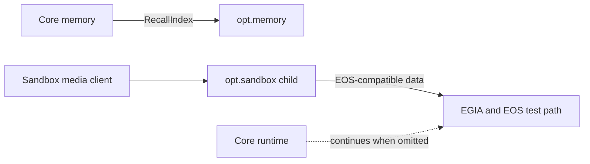

# `egia.opt` optional subsystems

## Contents

- [Overview](#overview)
- [Architecture](#architecture)
- [Owned modules](#owned-modules)
- [Data flow](#data-flow)
- [Conditions](#conditions)
- [Related documentation](#related-documentation)

## Overview

`egia.opt` contains features that composition may omit without changing the core execution contract. Optional modules implement injected seams or isolated development services; core does not import them as mandatory dependencies.

## Architecture

## Owned modules

`memory/vec.py` provides the sqlite-vec recall index behind the internal `RecallIndex` protocol. It embeds completed plans, replaces index rows by stable plan ID, and returns ranked IDs for core memory to resolve against authoritative records.

`sandbox/__main__.py` starts the isolated playground. `sandbox/server.py` owns its local EOS-compatible and media endpoints, while `sandbox/devices.py` produces configured microphone, camera, and speaker behavior. The sandbox is a development input surface, not a production device runtime or a safety bypass.

## Data flow

For optional memory, core supplies a completed plan or query text. The vector implementation creates a deterministic embedding, updates or queries its index, and returns identifiers and scores; core reloads the matching plan records, drops unknown IDs, and constructs the bounded recall digest.

For the sandbox, validated sandbox configuration selects loopback listeners and enabled devices. Media input is converted into EOS-compatible observations and device state, then enters the ordinary link, contract-validation, perception, context, and northbound paths. EGIA proxies sandbox WebSocket media over local IPC but does not merge the child into its process.

## Conditions

Normal vector indexing replaces an existing plan entry with the same stable ID and ranks available matches. An empty index or empty authoritative corpus produces no recall. Malformed stored vectors, missing sqlite-vec support, database failures, or unknown returned plan IDs degrade optional recall without changing episodic-memory authority.

Normal sandbox startup exposes only configured loopback services and enabled devices. Disabled devices produce their documented disabled state; empty media produces no fabricated observation. Invalid configuration, non-loopback binding, malformed media, unavailable child IPC, or child startup timeout keeps the sandbox route unavailable without taking down the northbound API or core runtime.

Restart rebuilds process-local sandbox state and reopens optional vector storage. On shutdown, vector connections close; sandbox tasks, sockets, device resources, and the child process are stopped. With either feature disabled or its dependency absent, composition uses the documented core behavior rather than silently emulating it.

## Related documentation

See [memory.md](opt/memory.md) for vector recall details, [sandbox.md](opt/sandbox.md) for the playground protocol, [core/memory.md](core/memory.md) for authoritative memory, [southbound.md](southbound.md) for EOS validation, and [northbound.md](northbound.md) for sandbox proxy behavior.
