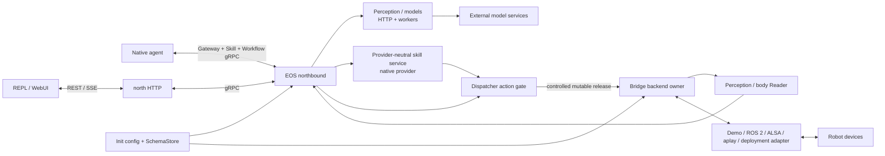

# EOS (Embodied OS) Technical Solution

## Repository introduction

EOS is the native execution runtime of IslandOS Aether. It gives an embodied agent a stable hardware abstraction, live robot state, and a controlled path from a primitive call to a device. EGIA decides *what* should happen; EOS determines whether a backend-aligned atomic release can be admitted on the local robot.

This repository contains the C++ EOS component in the merge-ready `src/eos/` layout. Canonical dynamic JSON Schemas and product-wide assets live in the combined IslandOS-Aether tree and are consumed by EOS without being copied.

## Contents

- [Purpose and goals](#purpose-and-goals)
- [Core repository features](#core-repository-features)
- [Architecture](#architecture)
- [Layout](#layout)
- [Modules](#modules)
- [Algorithm and optimization work](#algorithm-and-optimization-work)
- [Delivery priorities](#delivery-priorities)

## Purpose and goals

EOS exists to make agent cognition useful on real machines without coupling the agent to a robot vendor, transport, or control stack. EOS exposes **EOS-owned typed primitive bindings over a stable hardware abstraction layer (HAL)**. In the Voyager sense, executable compositions and their workflow/runtime memory are Agent-owned skills built over these stable primitives.

The longer-term technical direction has four connected parts:

1. **Typed primitives and HAL.** Admit devices and backend-aligned primitives; describe their targets and tiers; keep EGIA independent of backend details; degrade cleanly when a device disappears.
2. **Dynamic low-level reflexes.** Compose fast local reactions from declared sensor and actuator capabilities. Classical reflexes remain the dependable base. Small neural policies may rank or refine a bounded response, but they never receive final release authority.
3. **Efficient local perception.** Run compact multi-task perception models close to sensors and reuse one temporal latent/token representation across detection, tracking, scene updates, and action-policy consumers where model compatibility permits. This avoids repeating the same encoder and memory traffic for every consumer.
4. **Edge and LPDDR optimization.** Treat unified-memory bandwidth as a design budget, not an afterthought. Prefer zero-copy or bounded-copy feeds, quantized models, shared encoders, fixed-capacity buffers, batched transfers, and rate-aware scheduling. Optimize end-to-end time-to-action and energy, rather than model throughput in isolation.

These are directions, not claims about the current implementation. The [algorithm roadmap](algorithms.md) separates implemented foundations from proposed algorithms and defines how each should be measured.

### Design breakpoints

EOS is intended to improve the places where conventional robot-agent stacks usually break:

- A new robot should require a HAL adapter, not a rewrite of agent logic.
- A new backend action should join the primitive catalog, not add a private command path.
- A cloud or model outage should reduce autonomy, not remove local safety.
- A faster sensor should not force every consumer to run at its frequency.
- An edge accelerator should not be kept busy by saturating the shared LPDDR bus with duplicated frames and embeddings.
- Learned behavior should be replaceable and measurable while deterministic admission, watchdogs, stop authority, and hardware limits remain intact.

## Core repository features

The current repository provides the stable primitive foundation and a native execution host for Agent-owned skills. Deployment-owned code libraries embed their identity and primitive allowlist, load at startup through a stable C ABI, and can request only validated calls through the existing dispatcher. EOS does not author skills; its Workflow service validates, schedules, and reports caller-supplied ActionList definitions over the same governed execution boundary.

### Hardware abstraction and backend admission

`runtime/hardware` parses one hardware profile per process, admits backend/device combinations, mints process-scoped identity, and assigns deterministic per-class device IDs. Device class, feeds, supported primitives, and rate envelopes are represented independently of transport. Bridge solely owns backend objects and exposes const identity/feeds to readers; only Dispatcher receives controlled mutable release access. The committed default selects the public full-loopback `demo` profile for development and profile authoring. Optional ROS 2 arm, gripper, and camera adapters and the native `aplay` speaker backend are available for deployment-owned bindings.

This is the usable HAL boundary. Higher-level skill implementations remain Agent/deployment-owned; EOS provides only their native execution host and validated primitive boundary.

### Runtime initialization and contracts

`runtime/init` strictly parses `eos.toml`, loads one immutable SchemaStore, auto-registers the primitive catalog, and composes models, hardware, perception, dispatch, and skills before opening the gRPC listener. `eosd` is a thin CLI and signal entrypoint. Shutdown stops gRPC and the tick thread before destroying domain services in reverse order.

### Transport gateway

`runtime/northbound` serves `GatewayService`, `SkillService`, and `WorkflowService` on one gRPC-only listener with health and reflection. The external `eos-north-http` owns all REST/SSE behavior and calls public gRPC stubs rather than domain internals. It may start before EOS, reports separate liveness/readiness, and propagates request IDs and cancellation.

### Native skill host

`runtime/skills` owns a provider-neutral catalog, idempotent execution IDs, full lifecycle snapshots, deadlines, cancellation, retention, and structured logging. Its implemented `native/` profile admits trusted deployment `*.skill.so` libraries before the gateway starts; `managed/` and `external/` are fail-closed placeholders. The native C ABI exposes metadata, embedded parameter/return schemas, resource URI templates, asynchronous execution, cooperative cancellation, and direct versioned primitive calls without exposing a backend or C++ runtime object. Resource templates are discovery metadata rather than read handles. Installation and skill authoring remain deployment responsibilities; northbound exposes discovery and execution only.

### Body and model perception

`runtime/perception/body` reads const bridge feeds and converts them into device discovery and versioned perception resources. `runtime/models` owns all model capabilities and the declared logical clients across VAD, ASR, TTS, detection, pose, posture, and unified face operations, including its bounded worker queue and provider normalization. A TTS caller may pass returned audio into `speaker.play`; the backend itself has no model dependency.

### Command dispatch

`runtime/dispatch` is the complete action gate: schema validation, primitive discovery, target/type admission, numeric limits, velocity leases, stop/estop, controlled backend release, and transport-neutral results. Native skills hold this same Dispatcher, so direct and composed actions cannot diverge.

### External demo simulator and diagnostic client

The demo adapters cover all seven device classes through the explicitly launched `eos-simulator`. The simulator owns world and clock outside EOS and serves its own WebUI API on port `16004`. Simulator failure degrades demo devices without terminating `eosd`. `eos-repl` is an HTTP/SSE client of `eos-north-http`, exercising the browser-facing contract used by WebUI.

### Build, install, and verification

The root CMake project composes EOS today and can discover EGIA after a history-preserving merge. Public wrappers are independent of the caller's working directory; native programs install under `libexec/island`; reference configuration, documentation, and shared roles install separately. The native suite exercises libraries, adapters, initialization, bridge admission, body projection, model clients, gateway transport, dispatch, skills, the REPL, and cross-module chains.

### Supporting and side modules

The following modules support the core HAL/skill direction but do not replace it:

- **Dispatch action gate:** current dispatch owns the sole mutable backend release path, validation, limits, leases, stop, and estop. Hard-real-time isolation and richer freshness inputs remain future hardening of this gate, not a second release module.
- **Scene perception:** body currently projects contract-shaped scene resources from bridge feeds. Spatial fusion, prediction, and freshness-aware confidence are future work.
- **Motion:** current adapters execute bounded demo operations. General trajectory generation, tracking, collision checking, and recovery are not yet separate runtime modules.
- **Observability and replay:** structured logs and an optional external, privacy-allowlisted, hash-chained ActionList audit projection exist. The journal is non-authoritative and its SHA-256 chain is corruption evidence rather than attacker-proof authenticity. Deterministic full-payload capture/replay, latency traces, and model/skill provenance remain planned.
- **ROS 2:** the optional backend serves arm, gripper, and camera devices when their binding selects it. Site-specific graphs, protocol bridges, and hardware limits remain deployment-owned; speaker playback uses the native `aplay` backend instead.

## Architecture

EOS separates a flexible observation/cognition graph from one controlled command path. Data may have many producers and consumers; a physical action must cross the contract, dispatch, safety, HAL, and backend boundaries.



All modules shown are implemented. Optional model endpoints and native skill libraries are deployment-owned and may be absent.

### Architectural rules

- **One release path.** No skill, model, gateway method, or backend may create a second route to an actuator.
- **Stop anywhere, release once.** Any caller may request a stop; Dispatcher is the only action gate that may release to a backend.
- **Contracts before implementation.** EGIA sees versioned primitives and state, never ROS topics, vendor handles, or C++ object layouts.
- **Rates are decoupled.** Sensors, perception, reflexes, policies, and dispatch may run at different rates and exchange freshness-checked snapshots.
- **Learned components are bounded.** A model may observe, rank, predict, or propose; deterministic code checks its envelope and owns final release.
- **Hot-plug is an admission event.** A replacement backend or skill returns through identity, health, contract, and safety admission before use.
- **Memory movement is explicit.** Feed size, rate, ownership, copy count, and expiry are part of edge performance design.
- **Fail closed.** Missing configuration, stale state, invalid schemas, unhealthy devices, missed deadlines, and incompatible model artifacts do not silently fall back to motion.

## Layout

The component uses the same role-based paths before and after a combined-tree merge:

```text
IslandOS-Aether/
├── bin/                         # public, CWD-independent launchers
├── etc/eos/                     # EOS reference configuration and profiles
├── share/contracts/             # canonical Agent-runtime wire contracts
├── src/eos/
│   ├── include/eos/
│   │   ├── hardware/            # EOS-owned adapter API
│   │   ├── skill/               # installed native skill C ABI
│   │   └── internal/            # runtime-only module seams
│   ├── bin/                     # thin CLI and signal entrypoints
│   ├── lib/                     # dependency-leaf utilities
│   ├── runtime/                 # init, bridge, perception, dispatch, skills, gateway
│   └── ext/                     # backends, external simulator, diagnostic REPL
├── tests/eos/                   # cross-module native tests
└── docs/eos/                    # EOS documentation
```

Agent and EOS read the same `share/contracts` source; EOS does not embed EGIA code, operator UI code, or site-specific robot configuration. Runtime state writes belong under the resolved Island state/cache/log/run/tmp roles, never in source or configuration paths.

## Modules

| Module | Current responsibility | Maturity | Detail |
|---|---|---:|---|
| `lib` | Logging, paths, clocks, and fixed-cost utility primitives | Implemented | [Library](lib.md) |
| `runtime/init` | Strict config, immutable schemas, and process composition | Implemented | [Initialization](runtime/init.md) |
| `runtime/hardware` | Profile parsing, UUID/device identity, and backend admission | Implemented | [Bridge](runtime/hardware.md) |
| `runtime/perception/body` | Read-only device, status, vision, scene, and inventory snapshots | Implemented | [Perception runtime](runtime/perception.md) |
| `runtime/models` | All model capabilities, provider normalization, and bounded workers | Implemented | [Models runtime](runtime/models.md) |
| `runtime/dispatch` | Schema-validating action gate, limits, leases, acks, stop/estop, release | Implemented | [Dispatch](runtime/dispatch.md) |
| `runtime/skills` | Shared lifecycle/logging and native Dispatcher-backed execution | Native implemented; managed/external placeholders | [Skills](runtime/skills.md) |
| `runtime/northbound` | gRPC-only services, health, reflection, and streaming | Implemented | [Gateway](runtime/northbound.md) |
| `ext/north_http` | External REST/SSE-to-gRPC gateway and optional non-authoritative ActionList audit | Implemented | [north HTTP](../develop/interfaces/external/http.md) |
| `ext/backends/demo` | Deterministic HAL adapters for seven device classes | Implemented | [Demo backend](../develop/ext/backends/demo.md) |
| `ext/backends/aplay` | Native bounded WAV-to-ALSA speaker playback | Implemented | [Aplay speaker backend](../develop/ext/backends/host.md#aplay-speaker-backend) |
| `ext/backends/ros2` | Optional ROS 2 transport/backend seam | Initial | [Configuration](../usage/configuration.md) |
| `ext/repl` | Standalone HTTP/SSE diagnostic client | Implemented | [REPL](../develop/ext/tools/repl.md) |
| Reflex host | Multi-rate classical and bounded learned local reactions | Planned | [Algorithms](algorithms.md#dynamic-low-level-reflexes) |
| Perception host | Shared compact encoder/tokens and task heads | Research direction | [Algorithms](algorithms.md#shared-perception-representation) |

## Algorithm and optimization work

Detailed proposed algorithms, invariants, measurements, and promotion criteria are maintained in [Algorithm and edge optimization notes](algorithms.md). That document covers:

- Agent-owned skill discovery, compatibility, scoring, and lifecycle over EOS primitives;
- multi-rate low-level reflex arbitration;
- shared perception encoders and temporal latent/token reuse;
- freshness-aware state exchange and bounded degradation;
- LPDDR traffic accounting, zero-copy design, and edge scheduling;
- hardening the deterministic Dispatcher action gate around learned components.

Wire behavior and runtime mechanics remain in their dedicated references:

- [Northbound interfaces](../develop/interfaces/README.md)
- [Southbound interfaces](../develop/interfaces/README.md)
- [Canonical contracts](../develop/interfaces/contracts.md)
- [Configuration](../usage/configuration.md)

## Delivery priorities

1. **Primitive hardening:** keep the typed registry and one-release dispatch path stable while expanding backend coverage.
2. **Native skill hardening:** add isolation, deadlines, cancellation propagation, authorization, and richer lifecycle around the implemented code-skill ABI; see the root `todo.md`.
3. **Action-gate hardening:** preserve Dispatcher as the sole release path while proving fail-closed behavior under stale state and overruns.
4. **Reflex and perception hosts:** establish multi-rate data slots and a classical reflex baseline before admitting bounded learned components.
5. **Edge optimization:** instrument copy count, LPDDR bandwidth, latency, energy, and freshness; then optimize shared representations and scheduling against measured bottlenecks.
6. **Replay and qualification:** capture enough provenance to reproduce every primitive release decision, then qualify backend and model artifacts before deployment.

The order is intentional: Agent cognition depends on a trustworthy primitive surface. Neural reflexes and edge optimization become valuable only after capabilities, ownership, timing, and release authority are explicit.
