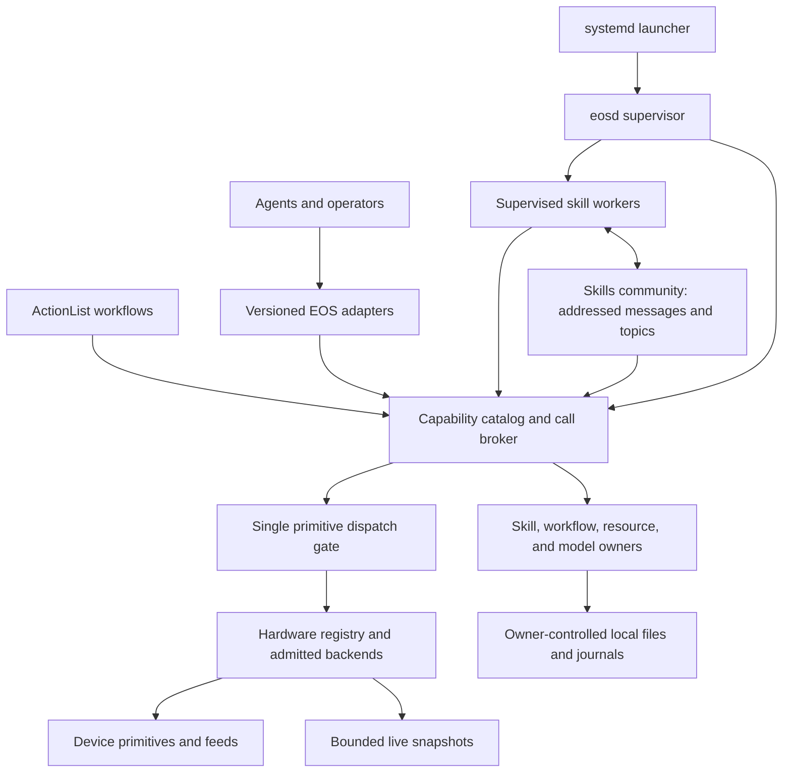

# EOS middleware map

<!-- docs-tree:start -->
**Location:** [Docs](../../README.md) / [EOS](../README.md) / [Design](README.md) / **eos middleware map**

Docs tree

- [docs/](../../README.md)
  - [eos/](../README.md)
    - [design/](README.md)
      - [runtime/](runtime/README.md)
      - [algorithms.md](algorithms.md)
      - [eos-2607.md](eos-2607.md)
      - **eos-middleware-map.md**
      - [lib.md](lib.md)
      - [mujoco.md](mujoco.md)

<!-- docs-tree:end -->

[中文](../../../docs_cn/eos/design/eos-middleware-map_cn.md) · [EOS documentation](../README.md) · [Runtime overview](runtime/README.md)

**EOS (Embodied OS)** is Aether's robot execution component. This page maps EOS 0.2.0 middleware responsibilities onto the runtime and marks remaining extensions. The OS vocabulary names application responsibilities; it does not require Linux system calls, kernel IPC, signals, `io_uring`, or a new database. Contracts for callers belong in [EOS interfaces](../interfaces/README.md), not in this design map.

## Ownership map

**Hardware is the execution foundation.** The [hardware runtime](runtime/hardware-legacy.md) admits one robot profile and owns its backend instances, device identities, health, and feeds. A primitive is an exact, versioned device command. The [Dispatcher](runtime/dispatch.md) remains the only controlled mutable path from EOS callers to a backend. Stable robot and part identities identify an intended target; the admitted binding resolves them to the current device and exact supported primitive. Missing, ambiguous, or unsupported mappings fail before release; Dispatcher decides current safety and health outcomes and replays admitted command results. Backend-specific safety and physical control remain with the backend.

**The EOS core is an application broker.** A capability is a discoverable operation a caller may request, including a hardware action, resource read, model call, or skill control action. The proposed catalog describes what the composed runtime supports; execution-scoped authority determines which caller may use it. The broker validates the operation and routes it to its existing owner, recording an accepted call through a terminal result or an explicit uncertain hardware outcome. A “syscall” means this checked application call. It does not move [ActionList scheduling](runtime/actionlist.md), [SkillManager execution state](runtime/skills/manager.md), model ownership, or hardware release into the transport adapter.

The [hardware capability kernel](runtime/kernel.md) now names admitted hardware primitives and routes trusted northbound, ActionList, and production packaged-worker primitive calls through one Broker and Dispatcher. Worker tokens bind an exact canonical capability to an execution and binding generation. The [CapabilityService v2](../interfaces/capabilities.md) exposes hardware discovery and operation lifecycle to agents over native gRPC and north HTTP. ActionList workflows use capability targets for new plans; historical primitive targets remain readable. Software capabilities remain proposed.

**Skills communicate through an EOS-owned community.** The implemented [SkillManager community](../interfaces/skills/native/community.md) supports bounded addressed messages between active executions and named topics with bounded fan-out, including packaged-worker ABI v2.1 calls. A skill declares schemas and send/receive rights; the manager checks them, bounds queues and payloads, and exposes dropped-message counts. Request/reply is a caller convention over addressed messages, not a transaction supplied by the raw callback. Messages are live coordination, not a durable work queue or a replacement for owner-controlled facts. No DDS or operating-system IPC mechanism is part of the application contract.

**Signals report and control work.** Existing [skill SIGNALs](runtime/skills/manager.md) and lifecycle snapshots are the starting point for typed skill control and operation-status events. Cancellation, deadline, stop, and terminal results retain their owning domain semantics. A client stream disconnect does not silently cancel accepted work. The v2 hardware operation surface now provides bounded submit, current-state watch, completion, and cancellation at the middleware level; broader async I/O remains proposed. `io_uring` is neither required nor exposed to agents or skill authors.

**State follows its owner and lifetime.** The ordinary fast path uses bounded immutable in-memory [observation snapshots](runtime/perception.md) and manager timelines. Large feeds may use read-only shared-memory snapshots for multiple local consumers only when measurement shows a benefit; freshness, sequence, generation, and bounds must remain visible through the same resource abstraction. Durable workflow, command, and small typed state remain in their existing owner-controlled local files and journals, including the [private store](runtime/store.md). Restart epochs distinguish a new process from retained durable records. EOS does not introduce a general database for this map.

**The process boundary stays explicit.** One `eosd` process owns one admitted robot profile and supervises isolated packaged skill workers through [SkillManager](runtime/skills/manager.md). Workers call the broker and do not receive backend handles. Worker exit revokes its authority, cancels outstanding work where possible, and leaves uncertain physical outcomes explicit. The existing systemd launcher manages long-lived services such as `eosd`, the external HTTP adapter, and a simulator; it is deployment supervision, not the skill community.

## Invariants

- Every actuator effect crosses the existing single dispatch gate; no agent, workflow, skill worker, message handler, or adapter holds a mutable backend handle.
- Exact primitive identity, target admission, command ID, same-device ordering, stop and estop priority, lease handling, and uncertain-outcome recovery retain the [dispatch rules](runtime/dispatch.md).
- Capability discovery describes availability; a call still requires current authority and admission. Worker grants end with the execution and cannot authorize a later one.
- Each accepted asynchronous operation has one identity and a visible terminal or uncertain state. Transport retries cannot silently repeat a physical command.
- Community queues and live feeds are bounded. Overflow, stale data, and restart or replay gaps are observable rather than silently repaired.
- Durable state has one domain owner. Diagnostic logs and community messages do not become authoritative workflow or command journals.
- Existing v2 skill packages remain loadable through compatible optional ABI extensions; v1 skill ABI support is not restored.

## Staged implementation

Each stage was reviewed on its own branch and integrated through a sequential squash merge to `master`. Its contract, implementation, tests, and English and Chinese documentation were committed in reviewable steps.

1. **Map:** This ownership map and the migration checks are in place.
2. **Capability core:** The hardware-only Catalog and Broker are implemented for trusted northbound, ActionList, and production packaged-worker calls. Broader owners remain later work; hardware actions still route through Dispatcher.
3. **Skills community:** Bounded addressed and topic messaging and the optional v2.1 ABI callback are implemented. Unified typed status/control behavior beyond existing SIGNAL and lifecycle surfaces remains later work.
4. **State and async operations:** Bounded hardware operation completion and watch are implemented. Broader feed consolidation and measured shared-memory paths remain later work; owner-controlled local-file recovery remains in place.
5. **Agent actions:** The v2 gRPC and HTTP capability action surfaces, REPL commands, and workflow capability targets are implemented. EOS 0.2.0 retires the public v1 primitive-action surface. Existing read and skill services remain available.
6. **Release:** EOS reports version 1.0.0 and provides an [English and Chinese migration guide](../interfaces/capability-migration.md).

Verification covers exact mapping and authority, dispatch exclusivity, cancellation and worker death, message rights and bounds, restart recovery, and terminal completion. Feed freshness and broader capability owners remain extension work; see the linked runtime contracts for their current behavior.
