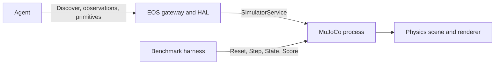

# MuJoCo benchmark simulator design

<!-- docs-tree:start -->
**Location:** [Docs](../../README.md) / [EOS](../README.md) / [Design](README.md) / **mujoco**

Docs tree

- [docs/](../../README.md)
  - [eos/](../README.md)
    - [design/](README.md)
      - [runtime/](runtime/README.md)
      - [algorithms.md](algorithms.md)
      - [eos-2607.md](eos-2607.md)
      - [eos-middleware-map.md](eos-middleware-map.md)
      - [lib.md](lib.md)
      - **mujoco.md**

<!-- docs-tree:end -->

[中文](../../../docs_cn/eos/design/mujoco_cn.md) · [Run it](../usage/mujoco.md) · [Develop it](../develop/ext/mujoco.md)

This page records the opt-in C++ benchmark simulator design, which uses `sim.toml` and `eos.toml`. The default Rust v2 path uses the [MuJoCo v2 interface](../interfaces/mujoco.md): IsOS resolves the package and EOS owns its simulator child. In the historical C++ path, the simulator is a separate process and repository; its private socket serves EOS, while a second Unix socket is reserved for a trusted benchmark harness.

The scene composes pinned UR5e and Robotiq models on an omnidirectional planar base. It has a fixed camera, tabletop cube, marked tray, and two seeded obstacles. Reset uses a deterministic integer mixer to vary object and obstacle positions. Manual stepping after reset and a fixed 2 ms physics step make replay deterministic for the same seed and command sequence; real-time mode is available for live observation.

Base and joint targets are driven through MuJoCo actuators. Cartesian arm commands solve against the six-joint model and reject workspace or collision failures. Motion commands wait for measured completion or timeout, and stop/halt change the active target and interrupt waiting commands. Gripper state comes from joint motion and pad/object contacts; the model does not report a calibrated force in newtons. Camera frames are rendered from a fixed scene camera and encoded as JPEG.

The benchmark service reads simulation truth independently of EOS observations. Navigation uses a staging region near the table. Grasp requires sustained bilateral pad contact while the cube is lifted above tabletop height. Placement requires a prior grasp, release, and cube position inside the marked tray. Collision count records robot contact with the table or obstacles; elapsed time uses simulated time. A successful task can still have collision events, allowing the benchmark to evaluate goal completion and contact quality separately.

The simulator profile omits gimbal, microphone, speaker, and `arm.pick`. Agents can compose navigation, arm movement, and gripper motion; a task-specific agent and grasp planner are outside this package. The private harness socket exposes seed control and ground truth only to evaluation code.

**Related:** [simulator contract](../interfaces/external/simulator.md) · [hardware runtime](runtime/hardware-legacy.md) · [package implementation](../develop/ext/mujoco.md)
