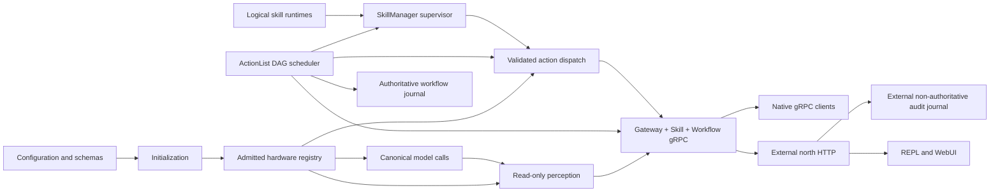

# Runtime overview

The EOS runtime turns deployment configuration and canonical contracts into one admitted robot process. This page describes the integrated data lifecycle and links to the focused pages that own each condition. [EOS documentation index](../../doc_index.md) is the component-wide map.

[中文](../../../../docs_cn/eos/design/runtime/README_cn.md)

## Module guide

[Initialization](init.md) reads configuration and schemas, admits the [hardware binding](hardware.md), and composes [models](models.md), [perception](perception.md), and the [private state store](store.md). [Dispatch](dispatch.md) is the single primitive release gate. [ActionList](actionlist.md) owns workflow scheduling and its journal.

The [skills overview](skills.md) explains provider-neutral execution. [SkillManager](skills/manager.md) owns routing, claims, and records; [native skills](skills/native.md) run in process. [Managed](skills/managed.md) and [external](skills/external.md) runtimes remain fail-closed placeholders. Their focused pages cover each lifecycle boundary.

[Northbound](northbound.md) exposes Gateway, Skill, and Workflow over gRPC; [workflow transport](northbound/workflow.md) documents its conversion and event stream. The separate [north HTTP process](../../develop/ext/north_http/README.md) provides REST/SSE and its own [module guide](../../develop/ext/north_http/README.md#module-map). Test and schema folders are documented with their owning modules.

## Data lifecycle

Initialization composes the modules before opening the gRPC listener. The arrows show ownership crossings: hardware supplies observations and controlled hardware access, models supply canonical results, perception remains read-only, ActionList owns workflow scheduling, skills own skill executions, all primitive effects pass through dispatch, and northbound owns transport mapping.

## Runtime logging

Initialization configures one structured logging system from `[log]` before it constructs domain services. Runtime modules route human-readable records directly beneath `var/log/eos/runs/<launch-id>/eosd/` and structured events to `eosd/events.jsonl`; north HTTP, simulator, and REPL use sibling service directories in the same supervised launch, and `launcher.log` is stored at the launch root. `var/log/eos/latest` points to the newest run. Retained mode creates a unique launch directory, while overwrite mode reuses `runs/current` and clears that entire launch before writing new output; retained runs are untouched. Every JSONL record carries the shared `launch_id` and its process-specific `run_id`. The common logging layer redacts sensitive keys, bounds diagnostic strings, and carries request correlation IDs across process boundaries. Payloads are never logged. Enabled ASR, TTS, and vision attachments, including microphone VAD diagnostic captures, are stored in the flat `var/log/eos/runs/<launch-id>/attachments/` directory, available as `var/log/eos/latest/attachments/`, with category-prefixed filenames such as `asr-<uuid>.wav`, `tts-<uuid>.<ext>`, and `vision-<uuid>.jpg`. Structured records include `category`, `relative_path`, media type, and byte size. Durable workflow and ActionList audit journals remain under `var/lib` and are not cleared by logging overwrite.

The north HTTP audit journal is outside this diagnostic system: it consumes the public Workflow stream through the same shared gRPC client, applies a strict privacy allowlist, and persists under the state root. EOS core never reads it, and its readiness impact is confined to the enabled north HTTP process.

## Cross-module conditions

Startup is all-or-nothing for configuration, schema loading, binding admission, required dependencies, and listener creation. A failure before serving produces no partially usable runtime. Unreferenced disabled models and optional device capabilities remain absent rather than acquiring fabricated values; an advanced primitive's declared model is a required dependency and must be enabled with the catalogued capability.

Once serving, read and action paths fail independently. Missing, stale, malformed, oversized, or unsupported observations are rejected or omitted according to their resource contract. Actions pass schema validation, target resolution, capability bounds, safety state, and backend acceptance in that order; a rejection does not imply execution. Timeouts, explicit cancellation, stop requests, and shutdown terminate bounded work or release velocity leases through the documented owner. A client disconnect ends its stream but does not implicitly cancel an asynchronous skill execution.

Concurrent readers observe immutable snapshots. Mutable backend access has one owner, model workers are bounded, subscriptions share sampled content, ActionList and skill execution cross dispatch rather than opening another actuator path, and SkillManager does not own ActionList DAG or fact state. Correlation identifiers and canonical acknowledgement or status mappings make accepted, rejected, unavailable, deadline, cancellation, ambiguous outcome, and internal failures observable.

Workflow readers bootstrap ActionLists and facts with an atomic ActionList-domain cursor, then follow complete mutation events. The core retains 4,096 transport events; epoch mismatch, future sequence, or expired retention requires a fresh runtime snapshot before resuming. When enabled, the separate core journal recovers authoritative ActionLists and latest facts across restart, but each process still starts a new client cursor epoch.

No runtime layer retries a semantic rejection. Transport retry or degraded behavior exists only where its focused page explicitly defines it. Unknown IDs, resources, primitives, schemas, capabilities, and enum values fail closed.

## Verification

Each focused page names its unit, integration, simulation, or manual checks. The integrated runtime is covered by the component build and CTest suite described in [EOS README](../../README.md); a passing build alone does not qualify hardware behavior, which requires the backend-specific checks linked from the [backend overview](../../develop/ext/README.md).
