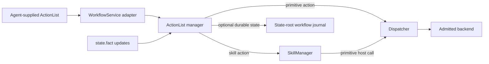

# ActionList runtime

[Runtime overview](README.md) · [Skill runtime](skills.md) · [WorkflowService contract](../../develop/interfaces/workflow.md) · [Dispatch](dispatch.md) · [中文](../../../../docs_cn/eos/design/runtime/actionlist_cn.md)

The ActionList runtime is the EOS core module that validates and executes bounded dependency graphs supplied by the Agent. It is a mechanical scheduler, not a planner: it never invents actions, rewrites dependencies, selects an alternative target, or retries an unsuccessful physical operation.

## Ownership boundary

`src/eos/runtime/actionlist/` owns ActionList definitions after admission, action and list state, dependency progression, latest state facts, supersession, linked skill execution and primitive command identities, snapshots, replayable mutation events, and the `actionlist` logger. Its implementation namespace is `eos::runtime::actionlist`.

The ActionList manager receives narrow skill-control and primitive-control dependencies during composition. Skill actions start and cancel executions through SkillManager. Primitive actions pass through `Dispatcher::ExecuteCommand` and its cancellation path; ActionList does not validate or release hardware commands itself. The northbound `WorkflowService` converts protobuf requests and responses at the transport boundary and does not own scheduler state.

The optional north HTTP audit remains outside EOS core. It consumes `GetRuntimeSnapshot` and `WatchActionListEvents` through the public Workflow gRPC service, persists only a privacy-allowlisted projection, and never feeds state or decisions back into this authoritative manager. The core workflow journal described below is separate authoritative storage and is read and written only by `Manager` through its repository API.

Without a configured journal, ActionList state and event history remain process-local for compatibility. With `[workflow].journal_enabled = true`, complete committed ActionList revisions and accepted latest-fact transitions survive restart under the EOS state root. Workflow definitions installed under `share/workflows` remain read-only templates: the runtime neither modifies them nor uses them as execution state. Decision policy and browser-facing presentation remain outside this foundation.

## Admission and graph model

An ActionList has a non-empty `workflow_id`, at least one action, and optional unique `supersedes_workflow_ids`. Every action has a unique non-empty `action_id`, exactly one skill or primitive target, an object-valued parameter payload, optional unique `depends_on` identifiers, optional output bindings, and an optional latest-fact equality condition.

An output binding names an earlier action and uses RFC 6901 JSON Pointers to select from that action's normalized `output` and replace an existing location in the destination action's parameter template. A binding adds its source as a dependency. Sources must precede their destination in the submitted action array; missing, self, future, or cyclic sources, invalid pointers, missing destination paths, and overlapping destinations are rejected atomically. Empty pointers select the complete JSON value. Array pointers address existing elements and use normal RFC 6901 escaping.

Admission resolves every dependency, rejects self-dependencies, and checks the complete directed graph for cycles before storing or starting any action. A malformed graph, duplicate identifier, invalid condition shape, or unavailable required control boundary rejects the complete definition atomically. Target identity and parameters are validated through the owning skill or dispatch boundary when an eligible action is admitted there; target rejection is retained as that action's terminal `REJECTED` result and fails the list without retry.

The manager owns the authoritative in-process record. `WorkflowService` maps this record to `ActionList`, `ActionItem`, `StateCondition`, and `ManagerRuntimeSnapshot` protobuf messages; protobuf types do not define the runtime scheduler.

## Scheduling and concurrency

An action becomes eligible only after every named or binding-implied dependency has `SUCCEEDED` and its optional condition matches a sufficiently fresh fact. A dependency marked `continue_on_failure` also satisfies an unbound dependency when it reaches a terminal failure, while an output binding still requires success and otherwise skips its consumer because failed output is unsafe. A `finalizer` instead waits for every dependency to become terminal and remains eligible after normal workflow failure or supersession. Immediately before dispatch, the manager copies submitted `parameters`, resolves every binding exactly once, stores the immutable object as `resolved_parameters`, and sends that object to the target owner for normal validation. The submitted template is never rewritten. A missing source output path rejects the destination action without dispatch. Array order otherwise has no scheduling meaning. Every eligible root or dependent may advance during the same scheduling pass, so independent actions can execute concurrently while SkillManager claims and Dispatcher admission remain authoritative for their resources. Same-device primitive jobs keep their ActionList concurrency but wait in Dispatcher's bounded FIFO through their terminal boundary; ActionList owns neither a device lock nor a parallel busy-rejection policy.

Skill actions receive an `execution_id` from SkillManager and follow its queued, running, and terminal lifecycle. Primitive actions receive an EOS-generated `command_id`, are executed by the module's worker pool, and retain their terminal acknowledgement as the action result. Target completion is applied back to the owning workflow and action before another progression pass.

Action states are `BLOCKED`, `READY`, `QUEUED`, `RUNNING`, `SUCCEEDED`, `REJECTED`, `FAILED`, `CANCELLED`, `TIMED_OUT`, and `OUTCOME_UNKNOWN`. List state is derived as `PENDING`, `RUNNING`, `SUCCEEDED`, `FAILED`, `SUPERSEDING`, or `SUPERSEDED`. A revision increases whenever the observable list or action state changes; readers replace an older snapshot rather than merging item arrays.

## Facts and conditions

The module keeps the latest accepted `StateFact` for each key. A fact carries a JSON-compatible value, source identity, non-zero source sequence, event time, and receive time. `state.fact` emitted by an admitted skill is converted into the same fact update path; ActionList does not reinterpret arbitrary SIGNAL names as facts.

An update from the same source must have a greater sequence, and an update must not move event time backwards relative to the retained value. Stale or duplicate updates are ignored. An accepted update re-evaluates blocked actions across retained lists.

A `when` condition compares the retained value with `equals`. When `max_age` is present, the event time must remain within that positive duration at evaluation time. Expiration alone does not create a timer; the condition is checked again on a later fact, execution, primitive, refresh, or scheduling event.

Facts form a latest-value view, not a stream join or general world model. Their payloads are never written to logs; when the authoritative workflow journal is enabled, accepted values are stored there with owner-only filesystem permissions because they are needed to recover condition state.

## Supersession and replacement

Submitting the same `workflow_id` may replace a list only while it is still `PENDING` and every action remains `BLOCKED`. The replacement preserves creation time, increments the revision, and atomically replaces the untouched definition. Once any action has started, callers must use a new workflow ID.

A superseding definition names existing eligible lists in `supersedes_workflow_ids` and must use a new `workflow_id`. Each old list moves to `SUPERSEDING`, blocked or ready normal work becomes `CANCELLED`, and the manager requests cooperative cancellation for queued or running skill executions and primitive commands. Finalizers remain eligible and the old list reaches `SUPERSEDED` only after they become terminal; the replacement begins after cancellation requests have been issued.

Supersession does not roll back completed physical effects and cannot hard-kill trusted native skill code. Completion from already running work remains observable on the old retained list.

## Failure and no-retry rules

Any normal action ending as `REJECTED`, `FAILED`, `CANCELLED`, `TIMED_OUT`, or `OUTCOME_UNKNOWN` stops further normal dispatch unless that action has `continue_on_failure`. A tolerated failure retains its action status and reason for diagnostics, permits unbound dependents to continue, and does not make the list fail. Remaining blocked normal actions become `SKIPPED`, workflow monitors receive cooperative cancellation, and finalizers continue in dependency order. The list stays `RUNNING` until all finalizers become terminal, then retains the original `FAILED` outcome. A finalizer failure does not prevent later finalizers from running. Supersession still cancels normal work regardless of `continue_on_failure`.

ActionList never retries a semantic rejection, timeout, cancellation, failure, or ambiguous primitive result. A thrown primitive call, a malformed acknowledgement, or an acknowledgement without a recognized terminal status becomes `OUTCOME_UNKNOWN`; this preserves the possibility that hardware observed the command. Retrying requires a new Agent decision and a new command identity. Existing `result` compatibility is unchanged: skill actions expose the direct skill result and primitive actions expose the raw acknowledgement. The additional JSON-valued `output` is normalized for bindings: it is the direct skill result or the primitive acknowledgement's `result` member.

Failures before target admission are recorded as `REJECTED` with a bounded reason. Transport success means only that a definition or query was handled; clients inspect action and list states for domain success.

## Snapshots and synchronization

`GetActionList` and `ListActionLists` return complete snapshots from the ActionList manager. `RuntimeSnapshot` obtains skill executions from SkillManager and then copies ActionLists, facts, and the current event cursor under one ActionList state lock. It is a best-effort view rather than an atomic transaction across both owners, but its ActionLists, facts, and cursor are mutually consistent.

The module serializes mutation of each authoritative collection and returns copied snapshots to readers. Linked completions are applied only to their owning workflow and action, then cause dependency and list status re-evaluation. Callers must use the public manager operations rather than retaining or mutating returned JSON snapshots.

## Event history and cursors

`EventCursor` is the transport-neutral `{epoch, sequence}` position mirrored by protobuf `ActionListCursor`. The manager creates a new opaque epoch at construction. An empty manager snapshot reports sequence zero; every published event advances sequence by one.

An `Event` contains its cursor, server observation time, and either a complete ActionList revision or a complete accepted fact update. Every observable ActionList mutation publishes the resulting full list. Every accepted fact publishes the new full fact before any condition-triggered list revisions. Rejected stale or duplicate facts remain silent.

`WaitForEvents` validates the epoch, rejects a sequence older than the retained window or newer than the latest publication, replays events strictly after the supplied cursor, and briefly waits when caught up. `ReplayStatus::kEpochMismatch` and `ReplayStatus::kFuture` map to gRPC `FAILED_PRECONDITION`; `ReplayStatus::kExpired` maps to `OUT_OF_RANGE`.

`ManagerOptions.max_events` defaults to 4,096 total events across both kinds. Retention evicts the oldest transport event by count. A client bootstraps from an atomic ActionList/fact/cursor snapshot, applies later events in order, and obtains a new snapshot whenever the epoch changes or its cursor expires. A restart always creates a new transport cursor epoch even when durable state was recovered; the journal is not exposed as an alternate client replay API. See the [WorkflowService recovery algorithm](../../develop/interfaces/workflow.md#resnapshot-and-resume-algorithm).

## Durable journal and restart recovery

The optional repository uses the fixed `${state}/workflows/workflow.journal` path; configuration exposes only an enable switch, not an arbitrary client-selected path. Each append contains a versioned JSON envelope inside a length-delimited CRC32 frame, is limited to 4 MiB, and is synchronized before the corresponding mutation is published or new target work can acquire the manager lock. Replay is capped at 256 MiB. An incomplete or checksum-invalid final frame is treated as a crash tail and truncated to the last complete record; corruption within committed history refuses startup. Reaching either bound fails closed. Compaction and archival retention are intentionally not part of this foundation.

Construction replays records in order and materializes the latest ActionList revision and fact for each identity before worker threads start. Recovered actions in `READY`, `QUEUED`, or `RUNNING` are never dispatched again: the manager appends a new terminal `OUTCOME_UNKNOWN` revision with a restart reason, then advances any persisted finalizer chain. Completed actions, binding declarations, submitted and resolved parameters, normalized outputs, legacy results, blocked todo state, supersession metadata, and facts remain queryable. This conservative rule covers the crash window in which a physical target may have observed work but its terminal result was not durably recorded.

## Logging and debugging

The `actionlist` logger emits structured records for definition admission or rejection, action and list transitions, fact acceptance or stale rejection, target dispatch, same-ID replacement, supersession requests, and unexpected submission-boundary failures. Records use debug for expected scheduling detail, info for accepted lifecycle milestones, warn for rejected or unsuccessful domain results, and error for an unexpected submission failure.

Useful fields include `workflow_id`, `revision`, `action_id`, target kind and identity, `execution_id`, status, fact key, fact source, fact sequence, and request correlation ID. Every primitive job carries the originating correlation ID so a northbound request can be followed through scheduling and dispatch.

Logs must not contain action parameters, action results, primitive acknowledgements, fact values, SIGNAL payloads, schemas, credentials, resource values, or raw protobuf. Normal polling, unchanged snapshots, condition rechecks without a transition, and duplicate cancellation requests remain silent. The common logging layer provides redaction, bounded diagnostic strings, rotation, retention, and the structured `events.jsonl` sink described in the [runtime overview](README.md#runtime-logging).

Event append and empty follow waits do not emit one log record per event or poll. Debuggers use snapshot/event cursors from the API together with the payload-free domain transition logs; this keeps replay traffic from duplicating fact or ActionList contents in logs.

For a stalled list, inspect the latest full snapshot first, then correlate `workflow_id`, `action_id`, and `execution_id` or `command_id` across the `actionlist`, `skills`, `dispatch`, and `northbound` loggers. `BLOCKED` means a dependency or fact condition is unmet; `QUEUED` means the target owner admitted the action but has not started it; `OUTCOME_UNKNOWN` must be treated as potentially executed.

## Testing

`eos_actionlist_tests` covers malformed, duplicate, empty, and cyclic definitions; independent roots and dependency progression; condition equality, source sequence ordering, and freshness; skill lifecycle projection; every primitive terminal mapping, thrown or non-terminal primitive outcomes, and no retry; same-ID replacement; running primitive supersession and cancellation; list derivation; and snapshots. It also verifies synchronous skill-runtime observer delivery, tokenized stale-result isolation, progress when one runtime cancellation throws, atomic snapshot cursor replay, epoch mismatch, bounded-retention expiry, versioned append/replay, truncated and corrupt tail repair, restart materialization, and no duplicate execution of recovered in-flight work. Dispatch integration tests verify that concurrent same-device primitive roots complete through the shared FIFO rather than failing spuriously as busy.

Northbound integration tests verify protobuf conversion and `ApplyActionList`, `GetActionList`, `ListActionLists`, `GetRuntimeSnapshot`, and live `WatchActionListEvents` behavior against the manager, including cursor publication and epoch rejection. Dispatch tests remain authoritative for primitive validation, safety, command idempotency, backend release, and acknowledgements; SkillManager tests remain authoritative for skill execution, claims, SIGNAL validation, cancellation, deadlines, and retention.

The extraction is complete when ActionList tests do not construct or inspect SkillManager-owned workflow state, SkillManager tests do not test DAG or fact scheduling, and every primitive path still reaches `Dispatcher::ExecuteCommand`.
