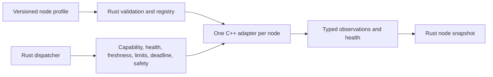

# V2 hardware foundation (in progress)

[中文](../../../../docs_cn/eos/design/runtime/hardware_cn.md) · [Field-level interface](../../interfaces/hardware.md) · [Development guide](../../develop/hardware.md)

## Why this boundary

The v2 foundation makes Rust the owner of EOS process state while keeping device libraries, ROS 2 integration, and vendor SDK calls in C++. A narrow CXX seam limits what can reach hardware and lets the core validate a command before a driver sees it. One adapter instance belongs to one node: a camera failure cannot mutate a base adapter, and a manipulator cannot be addressed through a camera path. The implementation can be exercised with mock adapters before a robot is available.

Rust is the default process foundation for the MuJoCo-first MVP. The C++ runtime and southbound HAL remain an unlaunched side chain until physical parity tests are complete. The new client surface is derived from the unified profile.

The current graph uses one device node per physical camera, base, or manipulator and an explicit [primitive binding](../../interfaces/primitive-bindings.md) for each admitted actuator operation. A binding names a versioned primitive and links its typed output to one device; it does not instantiate a driver. A device selects one adapter family, whose compiled factory owns all methods and stop behavior for that device. The shared Dispatcher stays the only command admission point. The owner-only Unix command channel multiplexes low-rate typed requests; camera preview has a dedicated bounded read-only Vision channel. A dedicated high-rate actuator channel is not implemented yet.

The opt-in C++ side chain still has ROS 2 and vendor hardware callers, including its per-device `PrimitiveDeclaration`/`Backend` contract. The new Rust/MuJoCo path has not passed equivalent physical ROS/vendor tests. No C++ component in this slice has evidence of both Rust parity and zero installed callers, so deletion is deferred under the repository cutover rule.

The in-process `aether-runtime` composition crate reads a bounded v2 node profile, admits exactly one adapter per configured hardware node, and exposes discovery and dispatch. The profile is the single source of identity, route, capabilities, adapter settings, timing, and limits across the new chain. CXX mock wrappers now exercise camera RGB-D, base, and manipulator joint and tool-pose transfer. The public `eosd` launcher selects this Rust process composition.

## Ownership and data flow

The profile declares a `core → layer → group → node` tree. A validated node carries its canonical path and the information needed for the registry, dispatcher, and adapter factory; these components must not maintain competing routing or capability declarations. Rust rejects unknown or malformed fields before adapter construction. The adapter reports observed health and samples; it cannot declare itself healthy through configuration. Rust owns sample freshness, node lifecycle, command admission, and typed results. C++ owns device-specific communication and remains the last physical limit and stop authority. The CXX mock base reports zero velocity on reads after its lease expires, but it has no physical actuator or independent watchdog; a production adapter or controller must enforce timed stop, and cutover requires an integration test. Neither the HAL nor the dispatcher computes navigation paths or inverse kinematics. A controller that accepts relative base poses or end-effector poses may plan internally, but that capability must be declared by the node.

**Target descriptor assembly:** each core defines its built-in type descriptors beside the owning node family; a verified package supplies only its contributed type/adapter descriptors. The registry checks unique IDs, placement, descriptions, typed ports, safety adapters and exact package provenance, then publishes one immutable catalog generation. IsOS aggregates that catalog for editing but does not redefine EOS types. Apply validates the declared graph and edge type identity; EOS reports live node health separately after launch. The Rust description field and legacy fallback are implemented, while module-owned registration and complete setting metadata remain G04 work.

## Package backend boundary

IsOS owns package resolution and graph writes; EOS owns the MuJoCo process as a direct child. Legacy graphs use `eos.process.backend@v1.0` with package and version settings. New graphs use package-contributed `eos.process.mujoco@v0.1` with an exact `node.package` pin, a selected scene, and a local socket. EOS receives the validated graph read-only, launches the verified package executable, and creates only the declared hardware socket clients. The simulator remains outside EOS address space. Every MuJoCo hardware adapter references its process node and matches its socket and device identity before EOS builds the adapter. The dispatcher remains the sole actuator command gate.

**R05 strict child target:** EOS derives `--managed-strict-socket` whenever it owns a MuJoCo child; no graph setting may disable the mode. IsOS-managed runs use the P01-verified executable and scene handoff. A local explicit EOS development launch also uses strict mode, but caller-supplied SHA arguments are labels without an IsOS verification receipt. The child receives only its framed socket and selected scene arguments. Historical gRPC `SimulatorService.Execute` and benchmark Reset/Step listeners would change the same engine outside Dispatcher, so the managed child must not bind them. A standalone MuJoCo launch without EOS retains the legacy `2.0.0` socket behavior. Before EOS publishes hardware readiness, it checks each graph device's kind, package pin, selected scene and backend binding, then obtains a live health response with exact `strict-socket-v1`, positive `ok` and `accepted`, protocol and echoed ID. A socket file or successful connect is only startup progress. The [EOS adapter contract](../../interfaces/mujoco.md) defines this boundary and the [MuJoCo owner contract](https://github.com/Island-Team/isos-mujoco-sim/blob/master/docs/mujoco/interfaces/socket.md) defines the socket fields.

The R05 Rust client checks graph/scene/device/socket identity before spawn; `BackendChild::wait_ready` requires strict health for every declared device, and `Endpoint::health` repeats the proof on refresh. Missing proof fails startup and reaps the child; child crash or later lost proof remains unavailable health. Dispatcher journal recovery already prevents a released uncertain movement from being reissued after restart; socket deduplication is only same-child retransmission protection. R06 implements preemptive stop, independent base/arm proof and termination/reap ordering under blocked work; its scoped cross-owner replay passed, while the original R06 row and scoped M3 exit are qualified, while broader live proof remains open.

**R05 design evidence:** [31 frozen EOS cases](../../../../tests/fixtures/mujoco_strict_client/cases.json) specify launch isolation, graph binding, health proof, movement evidence, journal recovery, the historical migration fixture and the open R06 boundary. On 2026-11-02, `python3 tests/fixtures/mujoco_strict_client/check.py`, `python3 scripts/check_doc_links.py --all` and `git diff --check` passed. Complete commands and output are in ignored `logs/test/20261102-r05-eos-strict-design/design-check.log`. These static checks alone do not prove behavior; the implementation and scoped cross-owner replay evidence below supply that proof for R05.

**R05 EOS implementation evidence (independently reviewed):** The implementation branch starts from EOS design `918c741309bfb2997e74ba16b8858aa61e516407` and exercises MuJoCo owner strict server `41e17107b7c7abe43cd29cc388b7dd157979d476`. From this checkout run `cargo fmt --all -- --check`, `cargo clippy --workspace --all-targets -- -D warnings`, `RUST_TEST_THREADS=1 cargo test --workspace`, `cargo build --workspace`, and `python3 tests/fixtures/mujoco_strict_client/check.py`. The serial workspace run passed 257 tests with one existing ignored live test. The real scene boundary ran `MUJOCO_R05_EXECUTABLE=/home/operator/projects/isos-mujoco-sim-strict-socket/build/eos-mujoco-sim MUJOCO_R05_PACKAGE_ROOT=/home/operator/projects/isos-mujoco-sim-strict-socket cargo test -p aether-runtime --bin aether-runtime backend_child::tests::real_strict_child_proves_both_catalog_scenes_when_selected -- --nocapture`; both `pick-place` and `navigation` passed. Focused stubs cover missing, malformed, false, wrong-version and wrong-ID health, bounded timeout, failed-child reap, graph bindings and later health loss. The initial parallel workspace run hit four timing-sensitive pre-existing Dispatcher tests; the first serial run hit one, the isolated Dispatcher run passed 39/39, and the final serial workspace run passed. Complete transcripts are retained in ignored `logs/test/20261102-r05-eos-strict-client/`. The independent review found and prompted a follow-up: a single absolute transport deadline and transient startup retry. The new slow-drip, bind-before-listen and first-timeout-then-success tests, real-scene replay and full workspace gates (259 passed, one existing ignored) are in ignored `logs/test/20261102-r05-eos-deadline-fix/`. The separate scoped cross-owner replay covers the IsOS two-generation and navigation runs. R06 physical stop and managed movement remain open. See ignored `logs/test/20261102-r05-cross-owner-qualifier/qualification.md` and `reviewer-verdict.md`; the reviewer verdict supersedes the original blanket no-merge wording for the R05 row only.

The [package node IDL](../../interfaces/node-contributions.md) adds verified sidecars with contributed type definitions and exact package references on new graph instances. MuJoCo contributes the process type in `eos/process/mujoco`; its new camera, base, and manipulator instances use generic built-in types in their respective EOS hardware groups and pin `node.adapter.package`. The old graph remains accepted. EOS checks type provenance before construction and admits package actuators only through its compiled MuJoCo adapter and stop path.

For new package camera, base, and manipulator families, IsOS passes an exact verified shared-library identity to EOS. EOS starts one supervised adapter host per node; only the host maps the library and rechecks the digest, ABI version, family, and supported kind. The parent Rust IPC wrapper implements the same typed HAL traits, so dispatcher admission, journal, stop, and sample validation stay in the same route. The host can call the library's independent stop while a command blocks and also stops on a missed parent heartbeat. The MuJoCo process/socket and CXX mock routes stay separate. The [hardware interface](../../interfaces/hardware.md#package-adapter-library-abi) defines the C header, IPC, and operation payloads.

EGIA `common` source, context, planner, and guard node types are design-only graph definitions. Their port types describe observation references, context snapshots, proposals, and guarded control requests. They do not create an EGIA executor. `egia.tensor` is reserved for future tensor-space data flow without an empty graph layer.

## Node facets

Hardware nodes live at `cores/eos/layers/hardware/groups/<camera|base|manipulator>/nodes/<node_id>`. The same v2 tree can address software nodes in other layers and cores; such nodes do not acquire an EOS hardware adapter by virtue of their path. Each hardware node exposes `status` and `health`. Cameras expose `observation`. Base and manipulator nodes expose `observation`, `movement`, and `safety`. A facet reports supported operations; its presence does not imply current health. The registry binds each hardware path to exactly one adapter and checks commands against that node's declared modes and limits.

Camera samples carry RGB and optional registered depth with calibration and frame metadata. Base samples carry measured planar pose and velocity. Manipulator samples carry an ordered joint set and optional end-effector pose. Commands use typed body velocity, relative base pose, complete joint position array, or end-effector pose rather than an untyped movement payload. See the [interface tables](../../interfaces/hardware.md) for all fields, units, and validation.

## Failure and safety

Adapter construction failure prevents admission of its required node. A runtime read or sample validation error rejects the request and degrades that node's Rust-side health until a valid, fresh probe succeeds. The registry must never synthesize fresh measurements. A node's observation timestamp is checked before movement that depends on current state. A deadline or unsupported mode rejects before release. Stop and emergency stop use an explicit actuator seam; a timeout after physical release produces an uncertain outcome and no automatic retry. The [dispatcher design](dispatcher.md) owns command correlation, admission order, and terminal records.

## Cutover sequence

1. Establish typed Rust values, one strict `1.0.0` node profile, mock adapter, CXX seam, and tests without changing the running C++ process.
2. Connect a representative adapter or ROS 2 graph and verify sample and command behavior against the typed v2 interfaces.
3. Add Rust dispatcher tree and safety gate, then migrate EOS composition module by module.
4. Remove superseded C++ paths and old schemas only after the replacement has equivalent tests and its last installed caller has moved to Rust.

No EGIA runtime is implemented here. The `core` level leaves room for EGIA to register its own layers later.
