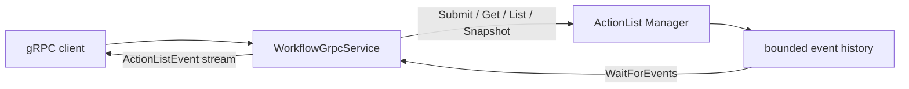

# Workflow northbound adapter

[Northbound runtime](../northbound.md) · [WorkflowService contract](../../../develop/interfaces/workflow.md) · [ActionList runtime](../actionlist.md) · [中文](../../../../../docs_cn/eos/design/runtime/northbound/workflow_cn.md)

`src/eos/runtime/northbound/workflow/` is the gRPC adapter for `island.eos.v1.WorkflowService`. It translates protobuf values and gRPC lifecycle into calls on `eos::runtime::actionlist::Manager`; it does not own ActionList scheduling, facts, cursors, or event retention.

## Ownership boundary

`WorkflowGrpcService` owns request validation, protobuf/JSON conversion, gRPC status mapping, correlation scope, streaming writes, and transport logging. The injected ActionList manager owns definitions, target progression, supersession, snapshots, `ActionListCursor` semantics, and the 4,096-event retention window.

The folder has its own `CMakeLists.txt` and contributes only `workflow/service.cpp` to `eos_northbound`. Other Gateway and Skill adapters remain outside this module.

## Unary conversion

`ApplyActionList` converts `WorkflowDefinition`, `WorkflowAction`, target oneofs, `google.protobuf.Struct` parameters, dependencies, and `StateCondition` into the transport-neutral JSON definition accepted by the manager. Responses are complete `ActionList` projections with exact enum, timestamp, result, reason, execution ID, and command ID mapping.

`GetActionList` and `ListActionLists` encode copied manager snapshots. `GetRuntimeSnapshot` encodes independently sequenced SkillManager executions plus the atomically copied ActionLists, facts, and `action_list_cursor`. Invalid dynamic values that cannot be represented as protobuf are internal conversion failures rather than silently omitted fields.

## Event streaming

`WatchActionListEvents` requires `WatchActionListEventsRequest.after` with a non-empty epoch. It repeatedly calls `Manager::WaitForEvents` with a 250 ms bounded wait so gRPC cancellation and shutdown remain observable. Each returned core event is converted to `ActionListEvent` with the exact cursor, `observed_at`, and one `action_list` or `fact` payload.

Replay is exclusive because the manager returns only sequences greater than the supplied cursor. After every successful `ServerWriter::Write`, the adapter advances its local cursor to the event just written. A client disconnect or failed write closes the stream successfully and never cancels workflow work. The stream otherwise remains open across terminal workflows because it follows manager-wide mutations.

The adapter never synthesizes an event, cursor, heartbeat, gap marker, or snapshot. Recovery behavior comes from the core status and the [public resnapshot algorithm](../../../develop/interfaces/workflow.md#resnapshot-and-resume-algorithm).

## Error mapping

Missing definitions, IDs, cursors, invalid duration/value conversion, and empty cursor epochs map to `INVALID_ARGUMENT`. Missing workflows map to `NOT_FOUND`. ActionList state conflicts, `ReplayStatus::kEpochMismatch`, and `ReplayStatus::kFuture` map to `FAILED_PRECONDITION`. `ReplayStatus::kExpired` maps to `OUT_OF_RANGE`. Unexpected exceptions or output conversion failures map to `INTERNAL`.

Accepted action failures are encoded in `ActionList` state and do not become transport failures. A cancelled gRPC watch returns normally from the adapter; cancellation of ActionList work requires the domain's supersession/cancellation paths.

## Logging and debugging

The common workflow handler creates or validates the request correlation ID and records `service`, method, final numeric gRPC status, and total duration through the `northbound` logger. Successful calls emit `grpc_request_completed`; rejected calls emit `grpc_request_rejected`. A watch logs once when it exits, not once per 250 ms wait or streamed event.

Definitions, parameters, ActionLists, facts, cursor values, event payloads, results, and raw protobuf are not logged. Diagnose domain progression with the `actionlist` logger and diagnose transport recovery with the client-observed status plus cursor.

## Testing

Northbound integration tests use the generated `WorkflowService` stub to verify apply/get/list/snapshot conversion, non-empty snapshot epochs, live event delivery with a sequence after the snapshot cursor, stream cancellation, and epoch mismatch as `FAILED_PRECONDITION`. ActionList unit tests verify exclusive replay, expired-cursor detection, and bounded retention independently of transport.

Contract-interface tests verify `WatchActionListEvents` is present and server-streaming in generated descriptors. Reflection must continue to publish the complete `WorkflowService` on the shared EOS listener; core unit tests remain authoritative for cursor status boundaries.
