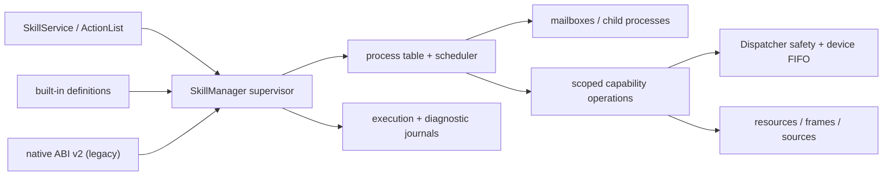

# Skill runtime overview

[Runtime overview](README.md) · [ActionList runtime](actionlist.md) · [Write a skill](../../develop/interfaces/skills/native/README.md) · [Call skills through gRPC](../../develop/interfaces/skills.md) · [中文](../../../../docs_cn/eos/design/runtime/skills_cn.md)

[Process model](skills/process-model.md) · [IPC](../../develop/interfaces/skills/native/ipc.md) · [Data and time](skills/data.md) · [Observability](skills/observability.md) · [Built-in authoring](skills/authoring.md)

EOS is evolving the skill subsystem into a supervisor for **logical skill processes**. A skill definition is analogous to an executable; every invocation becomes a manager-owned process with an opaque `execution_id`, lifecycle, parent, operations, mailbox, cancellation state, and journal history. `SkillManager` remains the single catalog and lifecycle authority, while Dispatcher remains the final primitive safety and per-device ordering gate.

> **Status legend:** **Implemented** describes the current tree. **Partial** has an executable foundation but not every documented design feature. **Legacy** remains supported during migration. **Future** is an architectural boundary, not executable functionality.

## Linux analogy—and its limits

The model borrows useful Linux process-manager ideas: executable definitions, PID-like execution IDs, a process table, parent/child trees, wait and terminate operations, IPC mailboxes, bounded scheduling, and reaping. These concepts give skill authors one inspectable lifecycle instead of ad-hoc threads and callbacks.

Built-in skill processes are still trusted coroutines inside `eosd`. They do **not** have address-space isolation, users, permissions, signals, cgroups, `fork`/`exec`, or a safe equivalent of `SIGKILL`. A blocking or CPU-bound handler can still harm the daemon. Hard resource limits, sandboxing, independent crash containment, and forcible termination belong to a **future** external-process runtime.

## Runtime profiles

| Profile | Status | Purpose |
| --- | --- | --- |
| Built-in C++ | **Implemented / Partial** | Statically linked, explicitly registered coroutine skills using capability-scoped APIs; source wrappers remain unavailable. |
| Native ABI v2 | **Implemented / Legacy** | Reviewed in-process shared libraries. Kept for unmigrated skills; no memory isolation or hard kill. |
| Managed | **Not built** | Obsolete placeholder excluded from skills composition. |
| External process | **Future** | Boundary for isolated processes, cgroups, sandboxing, and crash containment. It runs nothing today. |

Exact `{name, version}` identities have one owner. Duplicate ownership within or across runtimes rejects startup; runtime order never creates precedence. Existing `SkillService`, ActionList skill targets, execution states, and exact routing remain compatible.

## Process tree and lifecycle

**Implemented:** a built-in handler returns `Task<Outcome>`. Starting it creates a process record before scheduling. A process may spawn a declared skill, exchange schema-validated mailbox messages, await its exit, or request termination. Children are ordinary manager executions with `parent_execution_id`; child failure is observable by its parent but does not implicitly fail the parent.

Process trees are structured: no detached children, no self or ancestor invocation, maximum depth 8, and at most 32 live children per parent. Parent completion, cancellation, timeout, and shutdown cancel active descendants. Parent/child handles cannot attach to unrelated executions. Claim resolution happens before spawn so a parent cannot create a child that deadlocks on a whole-execution claim it holds.

`SkillManager` owns bounded execution records, idempotent start requests, exact provider routing, cancellation, deadlines, retention, replay, claims, child cleanup, and terminal reaping. Native ABI skills execute through this lifecycle but do not expose the built-in child-process API.

## Async execution and primitive concurrency

Built-in coroutine waits suspend rather than retain the calling manager worker. Primitive work uses a bounded eight-worker operation executor:

- 8 capability-operation workers by default;
- at most 64 outstanding primitive operations per execution and 256 globally.

Every primitive invocation has its own operation ID, cancellation, result, and dynamic device lease. One skill may start several primitives, and several skills may run primitives concurrently. Dispatcher remains the final safety and same-device ordering gate. Built-in cleanup cancels and drains outstanding operations before completing the execution.

Built-in non-reentrant serialization is scoped to the exact skill definition. Manager descriptor claims still serialize whole executions, while operation leases cover primitive device use.

Native ABI v2 also supports up to 64 outstanding asynchronous primitive operations per invocation through its optional append-only callbacks.

## Typed IPC

**Partial:** built-in skills can use declared, schema-validated parent/child mailboxes through `spawn`, `send`, `receive`, `request`, `await_exit`, and `terminate`. External Agent SIGNALs remain a separate interface.

Messages carry identity, sender and recipient execution IDs, channel/schema metadata, event time, optional deadline, and an object payload. A mailbox holds 256 pending messages by default. Sends wait within their TTL when full; expired entries are pruned, and invalid relationships, schemas, inactive endpoints, and conflicting request IDs fail closed. No persistence, transport IPC, or cross-runtime delivery is implied.

Raw IPC payloads are not persisted in normal diagnostics. Skills receive relationship-scoped process handles, never arbitrary access to the manager or another execution.

## One timestamp contract

**Target:** IPC, sources, resource observations, primitive requests and results, frames, logs, checkpoints, lifecycle events, and terminal results use common `EventTime` metadata:

- `source_timestamp_ns`: time supplied by the producer;
- `source_clock_id`: UTC, EOS boot-monotonic, or a named device clock;
- `observed_at`: UTC time at EOS receipt;
- `observed_monotonic_ns`: ordering and latency time within one boot;
- `boot_id`: the EOS process epoch;
- scoped sequence and event ID.

EOS never invents UTC for an unknown device clock. Producer timestamps may arrive out of order; manager sequence preserves admission order. Source exact/before/after/nearest queries use producer time and sequence as their tie-breaker. Public protobuf changes are additive so existing clients continue to decode current fields.

**Implemented:** execution lifecycle and source data already carry timestamps in profile-specific forms. A single exchange metadata type, boot-aware ordering, and complete propagation across all capabilities are redesign targets.

## Observability and journald

The design separates three views:

1. the live process table used by list and monitor APIs;
2. a bounded, sanitized execution journal for lifecycle, IPC, capabilities, checkpoints, and child events;
3. a persistent local diagnostic journal for operators across daemon restarts.

**Target:** every meaningful transition records stable IDs and reason codes, runtime/skill identity, severity and outcome, common timestamps, and queue/wait/run/capability latency. Payload metadata is limited to safe size, schema identity, and SHA-256 digest. Persistence is asynchronous and outside manager locks, using framed checksummed records, crash-tail repair, rotation, boot-aware filtering, and explicit gap/reset and degraded-storage events.

Normal diagnostics never persist arguments, results, SIGNAL/IPC bodies, frames, speech, credentials, resource values, or raw protobuf. Optional payload capture is short-lived and disabled by default; enabling it requires a deployment key, restrictive permissions, authenticated encryption, expiry, and audit events.

**Implemented:** the `skills` structured logger records manager/provider transitions, and `SkillJournald` exposes bounded execution history, checkpoints, activity spans, counters, durations, and a replay cursor. Native skills can emit diagnostic logs and checkpoints. Persistent checksummed storage, comprehensive IPC/operation events, explicit cursor gaps, and secure capture are redesign targets.

The trusted built-in `observe_human@1.0.0` skill accepts a stable human only after the same ID and sufficiently overlapping valid bbox appear in three strictly increasing source generations. It only scans and tracks: it starts no private pose or face inference and writes no stable-frame attachment. Pose, action, and face identity remain in the continuous perception resource rather than crossing between skills. Deployments may bound initial acquisition with `acquire_timeout_ms`; expiry publishes an execution-scoped `owner.found=false` fact and completes with `found:false`, allowing ActionList to choose an explicit empty-room branch without treating absence as failure.

## Author boundary

**Implemented:** `eos::runtime::skills::builtin` exposes explicitly registered `Definition`, `Execution`, `Outcome`, and typed `Result<T>/Error` APIs. `Execution` supplies cancellation-aware wrappers for primitives, resources, SIGNALs, parent/child mailbox operations, diagnostics, and checkpoints. Built-ins can open a move-only subscription for a declared perception resource, retaining producer demand until close or destruction; query bounded retained history by latest, exact sequence/time, before, after, nearest, or range; and wait for a publication newer than a sequence with bounded timeout and execution cancellation. These handles expose no publication capability. Snapshot-only resource providers use the same `ReadResource` capability: the navigation-point store exposes `robots/{robot_name}/navigation/waypoints/{waypoint_id}` this way, and the built-in `navigate_waypoint@1.0.0` reads it when no inline target is provided. Navigation points have no retained-history subscription, and skills receive no list, put, delete, reload, filesystem, or direct store capability. Timestamped skill-source metadata remains a separate manager-owned API. Skills never receive Dispatcher, perception/model internals, filesystem, network, workflow-manager, or hardware handles directly. There is no static registration.

ActionList continues to own DAG scheduling and workflow facts. A skill target becomes an ordinary manager process and follows the same routing, claims, deadlines, cancellation, terminal states, and observability rules as a direct `SkillService` start.

## Verification expectations

Changes must preserve the public service and legacy native path while testing suspended-process scale, distinct-device concurrency, same-device FIFO, cancellation and deadline delivery, process-tree cleanup, recursion and claim-deadlock rejection, mailbox ordering/backpressure/TTL/schema enforcement, clock rollback and out-of-order data, restart boot IDs, cursor gaps, journal recovery/rotation/storage failure, and privacy-safe diagnostics.

The component build and full CTest suite must pass after every runtime, manager, provider-contract, protobuf, or folder-boundary change. Focused manager, native, northbound, ActionList, and migrated-skill tests remain required.
