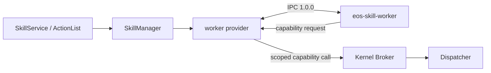

# Packaged skill worker boundary

<!-- docs-tree:start -->
**Location:** [Docs](../../../../README.md) / [EOS](../../../README.md) / [Design](../../README.md) / [Runtime](../README.md) / [Skills](README.md) / **external**

Docs tree

- [docs/](../../../../README.md)
  - [eos/](../../../README.md)
    - [design/](../../README.md)
      - [runtime/](../README.md)
        - [skills/](README.md)
          - [authoring.md](authoring.md)
          - [data.md](data.md)
          - **external.md**
          - [managed.md](managed.md)
          - [manager.md](manager.md)
          - [native.md](native.md)
          - [observability.md](observability.md)
          - [process-model.md](process-model.md)

<!-- docs-tree:end -->

[Skill runtime overview](../skills.md) · [SkillManager supervisor](manager.md) · [Skill authoring](../../../interfaces/skills/native/README.md) · [中文](../../../../../docs_cn/eos/design/runtime/skills/external_cn.md)

**Current scope:** this page describes the opt-in C++ skill side chain and its `eos-skill-worker`. The default Rust runtime has a separate implemented R04 native host: verified explicit-file selection, private `aether-runtime --skill-worker` re-exec, primitive-only descriptor admission and the seven-method SkillService subset. See the [R04 Rust host design](host-rust.md). The C++ worker remains a compatibility reference until Q02 last-caller review.

## Ownership and data flow

`SkillManager` owns identity, queueing, claims, lifecycle, and retention. The worker provider owns process creation and worker transport. EOS's runtime binding manager resolves stable robot/class/part selectors to admitted devices. The production provider finds the corresponding canonical hardware capability in the kernel Catalog and asks the shared Broker to mint an execution-scoped token. The worker has no Dispatcher pointer or backend socket. The Broker checks the exact capability, execution, generation, device, and expiry before starting a primitive. The provider routes subsequent command-ID poll and cancel through Broker methods to Dispatcher, which owns safety admission, command replay, and device ordering.

## Transport and lifecycle

Internal worker IPC is **1.0.0** (wire encoding `1`), specific to one EOS build. It uses Unix `SOCK_SEQPACKET`: one versioned request or response per packet, 64 KiB inline maximum, and an optional sealed read-only memfd up to 64 MiB. The host verifies the launched peer's `SO_PEERCRED`. A version, identity, framing, or grant mismatch fails closed. There is no older protocol fallback.

Each execution receives its own worker. The provider revokes its Broker grants on normal completion, cancellation, deadline, worker exit, or protocol error; a missing capability slot grants no hardware authority. Cancellation of an active primitive is routed through the Broker to Dispatcher before the worker is terminated. If Dispatcher cannot establish a terminal hardware outcome, EOS reports `worker.outcome_unknown`; it never retries automatically. The separate legacy provider constructor and its private grant table remain for isolated tests, not production composition.

## Current limits and next work

The current bridge covers packaged ABI v2 execution and brokered primitive, declared resource-read, inference, source publish/query/wait, SIGNAL receive/emit, checkpoint, and optional ABI v2.1 community calls. The worker forwards addressed send, topic publish, and receive to SkillManager; the [community contract](../../../interfaces/skills/native/community.md) owns delivery semantics. Child-process callbacks are not bridged. No built-in skill definitions are registered in production startup. Before loading skill code, the worker requires `no_new_privs`, resource limits, Landlock read-only access to its release and system libraries, and seccomp denial of new network sockets and child-process creation. If enforcement fails, admission fails closed. The public SkillService remains the execution entry; worker IPC is internal.

## Python 3.12 worker profile (planned)

Python package code is not admitted today. The native worker accepts only ABI v2 shared libraries; `NativeWorkerProvider` starts the fixed `eos-skill-worker`, which loads libraries through `Runtime::LoadDirectoryWithBroker`. The installed `EOS::SkillSDK` is an ABI version/layout checker, not a reusable broker client. Its current protocol and loader contract cannot select a Python entry point or interpreter.

Do not embed Python in `eosd`, import a package during catalog admission, or weaken the existing native worker sandbox to make an interpreter fit. A separate C++ `PythonWorkerProvider` must consume a statically validated package descriptor and start one Python worker per execution. It may reuse the versioned `SOCK_SEQPACKET` transport, peer verification, capability Broker, and cancellation semantics, but must add a distinct worker identity and metadata admission path. The pybind11 module belongs inside the worker and exposes typed broker calls only; it must not expose EOS pointers, Dispatcher access, native sockets, or unrestricted filesystem access.

The C++ bootstrap must establish `no_new_privs`, resource limits, and Landlock read-only access to the selected Python runtime and admitted package before running Python. Python must start in isolated mode without site initialization; a trusted bridge installs the final seccomp policy before importing the package entry point. The policy must preserve no network, no subprocess, and broker-only capabilities. The user-selected interpreter may be Python 3.12 from an explicit path, uv environment, or Conda environment; the runtime path and its native libraries are trusted host configuration and must be explicit in the deployment.

Admission requires a versioned, data-only Python skill descriptor with exact identity, entry point, parameter/result schemas, capabilities, and Python ABI/runtime constraints. EOS validates paths, schemas, limits, and declarations before launching a worker. Catalog inspection never imports the entry point. This is a separate execution profile, not an alternate package file suffix for native ABI v2.

Do not release the profile until tests prove malformed packages are rejected before entry-point import, the worker cannot write outside its declared transient area, open a network socket, spawn a child, or retain the broker descriptor after exit, and every worker is reaped after success, cancellation, crash, or protocol failure. Also qualify interpreter path confinement, Python 3.12 with explicit/uv/Conda runtimes, denied undeclared capabilities, capability-call cancellation, peer mismatch, environment import hooks, and sandbox feature absence. The implementation must show that package code cannot run before all required sandbox controls are active. The placeholder and its current constraints are recorded in [external language worker status](../../../../../src/eos/runtime/skills/external/README.md).
