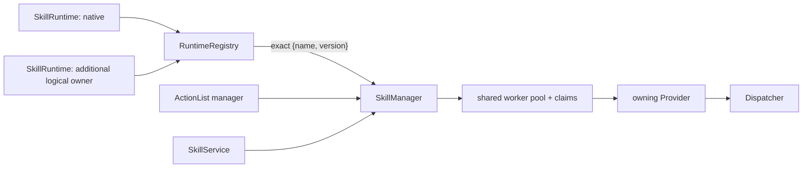

# SkillManager supervisor

[Skill runtime overview](../skills.md) · [Process model](process-model.md) · [IPC](../../../develop/interfaces/skills/native/ipc.md) · [Observability](observability.md) · [Native runtime](native.md) · [中文](../../../../../docs_cn/eos/design/runtime/skills/manager_cn.md)

SkillManager is the process-like supervisor for every admitted logical skill runtime. It aggregates catalogs, routes exact skill identities to one owner, schedules executions through one bounded worker pool, arbitrates claims across runtimes, retains lifecycle and SIGNAL state, and exposes the profile-neutral service consumed by northbound and ActionList.

## Ownership boundary

`src/eos/runtime/skills/manager/` owns `SkillManager`, `RuntimeRegistry`, worker scheduling, claim arbitration, execution records, request idempotency, cancellation, deadlines, SIGNAL queues and replay, observer delivery, retention, and the `skills` logger. `src/eos/runtime/skills/core/` contains only the shared `Provider`, metadata/model, and per-provider `Catalog` contracts used by the supervisor and runtime implementations.

SkillManager does not load a provider's package format or execute language-specific code directly. Each `SkillRuntime` supplies a stable process-local `runtime_id` and a non-owning `std::reference_wrapper<Provider>`; the provider must outlive SkillManager. Built-in and [native](native.md) providers implement this boundary; product composition is migrating skills to the built-in registry. [External](external.md) remains a future isolation boundary. The obsolete [managed](managed.md) placeholder is not a runtime choice.



## Runtime registration and routing

The multi-runtime constructor is `SkillManager(std::vector<SkillRuntime>, SkillManagerOptions, SkillManagerObservers)`. Construction requires at least one runtime and rejects an empty or duplicate `runtime_id`. For compatibility, `SkillManager(Provider&, ...)` registers one logical runtime with ID `default`.

`RuntimeRegistry` constructs one validated `Catalog` per provider and then builds an immutable aggregate routing table. An exact `{name, version}` identity may belong to only one runtime; duplication within one provider is rejected by its `Catalog`, and duplication across providers rejects supervisor construction before workers start serving. Runtime order never acts as precedence and there is no fallback routing.

`RuntimeRegistry::Find` returns an `OwnedSkill` containing the copied aggregate `Metadata`, owning `Provider`, owning `Catalog`, and `runtime_id`. Catalog listing aggregates all admitted skills. Starts, argument validation, execution, and SIGNAL schema validation use the same exact owner for the lifetime of the immutable registry.

## Execution lifecycle

`Start` validates identity, request ID, any supplied timeout, arguments, and claims before allocating a UUID execution record. An omitted timeout creates no deadline; an explicit timeout remains positive and capped at one hour. Manager-wide request idempotency returns `kExisting` for an identical retained start and `kConflict` for incompatible reuse; it does not depend on which runtime owns the skill.

```text
queued -> running -> succeeded | rejected | cancelled | timed_out | failed
   \-------------------------------------> cancelled | timed_out
```

One shared scheduler services all registered runtimes. A selected worker resolves the same `OwnedSkill`, builds `ExecutionHooks`, and calls `Provider::ExecuteAsync`; synchronous providers use its compatibility adapter. Provider exceptions are contained as `provider.exception`; a missing immutable owner is an internal invariant failure. Completed `RunResult` fields are mapped to the terminal snapshot, while cancellation or an expired deadline wins over a late provider result. Built-in coroutine and primitive-operation behavior is detailed in the [process model](process-model.md).

Cancellation and deadlines remain cooperative once provider code is running. A queued execution can be cancelled without entering a provider. A running execution releases its claims only after the provider callback returns, so non-returning in-process code can occupy a worker and delay shutdown.

## Claims and concurrency

Descriptor claim templates resolve against validated arguments before queueing. Device and resource claim values are global manager identities: compatible shared reads may coexist, while either side's `exclusive_use` conflicts across every runtime.

A non-reentrant descriptor receives an implicit exclusive `kProviderContext` claim whose value is its owning `runtime_id`. Non-reentrant skills owned by the same runtime therefore serialize with one another, while unrelated non-reentrant runtimes do not conflict merely because they both use provider context. A reentrant descriptor receives no implicit provider-context claim and may run concurrently when all explicit claims permit it.

The scheduler acquires a complete claim set atomically. Unrelated work may overtake blocked work, but a later execution cannot overtake an earlier pending execution with a conflicting claim. Dynamic device leases requested by a running provider share the same manager-wide claim arbitration and end on release, cancellation, deadline, or shutdown. These claims serialize complete skill-level ownership; they do not replace primitive arbitration. Dispatcher remains the authoritative final gate and places overlapping same-device terminal primitive calls from skills, ActionList, and direct callers in one bounded FIFO.

## SIGNALs, journal, monitor, and observers

Inbound SIGNALs are accepted only for the exact owning runtime's declared name and object schema. Request IDs make accepted SIGNALs idempotent; conflicting reuse, terminal executions, oversized payloads, and full queues fail closed. `CANCEL` is manager-reserved and follows cooperative cancellation rather than the application SIGNAL queue.

Lifecycle snapshots, emitted SIGNALs, and journal records share a monotonically increasing per-execution journal sequence. Retained entries newer than a cursor can be replayed before following new entries. Journal records are system activity spans, skill checkpoints, or a terminal suppression summary. The owning `Catalog` validates emitted SIGNALs before append; one execution is never automatically routed to another.

Snapshots carry the owning `runtime_id`, created, optional deadline, started, termination-requested, and finished timestamps; queue, run, and total durations; the current activity; and accounting for primitive/resource/SIGNAL/log/checkpoint/activity counts. Accounting also exposes dropped observability counts and aggregate claim-wait, SIGNAL-wait, and capability-call durations. It is diagnostic state, not a control or billing interface.

`SkillManagerObservers` delivers copied execution transitions and validated emitted SIGNALs to non-owning consumers such as ActionList. Observer callbacks run after manager state is published; an exception is contained and logged as `skill_observer_failed` without changing the execution result or terminating a worker.

`SkillJournald` also owns a bounded, process-local global monitor sequence and history. It publishes immutable complete execution upserts whenever visible state changes and removals when an execution leaves a selector or is evicted. Followers receive an initial reset snapshot, retained deltas after a valid cursor, or a fresh reset after an expired cursor; future cursors fail.

## Retention and shutdown

Defaults are four workers, 1,024 retained execution records, 256 pending inbound SIGNALs per execution, 1,024 unified journal entries per execution, and 4,096 global monitor updates. At capacity, the oldest eligible terminal record and its idempotency entries are evicted. A lifecycle append may trim older retained entries; an emitted SIGNAL or checkpoint fails rather than silently displacing an entry when its history is full. Automatic activity entries are dropped and counted so observability cannot fail a capability call.

Process records, mailboxes, routing metadata, idempotency keys, and monitor state remain process-local. The execution journal can additionally feed an optional asynchronous diagnostic log; it is operator history, not execution recovery, so active state and mailboxes do not survive restart. See [observability](observability.md). Shutdown requests cooperative termination of retained active work, wakes waits, joins workers, and only then allows providers to be destroyed.

## Logging and debugging

The `skills` logger records exact runtime routing, queued/start/terminal transitions, cancellation requests, SIGNAL acceptance/emission, provider or protocol failures, and observer failures. Correlation IDs follow a start from northbound or ActionList onto its worker. Expected lifecycle detail uses trace or debug, ordinary timeout/cancellation/failure uses warn, and broken invariants, provider exceptions, protocol errors, or observer exceptions use error. Registration and validation failures are returned to the composing caller or service rather than logged again at their throw site.

`skill_execution_terminal` is the one operator-facing terminal summary. For an unsuccessful execution it includes execution/request correlation, terminal status, stable reason code, bounded sanitized message, durations, capability accounting, and the last failed activity when known. Provider completion detail remains debug-level and is not a second terminal warning. The snapshot carries the same reason and message through Get/List/Watch, north HTTP/SSE, the REPL, and decision clients; consumers branch on status and reason, never message.

Safe fields include runtime ID on the routing event, skill name and version, execution ID, request ID, status, sequence, SIGNAL name and ID, queue depth, and bounded reason code. Logs must not contain arguments, results, schemas, claim values, resource values, SIGNAL payloads, primitive acknowledgement bodies, credentials, provider memory, or raw protobuf.

For routing failures, verify the startup runtime IDs and exact aggregate catalog; order does not choose an owner. For a queued execution, inspect `queue_reason` and conflicting global device/resource or runtime-scoped provider-context claims. For a stalled running execution, correlate the execution and runtime identity with provider and dispatch logs; cooperative cancellation cannot prove the provider callback returned.

## Testing

`eos_skill_manager_tests` covers duplicate exact identities across runtimes, aggregate listing, exact validation and execution routing, independent-runtime concurrency, same-runtime non-reentrant serialization, owning-runtime SIGNAL and cancellation routing, conflicting-claim queuing, queued cancellation, typed SIGNAL idempotency and replay, and observer isolation. Provider `Catalog` tests and constructor checks cover malformed per-runtime metadata and invalid runtime registration.

Provider-specific tests remain in their owning folders. Native tests verify ABI and host behavior; ActionList tests verify that its skill-control boundary observes SkillManager lifecycle and SIGNAL callbacks without taking ownership of supervisor records.

## Timestamped skill sources

SkillManager owns a process-local, bounded timeline for each descriptor-declared source topic. Every sample is a JSON object with producer time, manager sequence, and canonical `EventTime` including observation time, boot ID, and event ID. Lookup supports latest (the default), exact timestamp, at-or-before, at-or-after, and nearest; nearest ties select the newer publication sequence. Runtime and external adapters may publish through `PublishSource`, while provider hooks enforce declaration authority.

Descriptors independently declare read and write authority and one JSON Schema per topic. Startup rejects conflicting schemas, and the manager validates every publication. Skill callbacks fail closed outside their declared authority. `WaitForSource` returns the oldest retained sample newer than a sequence, times out without inventing data, and wakes cooperatively for execution cancellation or manager shutdown. Timelines are memory-only and do not enter the execution journal or diagnostic persistence. See [data and time](data.md) for clock-domain rules.
