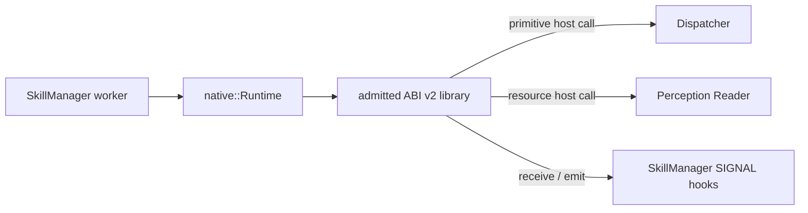

# Native skill runtime

[Skill runtime overview](../skills.md) · [SkillManager supervisor](manager.md) · [Native ABI](../../../develop/interfaces/skills/native/abi.md) · [Build, install, and test](../../../develop/interfaces/skills/native/build-install-test.md) · [中文](../../../../../docs_cn/eos/design/runtime/skills/native_cn.md)

The native runtime is the executable `SkillRuntime` implementation for reviewed deployment-owned C ABI v2 libraries. It runs skill code inside `eosd`; it is optimized for low-overhead capability calls, not isolation from untrusted code.

> **Legacy authoring path:** ABI v2 remains supported for unmigrated deployment skills, but new first-party skills should use the [built-in author API](authoring.md). The ABI is frozen for compatibility rather than expanded to mirror every built-in process feature.

## Ownership boundary

`src/eos/runtime/skills/native/` owns regular-file discovery, dynamic-library lifetime, ABI v2 table validation, copied metadata, compiled JSON Schemas, exact skill lookup, invocation-scoped host callbacks, and provider result validation. Its `eos::runtime::skills::native::Runtime` implements the profile-neutral `Provider` contract consumed by `SkillRuntime` and SkillManager.

The runtime does not own execution records, worker scheduling, claims, idempotency, deadlines, or event retention; those belong to SkillManager. It does not own primitive safety or hardware release; every physical effect reaches Dispatcher. It does not own ActionList DAGs or facts.

## Admission

`Runtime::LoadDirectory` scans one selected absolute directory in lexical order. It accepts only top-level regular, non-symlink `*.skill.so` files. Every library must export `eos_skill_library_query_v2`, return a structurally valid immutable table, and declare unique exact `{name, version}` skill identities within that runtime.

Admission copies all strings and descriptors, validates SemVer identities and table bounds, compiles parameter, result, and SIGNAL JSON Schemas, resolves declared primitive identities against Dispatcher, checks resource URI templates, validates claim templates, and verifies callback/capability consistency. A legacy-only symbol, invalid slice, duplicate identity, bad schema, missing primitive, invalid resource template, or inconsistent declaration rejects the complete directory load before it is registered with SkillManager.

One library may declare at most 256 skills. Each descriptor may declare at most 64 primitives, resources, SIGNALs, claims, and sources. There is no separate 4 MiB aggregate descriptor-metadata allowance.

Admitted libraries remain mapped for the process lifetime. There is no native hot reload or unload path. SkillManager startup additionally rejects an exact identity duplicated by another logical runtime.

## Execution and capabilities

SkillManager chooses the native runtime through `RuntimeRegistry` and calls `Provider::ValidateArguments` before queuing an execution. A worker later calls `Provider::ExecuteWithHooks` synchronously with the exact identity, validated arguments, request-derived command identity, cancellation predicate, SIGNAL callbacks, and device-claim callback.

The invocation-scoped host table exposes only declared primitive calls, allowlisted resource reads, cooperative cancellation, bounded SIGNAL receive/emit, structured diagnostics, and checkpoints. Primitive calls pass through Dispatcher and use derived command IDs. Resource reads pass through the normal perception Reader and must match a declared URI template. Host pointers and returned ABI slices are valid only for the documented invocation lifetime. Logging and checkpoint callbacks are append-only optional ABI v2 members. `report_failure` is another optional tail member and accepts one `eos_skill_failure_v2` for a non-OK execute return. Their absence on an older host does not invalidate the invocation or change the intended outcome.

A concrete resource URI must match a complete declared template: literal segments match exactly and each `{name}` matches one non-empty segment. A native invocation may keep up to 64 asynchronous primitives outstanding. Each operation has independent cancellation and a dynamic device claim; synchronous primitive calls are rejected while any asynchronous operation remains active. Return cleanup requests cancellation where necessary and drains all operations to terminal completion before the invocation is released.

The runtime accepts the frozen original completion size and reads the appended message only when `struct_size` covers it. It validates the returned result against the declared result schema and maps ABI status, acceptance, stable reason code, bounded message, result, and primitive acknowledgements into `RunResult`. SkillManager remains responsible for converting `RunResult` into the public execution terminal state.

## Failure and isolation

Missing callbacks, invalid ABI memory descriptions, contradictory terminal data, undeclared capabilities, malformed primitive acknowledgements, invalid emitted SIGNALs, or invalid result payloads fail closed. Once an invocation produces a protocol failure, later primitive release for that invocation is latched off.

The runtime accepts at most one valid reported failure. For a current skill it preserves that report as the terminal cause; for a legacy skill returning a bare failure it falls back to the last failed primitive, resource, or SIGNAL operation. `skill.failed` is used only when neither source provides a more specific reason. The primitive safety latch is independent from this cause tracking, so unavailable, protocol-error, cancelled, failed, and rejected capabilities are not all mislabeled `primitive.rejected`.

Cancellation and deadlines are cooperative. They make later host operations fail or deliver `CANCEL`, but cannot preempt the library callback. A native library can block a worker, delay shutdown, corrupt process memory, or terminate `eosd`; only reviewed deployment-owned libraries may use this runtime.

## Logging and debugging

Native admission and invocation records use the `skills` logger and the correlation ID propagated by SkillManager. Debugging fields may include library identity, skill identity, command identity, ABI/protocol status, capability name, bounded reason code, duration, and primitive acknowledgement count; the preceding manager routing event identifies the logical runtime. Logs never contain arguments, results, schemas, resource values, SIGNAL payloads, primitive acknowledgement bodies, credentials, raw ABI buffers, or raw protobuf.

Provider-level `skill_execute_completed` is debug detail. SkillManager emits one `skill_execution_terminal` summary with execution/request correlation, status, reason, sanitized message, duration/accounting, and the last failed activity when available; failure and timeout summaries are warning-level while expected rejection and cancellation remain debug-level. The same bounded message is retained in the public execution snapshot. Reason is the automation contract; message is diagnostic text and must not be parsed.

Skill-authored diagnostics become `skill_authored_log` records with immutable host identity and sanitized author fields. They are limited to 16 records per second, burst 64, and 1,024 accepted records per invocation. Checkpoints become public skill-source journal records and are limited to 256 per execution. Automatic activity entries are limited to 512. Quota or retention rejection is reported as unavailable to the skill, counted without failing its operation, and summarized at termination. Authors must omit device IDs, concrete URIs, personal data, recognized text, and every capability payload from both logs and checkpoints.

For an admission failure, inspect the first bounded reason and the named library; the configured load remains empty. For an execution failure, correlate execution ID and skill identity across `skills` and `dispatch`. A timeout or cancellation does not prove native code has returned, while a protocol error means no further primitive should be released from that invocation.

## Testing

`eos_native_skills_tests` covers valid ABI v2 loading, legacy rejection, malformed table and slice rejection, schema validation, primitive and resource capability enforcement, SIGNAL receive and emit, cancellation, result mapping, protocol latching, exact registry lookup, and process-lifetime ownership. SkillManager tests separately verify routing to the owning runtime, worker scheduling, claims, deadlines, and retained events.
