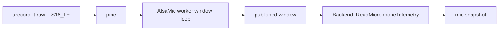
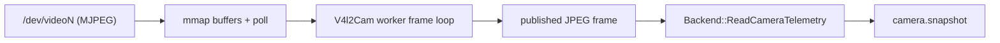

# Host device backends

[Chinese](../../../../../docs_cn/eos/develop/ext/backends/host_cn.md)

Reusable host-device backends capture directly inside `eosd`. The current set provides ALSA microphone input and V4L2 camera input.

## ALSA microphone backend

[Extensions and backends overview](../README.md) defines the shared data boundary and links the extension set.

[Chinese](../../../../../docs_cn/eos/develop/ext/backends/host_cn.md#alsa-microphone-backend)

Native ALSA audio capture implemented by `src/eos/ext/backends/alsa/`.

### ALSA contents

- [Overview](#alsa-overview)
- [Architecture](#alsa-architecture)
- [API](#alsa-api)
- [Design](#alsa-design)
- [Testing](#alsa-testing)

### ALSA overview

The `alsa` backend captures the host's audio input into the bounded PCM window that `mic.snapshot` publishes. It is the capture counterpart of the `aplay` speaker backend and runs inside `eosd`; no capture daemon or ROS 2 microphone component is involved.

Install ALSA utilities on the host because the backend executes `arecord` from `PATH`:

```sh
sudo apt install alsa-utils
test -x "$(command -v arecord)"
```

### ALSA architecture

The backend owns a worker thread that opens the device, reads fixed-size windows, and publishes the newest one. `ReadMicrophoneTelemetry()` copies that window out under a lock, so the reader never blocks on the device.



A microphone is feed-only: it declares no primitive and rejects every command path.

Operational events are written through the structured `microphone` logger and routed to `var/log/eos/latest/eosd/ext-alsa.log`. It records backend start/stop/halt, the first delivered window after each open, capture interruption, and bounded retry metadata; it never records PCM samples or encoded audio. Repeated open failures are collapsed by the repository-wide file-sink deduplicator.

### ALSA API

Declare the device in the selected binding and select the native backend:

```toml
[[profile.site.device]]
class = "mic"
part_id = "default"
description = "Host ALSA microphone"

[profile.site.device.backend]
type = "alsa"

[profile.site.device.backend.alsa]
alsa_device = "default"
frame_id = "mic"
sample_rate_hz = 16000
channels = 1
window_frames = 320
read_timeout_ms = 2000
```

Every key is optional and the defaults are the audio contracts' own: 16 kHz mono, 320 frames (20 ms), a 2000 ms read bound, and the `mic` mounting frame. `alsa_device` and `frame_id` must not be empty. `sample_rate_hz` is bounded to 1..192000, `channels` to 1..8, `window_frames` to 1..48000, and `read_timeout_ms` to 1..60000. Unknown keys are rejected, the table is required for `type = "alsa"`, and `alsa` is implemented only for class `mic`.

The committed `demo-host` profile uses this backend with `alsa_device = "default"`; microphone data is local capture, never WebSocket input or synthetic fallback. The `demo` profile uses a simulator-backed microphone. Select the desired profile from `[mode.binding]`. See [V4L2 camera backend](#v4l2-camera-backend) for the host-camera variant.

Set the current user's PulseAudio-compatible system default source with:

```sh
./scripts/sys_dev.sh --list
./scripts/sys_dev.sh --set mic --index 1
```

`--index` is the one-based number shown under `MICROPHONE`. The command changes the host audio server only; it never writes the deployment binding's `alsa_device` and it does not prove that the service account uses the same audio session. `scripts/mic.sh` remains the separate EOS configuration selector.

### ALSA design

**Absence is reported as absence.** A device that cannot be opened, or a stream that ends, clears the published window and drops health to not-alive, so `mic.snapshot` reports `device_present: false` instead of serving a stale window or an empty one. `alive` means a window has been delivered: a spawned `arecord` reports no error until it is read, so this is the strongest claim available without inventing one.

Falling back to synthetic audio is deliberately not a behavior of this backend. A device backend that quietly served generated samples would make `device_present` a false statement, and fallback is a selection decision that belongs at launch where it can be declared.

**`Clamp()` is a no-op.** A microphone has no actuation path and capture is continuous, so there is no safer state to hold and a dropped window is refilled immediately. `Halt()` is the state that stops the device, and a halted device serves no window.

Capture-only is enforced by the primitive catalog rather than by this backend: no catalog primitive targets class `mic`, so a capture device cannot declare one at all. That leaves a future `mic.*` primitive possible without this backend having to pre-declare what it cannot do.

### ALSA testing

`alsa_mic_test` drives the backend through a scripted capture stream, so every case runs without a sound card: a published window with its configuration intact, an unopenable device reporting absence rather than an empty window, a stream that ends, `Clamp()` leaving a continuous capture alive, `Halt()` stopping it, every command path rejecting, and an incomplete configuration refusing to construct.

Two more cases exercise the real `arecord` boundary, which a sound card would otherwise gate. One puts a stand-in `arecord` first on `PATH` and lets it replay a known ramp, so the actual `posix_spawn`, pipe, and window assembly run; the other asks the real `arecord` for an unknown device and holds that absence is reported without ever publishing a window. Between them the success and failure paths of the process boundary are covered on a host with no audio hardware.

`BindingTest.AlsaMicConfigurationStaysCaptureOnly` covers the binding surface: defaults, the required table, the class restriction, bounds, unknown keys, and that the table is invalid under another backend type.

## V4L2 camera backend

[Extensions and backends overview](../README.md) defines the shared data boundary and links the extension set.

[Chinese](../../../../../docs_cn/eos/develop/ext/backends/host_cn.md#v4l2-camera-backend)

Native Video4Linux2 capture implemented by `src/eos/ext/backends/v4l2/`.

### Contents

- [Overview](#overview)
- [Architecture](#architecture)
- [API](#api)
- [Design](#design)
- [Testing](#testing)

### Overview

The `v4l2` backend captures a host camera into the bounded JPEG frame that `camera.snapshot` publishes. It is the capture counterpart of the `aplay` speaker backend and the sibling of the `alsa` microphone: one worker thread inside `eosd` owns the device, and no capture daemon or ROS 2 camera component is involved.

Only cameras that can supply **MJPEG** are usable. The backend contains no encoder, so a device limited to raw formats has nothing to contribute and is reported as absent rather than transcoded. Most USB webcams and the cameras on a Jetson carrier board expose MJPEG directly, so no extra dependency is needed — the repository builds without OpenCV or libjpeg.

The device node is the only host prerequisite:

```sh
test -r /dev/video0
v4l2-ctl --device=/dev/video0 --list-formats   # expect MJPEG in the list
```

### Architecture

The backend owns a worker thread that opens the device, dequeues buffers, and publishes the newest frame. `ReadCameraTelemetry()` copies that frame out under a lock, so the reader never blocks on the device.



A camera is feed-only: it declares no primitive and rejects every command path.

### API

Declare the device in the selected binding and select the native backend:

```toml
[[profile.site.device]]
class = "cam"
part_id = "default"
description = "Host V4L2 camera"

[profile.site.device.backend]
type = "v4l2"

[profile.site.device.backend.v4l2]
video_device = "/dev/video0"
frame_id = "camera_optical"
width_px = 640
height_px = 480
fps = 30
read_timeout_ms = 2000
max_frame_bytes = 4194304
```

Every key is optional and the defaults are a 640x480 MJPEG stream at 30 fps with a 2000 ms read bound, the `camera` frame, and a 4 MiB encoded-frame bound. `video_device` and `frame_id` must not be empty. `width_px` and `height_px` are bounded to 1..16384, `fps` to 1..240, `read_timeout_ms` to 1..60000, and `max_frame_bytes` to 1..67108864. Unknown keys are rejected, the table is required for `type = "v4l2"`, and `v4l2` is implemented only for class `cam`.

The `demo-host` profile in `etc/eos/backends/demo.toml` is the committed example: it retains the same seven-device contract as `demo`, but replaces its simulator camera, microphone, and speaker with V4L2, ALSA, and aplay host peripherals. Select it from `[mode.binding]` with `backend = "backends/demo.toml"` and `profile = "demo-host"`. `BindingTest.HostProfileUsesHostPeripherals` compares the profiles device by device so they cannot drift.

### Design

**Absence is reported as absence.** A device that cannot be opened, that has no MJPEG mode, or whose stream ends clears the published frame and drops health to not-alive, so `camera.snapshot` reports the camera as not there instead of serving a stale or empty frame. `alive` means a frame has been delivered: an opened-but-dead device must not read as healthy, which is the same claim the ALSA backend makes for a spawned `arecord`.

Synthesizing an image is deliberately not a behavior of this backend. A device backend that quietly served a generated frame would make `device_present` a false statement, and fallback is a selection decision that belongs at launch where it can be declared.

**The negotiated resolution wins.** `VIDIOC_S_FMT` returns what the driver actually accepted, and that is what the published telemetry reports; the configured size is only a request. A refused frame rate is different — drivers routinely ignore `VIDIOC_S_PARM` and still deliver frames — so the requested rate is advisory and only feeds the declared `model` rate.

**`Clamp()` is a no-op.** A camera has no actuation path and capture is continuous, so there is no safer state to hold and a dropped frame is replaced immediately. `Halt()` is the state that stops the device, and a halted device serves no frame.

**A camera attached later is picked up.** A failed open is not fatal: the worker retries once a second for as long as the backend lives, so a camera plugged in after `eosd` starts begins delivering without a restart, and shutdown stays prompt because the retry wait is woken by `Halt()`.

Capture-only is enforced by the primitive catalog rather than by this backend: no catalog primitive targets class `cam`, so a capture device cannot declare one at all. That leaves a future `cam.*` primitive possible without this backend having to pre-declare what it cannot do.

### Testing

`v4l2_cam_test` drives the backend through a scripted frame stream, so every case runs without a camera: a published frame with its negotiated size intact, an unopenable device reporting absence rather than an empty frame, a stream that ends, `Clamp()` leaving a continuous capture alive, `Halt()` stopping it, every command path rejecting, and an incomplete configuration refusing to construct.

`BindingTest.V4l2CamConfigurationStaysCaptureOnly` covers the binding surface: defaults, the required table, the class restriction, bounds, unknown keys, and that the table is invalid under another backend type.

## Aplay speaker backend

[Extensions and backends overview](../README.md) · [Southbound primitives](../../interfaces/southbound/primitives.md)

The native `aplay` backend accepts one complete bounded PCM WAV asset from EOS and plays it through ALSA. It is an audio-output adapter only: URI resolution, text-to-speech, network reception, and prompt selection happen upstream.

### Configuration

```toml
[[profile.site.device]]
class = "speaker"
part_id = "default"
description = "System ALSA speaker"

[[profile.site.device.primitive]]
name = "speaker.play"
version = "1.0.0"
description = "Play one EOS-resolved WAV asset through the system speaker."

[profile.site.device.backend]
type = "aplay"

[profile.site.device.backend.aplay]
alsa_device = "default"
max_stream_bytes = 16777216
```

`alsa_device` defaults to `default` and must not be empty. `max_stream_bytes` defaults to 16 MiB and must be positive. The table is strict-keyed; `model_id` is not a speaker setting.

Install ALSA utilities on the robot host because the backend executes the trusted path `/usr/bin/aplay` directly:

```sh
sudo apt install alsa-utils
test -x /usr/bin/aplay
aplay -L
```

### Asset protocol

The northbound `speaker.play@1.0.0` call carries an EOS-readable URI. Dispatcher resolves and validates that URI, then releases one complete asset to the backend:

```json
{
  "uri": "asset://alerts/ready.wav"
}
```

The southbound command contains an EOS-owned diagnostic asset ID, `audio/wav`, and all encoded bytes. The backend rejects an empty or oversized asset, invalid PCM WAV, unsupported media type, or a call while playback is already active. Northbound callers never provide chunks, stream IDs, sequences, or raw audio bytes.

`kAccepted` means the backend owns the complete validated asset and queued it to the playback worker; it does not prove audible completion. Device-specific playback telemetry remains inside EOS because body discovery exposes only the speaker's common state and health.

### Validation and playback

Before accepting the asset the backend validates exact RIFF size, WAVE signature, chunk bounds and padding, a PCM `fmt ` chunk, one non-empty `data` chunk, nonzero channels and sample rate, consistent byte rate and block alignment, complete frames, and a maximum declared duration of five minutes.

Validated bytes are written to an anonymous in-memory file and passed on standard input using arguments equivalent to:

```sh
/usr/bin/aplay -q -D DEVICE
```

No shell parses the route or audio bytes. Playback has a wall-clock deadline equal to the WAV duration plus five seconds. Clamp or emergency stop invalidates the stream and sends `SIGTERM` to an active player, followed by `SIGKILL` after one second if necessary; the worker always reaps the child.

### Testing

Test the route as the same user and in the same service environment that runs `eosd`:

```sh
/usr/bin/aplay -q -D default /absolute/path/to/known-good.wav
```

Then call `speaker.play@1.0.0` with an admitted asset URI and verify audible output. `aplay_speaker_test` covers asset bounds, WAV validation, busy rejection, cancellation, halt, and playback failures without requiring physical audio hardware.
