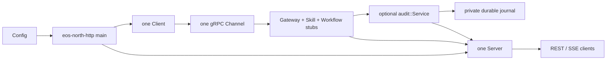

# North HTTP process

[Extensions overview](../README.md) · [REST/SSE contract](../../interfaces/external/http.md) · [Configuration](../../../usage/configuration.md) · [中文](../../../../../docs_cn/eos/develop/ext/north_http/README_cn.md)

`src/eos/ext/north_http/` is the standalone browser-facing REST/SSE-to-gRPC process. It is outside EOS core, links generated public contracts rather than runtime domain modules, and does not own robot, primitive, skill, workflow, or fact state.

## Module map

| Source folder | Documentation | Responsibility |
| --- | --- | --- |
| `north_http/` | this page | process composition, logging setup, signal handling, and executable lifecycle |
| `north_http/config/` | [config.md](config.md) | strict `north-http.toml` parsing and launch configuration |
| `north_http/client/` | [client.md](client.md) | one process-wide EOS gRPC channel and generated stub set |
| `north_http/audit/` | [audit.md](audit.md) | optional external ActionList/fact projection, durable journal, recovery, and health |
| `north_http/server/` | [server.md](server.md) | HTTP routing, ProtoJSON, SSE, CORS, bounded connection workers, class-specific admission, and transport logging |

Each folder owns its CMake target and tests. The root CMake file composes those targets into `eos-north-http`; the root `main.cpp` remains a thin process entry point.

## Process composition

Startup resolves the layout and absolute config path, strictly loads `Config`, applies supported command-line overrides, configures the `north-http` logging service, constructs one `Client(config.upstream)`, optionally constructs and starts `audit::Service` with the derived state directory, and then constructs `Server(config, client, audit)`. Declaration order keeps the shared client alive until after both borrowers are stopped and destroyed.

`SIGINT` and `SIGTERM` set a process stop flag. `Server::Run` observes that flag, closes the listener and active transports, cancels registered upstream contexts, and joins the bounded set of at most `max_connections` accepted-connection workers before returning; process composition then stops the audit worker. `eosd` neither launches nor owns this process.

`max_connections` is a hard worker bound: the accept loop does not accept another socket while that many connection workers are retained, so additional connections remain subject to the bounded listen backlog until a completed worker is joined and its slot is reused. Within accepted connections, unary requests, SSE streams, and live-monitor WebSockets have separate `max_inflight_requests`, `max_sse_streams`, and `max_monitor_streams` capacities. The server reads and classifies the HTTP header first; when that class is full, it returns HTTP `429` / `RESOURCE_EXHAUSTED` and closes the connection without reading the request body.

Connection workers contain all request-processing exceptions, record a bounded `north_http_worker_error`, close and unregister the transport, and always mark their slot reusable. SSE heartbeat and peer-disconnect helper threads likewise contain exceptions, cancel the associated gRPC context, actively unblock transport waits when required, and are stopped and joined before their request worker exits.

## Ownership boundary

The config module owns admission of process settings. The client module owns gRPC connectivity objects. The audit module owns only its external projection and journal. The server module owns HTTP connection state and translation. EOS `GatewayService`, `SkillService`, and `WorkflowService` remain the only route to core behavior; north HTTP never links Dispatcher, SkillManager, ActionList manager, hardware, or perception implementations.

The process may start while EOS is absent because channel creation is non-blocking. Liveness reports the adapter process, and readiness probes EOS health over the shared channel. Optional audit health is reported independently and never gates the adapter. gRPC reconnect behavior belongs to the channel and no second channel is created per service, request, browser stream, or audit stream.

## Logging and debugging

The process configures the shared logging library under `var/log/eos/runs/<launch-id>/north-http/`. Root lifecycle events are `north_http_process_started`, `north_http_process_stopped`, and `north_http_process_failed`; listener, upstream-state, request, stream, cancellation, and transport events belong to the server module; audit diagnostics use `north-http.audit`. The durable audit journal is separate from diagnostic logs.

Use the propagated correlation ID to join a browser request in north HTTP logs to the corresponding `northbound` and domain logs in `eosd`. Logs contain route/RPC identity, status, duration, byte counts, readiness transitions, and cancellation state, but not request bodies, credentials, media, transcripts, schemas, domain payloads, or raw protobuf.

## Testing

`eos_north_http_client_tests`, `eos_north_http_config_tests`, `eos_north_http_audit_tests`, and `eos_north_http_server_tests` cover the four focused module targets. The aggregate REPL integration test verifies the external client path through the composed north HTTP process; process-level launch and packaging checks remain with the EOS integration suite and wrapper tests.
