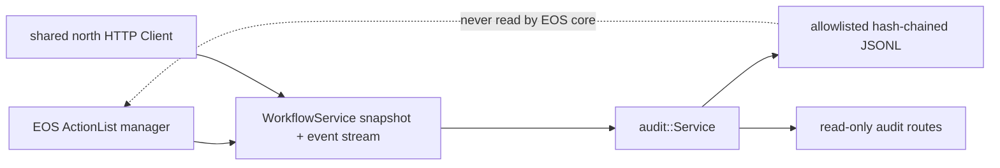

# External ActionList audit

[North HTTP process](README.md) · [gRPC client](client.md) · [Server](server.md) · [Workflow contract](../../interfaces/workflow.md) · [Debugging](../../../usage/debugging.md) · [中文](../../../../../docs_cn/eos/develop/ext/north_http/audit_cn.md)

`src/eos/ext/north_http/audit/` implements an optional durable, privacy-minimized projection of ActionList and fact mutations. It is an external observer in `eos-north-http`, not an EOS core module, source of truth, scheduler, recovery input, or authorization boundary.

## Ownership boundary

The public API is `eos::ext::north_http::audit::{Config, Health, ErrorCode, Status, Service}`. `Service(Client&, Config)` borrows the process-wide north HTTP client, owns one worker and its journal, and exposes idempotent `Start()`, idempotent `Stop()`, synchronized `status()`, and bounded `record_page(limit, budget)` selection. There is no unbounded record-list API; the public server uses `kMaximumRecordPageBytes = 4 MiB`.

Process composition derives the audit directory as `<state>/north-http/action-list-audit`, starts the audit before the HTTP server, injects an optional pointer through `Server(Config, Client&, audit::Service*)`, and stops the server before stopping and destroying the audit and shared client. No user-supplied path is accepted.

The audit uses the same `Client::workflows()` stub as browser Workflow routes. It creates no second channel, bypass into ActionList memory, or primitive path. Disabling or losing audit data never changes accepted workflows or physical effects.

## Durable record contract

Every journal line is one JSON object with `kind`, allowlisted domain fields, `segment`, `previous_hash`, and `hash`. Cursor-bearing records use `cursor: {epoch, sequence}` and `observed_at`. Numeric JSON values are native JSON numbers in this internal journal rather than the public ProtoJSON string representation.

`snapshot_commit` is one atomic bootstrap record containing the snapshot cursor, snapshot `observed_at`, an `action_lists` array, and a `facts` array. The complete bootstrap projection is committed in one journal line so restart never treats a partially written multi-record snapshot as a valid cursor.

An `action_list` projection permits only:

- List fields: `workflow_id`, `revision`, enum `status`, `created_at`, `updated_at`, optional `superseded_by_workflow_id`, cursor, and observation time.
- Per-action target fields: `action_id`, enum `status`, optional `execution_id`, optional `command_id`, `target_kind`, exact `target_name`, exact `target_version`, and primitive `device_id` when present.

A `fact` projection permits only `kind`, cursor, `observed_at`, `event_time`, `received_time`, optional nonzero `source_sequence`, and optional `source_execution_id`. Fact key, value, source, frame, unit, confidence, and validity are excluded entirely; low-entropy identifiers are not retained even as unsalted hashes.

The audit never persists action parameters, results, reasons, dependencies, conditions, supersession input arrays, schemas, fact values or excluded fact identity, resource values, SIGNAL payloads, primitive acknowledgements, credentials, authentication data, origins, request/response bodies, raw protobuf, media, speech, prompts, or transcripts. Workflow, action, target, execution, command, and device identifiers remain operationally sensitive metadata, so the journal still requires filesystem access control and retention review.

## Hash chain, rotation, and retention

Segments are named `audit-000000000000.jsonl`, increment monotonically, and rotate before an append would take a non-empty segment above `rotation_size_bytes`. Every fully encoded JSONL line including its newline must fit that hard cap; an oversized snapshot or event is not appended, audit degrades with `resource_exhausted`, and `action_list_audit_record_too_large` is emitted with only stable `error_code`. At most `rotation_files` segments are retained, and the overflow-safe configured size/count product must not exceed `kMaximumRetainedBytes = 256 MiB`; successful deletion of older segments and journal/state writes are synchronized to the filesystem. The service enforces an owner-only `0700` directory and `0600` journal/checkpoint files.

For each record, `previous_hash` is the prior retained tail hash and `hash` is lowercase SHA-256 over the canonical serialized record after adding `previous_hash` and `segment` but before adding `hash`. The all-zero hash begins a new journal. Recovery validates every retained record hash and every available predecessor link; after retention prunes an older segment, the first retained record anchors the verifiable retained suffix.

This SHA-256 chain is corruption and tamper evidence, not attacker-proof authenticity. There is no HMAC, signature, trusted timestamp, or protected signing key. An attacker able to rewrite the journal and recompute all hashes can forge a consistent chain.

`cursor.json` is an atomically replaced operational checkpoint containing epoch, sequence, tail hash, segment index, and record count. Segment replay, not blind trust in this checkpoint, reconstructs and validates journal state at startup.

## Recovery, resume, and resnapshot

Startup creates the derived directory and acquires a lifetime-held exclusive `writer.lock` before recovery. A second process degrades with `writer_conflict` without inspecting or changing the journal. Recovery rejects a matching `audit-*.jsonl` symlink or other non-regular entry without following, changing, or reading it, and sorts recognized regular segment files. Before reading content, it rejects a segment count above `rotation_files`, any file above `rotation_size_bytes`, or overflow-safe cumulative bytes above the configured product or 256 MiB; audit degrades with `resource_exhausted`, emits `action_list_audit_recovery_limit_exceeded`, and materializes no records. Otherwise it parses records oldest-first, verifies the retained hash chain, rebuilds retained records and the latest committed cursor, and rewrites `cursor.json`. A valid final record missing only its newline is retained and repaired; an unterminated malformed final fragment in the newest segment is treated as a torn append and truncated. Blank interior records, complete malformed records, parseable unterminated tampering, broken hashes, and interior corruption produce `degraded/corrupt_chain`; an unsafe filesystem entry or filesystem-operation failure produces `degraded/io`. None is silently skipped.

With no recovered cursor, the worker calls `GetRuntimeSnapshot`, requires a non-empty cursor epoch, writes one `snapshot_commit`, and begins `WatchActionListEvents` strictly after that cursor. A successful snapshot with an empty epoch is rejected before append and retried with `action_list_audit_snapshot_retry` reason `invalid_cursor`. With a recovered cursor, it resumes the stream directly without another snapshot. Events from the same epoch at or below the committed sequence are ignored as duplicates; the next accepted event must have the same epoch and exactly sequence plus one.

A local sequence gap, epoch mismatch, `FAILED_PRECONDITION`, or `OUT_OF_RANGE` clears the incremental cursor, records `action_list_audit_resnapshot_required`, waits `reconnect_delay_ms`, obtains a fresh atomic snapshot, appends a new `snapshot_commit`, and resumes. Other stream endings record `action_list_audit_stream_retry`, move health to `stopped` during the bounded reconnect delay, and retry the last committed cursor without inventing records.

The service advances its durable cursor only after the projected record and checkpoint are synchronized. This gives at-least-once upstream delivery with journal-level duplicate suppression; it does not make the external journal authoritative or reverse actions when storage fails.

## Health, degradation, and HTTP visibility

`Health` wire names are `stopped`, `healthy`, and `degraded`. `ErrorCode` names are `none`, `invalid_config`, `io`, `writer_conflict`, `corrupt_chain`, and `resource_exhausted`. `Status` exposes only health, error category, running flag, epoch, sequence, and retained record count; it intentionally contains no free-form exception or payload detail.

Audit is non-authoritative diagnostics and does not gate functional readiness. `/health/ready` depends on the EOS upstream, while `/v1/eos/audit/status` independently reports disabled, stopped, healthy, or degraded audit state. `/health/live` continues to report process liveness even when audit is stopped or degraded.

Permanent config, I/O, chain, and capacity failures fail closed for the audit projection and expose a stable degraded category. They do not stop the HTTP listener or EOS core. Operators must preserve the affected journal for diagnosis and repair or relocate it out of band; the service never deletes a corrupt complete record to make readiness green.

The read-only [audit routes](../../interfaces/external/http.md#audit-routes) return `Cache-Control: no-store`. They are operational visibility, not proof that the journal is authentic, complete beyond configured retention, or synchronized with skill-execution sequences.

## Logging and debugging

Audit diagnostics use logger `north-http.audit`, routed to `<run>/north-http/ext-north-http-audit.log` and the process `events.jsonl`. The durable journal under the state root is separate from both diagnostic sinks and is not controlled by `[log]` rotation, deduplication, overwrite, or attachment settings.

Lifecycle and failure events are `action_list_audit_recovered`, `action_list_audit_partial_tail_recovered`, `action_list_audit_snapshot_retry`, `action_list_audit_stream_retry`, `action_list_audit_resnapshot_required`, `action_list_audit_invalid_config`, `action_list_audit_recovery_failed`, `action_list_audit_recovery_limit_exceeded`, `action_list_audit_tail_recovery_failed`, `action_list_audit_chain_corrupt`, `action_list_audit_record_too_large`, `action_list_audit_write_failed`, and `action_list_audit_state_write_failed`. Safe fields are bounded operational counts, cursor sequence, numeric gRPC status, stable reasons such as `invalid_cursor`, and stable error category; records, upstream text, and excluded payloads are never copied into diagnostics.

Use `GET /v1/eos/audit/status` first, then inspect `north-http.audit` events around the transition. Correlate a generated audit snapshot/stream request with `eosd` by its logging correlation ID when available, but use cursor epoch/sequence from status or the journal to diagnose replay continuity. See the [debugging runbook](../../../usage/debugging.md).

## Testing

The 16 `eos_north_http_audit_tests` use an in-process WorkflowService fixture and temporary durable directories. They verify privacy allowlisting and bounded record pages, atomic snapshot projection, empty-cursor retry privacy, oversized append rejection, legacy over-size and over-count recovery refusal, event consumption, restart resume without duplicates, valid missing-newline repair, torn-tail truncation, interior blanks, rejection of complete/interior/parseable-unterminated corruption, rotation and retained-suffix recovery, gap and epoch resnapshot, POSIX permissions, segment-symlink refusal without following, and stable status names. Focused config tests cover strict audit keys and limits; server tests cover disabled audit routes, `no-store`, Workflow SSE cursor projection, and enabled degraded-audit readiness.
