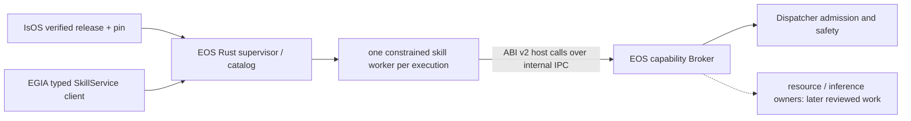

# EOS-hosted skill ABI and package boundary

[中文](../../../../../docs_cn/eos/interfaces/skills/native/host-abi_cn.md) · [Native authoring](README.md) · [C layout](abi.md) · [Capability operations](capabilities.md)

**Decision.** EOS owns and exposes the versioned **host capability ABI**. A skill package implements the corresponding guest entry point and immutable descriptor; it does not expose an EOS service ABI or receive a runtime, Dispatcher, backend, device, or socket handle. This is an EOS interface contract, while IsOS owns package resolution and release verification. ABI `v2` and `eos_skill_library_query_v2` are existing compatibility identities; they do not set the EOS product version. The default Rust runtime implements the R04 primitive-only native host and seven-method SkillService subset. The opt-in C++ skill side chain remains a compatibility reference until Q02 last-caller review.

## First-use path and ownership

1. **Install and select:** IsOS installs an exact verified release and records an explicit library selection and package pin in the applied deployment. It passes a manifest-listed, revision-bound selection file only to EOS. Installing a package alone grants no execution authority.
2. **Admit:** IsOS verifies package bytes before worker launch. EOS repeats selected-file and library checks, then inspects ABI descriptors inside a confined worker. `dlopen` and the query function can run library static constructors and query code inside that worker; an invalid descriptor must never reach its `execute` handler. A failed admission leaves the previous applied deployment intact and emits a sanitized event.
3. **Discover and invoke:** EGIA or another authorized caller discovers the admitted skill through `SkillService`, supplies schema-validated arguments and a public idempotency `request_id`, and receives a snapshot containing an `execution_id`. A skill identity is the exact `{name, version}` pair; its package pin is recorded separately. EOS derives private primitive command IDs from the request ID.
4. **Observe and stop:** EOS reports status, bounded checkpoints, and shared JSONL events with run/correlation IDs. Cancellation or shutdown revokes grants, cancels admitted primitives through the Broker and Dispatcher, waits a bounded interval, then reaps the worker. An unresolved actuator outcome is reported as unknown, never silently retried.

The [build guide](build-install-test.md) gives author commands. The [ABI reference](abi.md) is authoritative for current C struct layout and callback signatures. The [worker design](../../../design/runtime/skills/external.md) owns internal IPC and sandbox implementation. No package may claim a new host callback by merely putting a name in its descriptor.

## Target process boundary



The worker loads the native library and calls `eos_skill_library_query_v2(2)` inside the sandbox. The Rust supervisor owns the worker, catalog, leases, status, and event IDs. Its broker is the only adapter from guest requests to runtime capabilities. Internal IPC is private and versioned independently from the public ABI. Do not `dlopen` package code into the Rust supervisor. EGIA's Python stage graph uses typed gRPC and does not implement or consume the native C ABI. A future Python skill worker is a separate statically admitted profile; it receives the same brokered *semantic* capabilities, never raw C pointers or unrestricted EOS APIs.

## Boundary contract

All fields below are existing ABI v2 fields unless marked **target policy**. Units are bytes for text sizes, milliseconds for timeouts, nanoseconds for source timestamps, and dimensionless otherwise. The exact raw types and layouts are in [`abi.h`](../../../../../src/eos/include/eos/skill/abi.h) and [C layout](abi.md).

| Field or field group | Type; default | Purpose, validation, and owner | Compatibility |
| --- | --- | --- | --- |
| `abi_version`, `struct_size` | `uint32`; required | Guest library reports ABI `2` and its byte size; EOS requires at least the frozen base prefix and bounds reads to the reported and known layouts. | Preserve base offsets; append optional members and guard by size. |
| `name`, `version`, `build_id` | borrowed UTF-8 slice; `build_id` may be empty | Package/library identity, exact SemVer, provenance; EOS validates bounds and uniqueness. | Existing names and versions retain meaning; `build_id` is diagnostic, not authority. |
| `skill_count`, `skills`, `skill_descriptor_size` | count, pointer, byte stride; required except old stride fallback | EOS bounds the array, checks alignment, and reads each descriptor using its declared stride. | Old tables ending at `skills` use the frozen base stride. |
| Descriptor `name`, `version`, `description` | UTF-8 slices; description may be empty for old packages | Skill discovery identity and operator explanation; EOS owns validation. **Target policy:** new packages require nonblank description. | Do not reject previously admitted v2 packages solely for an empty description. |
| `parameters_schema_json`, `returns_schema_json` | object JSON Schemas; required | EOS compiles self-contained schemas, validates input before execution and output before publication; defaults are not injected. | Tightening an existing skill schema needs a new exact skill version. |
| `primitive_count/primitives`, `resource_count/resources`, `source_count/sources`, `inference_count/inferences` | bounded arrays; zero/`NULL` means none | Exact capability allowlist, resource URI patterns, source directions, inference authorities; EOS validates at admission and broker use. | Optional tail fields are read only when `EOS_SKILL_DESCRIPTOR_V2_HAS` succeeds. New authority requires an explicit declaration and release. |
| `signal_count/signals`, `claim_count/claims`, `ipc_channel_count/ipc_channels` | bounded arrays; zero/`NULL` means none | Declared communication schemas/directions and whole-execution resource claims; EOS checks each use. | Community tail is optional ABI v2.1; absence means unavailable, not implicit permission. |
| `reentrant`, `context`, `execute` | `uint32` 0/1, opaque pointer, function pointer; required execute | Skill owns process-lifetime context; EOS serializes when `reentrant=0`, validates entry point and exactly-once completion. | Never move or reinterpret existing members. |
| `host.abi_version`, `host.struct_size`, `host.context` | `uint32`, `uint32`, opaque pointer; invocation-scoped | EOS owns table and token; guest must check version/size and must not retain or share context. | Existing callback offsets are frozen. |
| Host capability callbacks | function pointers; optional tail may be `NULL` | The opt-in C++ side chain implements the listed callback families. R04 Rust must implement declared primitive, cancellation and required completion; other families need an admitted owner before exposure. Every implemented call is checked against descriptor, run, device, expiry, schema, and Dispatcher admission. | Guest checks `EOS_SKILL_HOST_V2_HAS` **and** pointer; absence returns unavailable only for a family the descriptor does not require. |
| `command_id`, `arguments_json`, `host` in execution | UTF-8 slices, host pointer; required | EOS binds one root command and validated object arguments to an invocation. | Values are borrowed only during `execute`. |
| Completion `accepted`, `reason_code`, `result_json`, `message` | 0/1, bounded UTF-8, object JSON, optional text | Guest completes once on a normal path; EOS validates result and records reason. `message` is operator text, not machine protocol. | Old completion base lacks `message`; consumers guard the tail. |

Only declared capabilities are *eligible*. Runtime readiness, package pin, device state, claims, expiry, and Dispatcher safety can still deny a call. A resource API is read-only; actuator writes must go through a declared primitive. A descriptor cannot grant access to an undeclared graph node by constructing a URI. EOS returns stable status/reason codes; messages are bounded, sanitized, and never parsed for control flow.

## Admission and execution algorithms

**Admission:** resolve only the explicitly selected P01-pinned library files; reject symlinks, path escape, mismatched digest, nonregular files, and duplicate identities before starting a worker; then query ABI `2` inside a confined worker, validate base sizes, optional tails, array strides, UTF-8, bounded names, SemVer, self-contained object schemas, declarations, and available primitives; publish the catalog atomically only after every selected library passes. The current C++ loader recursively discovers `*.skill.so`; the implemented Rust R04 policy never scans a directory. Recursive discovery must not be assumed secure.

An unconfigured external host publishes no executable skills. Invalid selection data is rejected before any worker starts. A malformed ABI descriptor can cause static constructors and query code to run inside the confined inspection worker, but cannot enter the `execute` handler or publish a catalog. A requested capability absent from the admitted descriptor is denied before dispatch. Negative fixtures cover these cases and worker cleanup; they establish a fail-closed admission seam, not general sandbox containment.

**Invocation:** validate caller and schema; acquire claims; create run and correlation IDs; start one confined worker and a time-limited Broker grant; pass only invocation-scoped host callbacks; route primitive requests through Broker then Dispatcher; validate each response and final result; revoke grants and release claims; publish terminal state once. Bounded queues, per-call deadlines, response copying, and exactly-once terminal transition prevent one worker from blocking unrelated runs. Never retry an actuator command after an ambiguous result.

**Stop:** mark run stopping and reject new capability calls; signal cancellation; cancel outstanding primitive operation IDs and wait for Dispatcher terminal results; revoke grant; ask worker to exit, then terminate/reap after deadline; emit one terminal outcome. Skill-defined `SIGNAL` or community messages are not substitutes for manager cancellation. If stop cannot prove a safe actuator outcome, surface `worker.outcome_unknown` and require operator recovery.

| Condition | External result | Log event and recovery |
| --- | --- | --- |
| External host unconfigured | No executable skill is listed or invoked | `skills.host_unavailable`; configure a verified host and package before retrying. |
| Missing/wrong ABI or invalid descriptor | Catalog admission fails, no new skill visible | `skills.admission_rejected` with safe reason and package pin; fix package or host support. |
| Optional callback absent | `EOS_SKILL_HOST_UNAVAILABLE` | Skill can use documented fallback; no implicit authority. |
| Undeclared or expired capability | `INVALID_ARGUMENT` or `UNAVAILABLE` with stable reason | `skills.capability_denied`; correct declaration or runtime readiness. |
| Worker crash, timeout, protocol mismatch | Run fails or outcome is unknown if an actuator is unresolved | `skills.worker_failed`; revoke grants, reap, inspect run/correlation logs. |
| Cancellation with terminal hardware result | Run becomes cancelled | `skills.run_cancelled`; no automatic restart. |

**Compatibility and milestones:** retain the existing query symbol, C layouts, exact skill identities, and ABI v2 optional-tail rules while connecting the Rust supervisor to the brokered worker. Advertise supported ABI/feature sets at admission. New mandatory layout or changed callback semantics needs a new ABI major and a separate worker path; it must not silently reinterpret v2. Implement in order: verified file selection → Rust catalog/worker supervision → broker/Dispatcher bridge → cancellation and failure accounting → shared logs/status → package and legacy ABI fixtures → full IsOS → EOS → EGIA run with MuJoCo. Record full test output under `logs/test/<run-id>/`.

## R04 Rust host selection and execution contract

This section freezes the R04 owner handoff and is executable work under [R04](../../../../island/implementation-todo.md). IsOS owns the graph declaration, P01 receipt and selected file. EOS owns the verification of its input, C ABI inspection, worker, broker, public SkillService projection and lifecycle. No graph wire invokes a skill, and neither a package installation nor a descriptor grants actuator authority.

The IsOS `isos.process.component@v0.1` EOS runtime node may contain optional `settings.skill_libraries`, an array of explicit `{package:{id,version},library}` entries. An absent or empty array selects no host libraries. IsOS verifies each exact pin and file at Apply and again before Run/Restart, then lists `isos/skill-selection.json` in the same schema-2 selected manifest as `eos/graph.json`. It passes that file only to EOS as `EOS_SKILL_SELECTION_FILE`. A nonempty selection requires the exact selected runtime feature `host-skill-abi-v2` at P05 preflight, before replacing an active child. The IsOS [selection contract](https://github.com/Island-Team/isos/blob/master/docs/isos/interfaces/skill-selection.md) owns graph paths and diagnostics.

The type catalog must describe this authored setting truthfully. R04 adds reusable serialized `data_type:"object_array"` to EOS's `SettingType` and optional `items_schema`, `min_items`, `max_items` fields to `Setting`, without changing serialization of existing descriptors when these fields are absent. **IsOS owns and publishes** the exact `isos.process.component@v0.1` descriptor; it clones the established `@v1.1` fields, includes its existing `env_from` field, and adds optional `skill_libraries` with `min_items:0`, `max_items:16`, and this `items_schema`. EOS does not redefine or advertise that IsOS type:

```json
{"type":"object","additionalProperties":false,"required":["package","library"],"properties":{"package":{"type":"object","additionalProperties":false,"required":["id","version"],"properties":{"id":{"type":"string","minLength":1},"version":{"type":"string","minLength":1}}},"library":{"type":"string","minLength":1,"maxLength":256}}}
```

`items_schema` is an object-valued, at-most-8-KiB local schema with depth at most three and only `type`, `properties`, `required`, `additionalProperties`, `minLength`, `maxLength` and `pattern` keywords; unknown keywords, remote references and malformed shapes fail catalog admission. The generic registry checks item shape and array count, and IsOS adds exact package ID/SemVer, POSIX path and P01 pin checks at the graph node path. IsOS's @v0.1 descriptor is its exact graph type identity; the independent P05 `host-skill-abi-v2` feature prevents an older selected EOS binary from accepting nonempty selection. UI catalog readers can render the real object-array metadata rather than a false string field.

The selected JSON is a UTF-8 object of at most 64 KiB with no extra fields. IsOS rejects an oversized selection before replacing an active child; EOS repeats the bound before worker launch. Its example is data, never an executable command:

```json
{
  "schema_version": 1,
  "active_revision": "aaaaaaaaaaaaaaaaaaaaaaaaaaaaaaaaaaaaaaaaaaaaaaaaaaaaaaaaaaaaaaaa",
  "libraries": [
    {
      "package_id": "island/example-skills",
      "package_version": "0.1.0",
      "package_root": "/private/isos/data/packages/island/example-skills/0.1.0",
      "payload_root": "/private/isos/data/packages/island/example-skills/0.1.0",
      "receipt_sha256": "bbbbbbbbbbbbbbbbbbbbbbbbbbbbbbbbbbbbbbbbbbbbbbbbbbbbbbbbbbbbbbbb",
      "release_sha256": "cccccccccccccccccccccccccccccccccccccccccccccccccccccccccccccccc",
      "payload_sha256": "dddddddddddddddddddddddddddddddddddddddddddddddddddddddddddddddd",
      "library": "lib/island/skills/example.skill.so",
      "library_sha256": "eeeeeeeeeeeeeeeeeeeeeeeeeeeeeeeeeeeeeeeeeeeeeeeeeeeeeeeeeeeeeeee"
    }
  ]
}
```

`schema_version` is required integer `1` (unit —); unknown versions fail. `active_revision` is the required 64-lowercase-hex SHA-256 of IsOS's saved whole graph, never EOS's projection digest. `libraries` is a required array (unit entries), sorted by `{package_id,package_version,library}` with no duplicates and bounded to 16 entries; empty means a ready but empty catalog. Every entry requires exact package identity strings, absolute `package_root` for P01 verifier metadata, absolute `payload_root` for the verified bytes, and a relative POSIX `library` path of 1–256 UTF-8 bytes ending in `.skill.so`, with nonempty segments, no `.`/`..`, backslash or leading slash. A linked P01 release may have a different payload root from the metadata store. All four digest fields are required lowercase 64-hex SHA-256 values: `receipt_sha256` binds the store receipt bytes, `release_sha256` and `payload_sha256` bind the P01 release and complete payload tree, and `library_sha256` binds this exact regular shared-object file. No default path search, implicit highest version, directory scan, glob, or environment override is allowed. Paths and digests are private launch data and never appear in SkillService, logs or user-facing errors.

R04 enforces at most 256 total admitted skill identities across all libraries, eight active invocation workers, and 1,024 retained execution records. These are independent count ceilings, not a promise that maximum-sized entries all fit simultaneously. Before SkillService reports `SERVING`, the encoded complete `ListSkillsResponse` must fit a 3 MiB aggregate budget, below EGIA's current 4 MiB default gRPC receive cap. Retained `ListExecutionsResponse` obeys the same 3 MiB budget: EOS evicts the oldest terminal records only and rejects a new Start when active records leave insufficient room. The SkillService transport accepts at most 2 MiB per request to accommodate a 1 MiB argument body and encodes at most 4 MiB per response; Gateway retains its separate 64 KiB request limit. `WatchExecution` reports an explicit `OUT_OF_RANGE` replay gap when its 64-snapshot ring or live watcher has lost a requested sequence. At most 64 watchers are admitted; losing a watcher never cancels its execution. Each library is at most 64 MiB; each descriptor text/name field is at most 4 KiB, each compiled parameter/result schema and each argument/result body is at most 1 MiB. Worker IPC allows one 64 KiB inline packet or a sealed read-only memfd up to 64 MiB, with at most 64 queued packets per execution and 64 MiB of queued payload bytes across all workers. Catalog inspection, including the parent’s independent descriptor and schema validation, has a five-second deadline per library. Each broker primitive call uses the smaller of its remaining execution deadline and five seconds. An execution with omitted public timeout has no overall deadline, preserving the published proto; it still obeys per-call limits and shutdown cancellation. Cancellation gives one second for cooperative exit, one second after termination request, then a kill/reap attempt with a further one-second deadline; an uninterruptible worker beyond that is a visible stop failure, never a completed reap claim. Counts and times are implementation limits, not ABI layout fields.

EOS accepts `EOS_SKILL_SELECTION_FILE` only with the R03 managed selected profile and grants verifier; an unselected standalone/mock runtime publishes no executable skill catalog. EOS requires the selection path to be exactly `isos/skill-selection.json` under the same `/v2/<revision>/<generation>/` leaf as `eos/graph.json`. It requires exactly one manifest `files` entry for that path, `manifest.schema_version:2`, manifest `revision` and `generation` equal to the selected path components, the file's SHA-256 equal to that entry, and `selection.active_revision` equal to manifest `revision` and the R03 verifier's `active_revision`. IsOS owns recomputation of the full generation inventory before spawn; EOS checks this manifest/path/file binding and does not substitute the EOS projection digest for saved revision. EOS then checks P01 receipt/release/payload identities, safe path components, regular-file ownership/mode, selected library length (at most 64 MiB) and exact digest. It opens the library with no-follow semantics, hashes bytes from that descriptor, copies those bytes to a private owner-only read-only staging file, and has the worker load only that staged copy. The source descriptor's metadata and content must remain stable during copy. A linked external payload cannot be substituted between EOS verification and `dlopen` by changing its pathname. This is a local same-UID trust boundary, not a claim against a malicious same-UID administrator. Any partial handoff, changed selected file, unsafe library or digest mismatch fails before the new EOS child launches an invocation worker or emits ready. IsOS now runs the private EOS candidate ABI/catalog preflight before old-child Stop, then requires checked old Stop before candidate publication. The exact merged-tip confirmed and unknown Stop replay is recorded in the [first-use guide](../../../develop/host-skills.md#exact-merged-tip-r04-checked-retirement-qualification-2026-11-02).

### Private candidate catalog preflight

The EOS private command and shared static readiness validator are implemented. IsOS performs pre-stop orchestration and checked candidate-grant retirement. The exact merged-tip live replay confirms one successful replacement and old-generation identity preservation after unknown Stop; the 90-second live timeout and post-probe executable/library mutation have separate evidence limits.

IsOS invokes the **same selected `aether-runtime` executable** with `--skill-catalog-preflight --profile <selected-v2-leaf>/eos/graph.json --run-id <candidate-run-id>` and the actual selected `--node-types` arguments. It supplies `EOS_CONTROL_GRANTS_FILE` for a newly prepared R03 candidate verifier and `EOS_SKILL_SELECTION_FILE=<selected-v2-leaf>/isos/skill-selection.json` in a cleared, manager-owned child environment. No bearer grant is needed or printed. This private command is accepted only for a nonempty managed skill selection. It rejects extra runtime launch arguments, including socket, journal, adapter, backend, scene and listener options. It has no public socket, gRPC listener, adapter construction, backend child, journal, primitive dispatch or `execute` call. The only guest code that may run is a selected library's static constructor and ABI query in the confined inspection worker after the normal sandbox setup.

The preflight reads the identical saved-revision profile, candidate grant verifier, schema-2 manifest, selection and package inputs used by startup. It checks the exact `v2/<revision>/<generation>` leaf and `run_id` binding, every selected P01 receipt/release/payload/library byte and ELF dependency, ABI v2 size/stride/schema/identity rules, duplicate identities, declared callback/Broker coverage, a statically admitted deployment binding for every declared primitive, and the encoded complete `ListSkillsResponse` 3 MiB ceiling. These final three gates run in one shared, pure data-only readiness validator used by this command and normal startup after `Catalog::admit`. It uses copied descriptors, `admitted_bindings(profile)`, the same profile-level primitive eligibility rules as the live projection, and the same public descriptor projection/Protobuf encoding, without constructing Runtime, Projection, Dispatcher, adapters or a listener. Live terminal-stop-fence, adapter, health and Dispatcher checks remain startup/invocation gates; preflight never claims those physical facts. A catalog that passes ABI admission but fails a static readiness gate returns `ok:false` before old-child stop. It stages exact verified library bytes and performs the existing five-second-per-library confined inspection; all inspection workers and stages must be cleaned up before success. An inspection child with unconfirmed reap fails preflight. A successful probe grants no execution authority and does not publish a live catalog.

The command writes exactly one UTF-8 JSON line to stdout, at most 16 KiB, then exits. A success exits `0`:

```json
{"schema_version":1,"ok":true,"active_revision":"aaaaaaaaaaaaaaaaaaaaaaaaaaaaaaaaaaaaaaaaaaaaaaaaaaaaaaaaaaaaaaaa","generation":"bbbbbbbbbbbbbbbbbbbbbbbbbbbbbbbbbbbbbbbbbbbbbbbbbbbbbbbbbbbbbbbb","run_id":"candidate-1","selection_sha256":"cccccccccccccccccccccccccccccccccccccccccccccccccccccccccccccccc","libraries":[{"package_id":"island/example-skills","package_version":"0.1.0","library":"lib/island/skills/example.skill.so","library_sha256":"dddddddddddddddddddddddddddddddddddddddddddddddddddddddddddddddd","abi_version":2,"skill_count":1}]}
```

`schema_version` is required integer `1` (unit —); `ok` is required boolean; `active_revision`, `generation` and `selection_sha256` are required lowercase SHA-256 strings (unit —); `run_id` is the required R03 candidate run identity (unit —). `libraries` is a required ordered array of 1–16 entries (unit entries), in the selected-file order. Each entry has the exact safe package ID and SemVer, relative library path, lowercase verified file digest, required integer `abi_version:2` (unit —), and integer `skill_count` from `1` to `256` (unit skills), matching the inspection worker's nonempty-table rule. Every value is a checked EOS result, never a guest-authored response field. No path root, grant, schema body or package bytes appear. Unknown fields, duplicate keys, malformed JSON and mismatched echo values are errors to IsOS. These fields describe the inspection result only; they are not a reusable approval token.

A rejection exits nonzero after bounded cleanup and emits one sanitized line such as `{"schema_version":1,"ok":false,"stage":"abi","code":"abi_descriptor_invalid"}`. The failure shape has exactly `schema_version`, `ok:false`, `stage`, and `code`; no message, path, descriptor or stderr is copied into it. The following is the closed stage/code map for this command; implementation maps lower-level failures to these values and adds no free-form reason strings:

| `stage` | Allowed `code` values |
| --- | --- |
| `input` | `preflight_arguments_invalid`, `preflight_grants_invalid`, `preflight_profile_invalid` |
| `selection` | `selection_invalid`, `selection_revision_mismatch`, `selection_manifest_invalid`, `selection_digest_mismatch`, `selection_handoff_incomplete` |
| `package` | `package_invalid`, `package_changed`, `package_unsafe`, `library_changed` |
| `elf` | `library_not_elf`, `library_dependency_unsafe` |
| `worker` | `worker_spawn_failed`, `worker_sandbox_failed`, `worker_inspection_failed`, `worker_timeout`, `worker_reap_failed` |
| `abi` | `abi_library_invalid`, `abi_descriptor_invalid`, `abi_schema_invalid`, `abi_capability_unowned` |
| `catalog` | `catalog_duplicate_identity`, `catalog_capacity`, `catalog_broker_unavailable`, `catalog_binding_unavailable`, `catalog_list_oversize` |

An unconfirmed inspection-child reap maps to `worker/worker_reap_failed` and takes precedence over the initiating error. IsOS captures at most 16 KiB stdout and 16 KiB stderr, parses exactly one JSON line with duplicate-key rejection, and compares every echoed value. A valid `ok:false`/nonzero result maps to IsOS diagnostic `skill_catalog_preflight_rejected`; absent, multiple, oversized, malformed or mismatched output and exit/`ok` disagreement map to `skill_catalog_preflight_invalid_output`; a hard deadline or signal maps to `skill_catalog_preflight_timeout`; an unconfirmed probe-process or candidate-grant cleanup maps to `skill_catalog_preflight_cleanup_unconfirmed`. These four codes are fixed IsOS manager-session diagnostics under the existing `deployment_preflight_failed` event; log fields may include only safe revision, generation, run/correlation ID, stage and code, never output text or stderr. IsOS imposes a **hard global 90-second wall-clock deadline** on probe execution, including package-tree reads, staging and per-library inspection; it is a limit, not a promise that the maximum 16 libraries or maximum payload bytes will finish. At the deadline IsOS terminates the probe process group; a separate bounded reap attempt may follow but can never turn the timed-out probe into success. A near-boundary timeout must still leave the old run live; if cleanup cannot be confirmed, it reports the cleanup code and does not claim success.

IsOS performs P01/P04/P05 and candidate-spec preflight first, creates a candidate `run_id` and verifier without publishing the candidate run scope, then calls this probe **before** `managers.remove(name)` or stopping any old child. It compares the response with its saved revision, selected generation, run ID, selection digest and exact ordered library pins/digests. On any failed probe or post-probe pre-stop check, IsOS must explicitly retire the candidate grant bundle through a checked result path; `Supervisor::stop()` and Drop do not serve as proof of checked retirement. A failed retirement returns `skill_catalog_preflight_cleanup_unconfirmed`, keeps the old PIDs, run ID, active revision, grants and run scope intact, and requires operator repair before another replacement attempt. Even successful retirement on a rejected probe leaves the old run untouched and needs no recovery run. After a successful probe, IsOS still rechecks the saved revision, generation inventory, selected executable bytes, grants and P01 files immediately before stopping the old run and spawning the candidate; it retains the same candidate grant bundle for launch. The actual new EOS launch independently repeats managed admission and `Catalog::admit` plus the shared data-only readiness gates against the selected generation, stages fresh verified bytes and rebuilds the catalog before ready. If any input changes between probe and launch, startup fails closed and the existing recovery path applies; the probe is never cached as launch authority. This TOCTOU rule also applies to automatic same-run EOS child restarts, which repeat launch admission without a replacement preflight. The candidate preflight does not claim R05's physical release fence or R06's actuator stop and simulator reap order.

For selected packages, EOS verifies the receipt and release byte digests, their package/version/source/asset relationships, the complete P01 payload-tree digest, and the selected library digest. IsOS owns the complete P01 release schema and full generation inventory validation before launch. EOS requires `receipt.json`, `release.json`, and **every payload file**, including files unrelated to the selected library, to be regular files owned by the EOS effective UID with no group or other write bit (`mode & 022 == 0`). The selected `isos/` directory is owned by that UID with mode `0700`; package root directories are checked for safe absolute, non-symlink paths and directory kind. This protects against a different local UID changing selected bytes; a same-UID actor remains inside the trusted boundary.

The staged ELF may depend only on fixed trusted host system libraries with SONAMEs `libc.so.6`, `libm.so.6`, `libpthread.so.0`, `libdl.so.2`, `libgcc_s.so.1`, or `libstdc++.so.6`, resolved from fixed root-owned `/lib` or `/usr/lib` loader locations. EOS parses the selected ELF dynamic section before worker launch, rejects `DT_RPATH`, `DT_RUNPATH`, `DT_AUDIT`, `DT_DEPAUDIT`, `DT_FILTER`, `DT_AUXILIARY`, an unlisted `DT_NEEDED`, package-local dependency or non-ELF file, and repeats this allowlist in the worker before `dlopen`. The worker's minimal environment contains no `LD_*` override; Landlock grants read access only to its staged file and fixed trusted system loader/library paths. A dependency on another package `.so` must be explicitly designed, pinned and staged in a later contract; R04 does not discover or execute unpinned transitive package bytes. A minimal C fixture can use only libc; a C++17 fixture may use the listed `libstdc++` and `libgcc_s` host ABI libraries. This policy does not pin the host OS's system library bytes; the host image is part of the declared test environment.

The default Rust build uses the selected `aether-runtime` executable in private `--skill-worker` re-exec mode for each catalog inspection and invocation; this mode starts no public listener and accepts only an inherited owner-only `SOCK_SEQPACKET` channel and one staged file descriptor. It is a real runtime entry path, not the opt-in C++ `eos-skill-worker` or a sixth public executable. The parent closes or marks close-on-exec every other descriptor, including hardware, journal, grant, simulator, gRPC and private-listener descriptors, and constructs a minimal worker environment from an allowlist. It never forwards `EOS_CONTROL_GRANTS_FILE`, `EOS_SKILL_SELECTION_FILE`, IsOS `env_from`, grant bytes, generic secret variables or arbitrary loader search paths. The worker must reject unexpected inherited descriptors or environment keys before package load. EOS establishes `no_new_privs`, resource limits, read-only Landlock for the staged file and required system libraries, and seccomp denial of network sockets, child creation, io_uring and x86_64 x32 syscall bypass, with an exact architecture check, before `dlopen`; failure of a required control rejects admission. The worker verifies the launched parent/peer and a versioned bounded message envelope. Its query may execute constructors and query code inside confinement, so only data-only failures can promise no guest code ran. An invalid descriptor never enters `execute`, receives no invocation grant, and leaves no catalog entry. Inspection workers are reaped with a deadline even on malformed library or protocol input. The C++ loader and its recursive discovery remain opt-in historical code pending Q02 last-caller review; Rust never calls them.

The parent revalidates every copied descriptor after the worker query, including contiguous handler indices, exact name and SemVer syntax, duplicate identities, primitive allowlists, and compiled self-contained JSON Schemas. A guest-written IPC catalog packet cannot bypass these checks. The parent then attaches the safe verified `{package_id,package_version}` pin to its internal descriptor for correlated JSONL events; the guest cannot author that pin, and no path, digest or token enters the public projection. Invocation cancellation uses a cloneable pidfd signal handle while the session owner retains bounded reap responsibility. Worker packet sends have a five-second nonblocking deadline.

Catalog admission negotiates the frozen C ABI `2` base prefix and optional tails by reported `struct_size` and descriptor stride; a short base, overlong count, misaligned pointer, invalid UTF-8, duplicate exact skill identity, nonobject or remote-reference schema, missing `execute`, or undeclared primitive is rejected atomically. Old v2 base layouts remain valid, including an empty description when previously permitted; optional v2.1 members are read only when the size guard passes. R04 must broker the declared primitive path. Until a callback family has a complete Rust owner, any descriptor with nonzero `resource_count`, `source_count`, `inference_count`, `signal_count`, `ipc_channel_count`, or `claim_count` is rejected at catalog admission; it cannot appear executable in `ListSkills`. The R04 Rust catalog projects an empty `SkillDescriptor.claims` array. Optional host callbacks for undeclared families may be absent/`NULL`; they are not simulated or allowed to bypass through another route. Optional log/checkpoint callbacks may be `NULL` even when the descriptor has no declaration field; a handler must use the ABI availability guard. The host never promises a callback merely because a descriptor names it. Catalog discovery performs no `execute` call and creates no Broker grants. One selected library may publish up to 256 descriptors, but the total admitted catalog and active worker count are separately bounded. The published `SkillDescriptor` contains only fields in `skills/catalog.proto`, with no native path, digest or token.

At `StartExecution`, EOS validates the exact admitted `{name,version}`, object-valued arguments against the admitted parameter schema, 1–96-byte public `request_id`, optional positive timeout no greater than one hour, active revision and R03 `egia-control` authorization before allocating an execution. It reuses `authorization: Bearer <64-lowercase-hex-grant>` and `x-eos-active-revision: <saved-byte SHA-256>` gRPC metadata; no proto field or new public grant is added. Missing/malformed/unknown grant is `UNAUTHENTICATED`, a valid `operator-control` grant is `PERMISSION_DENIED`, missing/malformed revision is `INVALID_ARGUMENT`, and stale revision is `FAILED_PRECONDITION`, all before worker spawn or physical release. `request_id` is the manager-global process-local idempotency key; `execution_id` is EOS's opaque response identity and `run_id` is the deployment generation, not an alias for either. A repeated retained ID with identical content returns the same execution snapshot; different content is `ALREADY_EXISTS`. Start queues behind the global eight-worker limit. For `reentrant=0`, at most one `execute` handler for that exact `{name,version}` may run at a time; other accepted starts remain FIFO queued for that identity, expire on their own deadline or cancel without spawning, and cannot overtake an earlier queued start. `reentrant=1` permits concurrent handlers subject to global capacity. The worker receives invocation-scoped ABI callbacks over the private broker channel, not runtime, Dispatcher, adapter, graph, socket or arbitrary filesystem handles. The Broker authorizes each exact declared capability, target, execution, binding generation and deadline immediately before use; actuator requests enter the same R03 Dispatcher admission with server-attested `skill-worker` ingress and a private derived command ID. Worker death or caller disconnect never replays an ambiguous actuator command.

Each primitive call's durable command ID is `sk-` followed by 64 lowercase hex characters of SHA-256 over the ASCII domain tag `eos-skill-primitive-v1\0`, then unambiguously length-prefixed UTF-8 IsOS `run_id`, exact skill name, skill version and public `request_id` (each `u32` little-endian byte length plus bytes), then the `u64` little-endian zero-based primitive-call index. The 67-byte ID fits Dispatcher limits and contains no secret. An EOS child restart within one IsOS run derives the same ID for the same call and the journal refuses physical replay of an uncertain command. A new IsOS run has a new run ID and may reuse the public request ID without colliding with the old durable command. The journal still compares its full role, ingress, revision, binding, target and typed argument identity; hash identity does not replace those checks.

`ListSkills` and `GetSkill` are read-only and remain available to an unauthenticated local EGIA discovery client once the catalog is admitted. `StartExecution` and `TerminateExecution` are writes requiring the managed EGIA grant and current active revision. `GetExecution`, `WatchExecution`, and `ListExecutions` require the same current-run EGIA grant, but no current revision, so an authorized caller can observe a retained old-revision result. Missing/unknown grant is `UNAUTHENTICATED`; a valid wrong-role grant, wrong-run identity, sealed/foreign record, and missing execution ID have the same opaque `NOT_FOUND` on execution reads. Those seven methods are the R04 required Rust facade. Other published SkillService methods retain their identities and return `UNIMPLEMENTED` until a separately reviewed implementation supplies their complete semantics. `WorkflowService`, ActionList execution, graph-authored skill sequences, child-process callbacks, `egia.tensor`, arbitrary model weights, and Python skill workers remain outside the 0.x release. The [SkillService contract](../../skills.md) identifies the R04 subset separately from historical C++ behavior.

For cancellation, EOS first stops accepting calls for the execution and revokes grants, asks Dispatcher to cancel active command IDs, waits for terminal or explicitly uncertain outcomes, then signals and boundedly reaps the worker. A running worker that fails to exit is terminated after the bounded grace period and reaped; no completed-stop event is emitted before reap. An unresolved actuator is `EXECUTION_STATUS_FAILED` with stable `reason_code = "worker.outcome_unknown"` because the published proto has no UNKNOWN execution status; movement inhibit remains in force, and EOS never retries automatically. Stop of the EOS process applies the same order before R06's simulator termination. The shared JSONL envelope records a sanitized package pin, stage, execution ID, correlation ID, terminal reason and worker exit/reap outcome without payload, grant, path or library bytes. [R04 fixtures](../../../../../tests/fixtures/r04_host_skills/README.md) cover data-only rejection, confined descriptor failure, ABI compatibility, undeclared calls, idempotency, crash, cancellation, uncertain motion, and reap.

### Selected native package pin and event delivery

A selected native skill pin has a `package_id` of at most 96 ASCII bytes in P01 lowercase `namespace/name` slug form and a `package_version` of at most 64 ASCII bytes. The version starts with an ASCII digit, has at least three dot-separated segments, and contains only ASCII letters, digits, `.`, `-`, or `+`; `0.1.0+build.1` is valid. EOS rejects a longer or malformed pin during catalog admission, before `SERVING`, so a selectable catalog cannot later lose every lifecycle event through the shared JSONL field validator. IsOS P01 may store longer identities; IsOS must apply this selected-skill limit at its pre-stop Validate/prelaunch gate. An event sink failure is retained as a host stop failure instead of silently reporting a clean stop. The generic `skill_stop_unconfirmed` event covers pending Dispatcher cancellation as well as an unreaped worker.

If an invocation packet cannot be sent after a worker child is spawned, EOS explicitly runs the bounded terminate/reap sequence before returning a start failure. The start error carries whether that child was actually reaped. An unreaped child retains its worker and nonreentrant accounting, sets the host stop-failure latch, and prevents a clean host stop claim; the background waiter is only eventual OS cleanup, never success evidence.

The same post-spawn rule applies to the inspection worker: an Inspect packet send failure explicitly attempts bounded terminate/reap, and an unconfirmed reap overrides the original transport error with `worker_reap_failed`. A failed `pidfd_open` kills the child and uses a bounded `try_wait` loop; it never blocks startup indefinitely in `wait()`. During catalog admission, `worker_reap_failed` emits `eos_skill_stop_unconfirmed` before the generic startup-failure event and prevents readiness or backend launch. An uninterruptible child may still outlive the process; that outcome is reported as unconfirmed, not as a clean reap.

An invocation-mode `pidfd_open` failure with unconfirmed reap propagates the same `worker_reap_failed` state into the execution manager as `worker_reaped:false`; it cannot be reclassified as a pre-spawn error.
