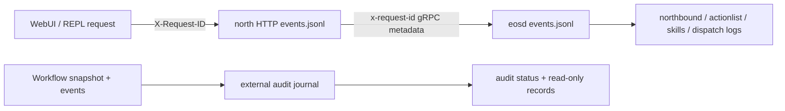

# EOS debugging runbook

[EOS overview](../README.md) · [Runtime](../design/runtime/README.md) · [Logging library](../design/lib.md#log) · [North HTTP contract](../develop/interfaces/external/http.md) · [External audit](../develop/ext/north_http/audit.md) · [中文](../../../docs_cn/eos/usage/debugging_cn.md)

Use observable boundaries before inspecting implementation state. Health identifies which process boundary is unavailable, correlation IDs join one request across processes and asynchronous owners, domain IDs join later lifecycle transitions, and the external audit cursor diagnoses retained ActionList continuity without making the audit authoritative.

## Evidence map



Diagnostic logs answer why a process or boundary accepted, rejected, retried, or failed. The audit journal answers which allowlisted ActionList/fact projections were durably observed in cursor order. Neither is a replacement for live EOS state, hardware-controller evidence, metrics, or an authenticated security audit system.

## Start with liveness and readiness

Check the adapter process first:

```sh
curl -sS http://127.0.0.1:16005/health/live
curl -sS -i http://127.0.0.1:16005/health/ready
curl -sS http://127.0.0.1:16005/v1/eos/audit/status
```

`/health/live` returning `200` proves only that the north HTTP listener can answer. `/health/ready` probes EOS gRPC health; `503` with `EOS gRPC upstream is not ready` points to EOS reachability or health. Audit health is independent and available from `/v1/eos/audit/status`; audit failure never makes liveness or functional readiness fail and never changes EOS core execution.

If north HTTP is absent, check its process manager and `var/log/eos/latest/north-http/events.jsonl`. If north HTTP is live but EOS is not ready, check the `eosd` process, configured `upstream`, EOS listener, and `var/log/eos/latest/eosd/events.jsonl`. If audit is degraded, preserve its state directory before attempting repair and inspect `north-http.audit` diagnostics.

The development launcher loads `libSegFault.so` for `eosd` when available and writes a native backtrace and memory map to `eosd/segfault.log` in that run's directory. On an `eosd` signal exit, it records the signal name, application logs, recent warning/error events, and the captured trace in `launcher.log`. Set `EOS_CORE_DUMP_LIMIT=unlimited` to additionally request a core dump from the operating system. Core files can contain camera, microphone, and request data; keep crash reports restricted and remove dumps after collecting diagnostics.

Audit recovery errors identify a failure stage and, when a record was examined, its segment and one-based position in retained history. A predecessor mismatch means the stored record points to a different preceding hash; it does not authorize rewriting the journal. Preserve the complete journal and lock file before investigating writers or restoring a verified backup.

## Correlate one request

Supply a stable request ID on the reproducing HTTP call:

```sh
request_id="debug-workflow-001"
curl -sS -H "X-Request-ID: ${request_id}" http://127.0.0.1:16005/v1/eos/runtime:snapshot
```

The response echoes `X-Request-ID`. North HTTP propagates it as `x-request-id` gRPC metadata; EOS binds it to the receiving northbound scope and preserves it onto asynchronous ActionList, skill, and dispatch work where documented.

Search current JSONL files exactly:

```sh
request_id="debug-workflow-001"
grep -F "\"correlation_id\":\"${request_id}\"" \
  var/log/eos/latest/north-http/events.jsonl \
  var/log/eos/latest/eosd/events.jsonl
```

With `jq`, keep only the fields needed for a timeline:

```sh
request_id="debug-workflow-001"
jq -c --arg id "${request_id}" \
  'select(.correlation_id == $id) | {ts,service,logger,event,fields}' \
  var/log/eos/latest/north-http/events.jsonl \
  var/log/eos/latest/eosd/events.jsonl
```

Include rotated `events.jsonl.*` files when the request predates the current segment. Do not broaden a production search by dumping request bodies, credentials, payloads, transcripts, or attachments into a debugging ticket.

## Follow domain ownership

Start with the `north-http` request or stream completion and the `northbound` gRPC method record. Then follow the owner indicated by the operation:

- Primitive calls: `dispatch` records admission, per-device FIFO contention, cancellation, timeout, release, and bounded acknowledgement metadata; backend-specific logs explain transport/device behavior.
- Backend-specific rejections retain only bounded diagnostic metadata. Correlate a rejection with the command ID, device health, and the deployment driver's own status; do not infer undocumented meanings from opaque backend codes.
- Skill calls: `skills` records exact runtime routing, queue/claim transitions, execution ID, SIGNAL lifecycle, cancellation, timeout, and terminal status; `dispatch` follows any primitive capability call.
- Workflow calls: `actionlist` records workflow/action revisions, target dispatch, fact acceptance metadata, supersession, and terminal transitions; follow `execution_id` into `skills` or `command_id` into `dispatch`.
- Resource/model calls: `northbound`, `body`, and `models.*` separate transport conversion, read-only projection, provider call, and normalized result health.

Correlation IDs identify originating work, but later autonomous observations may require exact `workflow_id`, `action_id`, `execution_id`, `command_id`, device ID, model ID, or fact source sequence. These identifiers are metadata, not permission to log their associated payloads.

For a failed skill, begin with its single `skill_execution_terminal` record. Use `reason` as the stable machine-readable category and `message` only as a bounded operator hint; also inspect `last_failed_activity` when present. The provider's `skill_execute_completed` record is debug-level implementation detail. Confirm the same reason/message in `GetExecution`, the watch/SSE terminal snapshot, or the REPL before following an associated `dispatch` failure. Never paste arguments, results, acknowledgements, resource values, device identities, concrete URIs, SIGNAL payloads, recognized text, credentials, or raw ABI/protobuf data into a replacement diagnostic.

## Diagnose Workflow SSE and cursors

Bootstrap browser state with the runtime snapshot and preserve `actionListCursor.epoch` plus decimal-string `sequence`. Open the Workflow SSE stream with the encoded `epoch:sequence` cursor:

```sh
curl -N 'http://127.0.0.1:16005/v1/eos/workflows:watch?cursor=BOOT_EPOCH%3A0'
```

Each event is named `action-list-event`; its SSE `id` is exact `epoch:sequence`, and its `data` is one complete ProtoJSON `ActionListEvent`. Persist the ID only after applying the payload. On ordinary disconnect, reconnect with `Last-Event-ID` or the `cursor` query. The query is authoritative when both are present.

An in-band `event: error` with numeric gRPC code `9` (`FAILED_PRECONDITION`) or `11` (`OUT_OF_RANGE`) means the incremental assumption is invalid or expired. Fetch a new `/v1/eos/runtime:snapshot`, replace cached ActionList/fact state, store its `actionListCursor`, and resume. Do not guess an epoch, increment sequence locally, merge partial ActionLists, or infer missing fact events from ActionList revision numbers.

## Diagnose the external audit

Read operational status without caching:

```sh
curl -sS http://127.0.0.1:16005/v1/eos/audit/status | jq .
curl -sS 'http://127.0.0.1:16005/v1/eos/audit/action-lists?limit=100' | jq .
```

`healthy` means the audit has a committed snapshot/cursor or an active stream and no permanent storage/chain/capacity failure. `stopped` is a non-degraded startup/reconnect/stop state. `degraded` plus `invalid_config`, `io`, `writer_conflict`, `corrupt_chain`, or `resource_exhausted` is fail-closed for the projection but does not gate functional readiness. The route's `records` counter is the retained record count; configured rotation limits that durable history, while the record route separately enforces a 4 MiB page and reports `truncated`.

Journal files live under `<state>/north-http/action-list-audit/`, separate from logs. Preserve `audit-*.jsonl` and `cursor.json` together before offline analysis. The service can truncate only an unterminated malformed tail consistent with a torn append. A complete malformed record, parseable unterminated tampering, interior chain break, or hash mismatch must remain degraded; do not delete evidence merely to restore readiness.

The SHA-256 chain detects retained corruption but is not cryptographic authenticity because there is no protected key. Verify filesystem ownership, deployment history, and external backups before treating it as security evidence.

## Logging versus audit data

`events.jsonl` and routed text files are diagnostic sinks controlled by `[log]`: levels, rotation, repeat suppression, append/overwrite, redaction, and attachment policy apply. They carry process/run identity, logger, event, correlation ID, and bounded operational fields, and may omit repeated or below-threshold events.

The ActionList audit is a separate `[action_list_audit]` journal controlled by its own rotation and retention. It stores only the documented projection in cursor order, never uses logging deduplication, and is not erased by `[log].overwrite`. Conversely, diagnostic logs must never copy journal records, ActionList/fact payloads, or cursor values merely to make audit debugging easier.

`north-http.audit` is a diagnostic logger, not the durable audit itself. It routes to `var/log/eos/latest/north-http/ext-north-http-audit.log` and `events.jsonl`; `north-http.client` has a reserved `ext-north-http-client.log` route but currently emits no events or request-context policy.

## Privacy-safe collection

Before sharing diagnostics, collect only the smallest time window and identifiers needed. Keep raw journal access restricted because allowlisted workflow, action, target, execution, command, and device IDs may reveal operations even though arguments, results, reasons, fact identity/value, schemas, and media are excluded.

Do not add temporary payload logging. Reproduce with explicit IDs, increase an existing logger threshold only when necessary, preserve original timestamps, `launch_id`, and `run_id`, and restore the configured level after capture. Attachments under `var/log/eos/runs/<launch-id>/attachments/`, also accessible through `var/log/eos/latest/attachments/`, are opt-in binary evidence and require a separate privacy review; they are never embedded in JSONL. The directory is flat and filenames are category-prefixed. Durable workflow and ActionList audit journals remain under `var/lib` outside these run trees.

## Verification commands

Run the focused suites after changing a boundary:

```sh
cmake --build build/aether --target \
  eos_north_http_client_tests eos_north_http_config_tests \
  eos_north_http_audit_tests eos_north_http_server_tests
ctest --test-dir build/aether/src/eos --output-on-failure \
  -R '^(eos_lib_tests|NorthHttp|AuditTest)'
ctest --test-dir build/aether/src/eos --output-on-failure \
  -R '^(eos_actionlist_tests|eos_northbound_tests|eos_dispatch_tests|eos_skill_manager_tests)$'
```

For contract changes, also run `tests/eos/test_contract_interfaces.py` through the repository test target. For a runtime incident, preserve the exact binary/config version, `run_id`, current and rotated diagnostic logs, audit status, and retained audit directory before restarting. Restarting north HTTP/audit preserves the EOS ActionList epoch and resumes its durable cursor; restarting `eosd` reconstructs the ActionList manager with a new epoch and can remove the live core reproduction state.
