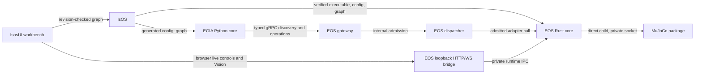

# Island 0.x target architecture

[中文](../../docs_cn/island/architecture_cn.md) · [Layer connections and data flow](layer-dataflow.md) · [Detailed implementation TODO](implementation-todo.md) · [Conventions](conventions.v1.3.0.md) · [EOS foundation](../eos/design/runtime/foundation.md)

**Target design — not implemented as one release.** The repositories already contain working parts of this system; their current interface pages and tests describe what can run today. This page fixes ownership and the integration order for the first MuJoCo-backed 0.x release. Follow the [implementation milestones](implementation-milestones.md), [EOS roadmap](../eos/maintenance/todo.md), and component roadmaps. WorkflowService, ActionList DAG execution and workflow templates are outside the 0.x target; historical wire identities remain compatibility references.

## First-use path

An operator first installs IsOS and the selected core builds, runs `isos init`, verifies the `island/mujoco-sim@0.1.1` package, composes its node set into a deployment graph, validates and applies that graph, and starts the deployment. IsOS starts EOS and EGIA as direct children. EOS starts the verified simulator as its own child and admits the declared adapters. The operator then uses IsosUI to inspect readiness, control only graph-declared nodes, watch observations and logs, and stop the deployment. The [IsOS first-run guide](https://github.com/Island-Team/isos/blob/master/docs/isos/usage/get-started.md) owns the commands; this page owns the boundaries.

| Product | Target release | Runtime and owner |
| --- | --- | --- |
| EOS | `0.2.0` | Rust owns graph admission, hardware adapters, gRPC gateway, health, and the sole actuator dispatcher; narrow CXX/C ABI adapters may supply device integration. |
| EGIA | `0.1.0` | Python owns agent state, typed stage data flow, policy, model calls, and northbound projections; it calls EOS through the existing gRPC contract. |
| IsOS | `0.1.0` | Rust owns the authored graph, verified package store, generated child configuration, process supervision, local API, logs, and version preflight. |
| IsosUI | `0.1.0` | React owns the graph editor and operator workbench; it writes through IsOS and sends only admitted EOS control requests. |
| MuJoCo package | `0.1.1` | The external executable owns simulation, scene assets, telemetry, rendering, and its owner-only Unix socket. |

The graph hierarchy is `core → layer → group → node`. A registered node type defines placement, settings, typed ports, capabilities, and lifecycle; an instance supplies identity, description, selected settings, package pins, and connections. Package metadata is neither a command payload nor a second graph authority. The [layer connection map](layer-dataflow.md) distinguishes containment, typed graph edges, process dependencies, service boundaries, fixed safety routes and log flow. The overview diagram below shows only the major authorities.

## Independent versions and compatibility

New authored graphs use `0.1.0`; new registered type IDs use `@v0.1`. Existing `1.0.0` graphs and `@v1.0` type IDs remain readable for their safe established behavior. A reader selects the parser by graph version, validates original identity and pins, normalizes in memory, and saves a new version only after an explicit compare-and-swap migration. Unknown future graph or type versions fail with a named diagnostic. The historical `isos.process.component@v1.0` arbitrary-command shape is displayed for migration but is never launched.

The product versions above are not the versions of protobuf namespaces, HTTP routes, release manifest schema, MuJoCo socket frames, primitive IDs, or historical tags. Keep those published identities and exact package pins; extend interfaces with optional fields/defaults and preserve protobuf field numbers and ProtoJSON names. IsOS preflight compares the actual graph and required features with each binary's advertised supported versions instead of assuming one exact version. An older binary that cannot read a new graph fails before launch with upgrade guidance.

## Configuration and observability algorithm

IsOS chooses its roots from `ISOS_HOME` or the XDG config/data/runtime directories. Authored graphs and `isos.toml` live in config; verified exact-version packages and immutable generated child config live in data; owner-only sockets and locks live in runtime; package download cache is separate. IsOS validates a draft, resolves exact package pins and assets, renders EOS/EGIA config into a revision-specific staging directory, verifies child capabilities, then atomically promotes the generated revision. EOS reads the applied graph without modifying it. Secrets are environment references resolved only for the intended child and never written to graph, generated diagnostics, or logs.

Each component emits the [shared JSONL envelope](conventions.v1.3.0.md#shared-observability-and-release-records). IsOS aggregates by deployment and source, retains bounded rotated files, and exposes cursor reads. At startup an operator sees one ready event per module or one actionable failure; later events represent state changes. A rotated cursor tells the client to reload from a fresh snapshot. Correlation IDs connect graph Apply, launch, EOS commands, EGIA missions, and simulator outcomes without recording raw media or model content.

## Ownership rules

- IsOS owns package registry lookup, signature/digest and platform checks, installation, graph revisions, selector options, process order, and version preflight. Installation never activates a package.
- EOS owns typed hardware payloads, adapter factories, runtime status and health, the gRPC peer used by EGIA, command journaling, admission, and stopping actuators before the simulator child.
- EGIA owns agent stage values and decisions. Its safety stage can refuse actions but cannot bypass EOS admission. Model-like services remain outside the deployment graph while appearing in common status and logs.
- IsosUI renders work pages and independently floating or docked control, monitor, Vision, and log panels. Visual layout is local UI state; node settings and wire QoS are graph state.

## Implementation order

Complete graph and node-type compatibility first; then catalog fields, package selectors, edge QoS, generated configuration and capability preflight; then EOS gRPC and EGIA stage integration; then MuJoCo lifecycle and IsosUI workbench qualification. Remove the unused C++ runtime only after last-caller checks, retaining the active CXX mock, adapter ABI, and schemas needed by EGIA. No public 1.0.0 tag is part of this target.
