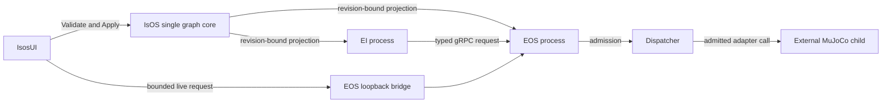

# IsOS 0.2.1 architecture target

[中文](../../docs_cn/island/architecture_cn.md) · [Unification design](unification-v0.2.1.md) · [Data flow](layer-dataflow.md) · [Conventions](conventions.v1.3.1.md)

**Integration target, unreleased.** IsOS (Island OS) is the product and the only core in new deployment graphs. EOS (Embodied OS) and EI (Embodied Intelligence, formerly EGIA) remain separately supervised processes with distinct safety and lifecycle owners. IsosUI is the graph editor and operator workbench in the same repository. The external `island/mujoco-sim@0.1.1` package supplies the verified simulator; it is not imported into this repository. The existing public EOS `0.2.0` release remains historical evidence. No `v0.2.1` tag or product release is made by this integration.

## Graph and source layout

The graph hierarchy remains `core → layer → group → node`. Graph format `0.2.0` has one `isos` core. IsOS manager layers keep their names; EOS domains use `eos_*` layers, EI domains use `ei_*` layers, and browser nodes use `ui`. New registered type IDs have the form `isos.<layer>.<name>@v0.2`. Group and instance IDs survive migration when their destination paths are unambiguous. The product source version is `0.2.1`; graph, type, HTTP, protobuf, package and simulator versions are independent.

| Source | Owner | Entry |
| --- | --- | --- |
| `crates/isos/` | Graph, package admission, revision, process supervision, local API and logs | [IsOS guide](../isos/README.md) |
| `crates/aether-*` and EOS contracts | Device adapters, health, Dispatcher admission, command outcomes and MuJoCo direct child | [EOS guide](../eos/README.md) |
| `ei/` | Cognition, stage data, model calls and EI safety | [EI guide](../ei/README.md) |
| `ui/` | Graph editor, status, logs, Vision and admitted browser controls | [IsosUI guide](../isosui/README.md) |

## Configuration and runtime flow

IsOS validates the whole graph and selected package receipts, then writes revision-bound EOS and EI projections. Each child validates its own projection before readiness. The graph is an address and configuration authority; crossing a process boundary still requires an explicit owned transport. EI safety may reject a proposal. EOS Dispatcher remains the only actuator admission route, regardless of whether the request comes from EI or the browser bridge. EOS reads the applied graph without mutating it and stops admitted actuators before terminating its MuJoCo child. IsOS orders dependent process Stop and reaps its direct children.

For first use, verify the external MuJoCo package, migrate a supported old graph if needed, Validate and Apply, launch the revision, inspect owner readiness, camera data and one admitted control result, then exercise failure, restart and safe Stop. [IsOS usage](../isos/usage/README.md) owns operator commands; [layer data flow](layer-dataflow.md) explains the boundaries.

## Compatibility and evidence

Supported `0.1.0` graphs with `isos`, `eos`, `egia` and `isosui` cores remain read-only until an explicit, atomic migration rewrites paths, type IDs, references, edges, bindings and generated configuration together. Unknown types, duplicate destination paths and ambiguous mappings produce source-path diagnostics and leave original bytes and revision intact. Safe legacy `1.0.0` reads remain available where documented. Existing EOS HTTP v2, protobuf identities and simulator socket contracts retain their independent versioning unless an owner contract changes them explicitly. Historical qualification pages in this directory record the commits and behavior tested at their original dates; they are not claims that this 0.2.1 target is released.
