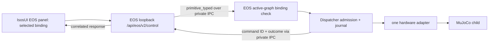
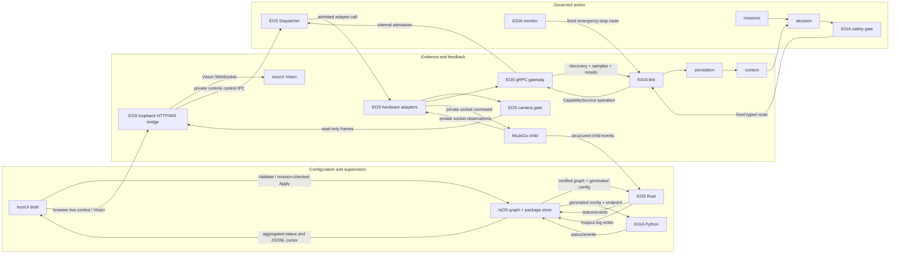

# Layer connections and data flow for the 0.x target

[中文](../../docs_cn/island/layer-dataflow_cn.md) · [Architecture overview](architecture.md) · [Implementation TODO](implementation-todo.md)

**Target design; the complete route is not implemented yet.** This is the cross-core connection map for the first IsOS → EOS → MuJoCo → EGIA deployment. A folder or graph path expresses **containment** (`core/layer/group/node`); a typed `inputs` source expresses a **data edge**; `references` and process `depends_on` express dependencies without carrying samples. A gRPC call, private simulator socket, or UI API is a service boundary, not an implicit graph wire. No WorkflowService, ActionList DAG, or graph-authored skill sequence is in this 0.x target. Exact serialized fields remain in the owner contracts linked below.

## First-use route

| Step | Connection and owner | Operator-visible evidence |
| --- | --- | --- |
| 1. Install | IsOS verifies exact package receipt, node contributions, assets and binaries; no process starts. | Package pin, digest and availability or a specific failure reason. |
| 2. Compose | IsosUI edits an IsOS draft from registered types. IsOS validates type placement, typed ports, package selectors and edges. | Type and instance descriptions, selected stable IDs, wire QoS and path-specific errors. |
| 3. Apply | IsOS compare-and-swaps the saved graph revision, resolves verified paths, renders immutable EOS/EGIA config and checks advertised version/feature sets. | Saved and active revisions remain distinct until restart. |
| 4. Launch | IsOS starts EOS; EOS starts its verified MuJoCo child and activates declared adapters; IsOS starts EGIA after EOS readiness. | Process, node and gateway readiness from their actual owners. |
| 5. Observe and act | Camera/base/arm evidence travels through EOS; EGIA discovers it through the EOS gRPC gateway. The planned IsosUI primitive demo selects one active graph binding and invokes it through the browser bridge. Both entry points converge on EOS dispatcher admission. | Selected binding and target, provenance, health, command ID and terminal or unknown result. |
| 6. Diagnose and stop | Status is read first; before deployment launch the log view opens the manager session's first Apply/package failure, and after launch it opens the deployment run's first ready/failure transition, then filters by node/correlation ID. EOS stops actuators before its simulator child; IsOS stops dependent cores. | One causal run timeline, explicit unknown outcomes and bounded stop result. |

## First primitive control demo — target UI design

One `eos.dispatcher.primitive_base` or `eos.dispatcher.primitive_manipulator` instance declares **one** primitive name/version/mode. Its `command` output has exactly one compatible hardware target via the IsOS graph. The target 0.x UI lists each active binding as one control in the EOS panel; selecting it shows the registered type and instance descriptions, typed argument help, exact target and live health from EOS. A graph wire declares the binding and never carries a browser call by itself. The current Rust runtime/bridge accepts `primitive_typed`; the binding controls and activation trace in IsosUI are still planned.

The panel first checks saved versus active revision, EOS readiness, the binding's single target, declared mode and current target health. It gets EOS monotonic time, builds the bounded typed request defined in the [primitive binding contract](../eos/interfaces/primitive-bindings.md), and submits it through the existing browser bridge. EOS verifies the source and target against its **active** graph, decodes the exact type and version, then asks Dispatcher to admit; the adapter remains the only physical release path. The selected node may show a transient `sending` state after the user invokes it, followed by the exact EOS result: `Completed`, `Cancelled`, `Rejected`, `InProgress` or `OutcomeUnknown`. `InProgress` remains nonterminal until an authorized result read confirms an outcome. A visual pulse follows a correlated response or runtime event, not a claim that a graph edge executed. Stale revision, absent binding, unhealthy target, invalid typed payload or bridge failure disables or rejects the call with a visible reason. Stop remains available through the existing governed path. EGIA uses the separate published `island.eos.v2.CapabilityService` gRPC ingress and the same Dispatcher; `eos/gateway/primitives` is a conceptual layer label, not a new graph path or wire identity.

## Three planes, one authority per plane

The arrows cross **different mechanisms**. IsOS-to-core arrows are immutable configuration and process ownership, not sample streams. EOS-to-EGIA is the existing typed gRPC service identity; EGIA never gets the simulator socket or an adapter pointer. IsosUI reads and applies through IsOS; browser live control and Vision use the existing EOS loopback HTTP/WebSocket bridge, which forwards bounded requests to the runtime private socket. EGIA uses the separate gRPC gateway. The diagram's `Dispatcher` is internal to EOS: UI and EGIA cannot address it directly. MuJoCo owns its socket protocol; EOS owns the client adapter, child lifecycle and stop order. Model-like services are separate EGIA dependencies, visible in status/logs but not deployment graph nodes.

## Connection rules by layer

| From → to | Data and connection kind | Runtime owner / gate | Failure behavior |
| --- | --- | --- | --- |
| IsOS `process/component` → EOS, EGIA | `depends_on`, generated config and child launch; **not a data edge** | IsOS checks actual graph/type support and package pins before start. | Missing feature or failed child prevents dependent readiness. |
| EOS `process/mujoco` → `hardware/{camera,base,manipulator}` | `references` plus verified adapter settings and private socket; **not arbitrary graph wiring** | EOS binds each declared device ID and compiled adapter factory to its exact package. | Mismatch leaves adapter unavailable; no substitute device. |
| EOS `hardware/camera.frame` → `interface/gate.frame` | Typed `camera_frame` source edge, then read-only `vision_frame` preview | EOS validates type/cardinality; active gate has bounded latest-frame retention. | Bad or stale frame is rejected; Vision never invents an image. |
| EOS resource/health → EGIA `io/link` → `evidence/perception` → `cognition/context` | Typed gRPC boundary followed by EGIA in-process stage ports | EOS owns payload; EGIA link validates complete discovery generation, perception bounds evidence, context bounds output. | Partial discovery blocks action; overflow is counted and attributed. |
| Operator intent → EGIA `cognition/missions` → `cognition/decision` + context | Validated intent and typed stage values, not actuator requests | EGIA owns mission revision, selection, model invocation and proposal parsing. | Empty queue idles; invalid model output produces rejection. |
| EGIA decision → `governance/safety` → fixed `io/link` egress → EOS gateway | Proposal, admitted primitive request and operation result | EGIA safety checks exact binding/policy; EOS dispatcher checks authority, health, limits, deadline and command identity again. | No graph edge can connect a proposal directly to actuation; uncertain result is never success. |
| EGIA `governance/monitor` → fixed emergency egress | Health latch and emergency-stop request | Monitor has only the dedicated stop route; EOS has final physical stop control. | Latch persists through restart until authorized reset. |
| IsosUI → EOS loopback HTTP/WS bridge → runtime | Bounded browser control and read-only Vision; **not EGIA gRPC** | The bridge checks origin and request bounds; EOS validates the node against its active graph, while UI disables control when saved/active revisions differ. Vision subscriptions carry their own revision. | Disallowed origin, inactive node or stale Vision revision fails; stale draft disables UI control. |
| EOS `dispatcher` → hardware adapter → MuJoCo | Admitted typed movement and terminal outcome | One EOS dispatcher route per actuator; simulator validates actual device and numeric bounds in managed strict mode. | Rejection or unknown outcome is reported; no implicit retry of released motion. |
| Any core → IsOS logs → IsosUI log panel | Sanitized event envelope and cursor, **not a control edge** | Producer owns event meaning; IsOS owns rotation/cursor aggregation. | Collector loss does not change command result; status stays authoritative. |

The [IsOS graph contract](https://github.com/Island-Team/isos/blob/master/docs/isos/interfaces/node-graph.md) owns source-object fields and revision semantics. [EOS hardware](../eos/interfaces/hardware.md), [Vision](../eos/interfaces/vision.md), [control](../eos/interfaces/control.md), [gRPC](../eos/interfaces/grpc.md), and [node contributions](../eos/interfaces/node-contributions.md) own EOS payloads and type registrations. [EGIA pipeline](https://github.com/Island-Team/Island-egia/blob/master/docs/egia/interfaces/pipeline.md) owns typed stage values. [MuJoCo socket](https://github.com/Island-Team/isos-mujoco-sim/blob/master/docs/mujoco/interfaces/socket.md) owns simulator frames. Do not copy their field tables into this map.

## Graph admission and routing algorithm

1. Parse by graph version and retain original bytes/revision. Resolve each registered type to its declared `(core, layer, group)`, fields, input/output ports and lifecycle. Normalize only supported legacy defaults in memory; unknown future identities fail with a path and supported set.
2. Validate every source: existing canonical node and output port, exact compatible data type and transport, required input and cardinality, permitted core boundary, no self-edge, and cycle policy. A cross-process value moves only through an explicitly owned bridge: EOS gRPC, the EOS private simulator socket client, the EOS HTTP/WS bridge, or an IsOS API. No route assumes shared memory across processes. `references` and `depends_on` are validated separately.
3. Reject graph paths that turn a proposal into an actuator command without EGIA safety and EOS dispatcher. Fixed safety→link, monitor→stop and dispatcher→adapter routes are runtime-owned. A package's node-set template can propose graph nodes, never an alternate command route.
4. Classify each edge by runtime owner: EOS for EOS-local typed routes, EGIA for EGIA in-process stage routes, or `design only` when no runtime exists. For each eligible **implemented routed evidence edge**, its owning core allocates a bounded queue and monotonic token bucket. `frequency_hz` is a positive finite delivery cap when present; absence is uncapped by that edge. Map nice `-20..19` to a documented positive weight and serve queues with bounded weighted fairness. Producer `expected_rate_hz` remains a sizing hint. Design-only edges have no runtime scheduler and are labeled as such in IsosUI.
5. Validate the whole deployment, exact package receipts and each child's advertised graph/type/feature set before Apply or launch. Publish a new generated config atomically only after complete validation. Keep the old saved bytes and active revision until explicit compare-and-swap migration and restart.

EOS's [scheduler design](../eos/design/runtime/scheduler.md) owns EOS-local queue/token behavior. EGIA owns the matching in-process evidence policy; required result, health and latch values plus fixed safety→link and monitor→stop paths must never be silently capped or dropped. IsOS rejects user QoS on non-routable or fixed safety paths. A dropped replaceable observation increments a gap counter and emits a bounded warning; an actuator command is never silently dropped as an observation. Stop closes admission, cancels or drains according to route class, obtains terminal actuator status or marks it unknown, and then reaps children in dependency order. Priority never overrides safety, and frequency is neither a command lease nor a monitor heartbeat interval.

## Trace one command and one failure

An EGIA proposal carries backend, device, primitive, version, typed arguments and correlation identity. Safety validates the complete discovery generation and policy, then the fixed link route calls EOS `CapabilityService.SubmitOperation`. EGIA follows `WatchOperation`, using `GetOperation` to recover after a broken watch; only a matching terminal success plus acknowledgement counts as success. EOS resolves the exact binding, reserves command identity, admits through Dispatcher and invokes only the selected adapter. The MuJoCo child validates its device and operation; the terminal result returns through EOS and EGIA link to perception/mission state. IsosUI reads the live result/status from owners. At each boundary, a rejection has a stable owner and event code; a timeout after physical release is `unknown`, never an automatic replay.

For a failed scene verification, IsOS stops before graph Apply or launch and logs package/asset failure under the manager-session run ID because no deployment run exists yet. For a socket failure after launch, EOS marks affected adapters unavailable, closes admission, attempts bounded actuator stop and reports any unknown outcome. EGIA link invalidates its discovery generation and safety denies new actions; IsosUI shows failed live status first and then the current run's first causal failure event. These paths are acceptance tests in the [detailed TODO](implementation-todo.md).
