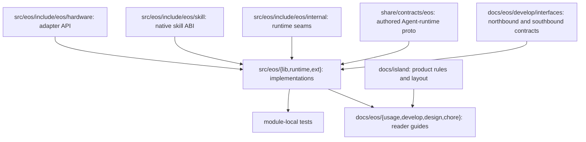

# Island-EOS layout

**Status:** Adopted standalone component layout, prepared for a history-preserving Island product merge

**Scope:** EOS native execution runtime and its Island integration surface

**Intent:** Preserve the product filesystem roles and the Agent–EOS process boundary with one component-neutral contract source

[中文](../../docs_cn/island/layout_cn.md)

## Purpose

This checkout contains EOS under `src/eos/` together with the product-level build scaffolding needed to compose it into IslandOS Aether. EOS owns device integration, read-only body and scene projection, configured outbound perception clients, command admission, execution, and the final hard-safety boundary before hardware. It has no separate runtime state or world-model foundation. Agent remains a separate process and communicates through the canonical contracts in `share/contracts/`.

The repository root is a relocatable development prefix, not a Linux root filesystem. Public commands, reference configuration, source, tests, documentation, generated builds, and mutable checkout state each have a distinct role.

## Boundaries


EOS does not embed Agent or own product prompts. Agent does not open hardware devices or bypass EOS command admission. Both components consume `share/contracts/`; `EOS_CONTRACTS` may select an installed absolute copy.

## Repository roles

`bin/`: public checkout wrappers for `eosd`, `eos-north-http`, `eos-simulator`, and `eos-repl`.

`etc/eos/`: versioned EOS process and safety configuration. Secrets do not belong here.

`src/eos/`: C++17 implementation, public headers, native modules, and module-local unit tests.

`src/eos/include/eos/skill/`: public C ABI for deployment-owned native skill libraries, installed as `eos/skill/abi.h`; skill implementations do not belong in EOS runtime source.

`tests/eos/`: component-wide and cross-module EOS verification.

`docs/island/`: product layout and cross-repository conventions.

`docs/eos/`: EOS architecture, interfaces, operations, and module references.

`build/`: ignored build output and downloaded build dependencies.

`var/`: ignored mutable checkout state, caches, logs, runtime files, and scratch data.

Diagnostic launches live under `var/log/eos/runs/<launch-id>/`, with `latest` selecting the newest run; overwrite mode uses `runs/current`. Optional media evidence lives in the flat `attachments/` directory within the same launch and is available through `var/log/eos/latest/attachments/`. Files use category prefixes such as `asr-`, `tts-`, and `vision-`; there are no category subdirectories. Overwrite mode clears the entire `runs/current` launch before writing new logs and attachments, without touching retained runs. Recovery-critical workflow and ActionList audit journals stay under `var/lib` outside these run trees.

The combined Island product may also provide `libexec/`, `src/egia/`, `src/island/`, and product-level test trees. This standalone history carries only the component-neutral runtime contracts within the shared product role.

## Source and documentation map



Implementation-only headers stay beside their module. EOS-owned driver interfaces live below `src/eos/include/eos/hardware/`; runtime-only cross-module seams live below `src/eos/include/eos/internal/`. Public modules are mapped from [the EOS documentation index](../eos/doc_index.md).

The runtime is organized by domain under `src/eos/runtime/`: `init` composes strict configuration and immutable schemas; `hardware` owns backends; `perception` projects read-only resources; `models` owns outbound model calls; `dispatch` is the sole primitive gate; `actionlist` owns workflow DAGs, facts, cursors, and retained mutation events; `skills/manager` supervises logical skill runtimes, `skills/core` holds their neutral contracts, and each execution profile stays in its own `skills/{native,managed,external}` folder; `northbound/workflow` owns the WorkflowService adapter while `northbound` owns the shared gRPC listener and remaining adapters. `src/eos/ext/north_http/{config,client,server,audit}` owns the separate REST/SSE process's strict configuration, one shared gRPC channel/stub set, HTTP server, and external non-authoritative ActionList journal respectively.

## Build and test

The root CMake project is a thin product-composition layer. It discovers `src/eos/CMakeLists.txt`, enables C++17 without compiler extensions, and can conditionally compose other Island components when their histories are present.

```sh
cmake --preset dev
cmake --build --preset dev -j
ctest --preset dev
```

Build products remain below `build/`; source, tests, build trees, local logs, and runtime state are never installed as product resources.

## Installation map

`bin/eosd`, `bin/eos-north-http`, `bin/eos-simulator`, `bin/eos-repl` -> `/usr/bin/`

Native `eosd`, `eos-north-http`, `eos-simulator`, `eos-repl` -> `/usr/libexec/island/`

`etc/eos/` -> `/etc/island/eos/`

Combined-tree `share/contracts/` -> `/usr/share/island/contracts/`

`docs/` -> `/usr/share/doc/island/`

Checkout `var/lib`, `var/cache`, `var/log`, `var/run`, `var/tmp` -> the corresponding `/var/lib/island`, `/var/cache/island`, `/var/log/island`, `/run/island`, and `/var/tmp/island` roles.

Public wrappers resolve their own location and do not depend on the caller's current working directory. Installed process lifecycle belongs to the service manager; repository helpers must not stop processes by broad name or port matching.

## Ownership rules

Product-wide paths are resolved once at composition boundaries and passed inward. Normal runtime writes are confined to resolved mutable roots. Configuration changes update both the schema or C++ representation and [the configuration reference](../eos/usage/configuration.md). Interface or process-boundary changes update the corresponding file below `docs/eos/` in the same change.

The canonical coding, documentation, module, and Git workflow is defined in [conventions.md](conventions.md).
