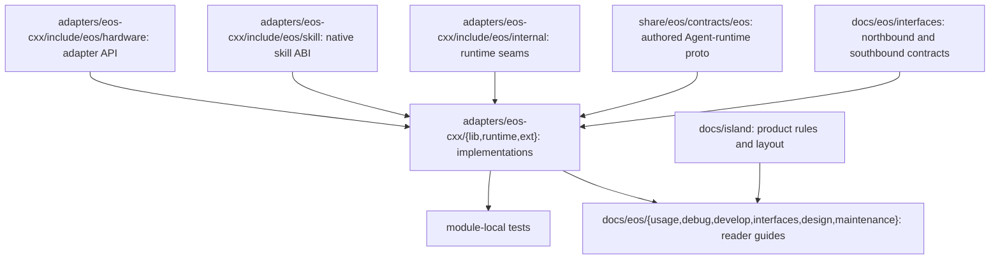

# IsOS repository layout

<!-- docs-tree:start -->
**Location:** [Docs](../README.md) / [Island](README.md) / **layout**

<details>
<summary>Docs tree</summary>

- [docs/](../README.md)
  - [island/](README.md)
    - [interfaces/](interfaces/README.md)
    - [contracts_aether.md](contracts_aether.md)
    - [conventions.v1.3.1.md](conventions.v1.3.1.md)
    - **layout.md**

</details>
<!-- docs-tree:end -->

## Unified source layout (0.2.1 target, unreleased)

This checkout contains IsOS in `crates/isos/`, EOS Rust crates in `crates/aether-*`, EI in `ei/`, and IsosUI in `ui/`. Their owner documentation lives in `docs/isos/`, `docs/eos/`, `docs/ei/` and `docs/isosui/`, with Chinese mirrors under `docs_cn/`. Shared architecture and source provenance live under `docs/island/`; published EOS contracts remain under `share/eos/`. The external `island/mujoco-sim@0.1.1` package is installed or linked by IsOS, not copied into this tree. The root Cargo workspace and lockfile compose Rust packages at source version `0.2.1`; EI has its Python project and the UI has its npm project. The graph format `0.2.0` contains one `isos` core. Build products, local package receipts and test logs are generated state, not source. See [architecture](architecture.md) and [unification](unification-v0.2.1.md).

## Historical EOS native layout

The material below records the earlier optional C++ side chain and remains for compatibility and last-caller work. It does not describe the unified source locations above.

**Status:** Historical opt-in C++ layout; use the linked Rust and node catalogs for the 0.x target

**Scope:** EOS native execution runtime and its Island integration surface

**Intent:** Preserve the product filesystem roles and the Agent–EOS process boundary with one component-neutral contract source

[中文](../../docs_cn/island/layout_cn.md)

**Current/target navigation:** the default EOS runtime is the Rust `crates/aether-*` workspace with thin public launchers. EOS documentation follows [core → layer → group → node](../eos/layers/README.md); [interfaces](../eos/interfaces/README.md) own contracts, [usage](../eos/usage/README.md) follows first use, and [runtime design](../eos/design/runtime/README.md) owns cross-layer algorithms. The `adapters/eos-cxx/`, CMake, WorkflowService, ActionList, checkout-local workflow examples, and `var/log/eos` layout described below belong to the opt-in C++ side chain and historical compatibility. The 0.x target has no workflow engine or graph-authored skill sequence; existing protobuf and ABI identities remain published. See the [historical catalog](../eos/legacy/README.md).

## Historical C++ layout purpose

This checkout contains EOS under `adapters/eos-cxx/` together with the product-level build scaffolding needed to compose it into IslandOS Aether. EOS owns device integration, read-only body and scene projection, configured outbound perception clients, command admission, execution, and the final hard-safety boundary before hardware. It has no separate runtime state or world-model foundation. Agent remains a separate process and communicates through the canonical contracts in `share/eos/contracts/`.

The repository root is a relocatable development prefix, not a Linux root filesystem. Public commands, reference configuration, source, tests, documentation, generated builds, and mutable checkout state each have a distinct role.

## Boundaries


EOS does not embed Agent or own product prompts. Agent does not open hardware devices or bypass EOS command admission. Both components consume `share/eos/contracts/`; `EOS_CONTRACTS` may select an installed absolute copy.

## Repository roles

`bin/`: public checkout wrappers for `eosd`, `eos-north-http`, and `eos-repl`.

`etc/eos/`: versioned EOS process and safety configuration. Secrets do not belong here.

`adapters/eos-cxx/`: C++17 implementation, public headers, native modules, and module-local unit tests.

`adapters/eos-cxx/include/eos/skill/`: public C ABI for deployment-owned native skill libraries, installed as `eos/skill/abi.h`; skill implementations do not belong in EOS runtime source.

`tests/eos/`: component-wide and cross-module EOS verification.

`share/`: authored contracts, generated runtime schemas and OpenAPI, plus checkout-local workflows and skill source; see the [share map](../../share/README.md).

`examples/`: teaching samples for packages, skills, and workflows; these are not installed as runtime resources.

`docs/island/`: product layout and cross-repository conventions.

`docs/eos/`: EOS architecture, interfaces, operations, and module references.

`build/`: ignored build output and downloaded build dependencies.

`var/`: ignored mutable checkout state, caches, logs, runtime files, and scratch data.

Diagnostic launches live under `var/log/eos/runs/<launch-id>/`, with `latest` selecting the newest run; overwrite mode uses `runs/current`. Optional media evidence lives in the flat `attachments/` directory within the same launch and is available through `var/log/eos/latest/attachments/`. Files use category prefixes such as `asr-`, `tts-`, and `vision-`; there are no category subdirectories. Overwrite mode clears the entire `runs/current` launch before writing new logs and attachments, without touching retained runs. Recovery-critical workflow and ActionList audit journals stay under `var/lib` outside these run trees.

The combined Island product may also provide `libexec/`, `src/egia/`, `src/island/`, and product-level test trees. This standalone history carries only the component-neutral runtime contracts within the shared product role.

## Source and documentation map



Implementation-only headers stay beside their module. EOS-owned driver interfaces live below `adapters/eos-cxx/include/eos/hardware/`; runtime-only cross-module seams live below `adapters/eos-cxx/include/eos/internal/`. Public modules are mapped from [the EOS documentation index](../eos/README.md).

The runtime is organized by domain under `adapters/eos-cxx/runtime/`: `init` composes strict configuration and immutable schemas; `hardware` owns backends; `perception` projects read-only resources; `models` owns outbound model calls; `dispatch` is the sole primitive gate; `actionlist` owns workflow DAGs, facts, cursors, and retained mutation events; `skills/manager` supervises logical skill runtimes, `skills/core` holds their neutral contracts, and each execution profile stays in its own `skills/{native,managed,external}` folder; `northbound/workflow` owns the WorkflowService adapter while `northbound` owns the shared gRPC listener and remaining adapters. `adapters/eos-cxx/ext/north_http/{config,client,server,audit}` owns the separate REST/SSE process's strict configuration, one shared gRPC channel/stub set, HTTP server, and external non-authoritative ActionList journal respectively.

## Build and test

The root CMake project is a thin product-composition layer. It discovers `adapters/eos-cxx/CMakeLists.txt`, enables C++17 without compiler extensions, and can conditionally compose other Island components when their histories are present.

```sh
cmake --preset dev
cmake --build --preset dev -j
ctest --preset dev
```

Build products remain below `build/`; source, tests, build trees, local logs, and runtime state are never installed as product resources.

## Installation map

`bin/eosd`, `bin/eos-north-http`, `bin/eos-repl` -> `/usr/bin/`

The optional native C++ `eosd`, `eos-north-http`, and `eos-repl` are build-tree tools; the default install does not put them in `/usr/libexec/island/`. Rust executables install under `/usr/libexec/island/`.

`etc/eos/` -> `/etc/island/eos/`

`share/eos/contracts/` -> `/usr/share/island/eos/contracts/`

`share/eos/schemas/` -> `/usr/share/island/eos/schemas/`

When north HTTP is enabled, `share/ext/north-http/openapi/north-http/` -> `/usr/share/island/ext/north-http/openapi/north-http/`

`docs/`, `docs_cn/` -> `/usr/share/doc/island/docs/`, `/usr/share/doc/island/docs_cn/` so their relative bilingual links remain valid.

Checkout `var/lib`, `var/cache`, `var/log`, `var/run`, `var/tmp` -> the corresponding `/var/lib/island`, `/var/cache/island`, `/var/log/island`, `/run/island`, and `/var/tmp/island` roles.

Public wrappers resolve their own location and do not depend on the caller's current working directory. Installed process lifecycle belongs to the service manager; repository helpers must not stop processes by broad name or port matching.

## Ownership rules

Product-wide paths are resolved once at composition boundaries and passed inward. Normal runtime writes are confined to resolved mutable roots. Configuration changes update both the schema or C++ representation and [the configuration reference](../eos/usage/configuration-reference.md). Interface or process-boundary changes update the corresponding file below `docs/eos/` in the same change.

The canonical coding, documentation, module, and Git workflow is defined in [conventions.v1.3.1.md](conventions.v1.3.1.md).
