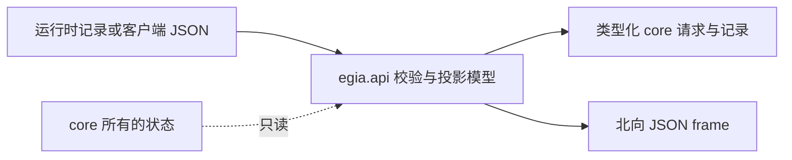

# `egia.api` 数据模型

## 目录

- [概述](#概述)
- [架构](#架构)
- [所属模块](#所属模块)
- [数据流](#数据流)
- [运行条件](#运行条件)
- [相关文档](#相关文档)

## 概述

`egia.api` 拥有运行时、北向适配器与操作端之间交换的类型化数据。这里的模块只定义值与校验，不打开 socket、不调用 EOS、不调度 Mission，也不持久化状态。运行时所有者创建这些值，`egia.io` 再把它们投影为 WebSocket frame。

## 架构

## 所属模块

`chat.py`、`invoke.py` 与 `review.py` 定义命令请求及其成功或错误回复。`mission.py` 定义 Mission 命令、生命周期记录、历史、文档与表快照。`plan.py` 定义语义 Plan graph、编辑、执行记录、迁移与操作端投影。

`context.py`、`observation.py` 与 `perceptions.py` 描述有界模型上下文和已准入 Observation 投影。`model_io.py` 描述模型消息、exchange、activity、Agent 状态与组合后的 model-I/O frame。

`primitives.py`、`skills.py` 与 `prompts.py` 描述已发现 catalog 和静态 prompt 投影。`skills.py` 还拥有严格 tagged skill command、cursor request、ack、error 和完整 execution snapshot。`status.py` 描述聚合运行时健康、子系统健康、安全状态、后端连接状态及逐设备状态。

## 数据流

命令 JSON 经 `egia.io.northbound` 解码，再由对应的严格请求模型校验。适配器附加服务端所有的信任属性，把请求转换为 core 操作，最后序列化 acknowledgement 或 error 模型。客户端输入不能提供 Mission origin、运行时 lifecycle state、安全 verdict 或后端 health。

Core record 反向流向投影模型。投影模型选择操作端可见字段，同时保留稳定 robot alias、device ID、correlation ID、timestamp、revision、result 与 failure reason。投影不会成为独立事实源；Mission、memory、perception 与 link 所有者继续保存规范状态。

Plan 数据具有显式兼容路径。`PlanRecord` 接受持久化 schema version 1、2、3，在内存中转换为 schema version 4，且不改写持久化行。新的 decision graph 要求 node ID 唯一、引用已知、不能自引用，并且 `after` 依赖关系无环。

## 运行条件

正常输入生成类型化值或使用精确 enum literal 与字段名的 JSON frame。空的可选 collection 保持为空；生产者发布前可选 snapshot 可以不存在；nullable result 与 reason 字段保留各自语义。

Malformed JSON 在这些模型运行前由北向适配器拒绝。结构无效值、严格命令模型中的未知字段、无效 enum、越界值、不一致 acknowledgement 字段、重复 graph node、未知依赖、自依赖与依赖环都会校验失败，且不改变 core 状态。

生产者 unavailable 时使用 route 级 `unavailable` error 或缺失的可选投影表示，不会伪造模型值。Timeout 由调用者所有，例如 primitive invocation 或模型执行；API 模型只携带结果状态或错误。Restart 从规范持久化记录恢复并执行读取时 Plan migration。此 package 不持有资源，因此 shutdown 无需 API 清理。

## 相关文档

WebSocket route 见 [northbound.md](northbound.md)，适配器所有权见 [io.md](io.md)，Mission 状态见 [core/missions.md](core/missions.md)，Plan 执行见 [core/decision.md](core/decision.md)，存储的 Plan record 见 [core/memory.md](core/memory.md)。
