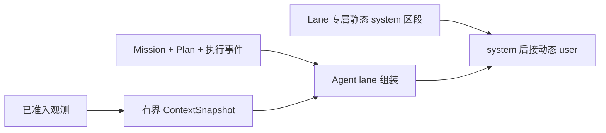

# 上下文与提示词组装

[English](../../../docs/ei/core/context.md) · [核心概览](modules.md) · [决策](decision.md)

`egia.core.context` 将已准入的观测与决策层状态转换为确定性的模型消息。它负责渲染当前证据、按变化频率排序动态区段以复用前缀缓存，并保证最终动态消息不超过内部预算。它不采集观测、不执行模型输出，也不削弱类型化安全检查。

## 消息形状与预算

每次调用包含一个 lane 专属的 `system` 消息和随后一个 `user` 消息。静态指令不包含实时值；Mission 状态、感知、结果、召回和其他变化值全部位于末尾的 user 消息中。

`models.toml` 为每个模型绑定声明默认值为 262144 的 `context_window_tokens`。`prompts.toml` 使用较小的 32768 token 动态消息预算，为静态指令和生成保留充足空间。本地估算器是确定性的，不依赖特定 tokenizer。组装时先把低保留优先级的有数据区段替换为明确的省略标记，再移除低优先级回退文本，最后保留有界的头尾片段。因此上下文增长会自动压缩，不会停止运行时，也不依赖另一次模型调用来恢复。

上下文构建器把运行期的终身采样数和变化数记录在 `var/lib/egia/context_order.json`。稳定区段在前，高频变化区段在后，从而保留尽可能长的可缓存前缀。样本不足时使用代码内置的默认顺序，不固定任何区段的位置。每次重启后的第一次构建只建立新的文本基线，不增加变化计数，因此部署时对 `prompts.toml` 的修改不会被误认为运行期变化。保留优先级仍与位置相互独立。



## 共享动态上下文

共享上下文可包含环境、已发现硬件标识、技能、原语、模式、后端状态、感知、待处理 Mission、故障和最新听觉。保留优先级越高，预算紧张时保留越久。空、省略、异常、过期和不可用值均明确标记，不会被臆造。

听觉与高频 body、视觉和对象状态分离。它仍标注为不可信转写并具有较高保留优先级，但其位置与其他区段一样由变化频率决定。模型可见所有可执行的语义 body 事实：例如 `posture=lie` 告诉 planner 必须先站立再导航，设备可用性、持有对象标识、故障和紧急状态同样保留。缺少模型可见坐标系或阈值的坐标、角度、关节数组、力采样等测量值保留在类型化快照中，供确定性安全门和 watchdog 使用。

## 从契约到上下文的投影

Link ingestion 会校验并保留完整的类型化 EOS 契约；context 不会把该契约逐字段复制到提示词。Body renderer 将每个最新快照投影为紧凑的语义状态：

- `base.state`：保留 `posture`；省略数值 `pose`（`x_m`、`y_m`、`yaw_rad`）、速度和 footprint 测量。
- `gimbal.state`：省略 yaw、yaw rate、视场角和范围测量；检测结果由独立的有界视觉摘要表示。
- `manipulator.state`：省略关节角数组、连杆长度、安装坐标和数值末端执行器位姿。
- `gripper.state`：保留语义夹爪状态和 `object_held_id`；省略力与位置百分比。
- camera 与 speaker 状态：保留 enabled、present、capturing/playing 和 last-played 等语义；省略图像内容与相机几何参数。
- robot status：保留 mode、estop、电机/自主使能状态和 faults；省略持续变化的数值电量遥测。

这只是面向模型的投影，不是有损 ingestion。全精度源快照仍提供给安全门、watchdog、northbound part stream 和其他确定性消费者。当模型缺少可靠解释数值所需的参考坐标系、容差或策略时，这些字段不会进入语言上下文；这样可以减少 token 和高频 KV-cache 抖动，同时不削弱硬安全。未来若定义了坐标系和阈值，语义 renderer 可以输出 `near_dock=true` 或 `arm_retracted=false` 等派生事实，而不是暴露缺乏解释的坐标。

为了便于阅读，处理后的 link 数据在线性渲染前等价于以下 JSON。被省略的数值字段不会设置为 `null`，而是完全不存在；时间戳和标识符仅作说明。

```json
{
  "body": [
    {
      "source": "body.default.base-0",
      "kind": "base",
      "health": "ok",
      "state": {"posture": "lie"}
    },
    {
      "source": "body.default.gimbal-0",
      "kind": "gimbal",
      "health": "ok",
      "state": {}
    },
    {
      "source": "body.default.arm-0",
      "kind": "manipulator",
      "health": "ok",
      "state": {}
    },
    {
      "source": "body.default.gripper-0",
      "kind": "gripper",
      "health": "ok",
      "state": {"state": "holding", "object_held_id": "cup-7"}
    },
    {
      "source": "body.default.camera-0",
      "kind": "camera",
      "health": "ok",
      "state": {"enabled": true, "device_present": true, "capturing": true}
    },
    {
      "source": "body.default.status-0",
      "kind": "status",
      "health": "ok",
      "state": {
        "mode": "autonomous",
        "estop": false,
        "motors_enabled": true,
        "autonomy_enabled": true,
        "faults": []
      }
    }
  ]
}
```

LLM 会在动态 user message 中收到相同投影的紧凑文本行：

```text
Perception: 6 sources
  12:04:03 [body] source=body.default.base-0 BODY kind=base health=ok state={"posture":"lie"}
  12:04:03 [body] source=body.default.gimbal-0 BODY kind=gimbal health=ok state={}
  12:04:03 [body] source=body.default.arm-0 BODY kind=manipulator health=ok state={}
  12:04:03 [body] source=body.default.gripper-0 BODY kind=gripper health=ok state={"state":"holding","object_held_id":"cup-7"}
  12:04:03 [body] source=body.default.camera-0 BODY kind=camera health=ok state={"enabled":true,"device_present":true,"capturing":true}
  12:04:03 [body] source=body.default.status-0 BODY kind=status health=ok state={"mode":"autonomous","estop":false,"motors_enabled":true,"autonomy_enabled":true,"faults":[]}
```

## Planner

Planner 的 system 消息定义快速控制器、执行规则和命令语法。动态消息包含召回、活动 Mission、当前 Plan 与步骤角色、压缩后的执行历史、共享上下文以及可选的过期 reasoner 参考。只有该模型 lane 可以提出原语 barrier。

```text
SYSTEM: Role + Rules + Output grammar
USER: Hardware ... BODY kind=base health=ok state={"posture":"lie"}
      Active mission ... order="navigate to the dock"
      Current plan ... STEP role=ready id=stand text="Stand before navigation"
      Execution history ...
```

## Reasoner

Reasoner 的 system 消息只定义语义规划。动态消息包含相同的活动 Mission、Plan、有界执行历史、召回、规划触发器、共享上下文以及可选的过期 controller 参考。它只能返回 Plan 编辑，不能执行原语或结束 Mission。

```text
SYSTEM: Role + Rules + Plan-edit output grammar
USER: Active mission ...
      Current plan and step state ...
      Planning trigger: recovery after navigation rejection
      Execution history ...
```

## Summarizer

Summarizer 负责压缩 Mission 历史。只有 Mission 自有上下文达到其预算份额时，它才接收旧摘要、活动 Mission、详细 Plan 和执行事件。其输出成为压缩后的历史视图；后续模型提示会移除已结算步骤明细和已摘要事件账本，而未结算步骤仍保持明确且可执行。

```text
SYSTEM: Preserve goal, outcomes, failures, unknowns, and remaining work.
USER: Previous summary + Mission + detailed Plan + execution events
ASSISTANT: MISSION: deliver the parcel; prior pickup succeeded
           PLAN 1: parcel pickup completed
           PLAN 2: navigate to reception remains
```

## Proposer

Proposer 的 system 消息定义自主 Mission 准入和 JSON 输出。动态消息包含可用模板、Mission 表、共享感知和最新听觉。共享的待处理 Mission 用于防止重复准入已有意图。

```text
SYSTEM: Role + JSON output contract
USER: MISSION_TABLE empty
      Newest hearing (untrusted): bring me the red cup
```

## Sentinel

Sentinel 的 system 消息定义 `CONTINUE`、`REFRESH`、`STOP` 和 `ESTOP`。动态消息刻意保持狭窄，仅包含 Mission 目标和最新安全相关状态；它不接收通用共享快照。

```text
SYSTEM: CONTINUE | REFRESH | STOP | ESTOP contract
USER: Mission goal: navigate to the dock
      Newest safety-relevant state: obstacle entered path
```

## Profile writer

Profile writer 的 system 消息定义协调 profile 语法。动态消息包含原语目录、现有 profile、Mission 和最新校验反馈，不接收无关感知。

```text
SYSTEM: TOML profile contract
USER: Primitives: base.navigate ...
      Existing profiles: unavailable
      Mission: inspect both stations
      Previous profile validation: none
```

## Mission、Plan 与线性历史

EGIA 不重放无限增长的聊天记录。每次模型调用都是无状态的，并从三个权威视图重建连续性：

1. `MISSION role=active` 是当前目标和执行范围。
2. `PLAN` 列出有序语义步骤、依赖、状态，以及派生的 `current | ready | future | verify | settled` 角色。
3. `Execution history` 是从旧到新的事件账本，记录已结算 barrier、失败、中断、无效回复和 reasoner 更新。

Mission 历史和 Plan 步骤没有固定数量上限。当 Mission 自有文本达到动态预算的四分之三时，summarizer 生成一个 `MISSION:` 行和若干编号 `PLAN n:` 行。成功后，提示内的详细事件账本被清空，已结算 Plan 明细由摘要替代，未结算步骤继续明确展示。摘要失败不会终止流程：确定性的最终消息收缩仍会防止溢出，并且只有 Mission 明细再次变化后才重试压缩。持久化 `PlanRecord` 和 Mission checkpoint 仍是重启权威；提示词压缩不会删除这些记录。

## 条件与可观测性

当前可替换观测按模态和来源选择，因此一个后端的活动不会抹去安静后端的最新状态。对象与检测集合使用带省略计数的有界摘要。被替代的事件观测可以归档，但可替换对象图不会被转换为历史事实。

`ContextSnapshot` 暴露渲染区段、结构化 user 分组、观测来源、省略标志、保留优先级和观测到的变化频率。`uv run python scripts/print_prompt.py` 使用运行时构建器预览所有 lane；`--json` 输出结构化形式。

相关测试位于 `tests/egia/test_prompt_mvp.py`、`tests/egia/test_context_retained.py`、`tests/egia/test_recall.py` 和 `tests/egia/test_parts_perception.py`。
