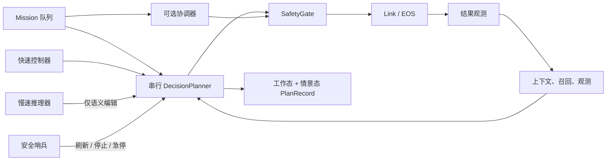
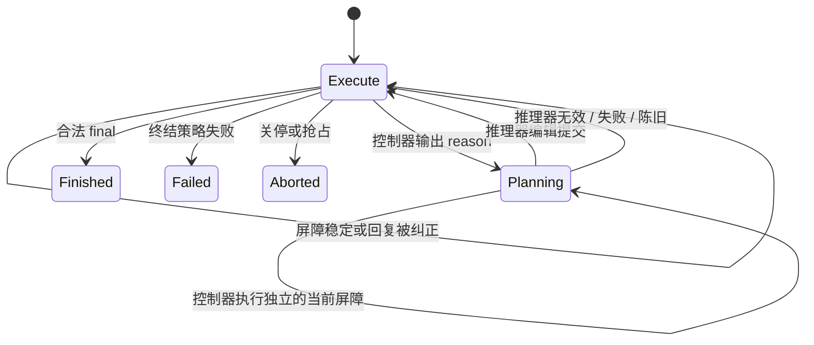

# 决策：从 Mission 语义到安全原语执行

English companion: [English](../../../docs/ei/core/decision.md)

决策子系统负责把已准入的 `MissionRecord` 转换为可编辑的语义 Plan、经过验证的原语屏障，以及持久化的 `PlanRecord`。其原始设计把**语义**与**动作**分离：模型可以理解目标并提出变更，但只有确定性代码能够解析、验证、调度、记录和发送动作。任何模型都不能直接与 EOS 通信。所有物理动作都遵循 `decision → safety gate → link → EOS`，确认结果再以 `result` 观测通过感知链路返回。

本文是 `egia.core.decision` 的总览，覆盖串行控制器/推理器路径、自主提议器、安全哨兵、模型调用策略、Profile，以及可选的多执行器协调模式。

## 设计与边界

该子系统保持五项不变量。

1. **Mission 是目标，Plan 是可变工作状态。** 模型可以新增、编辑、完成、重试、失败或删除符合条件的语义步骤，但不能改变已准入的 Mission。
2. **快速控制器是唯一的模型执行授权者。** 它使用 `none` 推理模式，每次回复至多产生一个就绪屏障，并且是唯一能让输出变成 `ActionInvocation` 的模型通道。
3. **慢速推理器只提供语义建议。** 它可以通过原子比较交换替换未来 Plan 结构，但不能输出原语，也不能结束 Mission。
4. **确认不等于物理事实证明。** EOS 接受只表示请求已被接收。必需结果会停留在 `verifying`，直至新鲜证据完成它们。
5. **记录只反映越过执行边界的工作。** 尚未执行的建议可以丢弃；已接受屏障在发出前建立检查点，结果稳定后再次建立检查点。



决策子系统不拥有 Mission 准入、感知保留、安全策略、后端传输或记忆存储引擎。它通过 `MissionQueue`、`Admission`、`ContextBuilder`、`SafetyGate`、`PrimitiveRegistry`、`DecisionModel` 和记忆存储接口消费这些契约。

## 数据模型

`MissionRecord` 提供身份、指令文本、来源/起源、优先级、可选模板身份和生命周期状态。规划器不会把其他待处理 Mission 复制进当前 Plan。

`PlanStep` 是带稳定 ID 的语义句子，状态为 `pending | running | verifying | done | failed`，并包含最新命令文本、可选原因与证据、`after` 依赖，以及两项约束：`required` 步骤禁止编辑或删除，`terminal` 步骤必须成功后才允许 `final`。

控制器回复被规范化为 `CommandReply`：零个或多个 `PlanEdit`、组成一个屏障的零个或多个独立 `ActionInvocation`、可选 `reason` 请求、可选的下一推理强度，以及 Plan 步骤 ID 或终结答案。解析是全有或全无的；格式错误的行不会产生部分执行。

`StepRecord` 记录一个已执行屏障：从 1 开始的序号、聚合结果、原因、令牌数、解析重试数、规划/执行时长、选中的语义步骤、已应用编辑，以及每个原语对应的 `ActionRecord`。`PlanRecord` 汇总 Mission 元数据、最终语义 Plan、全部已稳定屏障、注释、结果/错误、结局、修订号和模式版本，是 plans-as-memory 的持久化制品。

协调模式使用独立的 `Profile`：版本化 TOML 作业说明，包含不解析的语义 `intro` 和经过验证的 `ProfileStep` 有向无环图。每个步骤声明原语、依赖、标签、对象输入/输出、可选区域/工位、预计时长和参数。

## 串行流水线

1. **选择并标记 Mission。** 默认入口选择优先级最高的待处理 Mission 并标记为运行中。同一时间只执行一个串行 Mission。
2. **恢复持久状态。** 若启用预载且存在可恢复记录，则复制已稳定屏障和语义 Plan。原先处于 `running` 的 Plan 步骤转为 `verifying`；其结果未知，命令不得被盲目重放。
3. **初始化 Plan 并召回。** 选中的 Mission 模板可提供受保护的初始步骤。召回依次查询已审查的 reference plan、episodic plan、可用时的向量结果及相关文档摘录。记忆关闭或没有匹配项时省略该段，执行继续。
4. **识别确定性捷径。** 未模板化、未恢复且完整指令恰为一个带完整目标的原语命令时，先解析并通过注册表预检。有效命令无需控制器调用，直接成为带检查点的屏障；无效命令在发出前失败。自然语言和复合工作走常规循环。
5. **构造控制器请求。** 静态提示段组成 system message。受令牌预算约束的最后一条 user message 包含当前 Mission、Plan、召回、结果账本、感知、触发原因、存在时的陈旧对端参考，以及最新动态上下文。控制器始终使用 `none` 推理强度。
6. **推理期间持续监视。** 模型集群不可用时，可用性门会取消 completion，并在恢复后重试。哨兵并行监视新的安全相关观测。调度器、监控器或审计中断可以取消推理或冷却等待。
7. **隔离陈旧输出。** 若推理期间 Plan 代次或动作上下文改变，则丢弃控制器/推理器回复。连续 `body` 遥测和决策自身产生的 result 记录不会单独使回复失效；其他相关上下文会。陈旧对端回复可作为有界建议文本出现一次，但绝不能作为可执行输入。
8. **原子解析与验证。** 命令语法、Plan 编辑规则、依赖/就绪规则、必需/终结约束、原语注册表、显式目标、参数形状、成功动作防重放及屏障独立性均在动作运行前检查。无效回复会把可操作的验证反馈送入下一次快速请求。
9. **按需启动推理。** `reason <cause>` 是进入慢速通道的唯一方式。控制器可以只请求推理，也可在请求推理的同时提供当前可安全执行的工作。推理器接收相同语义状态，并且只能返回完整的 Plan 编辑集合。
10. **发出前建立检查点。** 选中的 Plan 步骤变为 `running`，附上确切命令，并在调用安全门前发布工作态和实时态。此时崩溃会恢复为未知屏障，而不是静默重放。
11. **执行屏障。** 仅当显式资源声明不重叠时，同一屏障内的调用才可并发；技能声明整个机器人。原语调用独立经过 `SafetyGate`。技能必须使用精确的已发现版本，其依赖全部对规划器可见，参数与结果按公布模式验证，并受同一单步超时限制（不超过 EOS 的一小时上限）。
12. **回灌结果。** 每个动作产生 `ActionRecord`、活动更新和 `kind="result"` 观测。全部成功会把普通步骤置为 `done`，必需步骤置为 `verifying`；任何拒绝/失败都会置为 `failed`；超时是中止且未知的动作结果。失败屏障会使后续已缓冲屏障失效。
13. **继续或结束。** 下一次控制器请求可见已稳定账本和新鲜上下文。只有必需步骤已稳定、终结步骤已成功、编辑合法且答案不宣称未执行工作时，`final` 才被接受。若编辑明确使整个 Plan 失败，则 Mission 失败，而非仅因终结文本可解析就成功。可选的最终语音本身也是正常的受门控原语，失败时可使 Mission 失败。
14. **持久化并稳定 Mission。** 每种退出路径都会发布最终实时 Plan。启用记忆时，规划器写入 episodic/index 状态并清除 working 状态。Mission 入口随后在 Mission 表中标记成功、失败、挂起或抢占。

## 控制器命令语言

Plan 编辑必须位于 `reason`、`step` 或 `final` 之前。允许空行及外围代码围栏；本通道不接受 JSON。

```text
effort none
plan add inspect "Inspect the target and retain observable evidence."
plan edit inspect "Inspect all visible sides of the target."
plan complete inspect "Fresh image confirms the target is intact."
plan retry inspect
plan fail inspect "The camera remains unavailable."
plan remove optional_note
reason occlusion requires a recovery route
step inspect
camera.capture@robot-a/camera-0 mode=rgb intent="collect verification evidence"
```

`final <supported outcome>` 必须是唯一终结命令，但之前可附带合法 Plan 编辑。它不能与 `reason`、`step` 或动作行共存。`step <id>` 必须至少包含一个动作。原语语法为 `name@robot/device key=value`；技能语法为 `skill name@version robot=alias key=value`。技能必须指定精确版本与机器人。标量布尔值、null、整数、浮点数、逗号列表和特殊列表字段会被确定性规范化。

解析器拒绝重复键、错误引号、多个终结形式、执行开始后的编辑、并发屏障中的共享资源及可证明存在依赖的调用。随后注册表和安全验证会拒绝未知/歧义原语、未知目标、错误模式、陈旧状态、越界、急停状态和未授权的 operator-tier 命令。

## 控制器/推理器并发



一个 Mission 最多同时存在一个控制器 completion 和一个推理器 completion。二者都捕获 Plan 代次和动作上下文指纹。规划器协程是唯一写入者。同一事件循环轮次内完成时，有效推理器结果先获得比较交换机会；其原子提交会隔离旧控制器输出。过时结果只保留一次，供另一通道重新判断。陈旧建议收件箱不会跨重启持久化。

推理器只能使用其独立绑定所支持并配置的 `low`、`medium` 或 `high` 模式。不支持的绑定能力会导致组合或 Mission 失败，而不会静默改变认知策略。

## 调用策略、预算与重试

每次调用都有触发类型：`mission_start`、`step`、`parse_retry` 或 `fault_interrupt`；提议器另使用 `proposal_event` 与 `proposal_idle`。待处理中断会把下一次规划器触发提升为 `fault_interrupt`。普通调用遵守 `min_call_interval_s`；中断绕过冷却，使紧急状态能及时重新判断。

`mission_token_budget = 0` 表示无限制。正预算由控制器和推理器共享。策略在调用进行前预留容量，完成后以服务商报告的 prompt 加 completion 用量替换预留。预算耗尽会拒绝包括中断在内的所有触发并使 Mission 失败；取消会释放预留。

成功返回但无效的控制器回复会增加连续计数，并携带验证反馈重试；有效回复重置计数。达到 `max_invalid_replies` 时 Mission 失败。模型传输失败则不同：同一逻辑请求以 `model_retry_initial_s` 到 `model_retry_max_s` 的指数退避无限重试；关停和中断可取消等待。模型不可用会暂停所有认知通道并取消活动 completion，直至恢复。

`max_steps = 0` 表示执行屏障数无限制；正数限制只统计恢复历史之后的新屏障，达到限制后 Mission 失败。`step_timeout_s` 限制每次安全门/发出调用。超时不被当作世界中的失败证明：它记录未知/中止动作，并把该不确定性返回规划过程。

## 抢占、取消、关停与重启

抢占只在安全边界检查：另一模型调用或屏障开始之前；不会重放动作，也不会假装撤销正在进行的物理动作。更高优先级胜者会中止当前 Plan，写入调度器注释；`MissionQueue` 根据容量和 `max_preemptions` 决定该 Mission 是否能回到 pending。operator 来源 Mission 始终高于 self-proposed Mission；同类替换使用配置的差值和老化分数。

监控/审计中断会取消陈旧推理，把来源/详情追加到历史和注释，然后通过快速通道重新进入。哨兵 `REFRESH` 只刷新认知；`STOP` 还请求运动停止；`ESTOP` 接合由 monitor 持有的急停锁。哨兵模型或其安全侧调用失败只会记录日志，不会暗中替代确定性安全门。

优雅关停会取消子模型任务、记录 aborted Plan，并挂起符合条件的 Mission。启用 `mission_preload = true` 后，重启会恢复它。已稳定屏障从不重放。技能启动后立即保存执行标识，并在每个 watch 快照后保存序列；重启只调用 `GetExecution` 并从游标恢复 `WatchExecution`，绝不再次调用 `StartExecution`。EOS 中找不到执行时会记录未知结果，语义步骤保持 `verifying`。原语步骤若在检查点中为 `running` 也会转为 `verifying`。禁用预载时，新启动会清除持久化的非终结 Mission 历史。

## 提议器流程

提议器是可选的非推理通道，把感知转换为候选 Mission，但绝不执行动作。它在出现新的 `hearing` 或 `detection` 时唤醒；仅在无运行中或待处理 Mission 时由空闲计时器唤醒。突发事件经防抖后合并处理。若没有非 body 观测或 Mission 生命周期变化，重复空闲 tick 不会再次消耗调用。

回复是一个紧凑 JSON 对象。提议的 urgency/value 会被限幅，成本由召回估计，同时检查 self-origin pending 容量，并由 Mission 准入去重后以 `self` 起源提交。启用模板时，只接受精确的白名单模板 ID，并以规范 Mission/Plan 替换模型措辞；未知 ID 被丢弃。只需一个已公布原语即可完全满足的请求可变为精确目标命令并使用确定性直达路径；复合意图保持自然语言。格式错误、空、噪声、重复或能力不支持的感知可不产生提议。模型错误退化到下一次事件/空闲机会，不阻塞 operator Mission。

## 哨兵流程

每次控制器调用开始时，哨兵保存 admission revision 和已知观测 ID。它忽略旧基线状态，只筛选新增的 `fault`、`status`、`vision`、`scene`、`detection` 和 `result`。相关记录构成有界的安全专用提示。`CONTINUE` 或无法解析的回复不产生信号；`REFRESH`、`STOP` 与 `ESTOP` 会取消陈旧控制器路径，后两者还调用确定性安全动作。请求失败会等待 `retry_s`，并在父调用仍活动时重试。取消会终止 watcher，不会虚构判定。

## Profile 与协调模式

当 `[decision.coordination].enabled = true` 时，协调器替换串行规划器入口，而不是与其并列的额外执行器。

1. Profile writer 把 Mission 文本、实时原语目录和最新有效 Profile 目录发给绑定推理器的模型。
2. 它提取围栏内或原始 TOML，禁止未知字段，并验证名称/步骤 ID、非空步骤、唯一 ID、已知依赖、无环依赖图、正时长和已注册原语名。
3. 无效输出最多按 writer 尝试上限重试，并反馈最后一条精确错误。耗尽后 Mission 失败且不存储任何内容。有效 Profile 保存为 `<name>.v<version>.toml`；相同版本保存会覆盖该文件。
4. 加载时每个名称选择最新有效版本。格式错误或手工改坏的文件移入 `quarantine/*.invalid`；隔离失败会记录日志并忽略该文件。Profile 模式迁移明确不受支持。
5. 有界 task board 实例化 Profile。根步骤从 `ready` 开始，有依赖步骤保持 `waiting`。board 已满会使准入失败，而不会逐出其他作业。
6. EOS discovery 为每个公布原语且 alive/admitted 的设备生成一个 bidder。设备不健康、缺少原语或无法服务显式工位时，bidder 弃权。空工位元数据表示未知/任意，并把最终准入留给 EOS。
7. 每轮拍卖使用执行时长、区域切换、原语切换、当前价格和拥塞负载，将依赖已就绪步骤分配给不同空闲 bidder。平局结果确定。没有可行 bidder 或达到 64 轮上限时，步骤保持 ready，等待后续 tick；系统绝不虚构可行性。
8. zone lease 防止共享工作区被并发占用。当前协调器在区域已被持有时推迟申请者；该路径不启用运行步骤 lease 抢占。非持有者释放 lease 是幂等无操作。
9. 每个 bidder 有一个串行 executor 队列；不同 bidder 和 Mission 可以并发。协调器在需要时注入 `part_id`，并通过同一安全门发送调用，受 `step_timeout_s` 限制。
10. 接受会把步骤置为 `done`、释放已承诺负载/区域、开放新的依赖就绪步骤，并在所有步骤完成时完成 Mission。超时、安全门拒绝或后端拒绝会把步骤与 Mission 置为失败；下游步骤永远不会就绪。每个结果也会作为决策 `result` 观测准入。
11. 重发现可以新增执行器、把消失的执行器标为不健康、刷新能力，并在恢复后替换降级的默认 bidder。消失 bidder 上已排队工作允许继续排空；新拍卖排除不健康 bidder。重发现错误按 best-effort 处理，并在下一周期重试。

协调模式目前不持久化实时 board、拍卖或 lease 状态，也不使用串行规划器的语义 `PlanRecord` 恢复路径。因此进程重启会从 Mission/Profile 输入重新构造协调工作，而非恢复精确的运行中 board。

## 条件与结局

- **空或缺失数据：** 无召回、无 Profile 目录、无哨兵相关增量或无就绪步骤，都是合法的无操作/等待状态。空模型回复、空 Profile、空屏障或空终结答案无效。
- **格式错误或超大数据：** 严格的 Pydantic/TOML/命令解析拒绝错误形状。动态提示段按优先级排序并受令牌预算约束；必需段始终保持权威。服务商截断通常表现为无效回复，并遵循纠错上限。
- **重复数据：** 重复命令键、Profile 步骤 ID、Plan 无效编辑、相同成功 primitive/target/arguments 的重放及重复 Mission 提议，在各自所属边界被拒绝或抑制。重复流式帧更新同一个 exchange，不增加请求总数。
- **陈旧或部分数据：** Plan/上下文变化隔离模型输出；失败屏障丢弃依赖的缓冲工作；部分命令解析不会执行任何内容。连续 body 遥测有意不触发失效，但发出时仍执行安全和注册表检查。
- **依赖不可用或降级：** 缺少可选记忆只移除召回/持久化；缺少向量索引退化到关键词召回；模型丢失暂停/重试认知；bidder 丢失停止新分配；哨兵失败仍保留确定性安全执行。
- **取消：** 关停、可用性丢失、中断和胜出的推理器提交会取消或隔离子工作并排空任务。发出前取消不产生动作记录；发出前检查点之后取消则恢复为未知/verifying。
- **终结行为：** 串行模式成功需要合法最终答案，协调模式成功需要所有 Profile 步骤完成。验证耗尽、令牌/步骤上限、显式全 Plan 失败、最终语音失败、Profile/board 失败或协调步骤被拒绝都会失败。关停与调度器抢占是中止/挂起，不会虚假成功。

## 配置与可观测性

`etc/egia/egia.toml` 管理决策边界和功能开关；`etc/egia/models.toml` 管理提供商绑定与公布的推理模式；`etc/egia/prompts.toml` 是唯一的通道指令来源；`etc/egia/missions.toml` 管理可选规范模板。安全阈值仍位于 `etc/egia/safety/`。

`ModelIOStore` 保留全局及每个 agent 的最新 exchange，以及每个 agent 最新原语活动。流式更新增加其 version，但同一个 `(agent_id, mission_id, exchange_id)` 只计数一次。Agent 状态为 `thinking`、`working`、`error` 或 `idle`。这是观测投影，不是持久执行状态。

## 验证映射

核心行为由 `tests/egia/test_planner_mvp.py`、`test_decision_sentinel.py`、`test_invocation_policy.py`、`test_proposer.py`、`test_profile_writer.py`、`test_profiles.py` 和 `test_coordination.py` 覆盖；语义 Plan、Mission、上下文、记忆、安全及组合测试还覆盖了相连边界。

**相关：** [核心总览](modules.md)、[上下文](context.md)、[Mission](missions.md)、[注册表](registry.md)、[安全](safety.md)、[记忆](memory.md) 与 [协调](coordination.md)。
