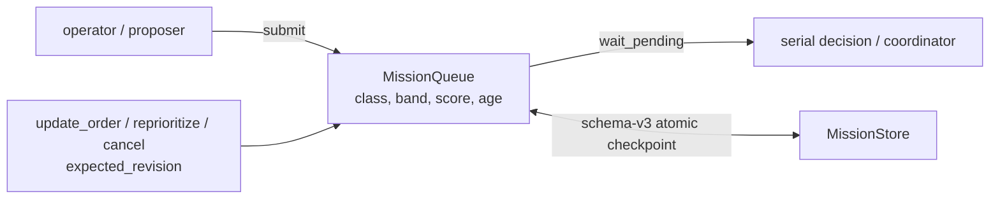

# egia/core/missions - Mission table（中文）

> 本文是英文规范 [`docs/ei/core/missions.md`](../../../docs/ei/core/missions.md) 的中文伴随文档。代码、类型、方法、字段和错误码保持英文名称。

## Contents

- [Overview](#overview)
- [Architecture](#architecture)
- [API](#api)
- [Design](#design)
- [Testing](#testing)

## Overview

`egia/core/missions/` 是 Mission 的唯一准入与调度边界。所有 Mission 共用有界 pending table；执行仍保持串行，协调模式也从同一个 table 取任务。本模块负责 durable checkpoint、Mission document revision、优先级和 lifecycle，不定义 northbound WebSocket mutation API。

`MissionState.CANCELLED` 是持久化终态。`MissionPriorityBand` 是类型化优先级带：`low | normal | high | urgent`，默认 `normal`。`MissionRecord`、Mission document 和 Mission projection 均保留该字段。

## Architecture



所有成功 mutation 都先写 durable checkpoint，再发布 in-memory state、history、archive callback 和 listener notification。写入失败时不允许出现 ghost mutation。公开 reader、`submit` 和 `wait_pending` 返回 deep snapshot，调用方不能通过修改返回对象改变 queue。

## API

`MissionQueue.get(mission_id)` 返回精确的 `MissionRecord` deep snapshot；不存在时返回 `None`。`pending()`、`records()`、`history()`、`running_mission`、`document()` 和 `revisions()` 同样不暴露内部可变对象。

Human INFO 日志记录 submit、selection、start、compact changed plan progress、finish、suspension、resubmission 与 restore 边界。`mission_progress` 包含 plan/document revision、decision mode、step-state count、current step、settled barrier count 和 latest outcome，并且仅在 compact progress signature 改变时发出。DEBUG 日志保留 document mutation、raw plan synchronization 和 step/action transition。事件只包含 ID、状态、revision、index、count、priority metadata 与布尔值；Mission text、Plan、primitive arguments、evidence 和 result payload 不进入日志。

`submit(..., priority_band=MissionPriorityBand.NORMAL)` 保存初始 band。plain Mission 创建普通可编辑 document；template Mission 保存 template ID/version 和受保护初始 Plan。

`update_order(mission_id, order, *, expected_revision)` 只允许修改 physically pending、普通且从未开始的 Mission。成功后 document revision 加一，并同步 `MissionRecord.order`、`MissionDocument.order` 和安全的 draft pending plan title。template、已开始步骤、已运行或 preempted work 都会被拒绝。

`reprioritize(mission_id, priority_band, *, expected_revision)` 可修改任何 physically pending Mission，包括已经 preempt 后重新进入 table 的 Mission。成功后 record/document band 同步，document revision 加一。

`cancel(mission_id, *, expected_revision, reason="cancelled")` 可取消任何 physically pending Mission。成功后 Mission 和 document 都变成 `CANCELLED`，设置 `finished_at`，从 pending table 移除，保留 terminal checkpoint，并执行正常 history、finished/archive callback 和 listener notification。启动恢复不会重新准入 cancelled checkpoint。

三个 mutation 都使用 Mission document revision 作为 compare-and-swap token。稳定 domain error 与 `code` 为：`MissionNotFoundError` / `mission_not_found`、`MissionConflictError` / `mission_revision_conflict`、`MissionNotPendingError` / `mission_not_pending`、`MissionProtectedError` / `mission_protected`、`MissionStartedError` / `mission_started`；其余 mutation validation 使用 `MissionMutationError` / `mission_mutation_failed`。

## Design

pending table 使用升序 key：

$$ \mathrm{key}(r)=\big(\mathrm{class\_rank}(r),-\mathrm{band\_rank}(r),-\mathrm{score}(r,\mathrm{now}),\mathrm{submitted\_at}(r)\big) $$

`operator` class 始终优先于 `self` class，任何 band 或 score 都不能跨越 class。相同 class 内，较高 band 优先；相同 band 内才比较动态 score；最后用 `submitted_at` 确定性打破平局。动态 score 仍包含 urgency、value、cost 和饱和 age term。

preemption 保持 class-dominant：较高优先级 class 必然胜出，较低 class 不能 preempt。相同 class 内，较高 band 必然胜出，较低 band 不能 preempt；band 相同时才使用既有 `preempt_margin` score hysteresis。检查仍只发生在 step boundary，不会中断 primitive call。

Mission checkpoint 当前为 schema v3。独立进程在 `mission_preload=false` 时仍可执行历史清理；托管 EGIA 启动始终恢复有效的非终态 checkpoint 或在损坏时关闭准入，不会因默认值清除先前未完成任务。in-process backend handoff 始终保留当前 session。读取时仍可将 schema v1/v2 迁移到 v3，并为旧 `MissionRecord`、document 和 revision snapshot 补默认 `normal` band。`succeeded`、`failed` 和 `cancelled` 都使用 `terminal` phase。

`etc/egia/missions.toml` 默认不进入 runtime；只有 `[decision] load_mission_templates = true` 时才加载并向 proposer 暴露 canonical Mission 和 protected initial Plan。

模型侧使用确定性的 `MISSION_TABLE`：running Mission 位于最前，pending Mission 按 scheduler 顺序排列，每行明确包含 role、短 ID、lifecycle state、origin、band、queue position 和 quoted order。active planner 另外收到 `MISSION role=active`、`CURRENT_STEP` 和逐项 `STEP`；step role 使用 `current | ready | future | verify | settled`，并保留字面 runtime state。primitive outcome 包含 robot/device target。

order edit 会保留旧 revision 的历史 order，最新 revision 与当前 record/document 使用新 order。template Plan 受到保护；只有所有工作仍为 pending 的 draft plan 才能安全同步 title。

## Testing

focused tests 使用 plugin isolation：

```bash
PYTEST_DISABLE_PLUGIN_AUTOLOAD=1 uv run pytest -p pytest_asyncio.plugin \
  tests/egia/test_missions.py \
  tests/egia/test_mission_table.py \
  tests/egia/test_mission_store.py \
  tests/egia/test_mission_document.py \
  tests/egia/test_mission_templates.py \
  tests/egia/test_coordinator.py \
  tests/egia/test_coordination.py -q
```

覆盖内容包括 class/band/score/age 排序、band preemption、snapshot isolation、revision conflict、ordinary/template/started-work edit 约束、持久化优先失败行为、archive/listener 保留、durable cancellation、禁止恢复 cancelled Mission，以及 checkpoint v1/v2 到 v3 的迁移。
