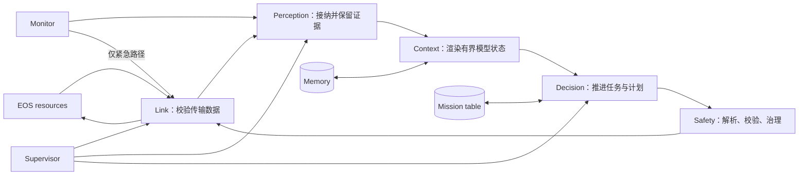

# EGIA 核心运行时

[English](../../../docs/ei/core/modules.md)

目标图层级和各类节点的操作员行为从[节点目录](../layers/README.md)开始阅读。本页记录**当前 Python 模块实现**及算法，不重复定义阶段负载契约。

本文是 `src/egia/core/` 总览。核心把外部证据与操作员意图变为受治理的 EOS primitive 调用。原始架构坚持单向权限链：观测可影响认知，认知可提出工作，但只有 安全边界能放行普通动作；设备执行与物理安全仍由 EOS 负责。

## 所有权映射

| 模块 | 所有权 | 不负责 | 详细文档 |
|---|---|---|---|
| `core/link` | EOS 通道、已校验发现代际、resource 与调用传输 | 规划和动作策略 | [Link](link.md) |
| `core/perception` | 接纳队列、有界历史、可替换当前证据 | 来源真值和提示词措辞 | [Perception](perception.md) |
| `core/context` | 确定性提示词区段与动态消息总预算 | 观测存储和模型调用 | [Context](context.md) |
| `core/registry` | 已解析 primitive 目录与规划器签名 | 传输和 native skill 执行 | [Registry](registry.md) |
| `core/missions` | 任务接纳、优先级、文档、检查点与生命周期 | 计划推理和 primitive 执行 | [Missions](missions.md) |
| `core/decision` | 模型通道、语义计划、步骤推进与结果 | primitive 放行权限 | [Decision](decision.md) |
| `core/decision/coordination` | 可选 profile DAG 市场、设备 bidder、zone lease | 虚构能力或绕过 gate | [Coordination](coordination.md) |
| `core/safety` | 普通动作接纳、审计、紧急屏障 | 物理放行保证 | [Safety](safety.md) |
| `core/monitor` | 健康事件、停滞、硬边界、速率窗口、estop latch | 普通工作执行 | [Monitor](monitor.md) |
| `core/memory` | working、episodic、已审核 reference 记录 | 任务权威状态 | [Memory](memory.md) |
| `core/supervisor` | 任务启动、就绪、重启观测、停止信号 | 领域状态 | [Supervisor](supervisor.md) |
| `core/__init__.py` | 组合依赖、注册入口、关闭资源 | 子系统算法 | 本页 |

## 端到端数据生命周期

1. 组合层解析配置与共享 schema，为每个稳定 backend alias 创建客户端，并在已解析 state/cache 根下创建存储。
2. Link 执行强制发现；只有完整且校验成功的代际才能原子替换旧快照。
3. EOS resource 与操作员 hearing 变为带来源的 `ObservationRecord`；事件保持顺序， 可替换状态按身份合并。
4. Context 读取快照并在一个总预算内渲染区段；舍入和摘要不修改 typed 原始状态。
5. 普通路径从有界 mission table 选取一个任务；显式启用 coordination 时可接纳多个 profile job。模型输出始终只是提议。
6. 普通调用必须指明 backend/device，经当前 registry 解析，通过 schema、设备限制、 策略、运行状态与速率检查后才到 link；EOS acknowledgement 作为证据返回。
7. 结果经 perception 回流，更新 plan/mission 并写 working checkpoint；结束计划写入 episodic，只有操作员提升才能进入 reference memory。
8. Monitor 独立观察链路、进度和测量边界；紧急升级先建立 fail-closed 屏障，再走专用 stop 路径。

## 生命周期与降级

`launch()` 只组合已配置子系统，由 supervisor 启动并等待就绪，运行中提供健康状态， 随后设置共享 stop 并关闭非托管资源。skill/model 发现、向量回忆、文档检索、proposer 和 coordination 可选降级，但不会改变权限链。强制发现、schema、配置或存储失败会被 显式暴露，不会用虚构数据替代。

空观测省略对应区段，空任务表等待；未知目标和畸形模型动作 fail closed。超大集合带 精确省略数。有身份语义的重复项幂等忽略，要求唯一处则拒绝。超时和取消绝不合成成功。 Raster map 目前仅保留 contract 类型，没有 source、存储、提示词区段或北向 producer。

## 架构不变量

- backend alias 是路由身份；EOS UUID 只标识进程代际。
- native skill 只提供规划说明；EGIA 不调用 `ExecuteSkill`。
- I/O 只投影状态并提交 typed request，不拥有核心状态。
- 只有 monitor 可绕过普通接纳，且仅用于紧急停止。
- 可变数据只写入已解析 `var/` 角色；依赖契约使 core 通过注入协议隔离 provider SDK 与北向 handler。
