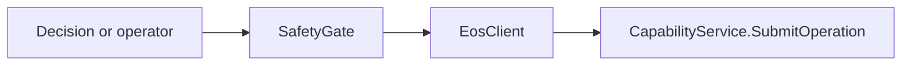

# egia/core/safety — governed EOS egress（中文）

> 本文是 [egia/core/safety — governed EOS egress](safety.md) 的中文伴随文档。代码、命令、路径、接口名称和字段名保持与英文原文一致，以便直接用于开发与运维。

## 中文说明

本页覆盖 **egia/core/safety — governed EOS egress** 的当前实现、边界和使用约定。请结合英文原文阅读完整的命令示例、配置键、协议字段与代码片段；任何与实现不一致时，以仓库中的代码和规范契约为准。

A03 将每个操作 ID 在 `SubmitOperation` 之前原子写入持久检查点。重启只用同一个 ID 调用 `GetOperation`，不会重提运动。紧急锁存先于外发停止写入并 `fsync`，记录所有受影响的别名和 EOS robot ID；EOS 或 EGIA 重启不会自动解锁。

恢复时先在外部处理 EOS estop，停止 EGIA 后在本机交互终端运行 `./bin/egia safety reset --state-root <island-state-root>`。命令须持有排他运行锁，只写一次性授权；下一次启动对每个别名两次重新发现、检查所选图 revision、`estop=false`、安全状态以及没有未解决操作后才持久解锁。任何失败都保持锁存；IsOS HTTP、管理器及 EGIA WebSocket 没有重置入口。

## 原文

以下内容保留原文，便于逐段对照：

展开英文原文

# egia/core/safety — governed EOS egress

[中文](../../../docs_cn/ei/core/safety.md) · [Core overview](modules.md)

All planner and operator actions pass through `SafetyGate`. Remote calls resolve against the current discovery catalog by the exact triple `(robot alias, device_id, primitive name)`. Missing, ambiguous, unknown, or stale targets are rejected before transport. The MVP has no Agent-local execution path.

## Implementation map and outputs

`gate.py` owns ordinary admission and returns a verdict with admission, reason and optional EOS acknowledgement. `audit.py` consumes fault observations, coalesces recovered episodes and escalates unrecovered conditions through the monitor-owned latch. `action_list.py` is a pure advisory conflict assessment; it does not execute or reserve devices. The gate reserves an owner-only operation ID checkpoint before SubmitOperation and settles it only from a terminal EOS receipt. Startup queries pending IDs with GetOperation; it never resubmits them.

An EOS acknowledgement has two distinct admission levels:

- gate admission says EGIA policy allowed the attempt;
- `primitive.ack.accepted` says EOS admitted the release.

A backend refusal is a normal result. A transport or malformed-ack failure is reported as `egress_failed` without synthesizing an acknowledgement.

## Primitive visibility

- standard primitives discovered from EOS are planner-visible;
- operator primitives require EOS exposure and `primitives.expose_operator = true`;
- privileged `motion.stop` and `safety.estop` are never planner-visible.

The operator WebSocket invokes the same gate and cannot bypass these rules.

## Fleet emergency sequence

An emergency is fleet-wide. For each affected EOS endpoint EGIA:

1. sends `motion.stop` to every discovered device whose class is `base`, `arm`, or `gimbal`;
2. sends one process-wide `safety.estop` with an empty device target;
3. records the endpoint's current EOS UUID in the fleet latch.

Calls are best effort across the entire fleet: a failed call is recorded and does not prevent attempts against other devices or endpoints. Re-engaging an already engaged latch is idempotent.

There is no `safety.estop.release`. The EGIA latch is fsynced under the durable state root before emergency egress, with the exact affected alias and EOS robot identity set. An EOS or EGIA restart never clears it. After external EOS estop remediation, a stopped EGIA process may run `egia safety reset`; the next launch consumes that one-shot authorization and checks every alias twice against a complete selected-revision discovery, `estop=false`, safe status and no unresolved operation before fsyncing unlatch. A failed check keeps the latch engaged.

## Monitor interaction

The monitor owns emergency escalation and may call the link directly for stop operations. Ordinary work still follows:

During recovery, the monitor forces EOS rediscovery and refreshes status and catalog state. It cannot clear the durable latch; the local stopped-process reset flow is the only EGIA unlatch route.

## Gate order and conditions

The gate evaluates the emergency latch, caller visibility, primitive and target resolution, canonical argument schema, device limits, configured policy, runtime state constraints, and rate or cooldown limits before transport. The first failed check returns a stable rejection reason and writes an audit observation; later checks and transport do not run. Missing, duplicated, stale, or ambiguous registry entries fail closed. Boolean values do not pass numeric checks, non-finite values are invalid, and a required limit that the device omits makes that invocation unavailable.

Admission does not predict backend acceptance. A valid rejected EOS acknowledgement is returned as a backend result; an absent, malformed, mismatched, or transport-failed acknowledgement becomes `egress_failed`. Timeouts do not imply that hardware did or did not execute, so EGIA records uncertainty and does not synthesize success. Cancellation and shutdown stop new admissions while preserving already returned audit data.

Emergency engagement creates a barrier before stop calls begin, preventing new workload from racing the fleet stop. Unknown or vanished targets, partial fleet discovery, backend refusal, timeout, and transport failure are recorded independently and cannot clear the barrier. The action-list conflict checker is currently advisory scaffolding; it does not add a second execution path or weaken the gate.

