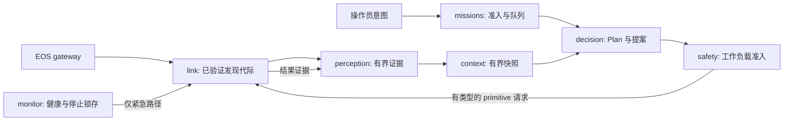

# EGIA 0.1.0 目标架构

[English](../../../docs/ei/design/architecture.md) · [节点目录](../layers/README.md) · [阶段接口](../interfaces/pipeline.md) · [首次使用](../develop/build-and-run.md) · [实现 TODO](../todo.md)

## 总览与发布状态

EGIA 是用 Python 实现的 EGI Agent core。它把带来源的 EOS 观测和操作员意图转换成 Mission、Plan 和经过安全门的 primitive 请求。EOS 负责物理执行和最终准入；IsOS 负责已安装包、已应用图、生成的配置、进程启动和统一日志视图。EGIA 本次目标版本是 `0.1.0`；产品版本不决定图、节点类型、protobuf 或 HTTP 的版本。

**当前：** `src/egia/core/` 已实现 link、perception、context、missions、decision、safety、monitor、memory 和 supervisor 的 Python 模块。A01 的 EGIA 适配器除旧 `egia.agent` profile 外还声明七种精确的 `@v0.1` 阶段类型，并为完整图渲染绑定修订的阶段覆盖文件。managed EGIA 把这些实例绑定到现有 core 所有者，stub 证据沿有类型的 link、perception、context 和 decision 端口传递。Rust EOS gRPC gateway 和 IsOS 阶段读取器已实现；所选 IsOS 托管的端到端运行仍需完成资格验证。

Q01 的可选 Vision 读取器是七个阶段以外的进程所属入口。其[私有重复代际测试设计](q01-vision-stale-test.md)在选定受管子进程中检查现有准入拒绝分支，不增加公共图像或命令路由。

**目标：** 图按 `core → layer → group → node` 描述可复用的 EGIA 阶段实例。一个 Python 进程承载整个 core；阶段节点是配置和可观测性单元，不是每个节点一个 OS 进程。注册类型固定端口、设置和生命周期；实例提供 ID、描述、连线和取值。注册类型和实例都要有 IsosUI 可见的 `description`。IsOS 只有在确认图/类型兼容且 EOS gRPC 端点可用后才生成配置并启动 EGIA。

## 数据流与所有权

图线描述证据和提案的依赖。safety 到 link 的命令路径、link 到 perception 的终结结果反馈是**受控的运行时路由**，不能成为可任意编辑的图线；这样既避免普通图环，也避免绕开安全门的第二执行路径。link resource 到 perception 的证据路径则是可编写的图线，按 A04 精确契约接受 QoS。Memory 只是有界的可选上下文来源和 checkpoint 接收方，没有动作授权权。Native skill 只提供规划语义；实际执行的只有通过准入的 primitive。

**A04 本地路由：** 仅 link resource → perception resource 和 perception observations → context observations 两条所有者路径可配置 QoS。每条路径最多保留一个最新待传值，以单调时钟限制速率，以加权公平调度服务；替换会累计缺口计数并产生 `evidence_overflow` 诊断。context snapshot → decision snapshot 尚无有界消费者，保持不限速。result、health、discovery、mission、安全及停止路径不经此调度器。IsOS 必须独立注册这些精确路径，其图才可编写 QoS 并声明 EGIA 边生效。

**A02 受治理 link：**托管运行中，IsOS 通过环境变量路径向 EGIA 交付本次运行的 grant 文件，并通过 `egia/stages.json` 交付保存图 revision。阶段组合保留该精确的 64 位小写 revision。Link 验证所有者、普通文件权限与精确的 grant 字节，然后要求 Discover、GetStatus 和 ListCapabilities 在保存图 revision 与 EOS 投影摘要上全部一致，**并与所选 IsOS revision 匹配**。强制重新发现之前以及不确定的传输中断之后，旧代际立即被封锁。Submit 携带 grant 和保存图 revision（estop 可省略 revision）；Get、Watch、Cancel 携带同一 grant 和 operation ID。响应丢失时通过同 ID 的 Get 恢复，绝不第二次 Submit。只有规范且身份匹配的终态 acknowledgement 才算成功。Safety → link 和 monitor 紧急出口仍由代码拥有；图边本身不能到达 client 写入方法或 EOS Dispatcher。

| layer / group | 阶段类型 | 输入 | 输出 | 所有者与失败规则 |
|---|---|---|---|---|
| `io / link` | `egia.link.gateway@v0.1` | 已验证的 EOS 端点、已准入请求 | 完整发现代际、资源样本、操作结果 | Link 管理通道；发现不完整时不发布新代际。 |
| `evidence / perception` | `egia.perception.admission@v0.1` | 带来源的 EOS 资源和 hearing | 有界观测快照/事件 | Perception 管理去重和限制；错误证据写诊断并拒绝。 |
| `cognition / context` | `egia.context.builder@v0.1` | 观测、body、可选 memory | 确定性的有界上下文 | Context 只负责渲染，不拥有源数据和模型调用。 |
| `cognition / missions` | `egia.missions.queue@v0.1` | 已验证的意图和计划结果 | 已选 Mission、生命周期变化 | Mission queue 管理优先级、修订和持久 checkpoint。 |
| `cognition / decision` | `egia.decision.planner@v0.1` | Mission、上下文 | 有类型的提案、Plan 转移 | Decision 管理模型调用；模型输出本身不能释放动作。 |
| `governance / safety` | `egia.safety.gate@v0.1` | 提案、当前 registry、monitor latch | 准入请求或拒绝 | Gate 管理工作负载准入；未知和过期目标默认拒绝。 |
| `governance / monitor` | `egia.monitor.health@v0.1` | Link 健康、进度、实测界限 | 健康事件和紧急锁存 | Monitor 只能通过专用紧急停止路径。 |

[节点目录](../layers/README.md)为表中每种类型提供叶页；[阶段接口](../interfaces/pipeline.md)定义类型 ID、端口类型、事件字段和设置验证。EOS 拥有 [Island-eos](https://github.com/Island-Team/Island-eos) 的 gRPC 与硬件契约（`docs/eos/interfaces/`）；EGIA 只消费它们，不重新定义 protobuf 字段或 EOS 命令。IsOS 拥有图序列化、边优先级/频率、包解析及带修订检查的 Apply。边优先级不能当作 EGIA Mission 优先级或设备安全策略。

## 算法与生命周期

1. **组合：** IsOS 解析精确版本包和 EOS 端点，检查图修订及类型支持，从已安装 EGIA 的完整默认文件与图覆盖生成不可变配置，先启动 EOS 再启动 EGIA。EGIA 在报告 ready 前解析全部配置和 schema；北向 TCP 监听成功本身不代表 ready。
2. **发现：** Link 对每个稳定 backend alias 依次调用 Gateway `Discover`、`ListResources`、`GetStatus`，再调用 CapabilityService `ListCapabilities`。按 robot、primitive、device、version 精确绑定能力；只有完整有效的发现代际才原子替换旧快照。
3. **证据准入：** Perception 验证来源和 payload，按顺序保留事件，按 key 合并可替换状态，并限制历史大小。Context 在总 prompt 预算内确定性地渲染快照，并显式记录省略数。没有可选证据时展示缺席，而非编造事实。
4. **规划与准入：** Missions 选取有界的下一个 Mission；Decision 给出有类型的提案。Safety gate 按 latch、目标、精确能力、参数 schema、设备限制、策略、运行状态、速率窗口的顺序检查。第一个失败写稳定拒绝原因，且不发送命令。准入后的 primitive 遵循 EOS 的持久操作 ID 与终结确认规则。
5. **观测与停止：** 结果作为带来源的证据进入下一次决策。Monitor 独立观察 backend 健康与进度，必要时锁存紧急停止并使用专用路径。关闭时先拒绝新提案，再取消模型工作、按 EOS 语义完成或取消在途操作、保存 Mission 终态、关闭通道并退出。超时或断线绝不表示物理成功。

必需的 EOS 发现、配置、schema 或存储失败会阻止 ready，并给出可操作的诊断。可选模型、召回、文档和 skill 来源可以降级，但不能改变 primitive 权限链。EOS 承诺可幂等处理的同一操作 ID 可以重复；身份冲突则失败。进程重启时恢复持久 Mission 状态，产生新的 run ID，并在新动作前重新发现 EOS。

## 配置、版本和日志

独立运行继续使用 `etc/egia/` 或 `--etc`；IsOS 部署通过 `EGIA_ETC`、`--mode isos --managed --no-tui` 和已解析的 EOS gRPC TCP/UDS 端点使用私有生成配置。先复制已安装包默认文件，再原子渲染图覆盖。CLI 与已文档化的环境变量可覆盖运行时选择；秘密只用环境引用，不进入生成文件或日志。目标适配器必须生成或填充 `prompts.toml`、模型绑定和安全策略，以及当前已有的 `egia.toml`、`modes.toml` 和 profile 文件。

A01 的 `egia-config setup` reader 分别声明产品 `0.1.0`、图 envelope `0.1.0` 与兼容旧版 `1.0.0`、精确的 `@v0.1` 与历史 `@v1.0` ID，以及 setup schema。保留旧 identity 标量供旧调用者使用。managed 阶段渲染要求完整的七阶段图；历史 common 设计 ID 仍只读且没有运行时路径。已合并的 IsOS A01 读取器与目录识别七个阶段类型，供跨仓库 Apply/Run 使用；所选端到端资格检查仍是独立关卡。EGIA 不改写已保存图字节；明确且带修订检查的迁移由 IsOS 负责。未知未来版本和未实现类型在启动前于其 JSON 路径失败。历史 `island.eos.v1`、`island.eos.v2` protobuf 命名空间是 wire 身份，不代表产品达到稳定版。

P05 增加精确的 setup 类型 ID 与特性令牌，以及所选 `egia --capabilities` 探针。[读取器预检设计](reader-features.md)区分运行时配置支持和图读取；EOS Gateway 就绪由 R02 验证。IsOS 在准入受管 EGIA 子进程前绑定实际启动器、解释器和安装代码。

EGIA 当前的脱敏结构化日志已有 run/correlation ID、replay JSONL、人类可读诊断、脱敏、轮转和非阻塞 session collector。目标把事件映射到共享 IsOS envelope：UTC 时间、级别、来源、core、可选规范 `node_path`、事件码、run ID、可选 correlation ID、简短消息、有界字段。配置成功后只记录一次启动摘要，之后记录状态变化和终结结果；重复诊断计数汇总，审计和终结事件始终保留。首次使用日志按“包/版本检查 → 配置渲染 → EOS 发现 → EGIA ready → Mission/动作/拒绝 → 停止”的因果顺序呈现，并从错误跳到所属阶段及恢复步骤。共享日志不替代本地 replay 或 Mission checkpoint。

## 待实现的验证

每个阶段使用假 EOS 客户端和假时钟做单元测试；通过 stub 集成测试覆盖完整发现、错误/重复/过期证据、Mission 优先级、模型超时、安全门拒绝、紧急停止和重启；再完成 IsOS → EOS → MuJoCo → EGIA 的真实进程运行。断言新旧图读取器的安全行为等价、未知版本失败，并检查日志顺序和秘密脱敏，以及北向监听断线时不能报告 ready。实现后把完整输出存入 `logs/test/<run-id>/`，在本页记录命令与结果。

2026-11-01 的文档验证：使用 Python 3 扫描 12 个中英文页面的本地链接和 fenced JSON，四个 JSON 示例均可解析，没有失效的本地链接；`git diff --check` 通过。扫描摘要位于忽略的 `logs/test/20261101-docs-egia/egia-docs.log`。这些检查只验证文档结构，不代表目标运行时已实现。
