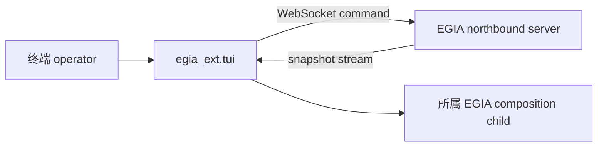

# `egia_ext` 操作端扩展

## 目录

- [概述](#概述)
- [架构](#架构)
- [所属模块](#所属模块)
- [数据流](#数据流)
- [运行条件](#运行条件)
- [相关文档](#相关文档)

## 概述

`libexec/egia_ext/` 包含私有、进程外 operator program。Extension 消费公开 EGIA interface，也可启动本地 helper，但不能通过导入 core implementation 获得执行捷径，并且不拥有运行时事实。

## 架构

## 所属模块

`tui/app.py` 协调 terminal lifecycle 与 view。`config.py` 解析 operator configuration。`feeds.py` 连接 EGIA stream，并把 frame 转换为本地 feed state。`render.py` 格式化 operator-visible panel。`repl.py` 把 terminal command 解析为公开 northbound request。`spawn.py` 拥有 child-process 创建与 teardown。`procmon.py` 观察这些 process。`__main__.py` 是私有 program entry point。

## 数据流

Terminal 读取配置、启动请求的本地 helper、订阅 northbound snapshot stream，并渲染收到的 JSON，而不成为第二状态权威。Operator text 或 command 在本地做足以选择 route 的校验，随后发送给 EGIA；规范 request validation、Mission policy、primitive gating 与 safety 仍在 EGIA 执行。

Process output 与 WebSocket frame 被规范化为有界 display state。Rendering 只改变表现；稳定 robot ID、device ID、Mission revision、correlation ID 与 backend reason 仍可追溯到来源。

## 运行条件

正常启动连接可用 feed，并让独立 view 持续更新。空 stream 或 snapshot 渲染为空或等待状态。Malformed frame、未知 command syntax 与 rejected request 显示为错误，且不在本地改变 EGIA state。

Feed unavailable、connection refused 或 reconnect delay 只影响相应 view，不授予 fallback execution path。Command timeout 与 server close code 1013 对 operator 可见。Attach mode 下 console 不拥有 runtime child；wrap mode 下 child startup failure 会被报告，不能误认为已经连接运行时。

EGIA 或 extension restart 后，stream 再次发送 current snapshot，terminal 重建 display state。Shutdown 或 terminal interruption 时取消 feed task、关闭 socket，并终止和回收 spawned child。Extension failure 不得终止 EGIA runtime。

## 相关文档

Terminal console 见 [tui.md](ext/tui.md)，消费的 wire API 见 [northbound.md](northbound.md)，northbound adapter 所有权见 [io.md](io.md)。
