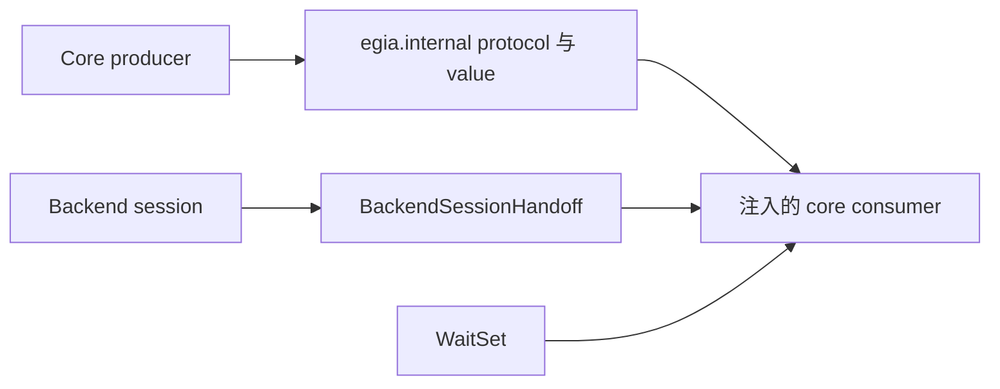

# `egia.internal` 运行时接缝

## 目录

- [概述](#概述)
- [架构](#架构)
- [所属模块](#所属模块)
- [数据流](#数据流)
- [运行条件](#运行条件)
- [相关文档](#相关文档)

## 概述

`egia.internal` 包含用于反转 core 子系统依赖的窄类型。这些接口传递数据和生命周期 signal，但不拥有 Mission、device、model policy、memory 或 northbound state。它们是内部 contract，不是稳定 external API。

## 架构

## 所属模块

`backend.py` 定义 `BackendSessionHandoff`，在 backend rebind 期间进程内交接已准入 Mission、active Plan 与有界 Observation state。`decision.py` 定义 `ActionInvocation`、`StepContext` 与 `GateVerdict`，它们把一个请求 action 经 policy 和 safety 传到可选 backend acknowledgement。

`model.py` 定义 planning 使用的 `DecisionModel` protocol，使 core 不耦合单一 provider。`recall.py` 定义 memory 使用的 `RecallIndex` protocol，可由可选 vector index 或其他实现提供。`notify.py` 定义 `WaitSet`，供 replaceable store 使用的轻量 broadcast notification primitive。

## 数据流

Producer 从已经校验的 domain data 构造 internal value，并跨注入 protocol 传递。Action invocation 保留 primitive name、稳定 robot/device target、argument 与 intent；step context 添加 Mission origin 与 execution context；gate 返回区分 admission、refusal、backend acknowledgement 和 egress failure 的 verdict。

在替换 backend-owned client、watcher 与 registry 前，composition 将已准入 Mission、active Plan 与有界 Observation state 深拷贝进 handoff。下一 session 消费隔离副本并清空 pending value；单调递增 revision 标识一次新 capture。Model 与 recall call 将 protocol result 返回给 decision 或 memory owner，由后者决定 persistence 与 operator projection。`WaitSet.notify_all` 在 store version 改变后唤醒当前 waiter；consumer 唤醒后必须重新读取 owner state。

## 运行条件

正常调用保留类型化 value，不添加 policy。空的可选 target 与 acknowledgement 必须保持显式：admitted verdict 可携带 backend rejection acknowledgement；admitted verdict 没有 acknowledgement 则表示 egress failure，不能视为成功。

Malformed data 应在所属 boundary 被拒绝；protocol implementation 仍可抛出其文档规定的 provider、storage 或 transport failure。缺少 implementation 时由 composition 禁用依赖 feature，不进行隐藏 fallback。`WaitSet.wait` timeout 时返回 `False`，notification 时返回 `True`；caller 必须允许唤醒后 state 未变或已被替换。

Restart 创建新 protocol implementation 与新 backend handoff；本 package 没有 durable object。Cancellation 与 shutdown 由所属 subsystem 控制。Recall implementation 必须关闭资源，model implementation 应在适用时释放 provider resource，waiter 必须能通过 owner 的 stop condition 退出。

## 相关文档

依赖方向见 [core/modules.md](core/modules.md)，backend session 见 [core/link.md](core/link.md)，model 与 action consumer 见 [core/decision.md](core/decision.md)，gate verdict 见 [core/safety.md](core/safety.md)，recall implementation 见 [core/memory.md](core/memory.md)。
