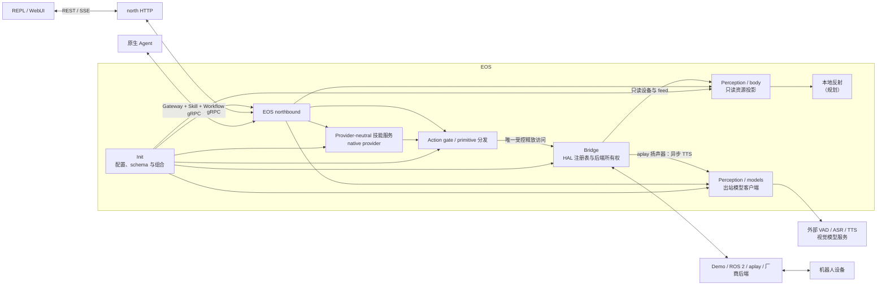

# EOS（Embodied OS）技术方案

## 仓库简介

EOS 是 IslandOS Aether 的原生执行运行时，为具身智能体提供稳定的硬件抽象、实时机器人状态，以及从 primitive 请求到设备的受控执行路径。EGIA 决定“做什么”，EOS 则决定该请求在本地机器人上“能否执行、如何执行”。

本仓库以便于合并的 `src/eos/` 布局保存 C++ EOS 组件。规范动态 JSON Schema 和产品级共享资源位于合并后的 IslandOS-Aether 树中，由 EOS 直接消费而不保留副本。

## 目录

- [目标](#目标)
- [仓库核心功能](#仓库核心功能)
- [架构](#架构)
- [布局](#布局)
- [模块](#模块)
- [算法与优化方向](#算法与优化方向)
- [交付优先级](#交付优先级)

## 目标

EOS 的目标是让智能体认知能力可靠地作用于真实机器，同时避免智能体与机器人厂商、传输方式或控制栈耦合。EOS 在稳定硬件抽象层（HAL）之上公开 **typed primitive 注册表**；在 Voyager 意义上，具备工作流和运行时记忆的组合属于 Agent 自有技能。

长期技术方向由四个相互关联的部分组成：

1. **Primitive 与 HAL——第一优先级。** 在运行时准入设备和 backend-aligned primitive；描述目标、输入、健康、时序与安全包络；使 EGIA 与后端细节解耦；在设备消失时 fail closed。
2. **动态低层反射。** 依据传感器与执行器能力声明组合快速本地反应。经典反射是 可靠基线；小型神经策略可以在有界范围内排序或修正响应，但不拥有最终释放权。
3. **高效本地感知。** 在传感器附近运行紧凑型多任务感知模型。在模型兼容时， 让检测、跟踪、场景更新和动作策略共享一份时序潜变量/token 表示，避免每个 消费者重复执行编码器并重复搬运内存。
4. **边缘与 LPDDR 优化。** 将统一内存带宽作为明确预算。优先采用零拷贝或有界 拷贝数据流、量化模型、共享编码器、定容缓冲和按速率调度；优化端到端 time-to-action 与能耗，而不只追求孤立的模型吞吐。

以上是研发方向，并非对当前实现的功能声明。[算法路线说明](algorithms_cn.md) 区分了已有基础、规划功能和研究方向，并给出各项工作的衡量方法。

### 希望突破的问题

- 接入新机器人应新增 HAL 适配器，而不是重写智能体逻辑。
- 新技能应进入受治理的能力目录，而不是增加私有命令通道。
- 云端或模型故障应降低自治能力，而不是移除本地安全。
- 高频传感器不应迫使所有消费者以相同频率运行。
- 边缘加速器不应因重复帧和 embedding 持续占满共享 LPDDR 总线。
- 学习型行为应可替换、可度量；确定性的准入、看门狗、停止权和硬件限制始终有效。

## 仓库核心功能

当前仓库提供稳定 primitive 基础，以及面向 Agent 自有技能的原生执行宿主。部署侧代码库通过稳定 C ABI 在启动时加载，在库内嵌入身份与 primitive allowlist，并且只能通过现有 dispatch 路径请求经过验证的调用。EOS 不编写技能；Workflow service 会在同一受治理执行边界上验证、调度并报告调用方提交的 ActionList 定义。

### 硬件抽象与后端准入

`runtime/hardware` 为每个进程解析一个硬件 profile，准入后端与设备组合，生成进程级 UUIDv7，并按设备类型生成确定性的零起始编号。通用 mode、binding、registry、identity 与 admission 逻辑和七类设备专用的解析、验证及后端构造相互分离。bridge 独占后端实例：body 只能读取设备身份和 feed，dispatch 才能通过受控接口释放动作。设备类型、feed、支持的 primitive 和速率包络独立于传输实现。提交的默认配置选择公开的完整 loopback `demo` profile；可选 ROS 2 后端支持由绑定选择的机械臂、夹爪和摄像头，原生 `aplay` 后端支持系统扬声器。

这是可用的 HAL 边界。高层技能实现仍由 Agent/部署侧拥有；EOS 只提供原生执行宿主和经过验证的 primitive 边界。

### 运行时初始化

`runtime/init` 读取并严格验证 `eos.toml`，加载一份进程期不可变的规范 schema 仓库，再依次组合感知模型 runtime、bridge registry、只读 body reader、dispatcher 与原生技能 runtime；组合根把进程内模型 Runtime 的异步 TTS 提交接口注入已准入的 `aplay` 扬声器。所有组件准入成功后才开放唯一 gRPC listener。关闭时先停止 gRPC 与 tick thread、等待 northbound thread 退出，再按构造逆序销毁各领域服务。`eosd` 只保留 CLI 参数与进入该组合根的职责；HTTP/SSE listener 属于独立 north HTTP 进程。

### 传输网关

`runtime/northbound` 在一个 gRPC-only listener 上提供 `GatewayService`、 `SkillService` 与 `WorkflowService`，以及 health/reflection。独立 `eos-north-http` 通过 public gRPC stub 提供完整 REST/SSE，不链接 domain internal；它可以在 EOS unavailable 时启动，并独立报告 live/ready、传播 request ID 与 cancellation。

### 原生技能宿主

`runtime/skills` 通过 transport-neutral provider 接口拆分目录、生命周期与具体执行器；应用服务拥有幂等请求、FIFO 队列、完整快照、watch、超时、取消、保留和结构化日志。当前 native provider 在 listener 启动前准入受信任的外部 `*.skill.so` 库，并以 dispatch 构造 executor。已安装的 C ABI 保持不变，只暴露元数据、同步回调、协作式取消探针和 primitive/resource capability，不暴露后端、dispatcher 或 C++ runtime 对象。EOS core 通过 gRPC `SkillService` 提供完整 catalog、execution、signal 与 stream API；north HTTP 将其映射为 REST/SSE，不提供同步执行 RPC。

技能生命周期继续使用共享的 `skills` 与 `northbound` logger、JSONL、字段截断、脱敏和去重机制。事件 taxonomy 为 `skill_execution_queued`、`skill_execution_started`、`skill_execution_idempotent_replay`、`skill_execution_idempotency_conflict`、`skill_execution_cancellation_requested`、`skill_execution_terminal`、`skill_execution_records_evicted`、`skill_execution_capacity_rejected`、`skill_provider_protocol_error`，以及四个 watch 事件 `skill_watch_opened`、`skill_watch_snapshot_sent`、`skill_watch_failed`、`skill_watch_closed`。日志只包含有界的 operational metadata；参数、结果、schema、资源内容、primitive acknowledgement、凭据和原始 protobuf payload 一律不记录。Start RPC 的 correlation ID 会传入 worker 并覆盖完整异步生命周期。

### 具身感知与资源投影

`runtime/perception/body` 通过 bridge 的只读设备/feed API，将已准入运行时转换为带版本、符合契约的机器人状态、设备、具身感知、视觉、场景和资源清单。构建逻辑按机械臂/操作器、底盘、相机、云台、夹爪、麦克风、扬声器、视觉、机器人状态、场景与 inventory/router 分开，同时保留一个统一 `Reader` API、原有资源 URI、JSON 形状、单调序列与时间戳。该模块不能取得可变后端，也不能发出命令。

### 感知模型客户端

`runtime/models` 统一拥有 TTS、ASR、VAD、视觉以及未来 VLA 等全部模型能力，包括配置、注册表、同步 HTTP 调用和有界异步 worker 队列，并按稳定 capability 处理协议与响应归一化。统一的 `vision.face` 客户端通过 operation 分派 ArcFace 操作，禁用项不参与发现、调用或自动替换。`aplay` 扬声器直接通过同一个进程内 Runtime 异步提交 Audio8，不绕行北向网关。EOS 只作为出站客户端，不启动、监控或下载外部模型服务。

### 命令分发

`runtime/dispatch` 是 action gate，统一负责 schema 验证、目标与类型准入、设备 primitive 支持与数值范围、estop、底盘速度 lease、后端释放、结构化回执和 primitive 发现。各设备处理器按机械臂、底盘、云台、夹爪、扬声器和 stop/safety 拆分；gateway 与原生技能消费同一种 transport-neutral 结果。bridge 是后端的唯一所有者，只有 dispatch 拥有受控的可变释放访问。资源仲裁和技能调度仍属于规划功能。

### 演示后端与诊断客户端

Demo adapter 通过显式 `eos-simulator` 覆盖七类设备。Simulator 在 EOS 外拥有 world 与 clock，并在 `16004` 提供自己的 WebUI API。`eos-repl` 是 `eos-north-http` 的 HTTP/SSE client，与外部 WebUI 使用同一 browser-facing contract。

### 构建、安装与验证

根 CMake 项目当前组合 EOS，并可在保留历史合并后发现 EGIA。公共 wrapper 不依赖调用者当前目录；原生程序安装到 `libexec/island`；配置、文档和共享角色独立安装。原生测试覆盖基础库、适配器、bridge 准入、body 投影、模型客户端、init/schema、网关传输、dispatch、skills、REPL 以及跨模块链路。

### 支撑与侧向模块

- **动作准入：** dispatch 已实现 fail-closed 验证、halt latch、紧急停止、运动停止与唯一释放路径；后续工作在该边界上继续强化 deadline 与过期状态处理，不另建旁路 action gate。
- **场景感知：** 已有 `perception/body` 的契约化场景投影；空间融合、占据、预测和基于新鲜度的置信度仍是后续工作。
- **运动：** 当前适配器执行有界 demo 操作；通用轨迹生成、跟踪、碰撞检查和恢复 尚未形成独立运行时模块。
- **可观测与回放：** 已有结构化日志与可选 external、privacy-allowlisted、hash-chained ActionList audit projection。journal 是 non-authoritative，SHA-256 chain 只提供 corruption evidence，不提供 attacker-proof authenticity。确定性 full-payload capture/replay、延迟 trace 和模型/技能 provenance 仍在规划中。
- **ROS 2：** 可选后端服务机械臂、夹爪和相机并验证传输隔离；具体场地的 ROS 图、厂商 bridge 和硬件限制由部署侧管理，扬声器改用原生 `aplay` 后端。

## 架构

EOS 将灵活的观测/认知图与单一受控命令路径分离。数据可以有多个生产者和消费者；物理动作必须依次跨过契约、dispatch action gate、HAL 与后端边界。



当前可执行程序已经实现 `init`、`bridge`、`perception/body`、`perception/models`、`dispatch`、`skills`、纯传输 `gateway` 以及 demo/ROS 2/`aplay`/厂商后端接缝。图中的本地反射宿主属于目标架构。

### 架构规则

- **单一释放路径。** 技能、模型、网关方法和后端都不得建立第二条执行器路径。
- **任何位置可停止，仅一处可释放。** 任意层都可请求停止；只有 dispatch 可通过 bridge 的受控接口释放动作。
- **契约先于实现。** EGIA 只看到带版本的 primitive 和状态，不看到 ROS topic、厂商句柄或 C++ 对象布局。
- **频率解耦。** 传感器、感知、反射和策略以各自频率运行，通过带新鲜度的快照交换数据。
- **学习组件受限。** 模型可以观测、排序、预测或提议；确定性代码检查其包络并拥有 最终释放权。
- **热插拔属于准入事件。** 替换后的后端或技能必须重新通过身份、健康、契约与安全 准入。
- **显式管理内存搬运。** feed 大小、速率、所有权、拷贝次数和过期时间都是边缘 性能设计的一部分。
- **Fail closed。** 配置缺失、状态过期、schema 无效、设备不健康、截止时间错过或 模型不兼容时，不得静默继续运动。

## 布局

独立仓库与合并产品树使用相同的角色路径：

```text
IslandOS-Aether/
├── bin/                         # 与 CWD 无关的公共启动器
├── etc/eos/                     # EOS 参考配置与 profile
├── share/contracts/             # Agent—运行时规范线上契约
├── src/eos/
│   ├── include/eos/
│   │   ├── hardware/            # EOS 自有硬件适配器 API
│   │   ├── skill/               # 已安装的原生技能 C ABI
│   │   └── internal/            # 运行时内部模块接口
│   ├── bin/                     # 可执行程序组合根
│   ├── lib/                     # 叶子依赖工具
│   ├── runtime/                 # init、bridge、perception/{body,models}、dispatch、skills、gateway
│   └── ext/                     # 后端、外部 simulator、诊断 REPL
├── tests/eos/                   # 原生跨模块测试
└── docs/eos/                    # EOS 文档
```

Agent 与 EOS 读取同一个 `share/contracts` 契约源；EOS 不嵌入 EGIA 代码、操作员 UI 或场地专用机器人配置。运行时状态写入只允许进入已解析的 Island state/cache/log/run/tmp 角色，不能进入源码或配置路径。

## 模块

| 模块 | 当前职责 | 成熟度 | 详情 |
|---|---|---:|---|
| `lib` | 日志、路径、时钟与固定成本工具原语 | 已实现 | [基础库](lib_cn.md) |
| `runtime/init` | 严格配置、不可变 schema 仓库与运行时组合 | 已实现 | [初始化](runtime/init_cn.md) |
| `runtime/hardware` | 通用 profile/身份/registry 准入、分类型后端构造与唯一后端所有权 | 已实现 | [Bridge](runtime/hardware_cn.md) |
| `runtime/perception/body` | 只读设备、状态、视觉、场景与资源 URI 投影 | 已实现 | [具身感知](runtime/body_cn.md) |
| `runtime/models` | 所有模型能力的配置、出站客户端、归一化与有界异步执行 | 已实现 | [模型运行时](runtime/models_cn.md) |
| `runtime/dispatch` | action gate、primitive 发现、准入、lease、回执与唯一释放路径 | 已实现基础 | [Dispatch](runtime/dispatch_cn.md) |
| `runtime/skills` | 原生技能加载/注册与经 dispatch 的执行 | 已实现基础 | [原生技能](runtime/skills_cn.md) |
| `runtime/northbound` | gRPC-only service、health、reflection 与 stream | 已实现 | [Gateway](runtime/northbound_cn.md) |
| `ext/north_http` | 独立 REST/SSE-to-gRPC gateway 与可选 non-authoritative ActionList audit | 已实现 | [north HTTP](../develop/interfaces/external/http_cn.md) |
| `ext/backends/demo` | 七类设备的确定性 HAL 适配器 | 已实现 | [Demo](../develop/ext/backends/demo_cn.md) |
| `ext/backends/aplay` | 原生有界 WAV asset 到 ALSA 的扬声器播放 | 已实现 | [Aplay 扬声器后端](../develop/ext/backends/host_cn.md#aplay-扬声器后端) |
| `ext/backends/ros2` | 可选 ROS 2 传输/后端接缝 | 初始 | [配置](../usage/configuration_cn.md) |
| `ext/repl` | 独立 HTTP/SSE 契约级诊断客户端 | 已实现 | [REPL](../develop/ext/tools/repl_cn.md) |
| 反射宿主 | 多速率经典反射与有界学习反射 | 规划 | [算法](algorithms_cn.md#dynamic-low-level-reflexes) |
| 感知宿主 | 共享紧凑编码器/token 与任务 head | 研究方向 | [算法](algorithms_cn.md#shared-perception-representation) |

## 算法与优化方向

[算法与边缘优化说明](algorithms_cn.md)详细描述建议算法、架构不变量、指标和准入条件，包括 Agent 自有技能、多速率反射仲裁、共享感知表示、基于新鲜度的状态交换、LPDDR 流量核算和确定性动作准入。

线上行为与运行机制继续由专项文档定义：

- [北向接口](../develop/interfaces/README_cn.md)
- [南向接口](../develop/interfaces/README_cn.md)
- [规范契约](../develop/interfaces/contracts_cn.md)
- [配置](../usage/configuration_cn.md)

## 交付优先级

1. **Primitive 加固：** 保持 typed 注册表与单次 release 的 dispatch 路径稳定，同时扩展后端覆盖。
2. **原生技能加固：** 围绕已实现的代码技能 ABI 增加隔离、deadline、取消传播、授权和更完整的生命周期。
3. **Dispatch 加固：** 在现有唯一 action gate 中强化 deadline、过期状态和 lease 行为，并证明异常时 fail closed。
4. **反射与感知宿主：** 先建立多速率数据槽和经典反射基线，再准入有界学习组件。
5. **边缘优化：** 测量拷贝次数、LPDDR 带宽、延迟、能耗和新鲜度，再针对实际瓶颈优化共享表示与调度。
6. **回放与资格验证：** 记录足以复现每次 primitive release 决策的 provenance，并在部署前完成后端与模型 artifact 的平台级验证。

该顺序是有意安排的：Agent 认知首先依赖可信的 primitive 界面。只有当能力、所有权、时序和释放权清晰之后，神经反射与边缘优化才能安全地产生价值。
