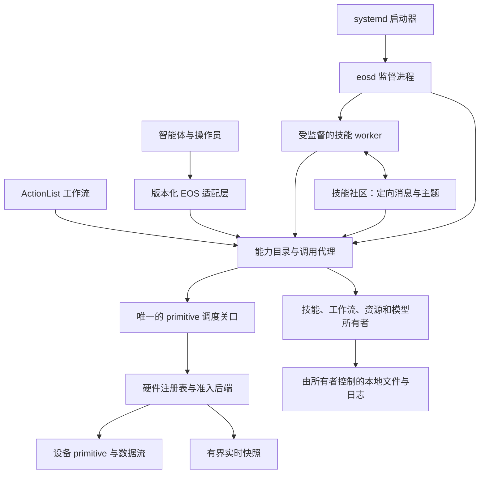

# EOS 中间件架构图

[English](../../../docs/eos/design/eos-middleware-map.md) · [EOS 文档](../README_cn.md) · [运行时总览](runtime/README_cn.md)

**EOS（Embodied OS）**是 Aether 的机器人执行组件。本文把 EOS 0.2.0 中间件职责映射到当前运行时，并标记仍待实现的扩展。OS 术语用于说明应用职责，并不要求 Linux 系统调用、内核 IPC、信号、`io_uring` 或新数据库。面向调用方的契约应写在 [EOS 接口目录](../interfaces/README_cn.md)，本文不定义报文格式。

## 所有权架构

**硬件是执行基础。**[硬件运行时](runtime/hardware-legacy_cn.md)准入一个机器人 profile，并拥有后端实例、设备身份、健康状态和数据流。primitive 是精确且带版本的设备命令。[Dispatcher](runtime/dispatch_cn.md)仍是 EOS 调用方到后端的唯一受控可变通道。稳定的机器人和部件身份表示预期目标；已准入的绑定将其解析为当前设备及其支持的精确 primitive。缺失、歧义或不支持的映射必须在释放命令前失败；Dispatcher 决定当前安全与健康结果，并重放已准入命令的结果。后端仍负责其专属的安全与物理控制。

**EOS 核心是应用级调用代理。**能力是调用方可请求的可发现操作，包括硬件动作、资源读取、模型调用和技能控制。拟议的目录描述组合后的运行时具备什么；执行范围内的权限决定调用方能使用什么。代理验证操作并交给现有所有者，记录已接受调用直至终态，或明确标记硬件结果不确定。“系统调用”在此指经过检查的应用调用；它不把 [ActionList 调度](runtime/actionlist_cn.md)、[SkillManager 执行状态](runtime/skills/manager_cn.md)、模型所有权或硬件释放转移给传输适配层。

[硬件能力内核](runtime/kernel_cn.md)现在命名已准入硬件 primitive，并让可信 northbound、ActionList 和生产打包 worker 的 primitive 调用通过同一个 Broker 与 Dispatcher。worker 令牌将精确的规范能力绑定到执行与绑定代次。[CapabilityService v2](../interfaces/capabilities_cn.md)通过原生 gRPC 与 north HTTP 向智能体提供硬件发现与操作生命周期。新 ActionList 工作流使用能力目标；历史 primitive 目标仍可读取。软件能力仍属于后续工作。

**技能通过 EOS 所有的社区通信。**已实现的 [SkillManager 社区](../interfaces/skills/native/ipc_cn.md)支持活动执行之间的有界定向消息和有界扇出的命名主题，包括打包 worker 的 ABI v2.1 调用。技能声明 schema 和收发权限；管理器检查权限，限制队列与 payload，并暴露消息丢弃计数。请求/回复是调用方在定向消息之上建立的约定，原始 callback 不提供事务。消息用于实时协调，不是持久工作队列，也不替代归属明确的事实数据。DDS 和操作系统 IPC 机制均不属于应用契约。

**信号负责工作控制和状态。**现有[技能 SIGNAL](runtime/skills/manager_cn.md)与生命周期快照是类型化技能控制及操作状态事件的基础。取消、期限、停止和终态结果仍遵守各自领域所有者的语义。客户端断开事件流不会暗中取消已接受的工作。v2 硬件操作表面现在在中间件层提供有界提交、当前状态观察、完成和取消；更广泛的异步 I/O 仍是拟议工作。智能体和技能作者不依赖 `io_uring`。

**状态按所有者和生命周期划分。**通常的快速路径使用有界、不可变的内存中[观测快照](runtime/perception_cn.md)与管理器时间线。仅在测量证明有收益时，大型数据流才可采用供多个本地消费者读取的只读共享内存快照；新鲜度、序列、代次及界限仍须通过相同资源抽象可见。持久工作流、命令和小型类型化状态保留在现有领域所有者控制的本地文件与日志中，包括[私有状态存储](runtime/store_cn.md)。重启代次用于区分新进程与保留的持久记录。本架构不引入通用数据库。

**进程边界保持明确。**一个 `eosd` 进程拥有一个已准入机器人 profile，并通过 [SkillManager](runtime/skills/manager_cn.md)监督隔离的软件包技能 worker。worker 调用代理，不取得后端句柄。worker 退出时撤销其权限，尽可能取消未完成工作，并明确报告结果不确定的物理动作。现有 systemd 启动器管理 `eosd`、外部 HTTP 适配器、仿真器等长期服务；它不是技能社区。

## 不变量

- 每项执行器效果均经过现有唯一调度关口；智能体、工作流、技能 worker、消息处理器和适配层均不持有可变后端句柄。
- primitive 的精确身份、目标准入、命令 ID、同设备顺序、stop 和 estop 优先级、租约处理及结果不确定时的恢复均遵守[调度规则](runtime/dispatch_cn.md)。
- 能力发现只描述可用性；调用仍需当前权限及准入。worker 授权随执行结束而失效，不能授权之后的执行。
- 每个已接受的异步操作都有唯一身份和可见的终态或不确定状态。传输重试不得暗中重复物理命令。
- 社区队列和实时数据流均有界。溢出、陈旧数据、重启或重放缺口必须可见，不能静默修补。
- 持久状态只有一个领域所有者。诊断日志和社区消息不能成为权威工作流或命令日志。
- 现有 v2 技能软件包通过兼容的可选 ABI 扩展继续加载；不恢复 v1 技能 ABI 支持。

## 分阶段实现

各阶段在独立分支接受审查，并依次压缩合并到 `master`。契约、实现、测试及中英文文档均分步骤提交。

1. **架构图：**本文所有权架构与迁移检查已建立。
2. **能力核心：**面向可信 northbound、ActionList 和生产打包 worker 调用的硬件专用 Catalog 与 Broker 已实现。更广泛的所有者仍待后续实现；硬件动作继续经过 Dispatcher。
3. **技能社区：**有界定向与主题消息及可选 v2.1 ABI callback 已实现。超出现有 SIGNAL 与生命周期表面的统一类型化状态/控制行为仍是后续工作。
4. **状态与异步操作：**有界硬件操作完成与 watch 已实现。更广泛的数据流整合和经测量需要的共享内存路径仍是后续工作；现有所有者控制的本地文件恢复保留。
5. **智能体动作：**v2 gRPC/HTTP 能力动作接口、REPL 命令与工作流能力目标已实现。EOS 0.2.0 退役公开的 v1 primitive 动作接口；现有读取和技能服务继续可用。
6. **发布：**EOS 报告版本 1.0.0，并提供[中英文迁移指南](../interfaces/capability-migration_cn.md)。

验证覆盖精确映射和权限、调度关口唯一性、取消与 worker 退出、消息权限与界限、重启恢复和终态完成。数据流新鲜度与更广泛的能力所有者仍是扩展工作；当前行为以所链接的运行时契约为准。
