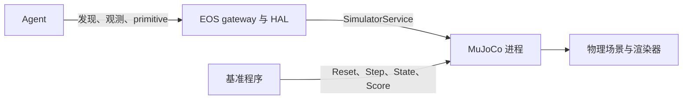

# MuJoCo 基准模拟器设计

[English](../../../docs/eos/design/mujoco.md) · [运行](../usage/mujoco_cn.md) · [开发](../develop/ext/mujoco_cn.md)

本页记录使用 `sim.toml` 与 `eos.toml` 的可选 C++ 基准模拟器设计。默认 Rust v2 路径使用 [MuJoCo v2 接口](../interfaces/mujoco_cn.md)：IsOS 解析软件包，EOS 管理仿真器子进程。历史 C++ 路径中的模拟器属于独立进程和仓库，通过私有套接字服务 EOS；另一 Unix 套接字专供可信基准程序使用。

场景将固定版本的 UR5e 与 Robotiq 模型安装在全向平面底盘上，并包含固定摄像头、桌面方块、标记托盘和两个按种子变化的障碍物。重置使用确定性整数混合算法改变方块和障碍物位置。固定的 2 ms 物理步长和重置后的手动步进使同一种子与命令序列可以重放；实时模式用于现场观测。

底盘与关节目标经 MuJoCo actuator 驱动。笛卡尔机械臂命令在六关节模型上求解 IK，并拒绝工作空间或碰撞失败。运动命令等待测得的完成或超时；stop/halt 改变活动目标并中断等待。夹爪状态来自关节运动与夹垫接触；模型不声称提供以牛顿为单位校准过的力。摄像头由固定场景视角渲染并编码为 JPEG。

基准服务读取模拟真实状态，不依赖 EOS 观测。导航按桌边区域评分；抓取要求方块离开桌面期间两侧夹垫持续接触；放置要求之前已抓取、已松开且方块位于托盘内。碰撞次数统计机器人与桌面或障碍物的接触；时间使用模拟时间。完成任务仍可能产生碰撞事件，因此目标完成与接触质量分别评估。

模拟器配置不声明云台、麦克风、扬声器和 `arm.pick`。Agent 可以组合导航、机械臂与夹爪动作；任务专用 Agent 和抓取规划不属于此包。私有基准 socket 只向评测代码提供种子控制与真实状态。

**相关：** [模拟器契约](../interfaces/external/simulator_cn.md) · [硬件运行时](runtime/hardware-legacy_cn.md) · [包实现](../develop/ext/mujoco_cn.md)
