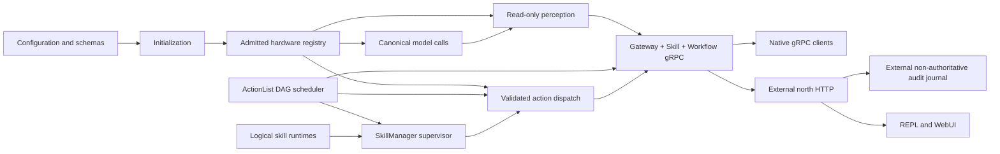

# 运行时总览

EOS 运行时把部署配置与规范契约组合成一个已准入的机器人进程。本文描述集成数据生命周期，并链接到拥有各项条件的专门页面。[EOS 文档索引](../../doc_index_cn.md)是组件级导航。

[English](../../../../docs/eos/design/runtime/README.md)

## 模块导览

[初始化](init_cn.md)读取配置和 schema、准入[硬件绑定](hardware_cn.md)，并组合[模型](models_cn.md)与[感知](perception_cn.md)。[Dispatch](dispatch_cn.md) 是唯一的 primitive 释放入口；[ActionList](actionlist_cn.md) 管理 workflow 调度及其 journal。

[技能总览](skills_cn.md)介绍与 provider 无关的执行模型。[SkillManager](skills/manager_cn.md)管理路由、claim 和执行记录；[原生技能](skills/native_cn.md)在进程内执行。[Managed](skills/managed_cn.md)与[external](skills/external_cn.md) runtime 仍是默认拒绝的占位。各专题页面解释相应生命周期。

[Northbound](northbound_cn.md)通过 gRPC 暴露 Gateway、Skill 与 Workflow；[workflow 传输](northbound/workflow_cn.md)说明转换与事件流。独立的[north HTTP 进程](../../develop/ext/north_http/README_cn.md)提供 REST/SSE，并有自己的[模块导览](../../develop/ext/north_http/README_cn.md#module-map)。test 与 schema 文件夹由所属模块记录。

## 数据生命周期

Initialization 在打开 gRPC listener 前组合模块。箭头表示 ownership crossing：hardware 提供 observation 与受控 hardware access，model 提供 canonical result，perception 保持 read-only，ActionList 拥有 workflow scheduling，skill 拥有 skill execution，所有 primitive effect 均通过 dispatch，northbound 拥有 transport mapping。

## 运行时日志

Initialization 在构造 domain service 前，根据 `[log]` 配置 structured logging system。human-readable record 直接路由到 `var/log/eos/runs/<launch-id>/eosd/`，structured event 写入 `eosd/events.jsonl`；north HTTP、simulator 与 REPL 使用同一次受监管启动中的同级 service directory，launch 根目录包含 `launcher.log`。`var/log/eos/latest` 指向最新 run；retained mode 创建唯一目录，overwrite mode 复用 `runs/current` 并在写入新输出前清空整个 launch，不影响 retained run。每条 JSONL 都携带共享的 `launch_id` 与进程特有的 `run_id`。公共 logging layer 执行 redaction 并贯穿 correlation ID；payload 永远不会写入日志。ASR、TTS、vision attachment 及 microphone VAD diagnostic capture 存储在扁平的 `var/log/eos/runs/<launch-id>/attachments/`，也可通过 `var/log/eos/latest/attachments/` 访问；文件使用 `asr-<uuid>.wav`、`tts-<uuid>.<ext>`、`vision-<uuid>.jpg` 等 category-prefixed filename。structured record 包含 `category`、`relative_path`、media type 与 byte size。durable workflow 与 ActionList audit journal 保持在 `var/lib` 下，不受 logging overwrite 清理。

north HTTP audit journal 位于该 diagnostic system 之外：它通过同一 shared gRPC client 消费 public Workflow stream，应用严格 privacy allowlist，并持久化到 state root。EOS core 从不读取它，其 readiness 影响仅限启用了 audit 的 north HTTP 进程。

## 跨模块条件

对于 configuration、schema loading、binding admission、required dependency 与 listener creation，startup 是 all-or-nothing。serving 后，read 与 action path 独立失败。缺失、陈旧、格式错误、过大或不支持的 observation 根据其 resource contract 被拒绝或省略。action 依次经过 schema validation、target resolution、capability bound、safety state 与 backend acceptance；rejection 不表示已执行。timeout、显式 cancellation、stop request 与 shutdown 通过其文档化 owner 终止 bounded work 或释放 velocity lease。client disconnect 会结束其 stream，但不会隐式取消 asynchronous skill execution。

并发 reader 观察 immutable snapshot。mutable backend access 只有一个 owner，model worker 有界，subscription 共享 sampled content，ActionList 与 skill execution 通过 dispatch 而非打开另一条 actuator path，且 SkillManager 不拥有 ActionList DAG 或 fact state。correlation identifier 与 canonical acknowledgement 或 status mapping 使 accepted、rejected、unavailable、deadline、cancellation、ambiguous outcome 与 internal failure 可观察。

Workflow reader 使用 atomic ActionList-domain cursor bootstrap ActionList 与 fact，随后 follow complete mutation event。core 保留 4,096 个 event；epoch mismatch、future sequence 或 expired retention 要求在 resume 前获取 fresh runtime snapshot。

任何 runtime layer 都不会重试 semantic rejection。transport retry 或 degraded behavior 仅存在于专门页面明确规定之处。未知 ID、resource、primitive、schema、capability 与 enum value 均 fail closed。

## 验证

每个专门页面列出其 unit、integration、simulation 或 manual check。集成运行时由 [EOS README](../../README_cn.md)所述的 component build 与 CTest suite 覆盖；仅 build 通过不能证明 hardware behavior 合格，后者需要执行[后端总览](../../develop/ext/README_cn.md)链接的 backend-specific check。
