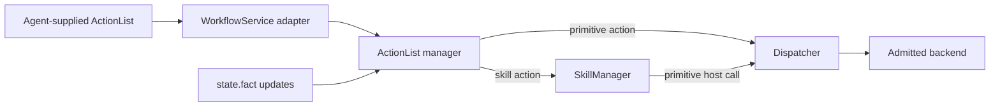

# ActionList 运行时

[运行时总览](README_cn.md) · [技能运行时](skills_cn.md) · [WorkflowService 契约](../../develop/interfaces/workflow_cn.md) · [Dispatch](dispatch_cn.md) · [English](../../../../docs/eos/design/runtime/actionlist.md)

ActionList 运行时是 EOS 核心模块，负责验证并执行 Agent 提供的有界依赖图。它是机械式调度器而非规划器：不会发明 action、重写依赖、选择替代 target，也不会重试不成功的物理操作。

## 所有权边界

`src/eos/runtime/actionlist/` 拥有准入后的 ActionList definition、action 与 list 状态、依赖推进、最新状态 fact、supersession、关联的 skill execution 与 primitive command 身份、snapshot、可 replay mutation event，以及 `actionlist` logger。其实现命名空间是 `eos::runtime::actionlist`。

ActionList manager 在组合阶段接收窄化的 skill control 与 primitive control 依赖。skill action 通过 SkillManager 启动和取消 execution。primitive action 通过 `Dispatcher::ExecuteCommand` 及其取消路径；ActionList 本身不验证或向硬件释放 command。北向 `WorkflowService` 在传输边界转换 protobuf request 和 response，不拥有 scheduler 状态。

可选 north HTTP audit 保持在 EOS core 外部。它通过 public Workflow gRPC service 消费 `GetRuntimeSnapshot` 与 `WatchActionListEvents`，只持久化 privacy-allowlisted projection，且绝不把状态或决策反馈给该 authoritative manager。

ActionList 状态与 event history 仅存在于进程内，并在 `eosd` 重启后消失。持久历史、决策策略和面向浏览器的呈现不属于本模块。

## 准入与图模型

一个 ActionList 包含非空 `workflow_id`、至少一个 action，以及可选且唯一的 `supersedes_workflow_ids`。每个 action 包含唯一且非空的 `action_id`、恰好一个 skill 或 primitive target、object 类型的 parameter payload、可选且唯一的 `depends_on` 标识，以及可选的最新 fact 相等条件。

准入在存储或启动任何 action 前解析每项依赖、拒绝自身依赖，并检查完整有向图是否存在环。图格式错误、重复标识、condition shape 无效或必需 control boundary 不可用，都会使完整 definition 被原子拒绝。target identity 与 parameter 在 eligible action 进入所属 skill 或 dispatch 边界时由该边界验证；target rejection 被保留为该 action 的 terminal `REJECTED` result，使 list 失败且不重试。

manager 拥有权威进程内 record。`WorkflowService` 将该 record 映射为 `ActionList`、`ActionItem`、`StateCondition` 与 `ManagerRuntimeSnapshot` protobuf message；protobuf type 不定义运行时 scheduler。

## 调度与并发

只有所有具名依赖均为 `SUCCEEDED`，且可选条件匹配足够新鲜的 fact 时，action 才会变为 eligible。array 顺序没有调度含义。每个 eligible root 或 dependent 均可在同一调度轮次推进，因此独立 action 可以并发执行，同时 SkillManager claim 与 Dispatcher admission 仍对各自资源保持权威。同一 device 的 primitive job 保留其 ActionList 并发性，但会在 Dispatcher 的有界 FIFO 中等待到 terminal boundary；ActionList 不拥有 device lock，也不维护另一套并行 busy-rejection policy。

skill action 从 SkillManager 获得 `execution_id`，并遵循其 queued、running 与 terminal 生命周期。primitive action 获得 EOS 生成的 `command_id`，由模块 worker pool 执行，并把 terminal acknowledgement 保留为 action result。target completion 先应用回所属 workflow 与 action，再开始下一次推进。

Action 状态为 `BLOCKED`、`READY`、`QUEUED`、`RUNNING`、`SUCCEEDED`、`REJECTED`、`FAILED`、`CANCELLED`、`TIMED_OUT` 和 `OUTCOME_UNKNOWN`。List 状态派生为 `PENDING`、`RUNNING`、`SUCCEEDED`、`FAILED`、`SUPERSEDING` 或 `SUPERSEDED`。可观察的 list 或 action 状态每次变化都会增加 revision；reader 应替换旧 snapshot，而不是合并 item array。

## Fact 与条件

本模块为每个 key 保存最新接受的 `StateFact`。fact 包含 JSON-compatible value、source identity、非零 source sequence、event time 和 receive time。已准入 skill 发出的 `state.fact` 被转换到同一 fact update 路径；ActionList 不会把任意 SIGNAL name 解释为 fact。

来自相同 source 的 update 必须具有更大的 sequence，且相对于保留值不得让 event time 后退。陈旧或重复 update 会被忽略。接受 update 后，会重新评估所有保留 list 中被阻塞的 action。

`when` condition 将保留值与 `equals` 比较。存在 `max_age` 时，event time 在评估时必须仍处于该正 duration 内。仅到期不会创建 timer；条件会在后续 fact、execution、primitive、refresh 或 scheduling event 到来时再次检查。

Fact 构成生命周期有界的 latest-value view，而不是 event database、stream join 或持久 world model。其 payload 永远不会写入日志。

## Supersession 与替换

仅当同一 `workflow_id` 的 list 仍为 `PENDING` 且每个 action 都保持 `BLOCKED` 时，提交才能替换它。替换会保留 creation time、增加 revision，并原子替换未触碰的 definition。一旦任一 action 已启动，caller 必须使用新的 workflow ID。

superseding definition 在 `supersedes_workflow_ids` 中列出已有且合格的 list，并必须使用新 `workflow_id`。每个旧 list 转为 `SUPERSEDING`，blocked 或 ready work 转为 `CANCELLED`，manager 对 queued 或 running 的 skill execution 与 primitive command 请求协作式取消。旧 list 保持可查询，并在不再存在 queued 或 running action 后进入 `SUPERSEDED`；replacement 仅在取消请求已发出后开始。

Supersession 不会回滚已完成的物理效果，也不能强制终止可信 native skill code。已在运行的 work 产生的 completion 仍可在旧的保留 list 中观察。

## 失败与不重试规则

任何 action 以 `REJECTED`、`FAILED`、`CANCELLED`、`TIMED_OUT` 或 `OUTCOME_UNKNOWN` 结束，都会使所属 list 变为 `FAILED`，并阻止后续 blocked 或 ready sibling 被派发。已经执行的 sibling 会继续到达自身 terminal state，除非显式 supersession 请求取消。

ActionList 永远不会重试 semantic rejection、timeout、cancellation、failure 或含糊的 primitive result。primitive call 抛出异常、acknowledgement 格式错误，或 acknowledgement 缺少可识别 terminal status 时，都会变为 `OUTCOME_UNKNOWN`；这保留了硬件可能已经观察到 command 的可能性。重试需要新的 Agent 决策与新的 command identity。

target admission 前的 failure 记录为 `REJECTED`，并带有有界 reason。传输成功仅表示 definition 或 query 已被处理；client 必须检查 action 与 list 状态来判断 domain success。

## Snapshot 与同步

`GetActionList` 与 `ListActionLists` 从 ActionList manager 返回完整 snapshot。`RuntimeSnapshot` 从 SkillManager 获取 skill execution，随后在一个 ActionList state lock 下复制 ActionList、fact 与当前 event cursor。它是 best-effort view，而不是跨两个 owner 的 atomic transaction，但其中的 ActionList、fact 与 cursor 彼此一致。

本模块串行化每个权威 collection 的 mutation，并向 reader 返回复制的 snapshot。关联 completion 只应用于其所属 workflow 和 action，然后触发 dependency 与 list status 重新评估。caller 必须使用 public manager operation，而不能保留或修改返回的 JSON snapshot。

## Event history 与 cursor

`EventCursor` 是 transport-neutral `{epoch, sequence}` position，由 protobuf `ActionListCursor` mirror。manager 在构造时创建新的 opaque epoch。空 manager snapshot 报告 sequence zero；每个 published event 使 sequence 增加一。

`Event` 包含其 cursor、server observation time，以及一个完整 ActionList revision 或一个完整 accepted fact update。每个 observable ActionList mutation 都发布 resulting full list。每个 accepted fact 先发布 new full fact，再发布任何 condition-triggered list revision。被拒绝的 stale 或 duplicate fact 保持静默。

`WaitForEvents` 验证 epoch、拒绝比 retained window 更旧或比 latest publication 更新的 sequence、replay supplied cursor 之后的 event，并在 caught up 时短暂等待。`ReplayStatus::kEpochMismatch` 与 `ReplayStatus::kFuture` 映射为 gRPC `FAILED_PRECONDITION`；`ReplayStatus::kExpired` 映射为 `OUT_OF_RANGE`。

`ManagerOptions.max_events` 默认为跨两种 kind 总计 4,096 个 event。retention 按 count 淘汰最旧 event，并且不 durable。client 从 atomic ActionList/fact/cursor snapshot bootstrap，按顺序应用后续 event，并在 epoch 改变或 cursor 过期时获取新 snapshot。参见 [WorkflowService recovery algorithm](../../develop/interfaces/workflow_cn.md#resnapshot-与-resume-algorithm)。

## 日志与调试

`actionlist` logger 为 definition admission 或 rejection、action 与 list transition、fact acceptance 或 stale rejection、target dispatch、同 ID replacement、supersession request，以及意外 submission-boundary failure 发出 structured record。预期 scheduling detail 使用 debug，已接受 lifecycle milestone 使用 info，被拒绝或未成功的 domain result 使用 warn，意外 submission failure 使用 error。

有用字段包括 `workflow_id`、`revision`、`action_id`、target kind 与 identity、`execution_id`、status、fact key、fact source、fact sequence 和 request correlation ID。每个 primitive job 都携带原始 correlation ID，使 northbound request 可以贯穿 scheduling 与 dispatch 被追踪。

日志不得包含 action parameter、action result、primitive acknowledgement、fact value、SIGNAL payload、schema、credential、resource value 或 raw protobuf。正常 polling、未变化 snapshot、不产生 transition 的 condition recheck，以及重复 cancellation request 保持静默。公共 logging layer 提供 redaction、有界 diagnostic string、rotation、retention，以及[运行时总览](README_cn.md#运行时日志)所述的 structured `events.jsonl` sink。

Event append 与空 follow wait 不会为每个 event 或 poll 发出一条 log record。debugger 使用 API 的 snapshot/event cursor 与 payload-free domain transition log；这避免 replay traffic 在日志中重复 fact 或 ActionList content。

对于停滞 list，先检查最新完整 snapshot，再使用 `workflow_id`、`action_id` 和 `execution_id` 或 `command_id` 关联 `actionlist`、`skills`、`dispatch` 与 `northbound` logger。`BLOCKED` 表示 dependency 或 fact condition 未满足；`QUEUED` 表示 target owner 已准入 action 但尚未启动；`OUTCOME_UNKNOWN` 必须按可能已经执行处理。

## 测试

`eos_actionlist_tests` 覆盖 malformed、重复、空与 cyclic definition；独立 root 与 dependency progression；condition equality、source sequence ordering 与 freshness；skill lifecycle projection；每种 primitive terminal mapping、抛异常或非 terminal 的 primitive outcome 与 no retry；同 ID replacement；运行中 primitive 的 supersession 与 cancellation；list derivation 与 snapshot。测试还覆盖同步 skill-runtime observer 通知、基于 token 的过期结果隔离、某个 runtime cancellation 抛异常时的持续推进、atomic snapshot cursor replay、epoch mismatch 与 bounded-retention expiry。Dispatch integration test 验证并发的同 device primitive root 通过共享 FIFO 完成，而不会被错误地作为 busy 失败。

Northbound integration test 针对 manager 验证 protobuf conversion 以及 `ApplyActionList`、`GetActionList`、`ListActionLists`、`GetRuntimeSnapshot` 和 live `WatchActionListEvents` behavior，包括 cursor publication 与 epoch rejection。Dispatch test 继续对 primitive validation、safety、command idempotency、backend release 与 acknowledgement 保持权威；SkillManager test 继续对 skill execution、claim、SIGNAL validation、cancellation、deadline 与 retention 保持权威。

当 ActionList test 不再构造或检查 SkillManager 拥有的 workflow state、SkillManager test 不再测试 DAG 或 fact scheduling，且每条 primitive path 仍到达 `Dispatcher::ExecuteCommand` 时，提取完成。
