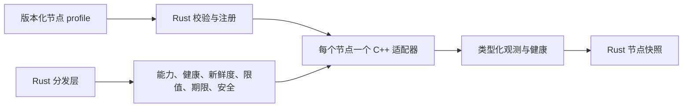

# v2 硬件基础层（开发中）

[English](../../../../docs/eos/design/runtime/hardware.md) · [字段接口](../../interfaces/hardware_cn.md) · [开发指南](../../develop/hardware_cn.md)

## 设计原因

v2 由 Rust 管理 EOS 进程状态，设备库、ROS 2 与供应商 SDK 留在 C++，通过窄 CXX 边界访问。Rust 在驱动收到命令前完成校验。每个节点独占一个适配器实例：相机故障不能修改底盘适配器，也不能通过相机地址控制机械臂。mock 适配器使没有实体机器人的开发环境也能测试边界。

Rust 是 MuJoCo 优先 MVP 的默认进程基础。C++ 运行时与 southbound HAL 保留为未启动的侧链，等待实体硬件等价测试。新客户端入口由统一 profile 派生。

当前图对每个实体相机、底盘或机械臂使用一个设备节点，并对每个已准入的执行器操作使用显式[原语绑定](../../interfaces/primitive-bindings_cn.md)。绑定命名带版本的原语，将类型化输出连接到一个设备；它不实例化驱动。设备选择一个适配器族，其已编译工厂拥有该设备的全部方法及停止行为。共享 Dispatcher 仍是唯一的命令准入点。仅所有者可访问的 Unix 命令通道复用低频类型化请求；相机预览使用专用、有界、只读的 Vision 通道。专用高频执行器通道尚未实现。

可选的 C++ 侧链仍有 ROS 2 和供应商硬件调用方，包括按设备声明的 `PrimitiveDeclaration`/`Backend` 契约。新的 Rust/MuJoCo 路径尚未通过等价的实体 ROS/供应商测试。本次切片没有任何 C++ 组件同时具备 Rust 等价性及零已安装调用方的证据，因此按仓库切换规则暂不删除。

进程内 `aether-runtime` 组合 crate 以有界方式读取 v2 节点 profile，为每个已配置的硬件节点准入恰好一个适配器，并提供发现与分发。profile 是新主链中身份、路径、能力、适配器设置、时间参数与限值的唯一来源。CXX mock 封装现已覆盖相机 RGB-D、底盘，以及机械臂关节和工具位姿传输。公开的 `eosd` 脚本选择此 Rust 进程组合。

## 所有权与数据流

profile 声明 `core → layer → group → node` 树。已校验的节点携带规范路径，以及注册表、分发层和适配器工厂所需的信息；这些组件不得另存相互竞争的路径或能力声明。Rust 在构造适配器前拒绝未知或错误字段。健康状态由适配器实际报告，不能从配置伪造。Rust 管理样本新鲜度、节点生命周期、命令准入和类型化结果；C++ 管理设备通信，且仍是物理限位和停止的最后执行者。CXX mock 底盘在租约到期后的读取中报告零速度，但没有物理执行器或独立 watchdog；生产适配器或控制器必须执行定时停止，切换前需要集成测试。HAL 和分发层都不计算导航路线或逆运动学。设备控制器若能接受相对底盘位姿或末端位姿，节点必须明确声明该模式。

**目标描述符组装：**各核心在所属节点族附近定义内置类型描述符；已验证包只提供自身贡献的类型/适配器描述符。注册表校验 ID 唯一、位置、描述、类型化端口、安全适配器及精确包来源，然后发布一个不可变目录代。IsOS 汇总目录供编辑，不重新定义 EOS 类型。Apply 校验声明图及连线数据类型身份；EOS 在启动后单独报告节点实时健康。Rust 描述字段和旧版回退已实现，模块自有注册和完整设置元数据仍属于 G04 待办。

## 包后端边界

IsOS 管理包解析和图写入，EOS 作为直接父进程管理 MuJoCo。旧图使用 `eos.process.backend@v1.0` 的软件包及版本设置；新图使用软件包贡献的 `eos.process.mujoco@v0.1`、精确的 `node.package` 固定版本、选定场景和本地套接字。EOS 只读已验证的图，启动已验证包的可执行文件，并建立声明过的硬件套接字客户端。仿真器仍在 EOS 地址空间之外。每个 MuJoCo 硬件适配器须引用其进程节点，且套接字和设备标识须一致，才能构造适配器。dispatcher 仍是执行器命令的唯一准入层。

**R05 严格子进程目标：** EOS 持有 MuJoCo 子进程时，总是推导 `--managed-strict-socket`；图设置不能关闭这种模式。由 IsOS 管理的运行使用 P01 已验证的可执行文件和场景交接。本地显式 EOS 开发启动也使用严格模式，但调用者提供的 SHA 参数仅是标签，没有 IsOS 验证收据。子进程只接收帧格式套接字和所选场景参数。历史 gRPC `SimulatorService.Execute` 及 benchmark Reset/Step 监听器能在 Dispatcher 外改变同一引擎，因此受管理子进程不得绑定它们。EOS 之外独立启动的 MuJoCo 保留旧 `2.0.0` 套接字行为。EOS 发布硬件就绪前，先核对每台图设备的类别、包锁定、所选场景及后端绑定，再要求实时健康响应具有精确的 `strict-socket-v1`、正面的 `ok` 与 `accepted`、协议和回显 ID。套接字文件或连接成功只表明启动进度。[EOS 适配器契约](../../interfaces/mujoco_cn.md)定义这一边界，[MuJoCo 所有者契约](https://github.com/Island-Team/isos-mujoco-sim/blob/master/docs_cn/mujoco/interfaces/socket_cn.md)定义套接字字段。

R05 Rust 客户端在启动前核对图/场景/设备/套接字身份；`BackendChild::wait_ready` 要求每台声明设备的严格健康证明，`Endpoint::health` 在刷新时重复验证。证明缺失使启动失败并回收子进程；崩溃或后续失去证明仍显示为健康不可用。Dispatcher 日志恢复已防止重启后重新下发结果不确定的已释放运动；套接字去重只保护同一子进程内的传输重发。R06 已实现阻塞工作期间的抢占停止、底盘/机械臂独立证明以及终止/回收顺序；限定范围的跨所有者重放已通过，原始 R06 条目与限定范围 M3 已验收，进一步实时证明仍待完成。

**R05 设计证据：** [31 个固定 EOS 用例](../../../../tests/fixtures/mujoco_strict_client/cases.json)规定启动隔离、图绑定、健康证明、运动证据、日志恢复、历史迁移样例和未关闭的 R06 边界。2026-11-02 执行 `python3 tests/fixtures/mujoco_strict_client/check.py`、`python3 scripts/check_doc_links.py --all` 与 `git diff --check` 均通过。完整命令和输出见被 Git 忽略的 `logs/test/20261102-r05-eos-strict-design/design-check.log`。这些静态检查本身不能证明行为；下方的实现及限定范围的跨所有者重放证据证明了 R05 行为。

**R05 EOS 实现证据（已通过独立审查）：** 实现分支基于 EOS 设计提交 `918c741309bfb2997e74ba16b8858aa61e516407`，并使用 MuJoCo 所有者严格服务端 `41e17107b7c7abe43cd29cc388b7dd157979d476`。在此检出中执行 `cargo fmt --all -- --check`、`cargo clippy --workspace --all-targets -- -D warnings`、`RUST_TEST_THREADS=1 cargo test --workspace`、`cargo build --workspace` 和 `python3 tests/fixtures/mujoco_strict_client/check.py`。串行工作区运行通过 257 项测试，另有一项已有的实时测试被忽略。真实场景边界执行 `MUJOCO_R05_EXECUTABLE=/home/ashex/projects/isos-mujoco-sim-strict-socket/build/eos-mujoco-sim MUJOCO_R05_PACKAGE_ROOT=/home/ashex/projects/isos-mujoco-sim-strict-socket cargo test -p aether-runtime --bin aether-runtime backend_child::tests::real_strict_child_proves_both_catalog_scenes_when_selected -- --nocapture`；`pick-place` 与 `navigation` 均通过。替身测试覆盖缺失、畸形、为假、错误版本及错误 ID 的健康响应、有界超时、失败子进程回收、图绑定和后续健康丢失。首次并行工作区运行触发四项原有 Dispatcher 时序敏感测试；首次串行运行仍触发一项，独立 Dispatcher 运行通过 39/39，最终串行工作区运行全部通过。完整输出保存在 Git 忽略的 `logs/test/20261102-r05-eos-strict-client/`。独立审查提出并推动了后续修复：单一绝对传输期限及启动期间瞬时故障重试。新的慢速逐字节响应、先绑定后监听、首次超时后成功测试、真实场景重放和完整工作区检查（259 项通过，1 项已有测试忽略）保存在 Git 忽略的 `logs/test/20261102-r05-eos-deadline-fix/`。另有独立的限定范围跨所有者重放覆盖 IsOS 双代与 navigation 运行。R06 物理停止和受管理运动仍未完成。见 Git 忽略的 `logs/test/20261102-r05-cross-owner-qualifier/qualification.md` 和 `reviewer-verdict.md`；审查结论仅针对 R05 行，取代原记录中笼统的不允许合并表述。

[软件包节点 IDL](../../interfaces/node-contributions_cn.md) 增加已验证的侧文件，包含软件包贡献的类型定义，以及新图实例中的精确软件包引用。MuJoCo 在 `eos/process/mujoco` 贡献进程类型；新的相机、底盘和机械臂实例使用 EOS 对应硬件 group 中的通用内置类型，并固定 `node.adapter.package`。旧图继续有效。EOS 在构造前检查类型来源，只通过已编译的 MuJoCo 适配器和停止路径准入软件包执行器。

对于软件包提供的新相机、底盘和机械臂适配器族，IsOS 向 EOS 传入精确且已验证的共享库身份。EOS 为每个节点启动受监督的适配器宿主；只有宿主映射共享库，并再次检查摘要、ABI 版本、适配器族和支持的设备类型。父进程中的 Rust IPC 封装实现同一套类型化 HAL 接口，dispatcher 的准入、日志、停止与样本校验仍通过同一路径。宿主可在命令阻塞时调用共享库的独立停止，并在父进程心跳中断后停止。MuJoCo 进程/套接字与 CXX mock 路径保持独立。C 头文件、IPC 和操作载荷见[硬件接口](../../interfaces/hardware_cn.md#软件包适配器共享库-abi)。

EGIA `common` 的 source、context、planner、guard 节点类型仅用于图设计。它们的端口类型分别表示观察引用、上下文快照、动作提议和经过保护的控制请求，并不创建 EGIA 执行器。`egia.tensor` 留给未来的张量空间数据流，当前图不创建空 layer。

## 节点接口组

硬件节点位于 `cores/eos/layers/hardware/groups/<camera|base|manipulator>/nodes/<node_id>`。同一 v2 树也可表示其他 layer 或 core 的软件节点；软件节点不会因路径而获得 EOS 硬件适配器。所有硬件节点都有 `status` 和 `health`；相机有 `observation`；底盘与机械臂有 `observation`、`movement`、`safety`。接口存在不代表设备当前健康。注册表把每个硬件地址绑定到唯一适配器，并按该节点声明的模式和限值检查命令。

相机样本携带 RGB、可选配准深度、标定与坐标系信息；底盘样本携带平面位姿和速度；机械臂样本携带有序关节集合和可选末端位姿。命令使用明确的本体速度、相对底盘位姿、完整关节位置数组或末端位姿。所有字段、单位和校验见[接口表](../../interfaces/hardware_cn.md)。

## 故障、安全与切换

必需节点的适配器构造失败时拒绝入场。运行时读取或样本校验失败会拒绝该请求，并使该节点的 Rust 健康状态降级，直到有效且新鲜的探测成功。注册表不得伪造新数据。依赖当前状态的运动必须检查观测时间。超期或不支持的模式在物理释放前拒绝。停止和急停通过明确的执行边界；物理释放后的超时若无法确定结果，应记录不确定结果，绝不自动重试。关联 ID、准入顺序和终态由[分发层](dispatcher_cn.md)负责。

切换顺序：先建立 Rust 类型、唯一的严格 `1.0.0` 节点 profile、mock、CXX 和测试；再连接代表性适配器或 ROS 2 图；随后建立分发树并逐步迁移 EOS 组合；替代功能通过等价测试、旧实现的最后一个已安装调用方迁移后，才删除旧 C++ 路径和 schema。这里不实现 EGIA 运行时，`core` 层为未来同级核心保留位置。
