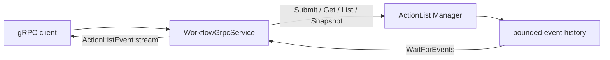

# Workflow northbound adapter

[Northbound 运行时](../northbound_cn.md) · [WorkflowService 契约](../../../develop/interfaces/workflow_cn.md) · [ActionList 运行时](../actionlist_cn.md) · [English](../../../../../docs/eos/design/runtime/northbound/workflow.md)

`src/eos/runtime/northbound/workflow/` 是 `island.eos.v1.WorkflowService` 的 gRPC adapter。它把 protobuf value 与 gRPC lifecycle 转换为对 `eos::runtime::actionlist::Manager` 的调用；它不拥有 ActionList scheduling、fact、cursor 或 event retention。

## 所有权边界

`WorkflowGrpcService` 拥有 request validation、protobuf/JSON conversion、gRPC status mapping、correlation scope、streaming write 与 transport logging。注入的 ActionList manager 拥有 definition、target progression、supersession、snapshot、`ActionListCursor` semantic，以及 4,096-event retention window。

该 folder 有自己的 `CMakeLists.txt`，并且只把 `workflow/service.cpp` 加入 `eos_northbound`。其他 Gateway 与 Skill adapter 保留在本 module 外。

## Unary conversion

`ApplyActionList` 把 `WorkflowDefinition`、`WorkflowAction`、target oneof、`google.protobuf.Struct` parameter、dependency 与 `StateCondition` 转换为 manager 接受的 transport-neutral JSON definition。response 是完整 `ActionList` projection，包含精确 enum、timestamp、result、reason、execution ID 与 command ID mapping。

`GetActionList` 与 `ListActionLists` 编码 copied manager snapshot。`GetRuntimeSnapshot` 编码 independently sequenced SkillManager execution，以及 atomically copied ActionList、fact 与 `action_list_cursor`。不能表示为 protobuf 的无效 dynamic value 属于 internal conversion failure，而不是被静默省略的 field。

## Event streaming

`WatchActionListEvents` 要求 `WatchActionListEventsRequest.after` 存在且 epoch 非空。它使用 250 ms bounded wait 重复调用 `Manager::WaitForEvents`，使 gRPC cancellation 与 shutdown 保持可观察。每个返回 core event 被转换为 `ActionListEvent`，包含 exact cursor、`observed_at`，以及一个 `action_list` 或 `fact` payload。

replay 是 exclusive 的，因为 manager 只返回 sequence 大于 supplied cursor 的 event。每次 `ServerWriter::Write` 成功后，adapter 把本地 cursor 推进到刚写入 event。client disconnect 或 failed write 会成功关闭 stream，且绝不取消 workflow work。stream 在 terminal workflow 后保持打开，因为它 follow manager-wide mutation。

adapter 绝不 synthesize event、cursor、heartbeat、gap marker 或 snapshot。recovery behavior 来自 core status 与[公开 resnapshot algorithm](../../../develop/interfaces/workflow_cn.md#resnapshot-与-resume-algorithm)。

## Error mapping

缺失 definition、ID、cursor、无效 duration/value conversion 与空 cursor epoch 映射为 `INVALID_ARGUMENT`。缺失 workflow 映射为 `NOT_FOUND`。ActionList state conflict、`ReplayStatus::kEpochMismatch` 与 `ReplayStatus::kFuture` 映射为 `FAILED_PRECONDITION`。`ReplayStatus::kExpired` 映射为 `OUT_OF_RANGE`。unexpected exception 或 output conversion failure 映射为 `INTERNAL`。

accepted action failure 编码在 `ActionList` state 中，不会变成 transport failure。cancelled gRPC watch 从 adapter 正常返回；取消 ActionList work 需要使用 domain 的 supersession/cancellation path。

## 日志与调试

公共 workflow handler 创建或验证 request correlation ID，并通过 `northbound` logger 记录 `service`、method、final numeric gRPC status 与 total duration。成功 call 发出 `grpc_request_completed`；被拒绝 call 发出 `grpc_request_rejected`。watch 只在退出时记录一次，而不是对每次 250 ms wait 或 streamed event 记录。

Definition、parameter、ActionList、fact、cursor value、event payload、result 与 raw protobuf 不会写入日志。使用 `actionlist` logger 诊断 domain progression，并使用 client 观察到的 status 与 cursor 诊断 transport recovery。

## 测试

Northbound integration test 使用生成的 `WorkflowService` stub 验证 apply/get/list/snapshot conversion、非空 snapshot epoch、sequence 位于 snapshot cursor 之后的 live event delivery、stream cancellation，以及 epoch mismatch 映射为 `FAILED_PRECONDITION`。ActionList unit test 独立于 transport 验证 exclusive replay、expired-cursor detection 与 bounded retention。

Contract-interface test 验证 `WatchActionListEvents` 在 generated descriptor 中存在且为 server-streaming。reflection 必须继续在 shared EOS listener 上发布完整 `WorkflowService`；core unit test 对 cursor status boundary 保持权威。
