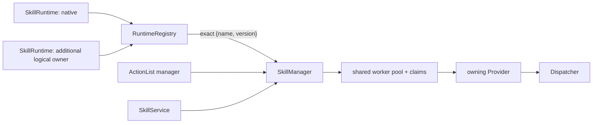

# SkillManager supervisor

[Skill runtime 总览](../skills_cn.md) · [Process model](process-model_cn.md) · [IPC](../../../develop/interfaces/skills/native/ipc_cn.md) · [Observability](observability_cn.md) · [Native runtime](native_cn.md) · [English](../../../../../docs/eos/design/runtime/skills/manager.md)

SkillManager 是所有已准入 logical skill runtime 的 process-like supervisor。它聚合 catalog、把 exact skill identity 路由到唯一 owner、通过一个有界 worker pool 调度 execution、跨 runtime 仲裁 claim、保留 lifecycle 与 SIGNAL state，并公开由 northbound 和 ActionList 使用的 profile-neutral service。

## 所有权边界

`src/eos/runtime/skills/manager/` 拥有 `SkillManager`、`RuntimeRegistry`、worker scheduling、claim arbitration、execution record、request idempotency、cancellation、deadline、SIGNAL queue 与 replay、observer delivery、retention，以及 `skills` logger。`src/eos/runtime/skills/core/` 只包含 supervisor 与 runtime implementation 共用的 `Provider`、metadata/model 和 per-provider `Catalog` contract。

SkillManager 不加载 provider 的 package format，也不直接执行 language-specific code。每个 `SkillRuntime` 提供稳定的 process-local `runtime_id` 与 non-owning `std::reference_wrapper<Provider>`；provider 必须比 SkillManager 存活更久。Built-in 与 [native](native_cn.md) provider 实现该 boundary，product composition 正在把 skill 迁移到 built-in registry。[External](external_cn.md) 是未来 isolation boundary；obsolete [managed](managed_cn.md) placeholder 不是 runtime choice。



## Runtime 注册与路由

multi-runtime constructor 是 `SkillManager(std::vector<SkillRuntime>, SkillManagerOptions, SkillManagerObservers)`。构造要求至少一个 runtime，并拒绝空或重复 `runtime_id`。为了 compatibility，`SkillManager(Provider&, ...)` 注册一个 ID 为 `default` 的 logical runtime。

`RuntimeRegistry` 为每个 provider 构造一个 validated `Catalog`，随后构建 immutable aggregate routing table。一个 exact `{name, version}` identity 只能属于一个 runtime；同一 provider 内的重复由其 `Catalog` 拒绝，跨 provider 的重复会在 worker 开始 serving 前拒绝 supervisor 构造。runtime 顺序永远不表示 precedence，也不存在 fallback routing。

`RuntimeRegistry::Find` 返回 `OwnedSkill`，其中包含 copied aggregate `Metadata`、owning `Provider`、owning `Catalog` 与 `runtime_id`。catalog listing 聚合所有 admitted skill。start、argument validation、execution 与 SIGNAL schema validation 在 immutable registry 生命周期内使用同一个 exact owner。

## Execution 生命周期

`Start` 在分配 UUID execution record 前验证 identity、request ID、timeout、argument 与 claim。manager-wide request idempotency 对相同 retained start 返回 `kExisting`，对不兼容复用返回 `kConflict`；该行为不依赖哪个 runtime 拥有 skill。

```text
queued -> running -> succeeded | rejected | cancelled | timed_out | failed
   \-------------------------------------> cancelled | timed_out
```

一个共享 scheduler 服务所有 registered runtime。选中的 worker 解析同一个 `OwnedSkill`、构建 `ExecutionHooks`，并调用 `Provider::ExecuteAsync`；synchronous provider 使用 compatibility adapter。provider exception 被封装为 `provider.exception`；immutable owner 缺失是 internal invariant failure。完成的 `RunResult` field 映射到 terminal snapshot，而 cancellation 或 expired deadline 胜过迟到 provider result。Built-in coroutine 与 primitive-operation behavior 见 [process model](process-model_cn.md)。

provider code 运行后，cancellation 与 deadline 仍是协作式的。queued execution 可以在不进入 provider 的情况下被取消。running execution 只有在 provider callback 返回后才释放 claim，因此不返回的 in-process code 可以占用 worker 并延迟 shutdown。

## Claim 与并发

descriptor claim template 在排队前根据 validated argument 解析。device 与 resource claim value 是 global manager identity：兼容 shared read 可以共存，而任一侧 `exclusive_use` 都会跨所有 runtime 发生冲突。

non-reentrant descriptor 获得隐式 exclusive `kProviderContext` claim，其 value 是 owning `runtime_id`。同一 runtime 拥有的 non-reentrant skill 因此彼此串行，而无关 non-reentrant runtime 不会仅因为双方都使用 provider context 而冲突。reentrant descriptor 不获得隐式 provider-context claim，并可在所有 explicit claim 允许时并发运行。

scheduler 原子获取完整 claim set。无关 work 可以越过 blocked work，但 later execution 不能越过具有冲突 claim 的 earlier pending execution。running provider 请求的 dynamic device lease 共享同一 manager-wide claim arbitration，并在 release、cancellation、deadline 或 shutdown 时结束。这些 claim 序列化完整的 skill-level ownership；它们不替代 primitive arbitration。Dispatcher 仍是权威的最终 gate，并把来自 skill、ActionList 与 direct caller 的重叠同 device terminal primitive call 放入一条有界 FIFO。

## SIGNAL、event 与 observer

inbound SIGNAL 仅在匹配 exact owning runtime 声明的 name 与 object schema 时才被接受。request ID 使 accepted SIGNAL 幂等；冲突复用、terminal execution、过大 payload 与 queue full 都 fail closed。`CANCEL` 由 manager 保留，遵循 cooperative cancellation，而不进入 application SIGNAL queue。

lifecycle snapshot、emitted SIGNAL 与 journal record 共享 monotonically increasing per-execution journal sequence。journal record 可以是 system activity、skill checkpoint 或 terminal suppression summary。snapshot 同时包含 lifecycle timestamp、 queue/run/total duration、current activity，以及 primitive/resource/SIGNAL/ log/checkpoint/activity count、drop count 和累计 claim/SIGNAL/capability duration。 可以先 replay cursor 之后的 retained entry，再跟随新 entry。owning `Catalog` 在 append 前验证 emitted SIGNAL；一个 execution 永远不会自动路由到另一个 execution。

`SkillManagerObservers` 把 copied execution transition 与 validated emitted SIGNAL 交付给 ActionList 等 non-owning consumer。observer callback 在 manager state 发布后运行；exception 被隔离并记录为 `skill_observer_failed`，不会改变 execution result 或终止 worker。

## Retention 与 shutdown

默认值是四个 worker、1,024 条 retained execution record、每个 execution 256 条 pending inbound SIGNAL，以及每个 execution 1,024 条 unified event。达到容量时，最旧的 eligible terminal record 及其 idempotency entry 被淘汰。lifecycle append 可以裁剪更旧 retained event；emitted SIGNAL 与 checkpoint 在 history 满时失败，而 automatic activity 只会被丢弃并计数，不能使 capability call 失败。

Process record、mailbox、routing metadata、idempotency key 与 monitor state 保持 process-local。execution journal 可额外写入 optional asynchronous diagnostic log；它是 operator history，而不是 execution recovery，因此 active state 与 mailbox 不跨 restart 保留。详见 [observability](observability_cn.md)。shutdown 为 retained active work 设置 cancellation、唤醒 wait、join worker，之后才允许 provider 被销毁。

## 日志与调试

`skills` logger 记录 exact runtime routing、queued/start/terminal transition、cancellation request、SIGNAL acceptance/emission、provider 或 protocol failure，以及 observer failure。correlation ID 从 northbound 或 ActionList 的 start 贯穿到 worker。预期 lifecycle detail 使用 trace 或 debug，普通 timeout/cancellation/failure 使用 warn，broken invariant、provider exception、protocol error 或 observer exception 使用 error。registration 与 validation failure 返回给 composing caller 或 service，而不在 throw site 重复记录。

`skill_execution_terminal` 是唯一的 operator-facing terminal summary。失败时它包含 execution/request correlation、terminal status、稳定 reason code、经过清理的有界 message、duration、capability accounting，以及可用时的 last failed activity。 provider completion detail 保持 debug level，不形成第二条 terminal warning。 snapshot 通过 Get/List/Watch、north HTTP/SSE、REPL 与 decision client 暴露相同 reason/message；consumer 只按 status 与 reason 分支，不能解析 message。

安全字段包括 routing event 中的 runtime ID、skill name 与 version、execution ID、request ID、status、sequence、SIGNAL name 与 ID、queue depth 和有界 reason code。日志不得包含 argument、result、schema、claim value、resource value、SIGNAL payload、primitive acknowledgement body、credential、provider memory 或 raw protobuf。

对于 routing failure，验证 startup runtime ID 与 exact aggregate catalog；顺序不会选择 owner。对于 queued execution，检查 `queue_reason` 以及冲突的 global device/resource 或 runtime-scoped provider-context claim。对于停滞的 running execution，使用 execution 与 runtime identity 关联 provider 和 dispatch log；cooperative cancellation 不能证明 provider callback 已返回。

## 测试

`eos_skill_manager_tests` 覆盖跨 runtime 重复 exact identity、aggregate listing、exact validation 与 execution routing、independent-runtime concurrency、same-runtime non-reentrant serialization、owning-runtime SIGNAL 与 cancellation routing、conflicting-claim queuing、queued cancellation、typed SIGNAL idempotency 与 replay，以及 observer isolation。provider `Catalog` test 与 constructor check 覆盖 malformed per-runtime metadata 和 invalid runtime registration。

Provider-specific test 保留在所属文件夹中。native test 验证 ABI 与 host behavior；ActionList test 验证其 skill-control boundary 观察 SkillManager lifecycle 与 SIGNAL callback，而不取得 supervisor record ownership。

## Timestamped skill source

SkillManager 为每个 descriptor-declared source topic 持有 process-local bounded timeline。sample 是 JSON object，包含 producer time、manager sequence，以及带 observation time、boot ID 和 event ID 的 canonical `EventTime`。lookup 支持 latest、exact、before、after 与 nearest；同 timestamp 时以较新的 publication sequence 打破 tie。

descriptor 分别声明 read/write authority 与 JSON Schema。startup 拒绝 conflicting schema，manager 验证每次 publication。`WaitForSource` 返回指定 sequence 后最早的 retained sample，在 execution cancellation 或 shutdown 时 cooperative wake。timeline 不进入 execution journal 或 diagnostic persistence。clock-domain rule 见 [data 与 time](data_cn.md)。
